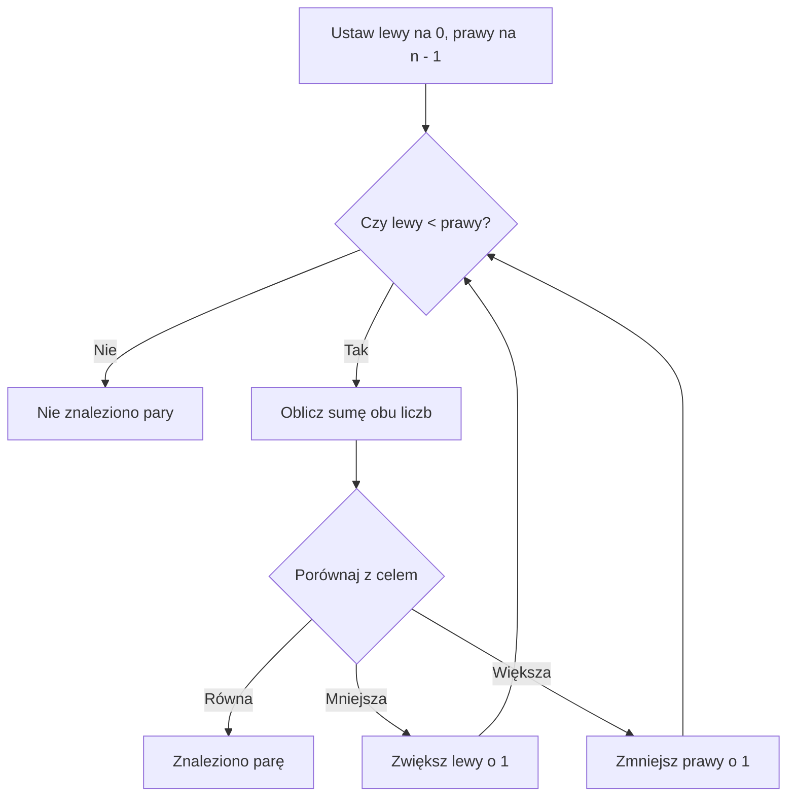

# Dwa wskaźniki (Two Pointers) - lekcja krok po kroku

**Język:** C++

**Poziom:** po poznaniu tablic, pętli i sum prefiksowych


## Co dzisiaj zrozumiemy?

Po lekcji potrafisz:

- wyjaśnić własnymi słowami, czym są dwa wskaźniki;
- przesuwać je na podstawie wyniku porównania;
- rozpoznać, kiedy tablica musi być posortowana;
- napisać program znajdujący dwie liczby o zadanej sumie;
- zastosować tę samą **ideę** w mniej oczywistym zadaniu: przy sprawdzaniu palindromu;
- porównać wydajność rozwiązania z dwiema zagnieżdżonymi pętlami.

> **Najważniejsza myśl:** Nie zawsze musimy sprawdzać wszystkie możliwości. Jeśli wiemy, które z nich na pewno nie mogą być dobre, pomijamy je.

## Dwie osoby przy półce

Wyobraź sobie, że na półce stoją pudełka od **najlżejszego do najcięższego**. Na każdym pudełku zapisano jego wagę.

Dwie osoby stoją na końcach półki:

- **Lewy** stoi przy najlżejszym pudełku.
- **Prawy** stoi przy najcięższym pudełku.

Chcą wybrać **dwa różne pudełka**, których łączna waga wynosi dokładnie **18 kg**.

Sprawdzają wagę pudełka z lewej i z prawej.

- Jeśli razem ważą **za mało**, Lewy idzie o jedno pudełko w prawo. Dlaczego? Przy tym samym lewym pudełku wszystkie inne dostępne pudełka są nie cięższe od prawego - suma nie wzrośnie.
- Jeśli razem ważą **za dużo**, Prawy idzie o jedno pudełko w lewo. Dlaczego? Przy tym samym prawym pudełku wszystkie inne dostępne pudełka są nie lżejsze od lewego - suma nie zmaleje.
- Jeśli waga wynosi **dokładnie 18 kg**, znaleźli parę.

**Ważne:** Ta logika działa dla pary o zadanej sumie **dlatego, że liczby są uporządkowane rosnąco**. W nieposortowanej tablicy samo przesuwanie wskaźników na tej zasadzie nie jest poprawne.


W tej technice słowo **wskaźnik** oznacza indeks. Nie chodzi o osobny typ danych C++.

Jeśli `lewy = 2`, to `lewy` oznacza pozycję numer `2`. Wartość stojąca na tej pozycji to `liczby[lewy]`. Zwiększenie indeksu o `1` oznacza przejście do następnego pudełka, a nie zwiększenie jego wagi.

Wystarczy uporządkowanie **niemalejące**: każda następna wartość jest większa lub równa poprzedniej. Powtórzenia są dozwolone. Możemy więc wybrać dwie jednakowe liczby, ale muszą pochodzić z dwóch różnych pozycji.

## Sprawdź, czy naprawdę rozumiesz

Powiedz własnymi słowami:

- Dlaczego przy zbyt małej sumie przesuwamy **lewy**, a nie prawy wskaźnik?
- Dlaczego przy zbyt dużej sumie przesuwamy **prawy** wskaźnik?
- Co oznacza sytuacja, gdy wskaźniki się spotkają?


<details markdown="1">
<summary>Wskazówka do pytań o pudełka</summary>

Ustal, czy drugie pudełko może być cięższe od obecnego prawego albo lżejsze od obecnego lewego. Rozpatruj tylko pozycje, których jeszcze nie odrzuciliśmy.

</details>

<details markdown="1">
<summary>Odpowiedzi do pytań o pudełka</summary>

- Suma jest za mała. Obecne prawe pudełko jest najcięższe z pozostałych. Zastąpienie go lżejszym nie pomoże. Odrzucamy więc obecne lewe pudełko.
- Suma jest za duża. Obecne lewe pudełko jest najlżejsze z pozostałych. Zastąpienie go cięższym nie pomoże. Odrzucamy więc obecne prawe pudełko.
- Gdy indeksy się spotkają, został jeden element. Nie tworzy on pary dwóch różnych pozycji. Jeśli wcześniej nie znaleźliśmy pary, nie ma rozwiązania.

</details>

## Przykład 1 - znajdź parę dającą sumę 18

Tablica (posortowana rosnąco):

| Indeks | 0 | 1 | 2 | 3 | 4 | 5 | 6 |
|---|---:|---:|---:|---:|---:|---:|---:|
| Liczba | 2 | 4 | 6 | 8 | 10 | 12 | 15 |

Początek: `lewy = 0`, `prawy = 6`.

Spróbuj samodzielnie zapisać kolejne sumy i przesunięcia.

<details markdown="1">
<summary>Wskazówka do przykładu 1</summary>

Zacznij od skrajnych pudełek. Po każdym porównaniu zmieniaj tylko jeden indeks, chyba że para została już znaleziona.

</details>

<details markdown="1">
<summary>Rozwiązanie przykładu 1 - kolejne kroki</summary>

| Krok | `lewy` | `prawy` | Lewa liczba | Prawa liczba | Suma | Decyzja |
| --- | ---: | ---: | ---: | ---: | ---: | --- |
| 1 | 0 | 6 | 2 | 15 | 17 | Za mało => `lewy = lewy + 1` |
| 2 | 1 | 6 | 4 | 15 | 19 | Za dużo => `prawy = prawy - 1` |
| 3 | 1 | 5 | 4 | 12 | 16 | Za mało => `lewy = lewy + 1` |
| 4 | 2 | 5 | 6 | 12 | 18 | Znaleziono parę |

Wynik: `6` i `12`. To wartości elementów. Ich indeksy to `2` i `5`.

W tablicy jest również para `8` i `10`. Zadanie wymaga jednej pary, więc kończymy przy pierwszej znalezionej przez ten algorytm.

</details>

## Przykład 2 - szukanie sumy 20

Tablica: `1, 3, 5, 7, 9`; poszukujemy sumy **20**.

Prześledź ruchy indeksów, zanim odsłonisz wynik.

<details markdown="1">
<summary>Wskazówka do przykładu 2</summary>

Nawet największa para musi korzystać z dwóch różnych pozycji. Sprawdź, co zostaje, kiedy `lewy` dochodzi do `prawy`.

</details>

<details markdown="1">
<summary>Rozwiązanie przykładu 2</summary>

- `1 + 9 = 10` => zwiększamy lewy wskaźnik;
- `3 + 9 = 12` => zwiększamy lewy;
- `5 + 9 = 14` => zwiększamy lewy;
- `7 + 9 = 16` => zwiększamy lewy;
- teraz oba wskaźniki wskazują ten sam element. **Kończymy: nie ma dwóch różnych elementów o sumie 20.**

</details>

Nie wolno użyć tego samego elementu dwa razy. Dlatego pętla działa, dopóki `lewy < prawy`, a nie `lewy <= prawy`.

## Warunki poprawności i zakres liczb

Dla szukania pary o określonej sumie przyjmujemy:

- tablica jest uporządkowana niemalejąco;
- wybieramy dwie różne pozycje;
- szukamy jednej pary, a nie liczby wszystkich par;
- dane nie zmieniają się w czasie szukania;
- suma dwóch wartości mieści się w użytym typie.

Reguła działa również dla uporządkowanych liczb ujemnych i dla powtórzeń. Samo uporządkowanie jest ważniejsze niż znak liczb.

W zadaniach tej lekcji tablica ma najwyżej `100` elementów. Rozpatrywane wartości mieszczą się od `-100` do `100`, a cel od `-200` do `200`. Suma dwóch elementów mieści się więc od `-200` do `200`. To bezpieczne dla `int`, również przy jego minimalnym zakresie gwarantowanym przez C++.

Nie przenoś tego założenia bez sprawdzenia do innych zadań. Dwie wartości mieszczące się osobno w `int` mogą dać sumę poza jego zakresem. Przepełnienie typu ze znakiem nie daje wiarygodnego wyniku.

Jeśli trzeba najpierw sortować dane, uwzględnij koszt sortowania. Sprawdź też, czy wolno zmienić kolejność. Po sortowaniu pozycje nie oznaczają już pierwotnych indeksów. Gdy zadanie wymaga właśnie tych indeksów, trzeba je zachować albo wybrać inną metodę.

## Pseudokod - szukanie pary

```text
WEJŚCIE: posortowana niemalejąco tablica a, liczba cel
lewy = 0
prawy = długość(a) - 1

DOPÓKI lewy < prawy:
    suma = a[lewy] + a[prawy]

    JEŻELI suma = cel:
        WYPISZ znalezioną parę
        ZAKOŃCZ

    JEŻELI suma < cel:
        lewy = lewy + 1
    W PRZECIWNYM RAZIE:
        prawy = prawy - 1

WYPISZ "Brak pary"
```

## Schemat decyzji



## Rozwiązanie w C++ - krok po kroku

Spróbuj najpierw samodzielnie zapisać algorytm. Kod możesz odsłonić po kliknięciu.

<details markdown="1">
<summary><strong>Pokaż rozwiązanie w C++ i jego omówienie</strong></summary>

```cpp
#include <iostream>

using namespace std;

int main()
{
    const int n = 7;
    int liczby[n] = {2, 4, 6, 8, 10, 12, 15};
    int cel = 18;
    int lewy = 0;
    int prawy = n - 1;
    bool znaleziono = false;

    while (lewy < prawy)
    {
        int suma = liczby[lewy] + liczby[prawy];

        if (suma == cel)
        {
            cout << "Para: " << liczby[lewy] << " i " << liczby[prawy] << '\n';
            znaleziono = true;
            break;
        }

        if (suma < cel)
        {
            lewy = lewy + 1;
        }
        else
        {
            prawy = prawy - 1;
        }
    }

    if (znaleziono == false)
    {
        cout << "Brak pary.\n";
    }

    return 0;
}
```

**Omówienie:**

- `lewy` i `prawy` przechowują **indeksy**, nie wartości.
- `while (lewy < prawy)` gwarantuje wybór dwóch różnych pozycji.
- `lewy = lewy + 1` przesuwa lewy wskaźnik w prawo; `prawy = prawy - 1` przesuwa prawy w lewo.
- `break` kończy poszukiwanie, gdy wystarczy znaleźć **jedną** parę.
- W przykładzie liczby są małe, dlatego do obliczeń wystarcza typ `int`.

### A co, jeśli tablica nie jest posortowana?

Wtedy nie można stosować opisanej reguły przesuwania wskaźników. Trzeba najpierw uporządkować dane albo wybrać inną metodę. W tej lekcji ćwiczymy przypadek, gdy tablica **jest już posortowana**.

Program nie pobiera danych. Wypisuje:

```text
Para: 6 i 12
```

</details>

## Kiedy warto zastosować dwa wskaźniki?

Szukaj takich wskazówek w treści zadania:

| Sygnał z zadania | Pytanie do siebie |
|---|---|
| „Znajdź dwie liczby o zadanej sumie” | Czy liczby są posortowane albo wolno je sortować? |
| „Sprawdź parę elementów od obu końców” | Czy mogę przesuwać dwa indeksy do środka? |
| „Najdłuższy / najkrótszy spójny fragment” | Czy da się przesuwać granice fragmentu bez wracania? (To wariant: **przesuwające się okno**.) |
| „Porównaj pierwszy i ostatni znak, potem kolejne” | Czy mogę sprawdzać symetrię dwoma wskaźnikami? |

**Nie rozpoznajemy algorytmu po jednym słowie.** Najważniejsze pytanie brzmi: *czy po wykonanym porównaniu mogę bezpiecznie odrzucić jakieś możliwości?*

### Kiedy tego użyć?

- „Wybierz dwie różne liczby o sumie równej...” => sprawdź uporządkowanie i możliwość odrzucenia skrajnego elementu.
- „Ceny podano od najmniejszej do największej” => możesz porównywać najmniejszy i największy pozostały element.
- „Czy napis czyta się tak samo od obu końców?” => porównuj symetryczne pozycje. Tu nie potrzebujesz sortowania.
- „Wyznacz najdłuższy spójny fragment” => samo sformułowanie jeszcze nie wystarcza. Musisz uzasadnić, jak zmiana granicy wpływa na warunek. Przesuwające się okno jest osobnym wariantem tej idei.

Najpierw nazwij to, co wskazują oba indeksy. Potem ustal, czego dowiadujesz się po porównaniu. Dopiero na końcu zapisuj pętlę.

### Zadanie: dwa pakiety zajęć

Przygotowano pakiety ćwiczeń. Ich ceny podano niemalejąco: `10, 20, 35, 50, 65, 80` zł. Wybierz dokładnie dwa różne pakiety za łącznie `85` zł. Wystarczy jedna para. Jeśli jej nie ma, zgłoś brak rozwiązania.

Zanim zaczniesz programować, ustal, czy trzeba sprawdzać każdą parę. Potrafisz uzasadnić ruch obu indeksów?


<details markdown="1">
<summary>Wskazówka do zadania o pakietach</summary>

Zwróć uwagę na słowa „dokładnie dwa”, „łącznie” i „niemalejąco”. Która z tych informacji pozwala odrzucić wiele par naraz?

</details>

<details markdown="1">
<summary>Rozpoznanie techniki krok po kroku i rozwiązanie zadania o pakietach</summary>

- Szukamy dwóch elementów, a nie sumy całego spójnego fragmentu. To zadanie o parze.
- Kolejność cen jest już znana: od najniższej do najwyższej. Nie trzeba sortować danych.
- Ustawiamy indeksy na końcach. Pierwsza suma to `10 + 80 = 90`. Jest za duża.
- Nawet najtańszy pozostały pakiet w parze z ceną `80` przekracza cel. Możemy odrzucić `80`. Żadna pominięta para z nim nie będzie poprawna.
- Teraz `10 + 65 = 75`. To za mało. Cena `65` jest największą pozostałą, więc żaden jej mniejszy zamiennik nie pomoże cenie `10`. Odrzucamy `10`.
- Następnie `20 + 65 = 85`. Znaleźliśmy parę. Odpowiedzią są pakiety za `20` i `65` zł, o indeksach `1` i `4`.
- Dopiero po takim rozumowaniu zapisujemy program. Wiemy, dlaczego suma za duża zmniejsza `prawy`, a suma za mała zwiększa `lewy`.

</details>

### Dlaczego wolno pomijać inne pary?

W każdym kroku rozpatrujemy pary mieszczące się między aktualnymi indeksami. Odrzucone wcześniej elementy nie mogą już dać rozwiązania z żadnym pozostałym elementem.

Jeśli suma skrajnych wartości jest za mała, obecny lewy element nie pasuje nawet do największego pozostałego. Nie pasuje więc do żadnego mniejszego. Usunięcie go zachowuje wszystkie możliwe rozwiązania.

Jeśli suma jest za duża, obecny prawy element nie pasuje nawet do najmniejszego pozostałego. Nie pasuje więc do żadnego większego. Jego odrzucenie także zachowuje wszystkie możliwe rozwiązania.

Każdy nieudany krok zmniejsza liczbę pozostałych pozycji. Gdy nie ma już dwóch różnych pozycji, przeszukaliśmy wszystkie możliwości, których nie wykluczyliśmy poprawnym rozumowaniem.

### Kiedy wybrać coś innego?

- Tablica nie jest uporządkowana i nie wolno jej porządkować => opisana reguła szukania pary nie ma uzasadnienia. Dla małych danych można sprawdzić wszystkie pary.
- Trzeba podać wszystkie pary albo ich liczbę => zatrzymanie po pierwszym trafieniu nie wystarczy. Powtórzenia wymagają dodatkowego rozumowania.
- Trzeba znaleźć trzy elementy => program szukający dwóch nie rozwiązuje całego problemu.
- Nie potrafisz powiedzieć, dlaczego odrzucone możliwości są niemożliwe => nie przesuwaj indeksu na podstawie samego przypuszczenia.

### Dwa wskaźniki czy sumy prefiksowe?

| Pytanie | Co trzeba znaleźć? | Wskazówka do wyboru |
| --- | --- | --- |
| Czy dwie ceny dają wskazaną sumę? | Dwie pozycje, niekoniecznie obok siebie | Dwa wskaźniki, jeśli uporządkowanie uzasadnia ruch |
| Ile łącznie sprzedano od dnia `a` do dnia `b`? | Sumę wszystkich elementów spójnego fragmentu | Sumy prefiksowe przy wielu pytaniach i niezmiennych danych |
| Czy słowo jest symetryczne? | Zgodność par znaków od obu końców | Dwa wskaźniki bez sortowania |

Sumy prefiksowe wymagają przygotowania tablicy pomocniczej. Nie wymagają uporządkowania danych. W opisanym szukaniu pary nie budujemy prefiksów, ale korzystamy z uporządkowania. Sama obecność słowa „suma” nie rozstrzyga wyboru.

## Dlaczego jest szybki? Porównanie metod

**Metoda naturalna początkującego:** dla każdej liczby przejrzyj wszystkie następne, używając dwóch pętli. W najgorszym przypadku jest około `n(n - 1) / 2` par - złożoność `O(n²)`.

**Dwa wskaźniki:** po każdym nieudanym porównaniu jeden indeks przesuwa się o jeden krok do środka. Łącznie wykonujemy najwyżej `n - 1` sprawdzeń par - złożoność **`O(n)`**, gdy dane są już posortowane. Pamięć pomocnicza: **`O(1)`**.

| Metoda | Czas w najgorszym przypadku | Pamięć dodatkowa |
|---|---|---|
| Dwie zagnieżdżone pętle | `O(n²)` | `O(1)` |
| Dwa wskaźniki; tablica już posortowana | `O(n)` | `O(1)` |
| Sortowanie + dwa wskaźniki | `O(n log n)` | zależnie od sortowania |

Dwa wskaźniki nie są rozwiązaniem każdego zadania. Ich poprawność zależy od właściwości danych i reguły przesuwania indeksów.

<details markdown="1">
<summary>Pokaż samodzielne rozwiązanie z dwiema zagnieżdżonymi pętlami</summary>

```cpp
#include <iostream>

using namespace std;

int main()
{
    const int n = 7;
    int liczby[n] = {2, 4, 6, 8, 10, 12, 15};
    int cel = 18;
    bool znaleziono = false;

    for (int i = 0; i < n - 1 && znaleziono == false; i++)
    {
        for (int j = i + 1; j < n; j++)
        {
            if (liczby[i] + liczby[j] == cel)
            {
                cout << "Para: " << liczby[i] << " i " << liczby[j] << '\n';
                znaleziono = true;
                break;
            }
        }
    }

    if (znaleziono == false)
    {
        cout << "Brak pary.\n";
    }

    return 0;
}
```

Program nie pobiera danych. Dla tej tablicy także wypisuje:

```text
Para: 6 i 12
```

`j` zaczyna od `i + 1`. Dzięki temu nie wybieramy tej samej pozycji dwa razy i nie sprawdzamy ponownie pary w odwrotnej kolejności. Ta metoda działa też dla nieuporządkowanych liczb. Jest jednak wolniejsza dla dużych tablic.

</details>

## Drugie, mniej oczywiste zastosowanie: palindrom

**Zadanie:** Napisz program, który sprawdza, czy podane **jedno słowo zapisane małymi literami** czyta się tak samo od lewej i od prawej strony. Takie słowo nazywamy **palindromem**.

<details markdown="1">
<summary>Pokaż przykładowe wyniki i prześledzenie słowa kajak</summary>

Przykłady:

| Słowo | Wynik |
|---|---|
| `kajak` | TAK |
| `potop` | TAK |
| `oko` | TAK |
| `komputer` | NIE |

**Dlaczego dwa wskaźniki?** Tym razem niczego nie sumujemy i niczego nie sortujemy. Chcemy porównać pierwszy znak z ostatnim, drugi z przedostatnim itd.

### Czytanie od obu końców

Wyobraź sobie, że dwie osoby trzymają kartkę ze słowem **kajak**. Pierwsza patrzy na pierwszą literę, a druga na ostatnią.

- Porównują `k` z `k` - zgadzają się, więc przesuwają palce do środka.
- Porównują `a` z `a` - znów się zgadzają.
- Spotykają się przy `j` - wszystkie pary były zgodne. To palindrom.

</details>

Jeśli choć jedna para liter jest różna, słowo **nie jest** palindromem.

> Tym razem przesuwamy **oba wskaźniki jednocześnie**. Ta sama technika dwóch wskaźników może mieć inną regułę przesuwania niż w zadaniu z sumą.

**Nie sortujemy liter!** Po sortowaniu nie sprawdzalibyśmy już oryginalnego słowa.

### Kiedy tego użyć?

Gdy sprawdzasz, czy słowo jest palindromem, albo porównujesz symetryczne elementy od obu końców. Po zgodnym porównaniu para jest sprawdzona. Nie trzeba do niej wracać.

### Kiedy wybrać coś innego?

Jeśli zadanie każe ignorować spacje, wielkość liter albo interpunkcję, najpierw uwzględnij te reguły. Poniższy program porównuje wszystkie znaki podanego słowa.

Przyjmujemy słowo długości od `1` do `1000`, zapisane małymi literami od `a` do `z`, bez polskich znaków, spacji i interpunkcji. To ograniczenie pozwala porównywać pojedyncze znaki `string` bez dodatkowego przetwarzania tekstu.

## Spróbuj sam - podpowiedzi i rozwiązanie palindromu

Najpierw spróbuj samodzielnie rozwiązać zadanie. Odsłaniaj kolejne podpowiedzi tylko wtedy, gdy są potrzebne.

<details markdown="1">
<summary>Podpowiedź 1: - kliknij, aby rozwinąć</summary>

**Podpowiedź 1:** Wczytaj słowo do zmiennej typu `string`.

</details>

<details markdown="1">
<summary>Podpowiedź 2: - kliknij, aby rozwinąć</summary>

**Podpowiedź 2:** Policz litery słowa. Lewy indeks to `0`, a prawy to numer ostatniej litery, czyli `dlugosc - 1`.

</details>

<details markdown="1">
<summary>Podpowiedź 3: - kliknij, aby rozwinąć</summary>

**Podpowiedź 3:** Dopóki `lewy < prawy`, porównuj `slowo[lewy]` ze `slowo[prawy]`.

</details>

<details markdown="1">
<summary>Podpowiedź 4: - kliknij, aby rozwinąć</summary>

**Podpowiedź 4:** Jeśli litery są różne, zapamiętaj, że wynik to NIE, i przerwij pętlę. W przeciwnym razie przesuń oba indeksy do środka.

</details>

### Rozwiązanie w C++

<details markdown="1">
<summary><strong>Pokaż pełne rozwiązanie w C++ i objaśnienie</strong></summary>

```cpp
#include <iostream>
#include <string>

using namespace std;

int main()
{
    string slowo;
    if (!(cin >> slowo))
    {
        return 0;
    }

    int dlugosc = 0;
    for (char litera : slowo)
    {
        if (litera < 'a' || litera > 'z' || dlugosc >= 1000)
        {
            return 0;
        }
        dlugosc = dlugosc + 1;
    }

    int lewy = 0;
    int prawy = dlugosc - 1;
    bool palindrom = true;

    while (lewy < prawy)
    {
        if (slowo[lewy] != slowo[prawy])
        {
            palindrom = false;
            break;
        }
        lewy = lewy + 1;
        prawy = prawy - 1;
    }

    if (palindrom == true)
    {
        cout << "TAK - to palindrom.\n";
    }
    else
    {
        cout << "NIE - to nie jest palindrom.\n";
    }

    return 0;
}
```

Pętla `for (char litera : slowo)` pobiera kolejne litery. Przy okazji kontroli danych liczymy długość w zmiennej `int`. Nie ma tu zamiany dużej wartości długości na mniejszy typ.

Dla wejścia `kajak` wynik to `TAK - to palindrom.`. Dla wejścia `komputer` wynik to `NIE - to nie jest palindrom.`.

**Zakres zadania:** celowo sprawdzamy pojedyncze słowa zapisane małymi literami, bez spacji i interpunkcji. Dzięki temu uczymy się przede wszystkim przesuwania wskaźników. Obsługę zdań, wielkich liter i znaków specjalnych można dodać na późniejszym etapie.

**Złożoność:** `O(n)` czasu - wskaźniki przesuwają się do środka i nie cofają się. Dodatkowa pamięć potrzebna do porównań: `O(1)` (nie liczymy pamięci zajętej przez samo wczytane słowo).

</details>

## Najczęstsze błędy

- **Brak sortowania przy szukaniu pary o sumie** - reguła przesuwania traci uzasadnienie.
- **Warunek `lewy <= prawy` w zadaniu o dwóch różnych elementach** - może użyć jednej liczby dwa razy.
- **Przesuwanie złego wskaźnika** - przy sumie za małej przesuwamy lewy, przy za dużej prawy.
- **Brak przesunięcia w którejś gałęzi** - pętla może nigdy się nie zakończyć.
- **Mylenie indeksów z wartościami** - `lewy` nie oznacza wartości `liczby[lewy]`.
- **Sortowanie liter przed sprawdzaniem palindromu** - zmienia badany problem.
- **Próba stosowania reguły przesuwania z sumy par do każdego zadania** - dwa wskaźniki to **technika**, a decyzje zależą od właściwości konkretnego problemu.

- Zapomnienie, że równe wartości mogą stać na różnych pozycjach => pominięcie poprawnej pary, na przykład dwóch liczb `9` dających `18`.
- Nieuwzględnienie zakresu sumy => ryzyko przepełnienia mimo poprawnych indeksów.
- Liczenie kosztu dwóch wskaźników bez potrzebnego wcześniej sortowania => zaniżona ocena czasu całego rozwiązania.

## Ćwiczenia końcowe

### A. Ręczne przesuwanie wskaźników


Tablica to `1, 4, 6, 9, 11, 14`. Cel wynosi `17`. Zacznij od indeksów `0` i `5`. Zapisz dla każdego kroku oba indeksy, wartości, sumę i decyzję. Zakończ przy pierwszej znalezionej parze albo po spotkaniu indeksów.


<details markdown="1">
<summary>Wskazówka do zadania A</summary>

Przy zbyt małej sumie zmieniaj `lewy`. Przy zbyt dużej zmieniaj `prawy`. W tabeli rozdziel indeksy i wartości.

</details>

<details markdown="1">
<summary>Rozwiązanie zadania A</summary>

| Krok | `lewy` | `prawy` | Działanie | Decyzja |
| --- | ---: | ---: | --- | --- |
| 1 | 0 | 5 | `1 + 14 = 15` | Za mało => `lewy = 1` |
| 2 | 1 | 5 | `4 + 14 = 18` | Za dużo => `prawy = 4` |
| 3 | 1 | 4 | `4 + 11 = 15` | Za mało => `lewy = 2` |
| 4 | 2 | 4 | `6 + 11 = 17` | Znaleziono parę |

Wartości to `6` i `11`, a indeksy to `2` i `4`.

</details>

### B. Interpretacja istniejącego kodu


Poniższy fragment jest częścią funkcji `main`. Wypisuje indeksy. Zapisz dokładny wydruk, liczbę wykonań ciała pętli i powód zakończenia. Czy zakończenie pętli zawsze oznacza znalezienie pary?

```cpp
int liczby[5] = {2, 5, 8, 11, 14};
int cel = 14;
int lewy = 0;
int prawy = 4;

while (lewy < prawy)
{
    int suma = liczby[lewy] + liczby[prawy];
    if (suma == cel)
    {
        break;
    }
    if (suma < cel)
    {
        lewy = lewy + 1;
    }
    else
    {
        prawy = prawy - 1;
    }
}

cout << lewy << " " << prawy << '\n';
```


<details markdown="1">
<summary>Wskazówka do zadania B</summary>

Sprawdzaj warunek przed każdym wejściem do pętli. Program nie wypisuje tutaj wartości `liczby[lewy]` ani `liczby[prawy]`.

</details>

<details markdown="1">
<summary>Rozwiązanie zadania B</summary>

Wydruk:

```text
2 2
```

Pętla wykona się cztery razy:

- Indeksy `0, 4`: `2 + 14 = 16` => zmniejszamy `prawy` do `3`.
- Indeksy `0, 3`: `2 + 11 = 13` => zwiększamy `lewy` do `1`.
- Indeksy `1, 3`: `5 + 11 = 16` => zmniejszamy `prawy` do `2`.
- Indeksy `1, 2`: `5 + 8 = 13` => zwiększamy `lewy` do `2`.

Warunek `lewy < prawy` jest teraz fałszywy. Nie znaleziono pary. Zakończenie pętli nie jest dowodem trafienia - dlatego pełny program przechowuje osobno `znaleziono`.

</details>

### C. Samodzielna implementacja - kontrola biletów

**Zadanie: kontrola biletów**

W systemie zapisano rosnąco ceny biletów: `7, 11, 14, 18, 21, 26, 30` (w zł). Klient chce kupić **dokładnie dwa** bilety, płacąc łącznie **40 zł**.

- Zapisz, od których indeksów zaczniesz.
- W tabeli pokaż kolejne sumy i decyzje o przesunięciu.
- Napisz samodzielnie program w C++, który wypisze jedną znalezioną parę lub komunikat o jej braku.
- Zmień budżet na **39 zł** i sprawdź, co się stanie.
- Wyjaśnij jednym zdaniem, dlaczego nie potrzebujesz dwóch zagnieżdżonych pętli.

Ceny pozostają zapisane w programie. Wczytaj tylko budżet: jedną liczbę całkowitą od `0` do `100`. Wypisz pierwszą parę znalezioną podczas przechodzenia od obu końców albo `Brak pary.`. Uruchom program osobno dla budżetów `40` i `39`.


<details markdown="1">
<summary>Wskazówka do zadania C</summary>

Przechowuj ceny w zwykłej tablicy. Zmieniaj indeksy według porównania sumy z budżetem. Do sprawdzenia dwóch budżetów wystarczą dwa uruchomienia tego samego programu.

</details>

<details markdown="1">
<summary>Rozwiązanie zadania C</summary>

Zaczynamy od indeksów `0` i `6`.

| Budżet | Kolejne sumy i decyzje | Znaleziona para |
| --- | --- | --- |
| 40 | `7 + 30 = 37` => lewy; `11 + 30 = 41` => prawy; `11 + 26 = 37` => lewy; `14 + 26 = 40` | `14` i `26` |
| 39 | `7 + 30 = 37` => lewy; `11 + 30 = 41` => prawy; `11 + 26 = 37` => lewy; `14 + 26 = 40` => prawy; `14 + 21 = 35` => lewy; `18 + 21 = 39` | `18` i `21` |

```cpp
#include <iostream>

using namespace std;

int main()
{
    const int n = 7;
    int ceny[n] = {7, 11, 14, 18, 21, 26, 30};
    int budzet;
    if (!(cin >> budzet) || budzet < 0 || budzet > 100)
    {
        return 0;
    }

    int lewy = 0;
    int prawy = n - 1;
    bool znaleziono = false;
    while (lewy < prawy)
    {
        int suma = ceny[lewy] + ceny[prawy];
        if (suma == budzet)
        {
            cout << "Para: " << ceny[lewy] << " i " << ceny[prawy] << '\n';
            znaleziono = true;
            break;
        }
        if (suma < budzet)
        {
            lewy = lewy + 1;
        }
        else
        {
            prawy = prawy - 1;
        }
    }
    if (znaleziono == false)
    {
        cout << "Brak pary.\n";
    }
    return 0;
}
```

Dla wejścia `40` program wypisuje `Para: 14 i 26`. Dla wejścia `39` wypisuje `Para: 18 i 21`.

Nie potrzebujemy dwóch zagnieżdżonych pętli, ponieważ po każdym nieudanym porównaniu odrzucamy jeden element wraz ze wszystkimi niemożliwymi parami z nim. Wyszukiwanie zajmuje `O(n)` czasu i `O(1)` pamięci pomocniczej.

</details>

### D. Rozpoznanie techniki w nowym zadaniu


Do połączenia listwy potrzeba dokładnie dwóch różnych odcinków o łącznej długości `25` cm. Dostępne długości zapisano niemalejąco: `3, 5, 8, 12, 17, 20` cm.

Nie pisz programu. Wybierz między sumami prefiksowymi a dwoma wskaźnikami. Uzasadnij wybór na podstawie treści. Następnie rozpocznij od obu końców i podaj pierwszą znalezioną parę długości oraz jej indeksy. Wyjaśnij, dlaczego wolno było pominąć odrzucone możliwości.


<details markdown="1">
<summary>Wskazówka do zadania D</summary>

Czy trzeba sumować wszystkie odcinki między dwiema pozycjami? Czy tylko wybrać dwa odcinki? Która informacja o kolejności pozwala zdecydować o ruchu indeksu?

</details>

<details markdown="1">
<summary>Rozwiązanie zadania D</summary>

Wybieramy dwa wskaźniki. Potrzebujemy pary elementów, nie sumy wszystkich pozycji w pewnym fragmencie. Długości są uporządkowane niemalejąco.

Zaczynamy od indeksów `0` i `5`. Suma `3 + 20 = 23` jest za mała. Odcinek `20` jest największy, więc długość `3` nie pasuje do żadnego pozostałego odcinka. Zwiększamy `lewy` do `1`.

Teraz `5 + 20 = 25`. Odpowiedź: odcinki `5` i `20` cm, indeksy `1` i `5`. Istnieje także para `8` i `17`, ale przy podanej kolejności sprawdzania kończymy wcześniej.

</details>

### E. Zadanie nieoczywiste - paczki i łodzie


Na wyspie czekają paczki. Jedna łódź zabiera najwyżej dwie paczki. Łączna masa nie może przekroczyć limitu. Każdą paczkę przewozimy dokładnie raz. Oblicz najmniejszą potrzebną liczbę łodzi. Paczka może płynąć sama.

Pierwszy wiersz zawiera `n` i `limit`, obie liczby od `1` do `100`. Drugi zawiera `n` całkowitych mas, podanych niemalejąco. Każda masa należy do zakresu od `1` do `limit`. Wypisz jedną liczbę - minimalną liczbę łodzi.

Wejście:

```text
6 9
2 3 4 5 7 8
```

Ustal, co zrobić z najcięższą pozostałą paczką. Czy musi sprawdzać wszystkich możliwych partnerów?


<details markdown="1">
<summary>Wskazówka do zadania E</summary>

Jeśli najlżejsza pozostała paczka nie mieści się z najcięższą, żaden cięższy partner też się nie zmieści. Gdy zostanie jedna paczka, nadal potrzebuje łodzi.

</details>

<details markdown="1">
<summary>Rozwiązanie zadania E</summary>

Najcięższa paczka musi popłynąć. Jeśli mieści się z najlżejszą, zabieramy obie. Jeśli się nie mieści, najcięższa płynie sama. Pozostałe paczki rozpatrujemy tak samo.

#### Kiedy tego użyć?

Gdy każda łódź zabiera najwyżej dwie paczki, każda paczka osobno mieści się w limicie, a masy są uporządkowane. W tym wariancie decydujemy o parowaniu, zamiast szukać jednej dokładnej sumy.

#### Kiedy wybrać coś innego?

Gdy łódź może zabrać trzy lub więcej paczek, ta sama reguła nie ma już przedstawionego tu uzasadnienia. Jeśli dane są nieuporządkowane, trzeba też uwzględnić ich uporządkowanie.

Dlaczego wybór najlżejszej paczki nie zwiększa liczby łodzi? W dowolnym najlepszym podziale najcięższa ma partnera albo płynie sama. Jeżeli najlżejsza mieści się z najcięższą, możemy umieścić je razem. Jeśli już płynęły razem, niczego nie zmieniamy. W innym przypadku pozostaje najwyżej dwóch dotychczasowych partnerów. Jeden może płynąć sam na drugiej łodzi. Gdy są dwaj, mogą płynąć razem: jeden był partnerem najcięższej, a drugi nie jest od najcięższej cięższy. Ich suma nie przekroczy limitu. Nadal wystarczają najwyżej dwie dotychczasowe łodzie, więc liczba łodzi nie wzrośnie.

Gdy nawet najlżejsza nie mieści się z najcięższą, ta najcięższa musi płynąć sama w każdym poprawnym podziale. Zatem także ten krok nie pogarsza najlepszego wyniku.

| Łódź | Porównanie | Decyzja |
| --- | --- | --- |
| 1 | `2 + 8 = 10`, ponad limit `9` | `8` płynie sama |
| 2 | `2 + 7 = 9` | Płyną `2` i `7` |
| 3 | `3 + 5 = 8` | Płyną `3` i `5` |
| 4 | Została paczka `4` | Płynie sama |

Wyjście:

```text
4
```

Łączna masa wynosi `29`. Trzy łodzie mieszczą najwyżej `27`, więc wynik mniejszy od `4` jest niemożliwy. Powyższy podział pokazuje, że `4` wystarczają.

```cpp
#include <iostream>

using namespace std;

int main()
{
    const int MAKS = 100;
    int masy[MAKS];
    int n;
    int limit;
    if (!(cin >> n >> limit) || n < 1 || n > MAKS || limit < 1 || limit > 100)
    {
        return 0;
    }
    for (int i = 0; i < n; i++)
    {
        if (!(cin >> masy[i]) || masy[i] < 1 || masy[i] > limit)
        {
            return 0;
        }
        if (i > 0 && masy[i] < masy[i - 1])
        {
            return 0;
        }
    }

    int lewy = 0;
    int prawy = n - 1;
    int lodzie = 0;
    while (lewy <= prawy)
    {
        if (lewy < prawy && masy[lewy] + masy[prawy] <= limit)
        {
            lewy = lewy + 1;
        }
        prawy = prawy - 1;
        lodzie = lodzie + 1;
    }

    cout << lodzie << '\n';
    return 0;
}
```

Tutaj pętla ma warunek `lewy <= prawy`, bo samotna paczka też wymaga obsługi. Warunek wewnętrzny `lewy < prawy` pilnuje, by nie potraktować tej samej paczki jako dwóch.

Suma dwóch mas nie przekracza `200`, a liczba łodzi nie przekracza `100`. Typ `int` wystarcza przy podanych ograniczeniach. Po wczytaniu uporządkowanych danych praca zajmuje `O(n)` czasu. Wskaźniki i licznik potrzebują `O(1)` dodatkowej pamięci poza tablicą danych.

</details>

## Ćwiczenie z debuggerem

Uruchom w debuggerze pierwszy program szukający pary o sumie `18`. Ustaw punkt przerwania na instrukcji `int suma = liczby[lewy] + liczby[prawy];`.

Obserwuj `lewy`, `prawy`, `liczby[lewy]`, `liczby[prawy]` i `znaleziono`. Po wykonaniu dodawania odczytaj `suma`. Zapisz, który indeks zmienia się po każdym nieudanym porównaniu. Wyjaśnij, dlaczego po trafieniu pętla nie wykonuje kolejnego kroku.


<details markdown="1">
<summary>Wskazówka do ćwiczenia z debuggerem</summary>

Zmienna `suma` otrzymuje wartość dopiero po wykonaniu instrukcji. Ruch indeksu i zmiana wartości elementu to dwie różne rzeczy. Tablica przez cały czas pozostaje taka sama.

</details>

<details markdown="1">
<summary>Rozwiązanie ćwiczenia z debuggerem</summary>

Kolejne pary indeksów to `(0, 6)`, `(1, 6)`, `(1, 5)`, `(2, 5)`. Sumy wynoszą kolejno `17`, `19`, `16`, `18`.

Po pierwszym i trzecim porównaniu zwiększamy `lewy`. Po drugim zmniejszamy `prawy`. Po czwartym program ustawia `znaleziono = true` i wykonuje `break`. Indeksy nie muszą się spotkać, bo znalezienie jednej pary kończy zadanie.

</details>

## Trzy pytania, które warto zapamiętać

- **Co wskazują moje dwa indeksy?** Dwa elementy, czy dwa końce fragmentu?
- **Co oznacza porównanie?** Który kierunek przesunięcia jest uzasadniony?
- **Dlaczego mogę pominąć inne możliwości?** Jeśli nie potrafisz tego wyjaśnić, algorytm może być niepoprawny.

**Dalszy krok:** przesuwające się okno (*sliding window*), czyli dwa wskaźniki określające granice fragmentu tablicy. To naturalne rozszerzenie dzisiejszej techniki.
