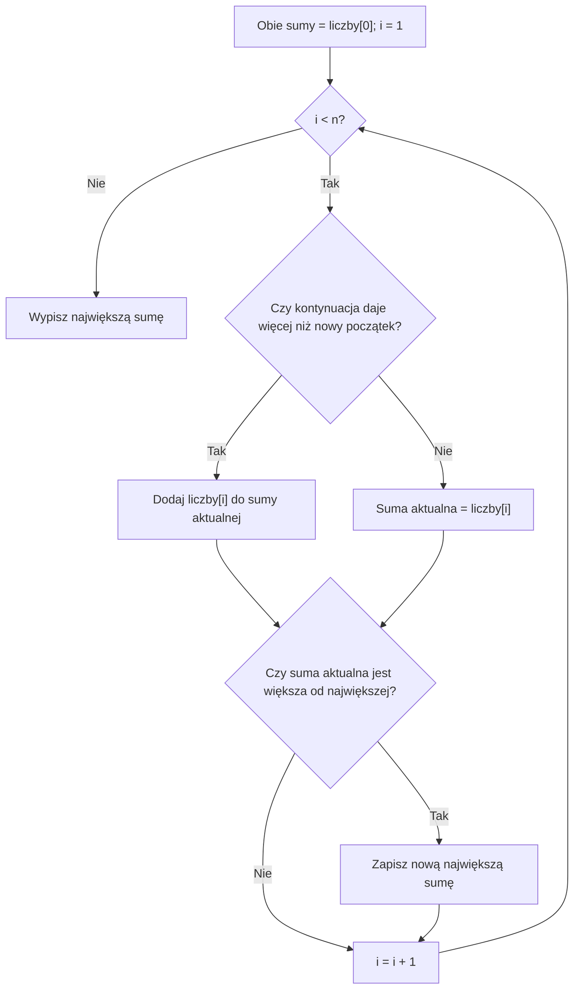

# Algorytm Kadane - maksymalna suma spójnego fragmentu tablicy


## Problem: który okres był najlepszy?

Wyobraź sobie, że firma każdego dnia notuje zysk lub stratę. Liczba dodatnia oznacza zysk, ujemna - stratę.

| Dzień (indeks) | 0 | 1 | 2 | 3 | 4 | 5 | 6 | 7 |
|---|---:|---:|---:|---:|---:|---:|---:|---:|
| Wynik | 4 | -6 | 3 | 5 | -2 | 4 | -7 | 2 |

**Zadanie:** Znajdź taki okres złożony z **kolejnych dni**, w którym łączny wynik był największy. Okres musi zawierać przynajmniej jeden dzień.

> **Spójny fragment** to elementy leżące obok siebie. Nie wolno wybrać samych dodatnich liczb i pominąć ujemnej znajdującej się pomiędzy nimi.

<details markdown="1">
<summary>Podpowiedź do zadania o najlepszym okresie</summary>

Nie wybieraj oddzielnych dni z zyskiem. Możesz wybrać jeden dzień albo kilka sąsiadujących. Strata wewnątrz wybranego okresu też wchodzi do sumy.

</details>

<details markdown="1">
<summary>Pokaż najlepszy okres dla tych danych</summary>

Najlepszy fragment to `3, 5, -2, 4` (indeksy od 2 do 5). Jego suma to `10`.

Suma całej tablicy wynosi tylko `3`. Nie szukamy więc sumy wszystkich dni, lecz najlepszego okresu.

</details>

## Cel lekcji

Po tej lekcji potrafisz:

- wyjaśnić, czym jest **spójny fragment tablicy**;
- odróżnić największą sumę fragmentu od sumy całej tablicy;
- prześledzić algorytm Kadane’a krok po kroku;
- rozpoznać zadanie, w którym warto go zastosować;
- napisać algorytm w C++ za pomocą tablicy, pętli i instrukcji `if`.

## Czy warto kontynuować dotychczasowy fragment?

Wyobraź sobie, że prowadzisz zeszyt z dziennymi wynikami. Każdego dnia możesz zrobić jedną z dwóch rzeczy:

- **Dopisać dzisiejszy wynik do okresu, który już liczysz.**
- **Zacząć nowy okres od dzisiaj.**

Którą decyzję podjąć?

<details markdown="1">
<summary>Podpowiedź do decyzji o nowym początku</summary>

Porównaj dotychczasową sumę powiększoną o dzisiejszy wynik z samym dzisiejszym wynikiem.

</details>

<details markdown="1">
<summary>Pokaż przykłady kontynuowania i rozpoczynania od nowa</summary>

Jeśli wcześniej zebrałeś `-2`, a dzisiaj masz `3`, to:

- kontynuacja starego okresu daje `-2 + 3 = 1`;
- rozpoczęcie od dzisiaj daje `3`.

Lepiej zacząć od nowa. **Ujemny bagaż z przeszłości tylko pogarsza przyszłą sumę.**

Jeśli natomiast wcześniej zebrałeś `5`, a dzisiaj masz `-2`, to:

- kontynuacja daje `5 + (-2) = 3`;
- rozpoczęcie od dzisiaj daje `-2`.

Lepiej kontynuować. Ujemny dzień nie musi oznaczać końca dobrego okresu!

</details>

**Zapamiętaj dwa pytania:**

- Jaka jest największa suma fragmentu **kończącego się dokładnie tutaj**? (`sumaAktualna`)
- Jaka była największa suma **znaleziona do tej pory**? (`sumaNajwieksza`)

To są dwie różne wartości. Pierwsza może spaść. Druga zapamiętuje najlepszy wynik.

Decyzja zależy od sumy dotychczasowego fragmentu, a nie od samego znaku nowej liczby. Ujemna suma pogarsza wynik po dodaniu następnej liczby. Dodatnia suma go poprawia.

Gdy dotychczasowa suma jest równa `0`, oba wybory dają tę samą nową sumę. Pokazany program rozpoczyna wtedy nowy fragment. Nie zmienia to największej wartości sumy.

Nie wybieramy pustego fragmentu. Nawet jeśli wszystkie wyniki są stratami, trzeba wybrać co najmniej jeden dzień.

## Przykład 1 - obliczenia krok po kroku

Tablica: `4, -6, 3, 5, -2, 4, -7, 2`.

Na początku przyjmujemy, że obie sumy są równe pierwszemu elementowi, czyli `4`. Kolejne elementy badamy od indeksu `1`.

W każdym kroku porównujemy:

- **kontynuację**: `sumaAktualna + liczby[i]`;
- **nowy początek**: `liczby[i]`.

Wybieramy większą wartość i w razie potrzeby aktualizujemy `sumaNajwieksza`.


Spróbuj uzupełnić oba wyniki dla każdej pozycji przed odsłonięciem tabeli.

<details markdown="1">
<summary>Podpowiedź do przykładu 1</summary>

Pierwsza suma odpowiada fragmentowi kończącemu się na obecnym indeksie. Druga ma zachować najlepszy wynik, nawet jeśli bieżąca suma później spadnie.

</details>

<details markdown="1">
<summary>Rozwiązanie przykładu 1 - tabela i wynik</summary>

| Indeks | Liczba | Kontynuacja | Nowy początek | `sumaAktualna` | `sumaNajwieksza` |
|---:|---:|---:|---:|---:|---:|
| 0 | 4 | - | 4 | 4 | 4 |
| 1 | -6 | -2 | -6 | -2 | 4 |
| 2 | 3 | 1 | 3 | 3 | 4 |
| 3 | 5 | 8 | 5 | 8 | 8 |
| 4 | -2 | 6 | -2 | 6 | 8 |
| 5 | 4 | 10 | 4 | 10 | **10** |
| 6 | -7 | 3 | -7 | 3 | 10 |
| 7 | 2 | 5 | 2 | 5 | 10 |

**Wynik: 10.** Zauważ, że suma aktualna po znalezieniu najlepszego wyniku jeszcze się zmienia. Nie wolno więc na końcu wypisywać jej zamiast `sumaNajwieksza`.

</details>

## Schemat podejmowania decyzji



Najpierw wykorzystujemy pierwszy element. Przed każdym następnym krokiem sprawdzamy, czy istnieje kolejny element. Dla tablicy jednoelementowej od razu wypisujemy wartość pierwszego elementu.

## Przykład 2 - wszystkie liczby ujemne

Tablica: `-8, -3, -6, -2, -5`.

Wyznacz wynik dla niepustego fragmentu.

<details markdown="1">
<summary>Podpowiedź do przykładu 2</summary>

Pusty fragment miałby sumę zero, ale nie jest dopuszczalny. Zastanów się, który pojedynczy element daje najmniejszą stratę.

</details>

<details markdown="1">
<summary>Rozwiązanie przykładu 2 i poprawna inicjalizacja</summary>

Najlepszym fragmentem jest jednoelementowy fragment `-2`. **Wynik wynosi `-2`, a nie `0`.**

Dlaczego? Zadanie wymaga wybrania co najmniej jednego elementu. Nie możemy uznać pustego fragmentu za rozwiązanie.

Dlatego przyjmujemy na początku:

```cpp
int sumaAktualna = liczby[0];
int sumaNajwieksza = liczby[0];
```

Nie zaczynamy od zera. To ważna różnica.

</details>

## Ograniczenia danych i typ int

Przyjmujemy `1 <= n <= 100`. Wartości należą do zakresu od `-100` do `100`. Każda suma niepustego fragmentu mieści się więc od `-10 000` do `10 000`. Mieszczą się też działania pośrednie przy porównywaniu kontynuacji z nowym początkiem.

Takie dane są bezpieczne dla `int`, także przy jego minimalnym zakresie gwarantowanym przez C++. W innych zadaniach sprawdź ograniczenia ponownie. Pojedyncze wartości mieszczące się w `int` mogą mieć sumę poza jego zakresem. Przepełnienie typu ze znakiem nie daje wiarygodnego wyniku.

Tablica musi zawierać co najmniej jeden element. Program korzysta z `liczby[0]`, więc nie uruchamiamy tego wariantu dla pustych danych.

## Pseudokod

```text
WEJŚCIE: tablica liczby o n elementach, n >= 1

sumaAktualna = liczby[0]
sumaNajwieksza = liczby[0]

DLA i OD 1 DO n - 1:
    JEŻELI sumaAktualna + liczby[i] > liczby[i]:
        sumaAktualna = sumaAktualna + liczby[i]
    W PRZECIWNYM RAZIE:
        sumaAktualna = liczby[i]

    JEŻELI sumaAktualna > sumaNajwieksza:
        sumaNajwieksza = sumaAktualna

WYPISZ sumaNajwieksza
```

## Implementacja w C++

Najpierw prześledź tabelę z przykładu 1 i spróbuj samodzielnie przepisać pseudokod na C++. Potem porównaj rozwiązanie.

<details markdown="1">
<summary><strong>Pokaż podpowiedź</strong></summary>

Potrzebujesz zwykłej tablicy, dwóch zmiennych przechowujących sumy, jednej pętli `for` i dwóch instrukcji `if`. Pętlę rozpocznij od indeksu `1`, ponieważ element `0` wykorzystaliśmy do ustalenia obu sum.

</details>

<details markdown="1">
<summary><strong>Pokaż kompletne rozwiązanie C++</strong></summary>

```cpp
#include <iostream>
using namespace std;

int main() {
    int liczby[8] = {4, -6, 3, 5, -2, 4, -7, 2};
    int n = 8;

    int sumaAktualna = liczby[0];
    int sumaNajwieksza = liczby[0];

    for (int i = 1; i < n; i++) {
        if (sumaAktualna + liczby[i] > liczby[i]) {
            sumaAktualna = sumaAktualna + liczby[i];
        } else {
            sumaAktualna = liczby[i];
        }

        if (sumaAktualna > sumaNajwieksza) {
            sumaNajwieksza = sumaAktualna;
        }
    }

    cout << "Najwieksza suma: " << sumaNajwieksza << "\n";
    return 0;
}
```

**Wynik:** `Najwieksza suma: 10`

</details>

## Kiedy stosować algorytm Kadane?

Zwracaj uwagę na treść zadania:

| Sformułowanie | Co powinno zwrócić uwagę? |
|---|---|
| „Największa suma kolejnych elementów” | Szukamy jednego spójnego fragmentu. |
| „Najlepszy okres kolejnych dni” | Interesuje nas suma wyników w pewnym przedziale. |
| „Zyski i straty w kolejnych dniach” | Wartości dodatnie i ujemne mogą występować razem. |
| „Wybierz dowolnie długi, niepusty spójny fragment” | Długość fragmentu nie jest z góry narzucona. |

**Kiedy nie stosować tego algorytmu wprost?** Gdy trzeba znaleźć największą sumę **dokładnie `k` kolejnych elementów** - wtedy lepiej pasuje przesuwające się okno o stałej długości. Gdy zadanie zawiera wiele pytań o sumy **konkretnych przedziałów**, pomocne mogą być sumy prefiksowe.

### Kiedy tego użyć?

Sprawdź trzy cechy zadania:

- Chodzi o **sumę** wartości, a nie największy pojedynczy element, długość fragmentu czy liczbę fragmentów.
- Wybierasz **jeden spójny, niepusty fragment**. Wszystkie elementy pomiędzy jego końcami muszą wejść do sumy.
- Długość może być dowolna od `1` do `n`. Nie narzucono liczby elementów ani dodatkowego limitu długości.

Wskazówkami są sformułowania „najlepszy okres”, „największy łączny wynik kolejnych rund” i „fragment o największym bilansie”. Samo słowo „suma” nie wystarcza. Sprawdź, czego dokładnie wymaga wybór elementów.

Liczby ujemne sprawiają, że nie zawsze warto brać całą tablicę. Mogą również sprawić, że dotychczasowy początek należy odrzucić. Jeśli najlepsza suma kończąca się poprzednio jest ujemna, to jej dołączenie pogarsza każdy nowy początek. Gdy jest dodatnia, kontynuacja daje większą sumę niż sam nowy element.

### Zadanie - rozliczenie kolejnych dni

Firma zapisała wyniki kolejnych dni: `-4, 6, -2, 3, -8, 5`. Liczba dodatnia to zysk, ujemna to strata. Wybierz jeden niepusty okres kolejnych dni o największym łącznym wyniku. Długość okresu nie jest narzucona. Podaj sumę i indeksy wybranego okresu, licząc od `0`.

Zanim napiszesz kod, ustal, co jest fragmentem i co ma być największe. Czy wolno wybrać tylko dni z dodatnimi wynikami?


<details markdown="1">
<summary>Podpowiedź do zadania o rozliczeniu</summary>

Zwróć uwagę na słowa „jeden”, „niepusty”, „kolejnych” i „długość nie jest narzucona”. Porównaj ten wybór z ramką o ustalonym rozmiarze.

</details>

<details markdown="1">
<summary>Rozpoznanie krok po kroku i rozwiązanie zadania o rozliczeniu</summary>

- Wyniki zapisano w kolejności dni. Nie wolno sortować danych, bo zmieniłoby to sąsiedztwo.
- „Jeden okres kolejnych dni” oznacza spójny fragment. Nie wolno pominąć straty wewnątrz niego.
- „Niepusty” oznacza, że trzeba wybrać przynajmniej jeden dzień, nawet przy samych stratach.
- „Długość nie jest narzucona” odróżnia ten problem od stałego okna.
- Szukamy największej sumy. Dla każdego końca wystarczy wybrać między kontynuacją najlepszego fragmentu z poprzedniej pozycji a nowym początkiem. To algorytm Kadane.

| Indeks | Wynik dnia | `sumaAktualna` | `sumaNajwieksza` |
| --- | ---: | ---: | ---: |
| 0 | -4 | -4 | -4 |
| 1 | 6 | 6 | 6 |
| 2 | -2 | 4 | 6 |
| 3 | 3 | 7 | 7 |
| 4 | -8 | -1 | 7 |
| 5 | 5 | 5 | 7 |

Odpowiedź to `7`, dla indeksów `1..3`: `6 - 2 + 3 = 7`. O wyborze metody zdecydowały warunki zadania, zanim powstał kod.

</details>

### Kiedy wybrać coś innego?

- Dokładnie `k` kolejnych elementów => stałe okno sprawdza fragmenty wymaganej długości.
- Co najmniej `k` albo co najwyżej `k` elementów => prosty wariant Kadane nie pilnuje tego ograniczenia. Potrzebna jest inna technika albo odpowiednia modyfikacja z uzasadnieniem.
- Wiele pytań o sumy konkretnie wskazanych przedziałów => sumy prefiksowe pozwalają korzystać z wcześniej zapisanych sum.
- Dowolnie wybrane, niesąsiadujące pozycje => to nie jest problem spójnego fragmentu.
- Największy pojedynczy element albo liczba wszystkich fragmentów => ten program nie rozwiązuje tak postawionego zadania.

### Dlaczego ograniczenie długości zmienia problem?

Podstawowy algorytm zapamiętuje największą sumę kończącą się w danym miejscu. Nie zachowuje osobno najlepszego wyniku dla każdej możliwej długości. Gdy dopiszesz warunek dotyczący długości, odrzucony wcześniej fragment może być potrzebny.


<details markdown="1">
<summary>Pokaż przykłady z ograniczeniem długości</summary>

- Tablica `5, -100, 6`, długość dokładnie `2`: sumy okien to `-95` i `-94`, więc wynik wynosi `-94`. Zwykły Kadane dałby `6` z jednego elementu. Ten fragment jest za krótki.
- Tablica `4, 4, 4`, długość najwyżej `2`: poprawny wynik to `8`. Kadane dałby `12`, ale fragment z trzema elementami jest za długi.

Nie wystarczy obliczyć sumy zwykłym Kadane i dopiero na końcu sprawdzić długości.

</details>

### Kadane, sumy prefiksowe czy okno?

| Zadanie | Co wykorzystujemy? | Technika |
| --- | --- | --- |
| Największa suma dowolnie długiego niepustego fragmentu | Najlepszy fragment kończący się na poprzedniej pozycji | Kadane |
| Największa suma dokładnie `k` kolejnych elementów | Usunięcie jednego elementu i dodanie nowego | Stałe okno |
| Wiele pytań o sumy od indeksu `a` do `b` | Różnica wcześniej zapisanych sum od początku | Sumy prefiksowe |
| Najdłuższy fragment w limicie sumy przy nieujemnych danych | Uzasadnione przesuwanie obu granic | Poznane okno zmienne |

Kadane nie wymaga nieujemności. To właśnie ujemne wyniki często uzasadniają nowy początek. Nie przenoś tu reguły skracania okna po przekroczeniu limitu. Kadane optymalizuje sumę bez takiego limitu, a nie długość okna w zadanym limicie.

## Dlaczego algorytm działa?

Załóżmy, że chcemy znaleźć najlepszy fragment kończący się na bieżącym elemencie.

Taki fragment może powstać tylko na dwa sposoby:

- zaczynamy od bieżącego elementu;
- dołączamy bieżący element do najlepszego fragmentu kończącego się na poprzedniej pozycji.

Innej możliwości nie ma. Wybieramy lepszą z tych dwóch, a następnie porównujemy ją z najlepszym wynikiem znalezionym wcześniej. Dzięki temu nie musimy sprawdzać wszystkich początków i końców fragmentów.

Na pierwszej pozycji istnieje tylko jeden niepusty fragment kończący się w tym miejscu. Jego suma to `liczby[0]`.

Jeśli znamy najlepszą sumę kończącą się poprzednio, każdy dłuższy fragment kończący się teraz musi dołączyć bieżącą liczbę do jakiegoś fragmentu z poprzednim końcem. Najlepszy z tych poprzedników daje największą kontynuację. Porównujemy ją z samą bieżącą liczbą. To wystarcza do poprawnego obliczenia nowej `sumaAktualna`.

Najlepszy fragment całej tablicy ma jakiś prawy koniec. Pętla rozpatruje każdy koniec i aktualizuje `sumaNajwieksza`. Dlatego nie pomijamy najlepszego wyniku.

## Wydajność - porównanie sposobów

**Sposób początkującego:** wybierz początek i koniec każdego fragmentu, a następnie policz jego sumę od nowa. Przy trzech zagnieżdżonych pętlach zajmuje to `O(n³)` czasu.

**Lepszy sposób:** dla każdego początku przesuwaj koniec i dodawaj tylko nowy element. Dwie pętle dają `O(n²)` czasu.

**Kadane:** jedna pętla, każdy element rozpatrzony raz - **`O(n)` czasu i `O(1)` dodatkowej pamięci**.

| Metoda | Czas | Dodatkowa pamięć |
|---|---|---|
| Każdy fragment sumowany od początku | `O(n³)` | `O(1)` |
| Dwie pętle, suma aktualizowana na bieżąco | `O(n²)` | `O(1)` |
| Algorytm Kadane’a | **`O(n)`** | **`O(1)`** |

Dla tablicy liczącej 10 000 elementów istnieje ponad 50 milionów niepustych spójnych fragmentów. Kadane nie przegląda ich osobno: przetwarza tylko 10 000 elementów.

Dodatkowa pamięć nie obejmuje samej tablicy wejściowej. Kadane przechowuje poza nią tylko dwie sumy, indeks pętli i długość danych.


<details markdown="1">
<summary>Pokaż samodzielne sprawdzanie wszystkich fragmentów dwiema pętlami</summary>

```cpp
#include <iostream>
using namespace std;

int main() {
    int liczby[8] = {4, -6, 3, 5, -2, 4, -7, 2};
    int n = 8;
    int sumaNajwieksza = liczby[0];

    for (int poczatek = 0; poczatek < n; poczatek++) {
        int suma = 0;
        for (int koniec = poczatek; koniec < n; koniec++) {
            suma = suma + liczby[koniec];
            if (suma > sumaNajwieksza) {
                sumaNajwieksza = suma;
            }
        }
    }

    cout << "Najwieksza suma: " << sumaNajwieksza << '\n';
    return 0;
}
```

Program nie pobiera danych. Wypisuje `Najwieksza suma: 10`.

Dla każdego początku zerujemy sumę i dodajemy kolejne końce. Każde porównanie dotyczy już co najmniej jednego elementu, więc nie dopuszczamy pustego fragmentu. Początkowe maksimum to pierwszy element, a nie `0`.

Ten program jest poprawnym punktem odniesienia dla małych danych. Kadane daje ten sam wynik bez przeglądania osobno wszystkich początków.

</details>

## Najczęstsze błędy

- **Rozpoczęcie od zera** - przy tablicy zawierającej wyłącznie liczby ujemne może dać błędny wynik `0`.
- **Pominięcie elementu ujemnego w środku** - wybrany fragment przestaje być spójny.
- **Mylenie dwóch sum** - `sumaAktualna` oznacza najlepszy fragment kończący się tutaj, a `sumaNajwieksza` najlepszy wynik w całej przejrzanej części tablicy.
- **Zapominanie o aktualizacji największej sumy** - poprawnie policzona suma aktualna nie wystarczy.
- **Zastosowanie Kadane’a do fragmentu o ustalonej długości** - to inne zadanie.
- **Nieprawidłowy początek pętli** - jeśli sumy startują od `liczby[0]`, pętla zaczyna się od `i = 1`.

- Kończenie fragmentu tylko dlatego, że nowa liczba jest ujemna => utrata dobrych fragmentów zawierających niewielką stratę.
- Dopuszczenie pustego fragmentu bez zgody w treści zadania => błędny wynik dla samych liczb ujemnych.
- Zmiana kolejności danych => zmiana tego, które elementy sąsiadują.
- Niesprawdzenie zakresu sumy => ryzyko przepełnienia mimo poprawności samej idei algorytmu.

## Ćwiczenia końcowe

### A. Ręczne obliczanie najlepszego fragmentu


Dane to `1, -3, 4, 2, -1`. Bez pisania programu znajdź największą sumę niepustego spójnego fragmentu. Podaj też indeksy wybranego fragmentu, licząc od `0`. Sprawdź sumę zwykłym dodawaniem.


<details markdown="1">
<summary>Podpowiedź do zadania A</summary>

Nie musisz kontynuować fragmentu, którego najlepsza suma kończąca się poprzednio jest ujemna. Pamiętaj też, że najlepszy wynik nie musi kończyć się na ostatniej pozycji.

</details>

<details markdown="1">
<summary>Rozwiązanie zadania A</summary>

Najlepszy fragment to `4, 2`, indeksy `2..3`. Suma wynosi `6`.

Sumy aktualne na kolejnych pozycjach to `1, -2, 4, 6, 5`. Największe dotychczasowe sumy to `1, 1, 4, 6, 6`. Dołączenie końcowego `-1` zmniejsza sumę, więc wybieramy wcześniejszy koniec.

</details>

### B. Uzupełnianie tabeli stanów


Uzupełnij tabelę dla tablicy `-2, 3, -5, 4, 2, -1`. Na pierwszej pozycji ustaw obie sumy na pierwszy element. Dalej stosuj dokładnie porównanie z pseudokodu: kontynuuj tylko wtedy, gdy daje to większą sumę niż nowy początek.

Podaj także indeksy, przy których podczas pętli rozpoczynasz nowy fragment. Nie licz inicjalizacji na indeksie `0` jako restartu.

| Indeks | Liczba | `sumaAktualna` | `sumaNajwieksza` |
| --- | ---: | --- | --- |
| 0 | -2 | ? | ? |
| 1 | 3 | ? | ? |
| 2 | -5 | ? | ? |
| 3 | 4 | ? | ? |
| 4 | 2 | ? | ? |
| 5 | -1 | ? | ? |


<details markdown="1">
<summary>Podpowiedź do zadania B</summary>

Największa dotychczasowa suma nie maleje. Suma aktualna może się zmniejszyć, a potem rozpocząć od nowej liczby.

</details>

<details markdown="1">
<summary>Rozwiązanie zadania B</summary>

| Indeks | Liczba | `sumaAktualna` | `sumaNajwieksza` |
| --- | ---: | ---: | ---: |
| 0 | -2 | -2 | -2 |
| 1 | 3 | 3 | 3 |
| 2 | -5 | -2 | 3 |
| 3 | 4 | 4 | 4 |
| 4 | 2 | 6 | 6 |
| 5 | -1 | 5 | 6 |

Nowe fragmenty zaczynają się przy indeksach `1` i `3`. W obu przypadkach poprzednia suma aktualna jest ujemna. Ostateczny wynik to `6`, mimo że końcowa suma aktualna wynosi `5`.

</details>

### C. Analiza gotowego kodu


Program nie pobiera danych. Dla tablicy `5, -8, 3, 2, -6` wypisuje sumę aktualną i największą dotychczasową. Zapisz dokładnie wszystkie wiersze wydruku. Którą z dwóch końcowych wartości należałoby wypisać jako odpowiedź na pytanie o największą sumę fragmentu?

```cpp
#include <iostream>
using namespace std;

int main() {
    int liczby[5] = {5, -8, 3, 2, -6};
    int n = 5;
    int sumaAktualna = liczby[0];
    int sumaNajwieksza = liczby[0];
    cout << sumaAktualna << " " << sumaNajwieksza << '\n';

    for (int i = 1; i < n; i++) {
        if (sumaAktualna + liczby[i] > liczby[i]) {
            sumaAktualna = sumaAktualna + liczby[i];
        } else {
            sumaAktualna = liczby[i];
        }
        if (sumaAktualna > sumaNajwieksza) {
            sumaNajwieksza = sumaAktualna;
        }
        cout << sumaAktualna << " " << sumaNajwieksza << '\n';
    }
    return 0;
}
```

<details markdown="1">
<summary>Podpowiedź do zadania C</summary>

Pierwszy wiersz powstaje przed pętlą. Ostatni wiersz nie musi zawierać dwóch jednakowych liczb.

</details>

<details markdown="1">
<summary>Rozwiązanie zadania C</summary>

Wydruk:

```text
5 5
-3 5
3 5
5 5
-1 5
```

Odpowiedzią jest `sumaNajwieksza`, czyli `5`. Wypisanie końcowej `sumaAktualna` dałoby `-1` i byłoby błędem. Najlepszy fragment mógł skończyć się wcześniej.

</details>

### D. Samodzielna implementacja - najlepsza seria punktowa

W kolejnych rundach gry uzyskano następujące zmiany punktów:

```text
-3  5  -1  4  -6  2  3  -2
```

Napisz w C++ program wyznaczający największą sumę **co najmniej jednej kolejnej rundy**.

Program ma korzystać z danych zapisanych w tablicy. Nie pobiera wejścia. Przy teście z trzema liczbami ustaw także rozmiar tablicy i `n` na `3`.

**Kolejność pracy:**

- Zapisz tablicę i jej długość.
- Ręcznie oblicz `sumaAktualna` i `sumaNajwieksza` dla kolejnych indeksów.
- Napisz kod, korzystając z `int`, `for` i `if`.
- Sprawdź program dla tablicy `-4, -2, -7`.
- Wyjaśnij, dlaczego nie trzeba dwóch zagnieżdżonych pętli.

<details markdown="1">
<summary><strong>Podpowiedź do zadania D</strong></summary>

Przy każdym elemencie porównaj sumę poprzedniego fragmentu powiększoną o bieżącą liczbę z samą bieżącą liczbą. Następnie zapamiętaj większy wynik, jeśli poprawia największą sumę.

</details>

<details markdown="1">
<summary><strong>Rozwiązanie zadania D - odpowiedzi i pełny program</strong></summary>

- Dla `-3, 5, -1, 4, -6, 2, 3, -2` największa suma to **8** (fragment `5, -1, 4`).
- Dla `-4, -2, -7` największa suma to **-2**.


| Indeks | Wynik rundy | `sumaAktualna` | `sumaNajwieksza` |
| --- | ---: | ---: | ---: |
| 0 | -3 | -3 | -3 |
| 1 | 5 | 5 | 5 |
| 2 | -1 | 4 | 5 |
| 3 | 4 | 8 | 8 |
| 4 | -6 | 2 | 8 |
| 5 | 2 | 4 | 8 |
| 6 | 3 | 7 | 8 |
| 7 | -2 | 5 | 8 |

```cpp
#include <iostream>
using namespace std;

int main() {
    int liczby[8] = {-3, 5, -1, 4, -6, 2, 3, -2};
    int n = 8;

    int sumaAktualna = liczby[0];
    int sumaNajwieksza = liczby[0];

    for (int i = 1; i < n; i++) {
        if (sumaAktualna + liczby[i] > liczby[i]) {
            sumaAktualna = sumaAktualna + liczby[i];
        } else {
            sumaAktualna = liczby[i];
        }

        if (sumaAktualna > sumaNajwieksza) {
            sumaNajwieksza = sumaAktualna;
        }
    }

    cout << "Najwieksza suma: " << sumaNajwieksza << "\n";
    return 0;
}
```

Program wypisuje `Najwieksza suma: 8`.

Nie potrzebujemy dwóch zagnieżdżonych pętli, ponieważ wszystkie fragmenty kończące się w tym samym miejscu zastępujemy jednym najlepszym poprzednikiem. Czas wynosi `O(n)`, a dodatkowa pamięć poza tablicą `O(1)`.

</details>

### E. Rozpoznanie techniki - zyski i straty


Firma zapisała wyniki ośmiu kolejnych dni: `-5, 4, -1, 2, -6, 7, -2, 3`. Wartość dodatnia to zysk, ujemna to strata. Wybierz jeden niepusty okres kolejnych dni o największym łącznym wyniku. Długość okresu jest dowolna.

Bez pisania programu wybierz technikę i uzasadnij ją cechami zadania. Podaj największą sumę oraz indeksy najlepszego okresu, licząc od `0`. Wyjaśnij, czy wolno pominąć stratę wewnątrz wybranego okresu.


<details markdown="1">
<summary>Podpowiedź do zadania E</summary>

Nie szukasz sumy wskazanego z góry przedziału. Nie ma też stałej długości ramki. Trzeba znaleźć jeden najlepszy niepusty fragment.

</details>

<details markdown="1">
<summary>Rozwiązanie zadania E</summary>

Wybieramy algorytm Kadane. Celem jest największa suma, fragment ma być spójny i niepusty, a jego długość nie jest narzucona.

Sumy aktualne to `-5, 4, 3, 5, -1, 7, 5, 8`. Najlepsza suma to `8`, dla indeksów `5..7`: `7 - 2 + 3 = 8`.

Nie wolno usunąć straty `-2` z tego okresu. Wybrane dni muszą sąsiadować. Nie wybieramy też wszystkich dodatnich wyników z całej tablicy.

</details>

### F. Mniej oczywiste zastosowanie - najlepsza trasa rowerowa

Na trasie rowerowej zapisano zmianę wysokości na kolejnych odcinkach. Liczba dodatnia oznacza podjazd, a ujemna - zjazd.

```text
2  -5  4  3  -2  6  -8  3
```

**Polecenie:** Wybierz co najmniej jeden **kolejny odcinek** trasy tak, aby suma zmian wysokości była największa. Podaj tę sumę.

Nie szukamy największego pojedynczego podjazdu, lecz fragmentu trasy, w którym łączna zmiana wysokości jest największa.

#### Pytania pomocnicze

- Czy wolno pominąć zjazd znajdujący się pomiędzy dwoma podjazdami?
- Co oznacza dodatnia lub ujemna suma aktualnie analizowanego fragmentu?
- Jak zdecydować, czy dołączyć następny odcinek, czy rozpocząć od niego nowy fragment?
- Czy potrzeba zmieniać algorytm, skoro zamiast zysków i strat mamy zmiany wysokości?

<details markdown="1">
<summary><strong>Podpowiedź 1 do zadania F - rozpoznaj problem</strong></summary>

Szukasz największej sumy **spójnego fragmentu** tablicy. To dokładnie ten sam problem, który rozwiązuje algorytm Kadane’a. Ujemna zmiana wysokości nie musi kończyć badanego fragmentu.

</details>

<details markdown="1">
<summary><strong>Podpowiedź 2 do zadania F - sprawdź fragment</strong></summary>

Rozważ fragment `4, 3, -2, 6`. Jego suma wynosi `11`. Sprawdź, czy po dołączeniu sąsiednich odcinków otrzymasz większy wynik.

</details>

<details markdown="1">
<summary><strong>Rozwiązanie zadania F - C++ i wynik</strong></summary>

```cpp
#include <iostream>
using namespace std;

int main() {
    int zmiany[8] = {2, -5, 4, 3, -2, 6, -8, 3};
    int n = 8;

    int sumaAktualna = zmiany[0];
    int sumaNajwieksza = zmiany[0];

    for (int i = 1; i < n; i++) {
        if (sumaAktualna + zmiany[i] > zmiany[i]) {
            sumaAktualna = sumaAktualna + zmiany[i];
        } else {
            sumaAktualna = zmiany[i];
        }

        if (sumaAktualna > sumaNajwieksza) {
            sumaNajwieksza = sumaAktualna;
        }
    }

    cout << sumaNajwieksza << "\n";
    return 0;
}
```

**Wynik: `11`.** Najlepszy fragment to `4, 3, -2, 6` (indeksy od `2` do `5`).


Odpowiedzi do pytań pomocniczych:

- Nie wolno pominąć zjazdu wewnątrz wybranego fragmentu. Odcinki mają być kolejne.
- Dodatnia suma oznacza łączny wzrost wysokości w badanym fragmencie, ujemna oznacza łączny spadek.
- Gdy dotychczasowa suma aktualna jest ujemna, zaczynamy od nowego odcinka. Gdy jest dodatnia, kontynuujemy. Przy zerze obie możliwości dają taką samą sumę.
- Algorytm pozostaje ten sam. Zmieniła się interpretacja liczb, a nie matematyczny problem.

Szukamy największej łącznej zmiany wysokości. Nie sumujemy tylko podjazdów i nie wyznaczamy najwyższego punktu względem początku całej trasy.

</details>

### G. Przypadki brzegowe


Dla każdego z poniższych zestawów ręcznie podaj największą sumę niepustego spójnego fragmentu. Następnie sprawdź je programem, zmieniając tablicę oraz jej długość. Nie zmieniaj właściwego algorytmu.

- `-4, -2, -7`
- `-5`
- `7`
- `0`
- `0, 0, 0`
- `1, 2, 3`
- `5, -5, 5`
- `-3, -3`

Które testy wykryją błąd polegający na zmianie wyłącznie inicjalizacji `sumaNajwieksza` na `0`? Reszta programu pozostaje bez zmian. Pusta tablica nie jest poprawnym wejściem do tego wariantu.


<details markdown="1">
<summary>Podpowiedź do zadania G</summary>

Pomyśl o tablicy z jednym elementem. Pętla zaczynająca się od indeksu `1` nie wykona w niej żadnego kroku. Zera nie muszą wykryć błędnej inicjalizacji.

</details>

<details markdown="1">
<summary>Rozwiązanie zadania G</summary>

| Dane | Poprawna największa suma |
| --- | ---: |
| `-4, -2, -7` | -2 |
| `-5` | -5 |
| `7` | 7 |
| `0` | 0 |
| `0, 0, 0` | 0 |
| `1, 2, 3` | 6 |
| `5, -5, 5` | 5 |
| `-3, -3` | -3 |

Zmiana wyłącznie inicjalizacji największej sumy na zero da błędny wynik dla `-4, -2, -7`, `-5`, `7` oraz `-3, -3`. W każdym z tych testów błędny program wypisze `0`.

Przypadek `7` pokazuje, że problem nie dotyczy tylko liczb ujemnych. Przy jednym elemencie nie ma późniejszego porównania, które mogłoby poprawić źle ustawione maksimum.

Pozostałe zestawy mogą przypadkowo dać poprawny wynik nawet przy takim błędzie. Dlatego test z zerami nie zastępuje testu z samymi liczbami ujemnymi i testu jednoelementowego.

</details>

## Ćwiczenie z debuggerem

Uruchom pierwszy program z przykładu 1 w debuggerze. Ustaw punkt przerwania na porównaniu `sumaAktualna + liczby[i] > liczby[i]`. Obserwuj `i`, `liczby[i]`, `sumaAktualna` i `sumaNajwieksza`.

Zapisz obie sumy po obsłużeniu indeksów `2`, `5` i `7`. Wyjaśnij, dlaczego przy indeksie `2` program rozpoczyna nowy fragment i dlaczego końcowy wynik nie jest równy końcowej sumie aktualnej.


<details markdown="1">
<summary>Podpowiedź do ćwiczenia z debuggerem</summary>

Odczytaj sumy po wykonaniu obu instrukcji `if` dla danej pozycji. Największa suma ma pamiętać wcześniejszy dobry wynik.

</details>

<details markdown="1">
<summary>Rozwiązanie ćwiczenia z debuggerem</summary>

| Po obsłużeniu indeksu | `sumaAktualna` | `sumaNajwieksza` |
| --- | ---: | ---: |
| 2 | 3 | 4 |
| 5 | 10 | 10 |
| 7 | 5 | 10 |

Przed indeksem `2` suma aktualna wynosi `-2`. Kontynuacja z liczbą `3` dałaby `1`, a nowy początek daje `3`. Wybieramy nowy początek.

Przy indeksie `5` znajdujemy sumę `10`. Późniejsze elementy obniżają sumę aktualną, ale nie usuwają wcześniej znalezionego fragmentu. Wypisujemy zapamiętane `10`.

</details>

## Sprawdź, czy rozumiesz

Spróbuj odpowiedzieć bez zaglądania do kodu:

- Dlaczego nie można po prostu zsumować wszystkich dodatnich liczb?
- Dlaczego ujemna liczba nie zawsze oznacza rozpoczęcie nowego fragmentu?
- Dlaczego `sumaNajwieksza` musi być osobną zmienną?
- Co się stanie, jeśli wszystkie elementy tablicy są ujemne?
- Czym algorytm Kadane’a różni się od przesuwającego się okna o stałej długości?

<details markdown="1">
<summary>Podpowiedź do pytań kontrolnych</summary>

Rozróżnij sumę fragmentu kończącego się tutaj od najlepszego wyniku z całej przejrzanej części. Wróć też do wymagania niepustości i braku ograniczenia długości.

</details>

<details markdown="1">
<summary><strong>Sprawdź odpowiedzi</strong></summary>

- Mogłyby pochodzić z nieprzylegających do siebie miejsc tablicy, a fragment ma być spójny.
- Nawet po niewielkiej stracie kontynuacja może być lepsza niż rozpoczynanie nowego fragmentu.
- Suma aktualna może później spaść; największy wynik należy zapamiętać.
- Wynikiem jest największy (najmniej ujemny) pojedynczy element.
- Kadane dopuszcza dowolną dodatnią długość fragmentu, a okno stałe wymaga długości dokładnie `k`.

</details>
