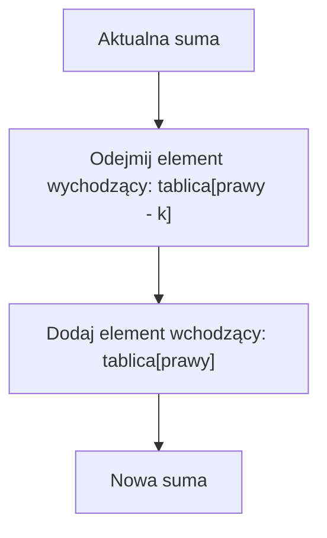
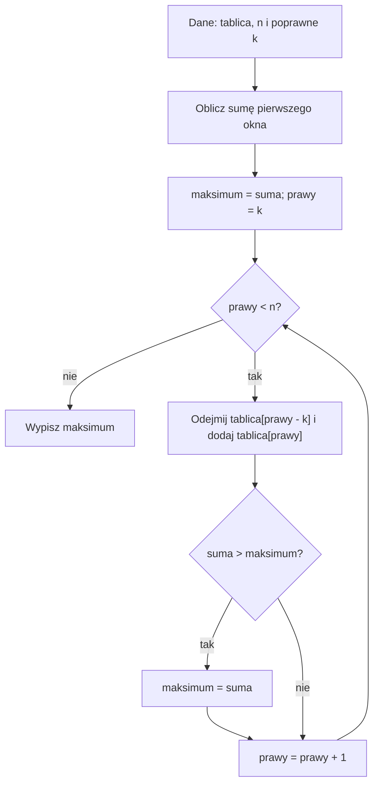

# Przesuwające się okno (Sliding Window)

## Cel lekcji

Zrozumiesz, skąd bierze się oszczędność obliczeń. Nauczysz się rozpoznawać zadania z oknem o stałej długości i samodzielnie je rozwiązywać. Na końcu poznasz trudniejszy wariant: okno o zmiennej długości.

Wystarczą zwykłe tablice, `int`, pętle i `if`. Dane w przykładach są małe. Ich ograniczenia podajemy przed programami.


## Przesuwamy ramkę po liczbach

Wyobraź sobie siedem pudełek ustawionych w jednym rzędzie. W pudełkach są kolejno: **3, 5, 2, 8, 4, 6, 1** przedmiotów.

Masz ramkę, która **zawsze obejmuje trzy sąsiednie pudełka**. Twoje zadanie: znaleźć ustawienie ramki, w którym przedmiotów jest najwięcej.

<details markdown="1">
<summary>Wskazówka do przesuwania ramki</summary>

Zapisz, które pudełko przestaje być objęte ramką, a które pojawia się w niej po przesunięciu. Pudełka w środku nadal należą do okna.

</details>

<details markdown="1">
<summary>Pokaż kolejne obliczenia przy przesuwaniu ramki</summary>

Na początku ramka obejmuje `3, 5, 2`: suma wynosi **10**.

Przesuwasz ramkę o jedno pudełko w prawo. Teraz obejmuje `5, 2, 8`. Czy trzeba od początku dodawać wszystkie trzy liczby? **Nie.** Z poprzedniej sumy odejmujesz pudełko, które wypadło (`3`), i dodajesz nowe pudełko (`8`):

`10 - 3 + 8 = 15`

Przy następnym ruchu wypada `5`, wchodzi `4`:

`15 - 5 + 4 = 14`

</details>

**Najważniejsze zdanie do zapamiętania:** *Gdy przesuwasz okno o jedną pozycję, wszystko w środku zostaje takie samo. Zmieniają się tylko dwa elementy: jeden wychodzi, drugi wchodzi.*

To jest cała idea wariantu ze stałą długością okna.

## Przykład 1 - największa suma trzech kolejnych liczb

Tablica (indeksy od zera):

| Indeks | 0 | 1 | 2 | 3 | 4 | 5 | 6 |
|---|---:|---:|---:|---:|---:|---:|---:|
| Wartość | 3 | 5 | 2 | 8 | 4 | 6 | 1 |

Długość okna: `k = 3`.


Wyznacz kolejne sumy i znajdź największą. Przy kilku równie dobrych oknach wybierz pierwsze od lewej.

<details markdown="1">
<summary>Wskazówka do przykładu 1</summary>

Pierwszą sumę policz zwykłym dodawaniem. Potem za każdym razem odejmij jedną wartość i dodaj jedną nową.

</details>

<details markdown="1">
<summary>Rozwiązanie przykładu 1 - kolejne okna</summary>

| Okno: indeksy | Liczby | Obliczenie sumy | Suma |
|---|---|---|---:|
| 0-2 | 3, 5, 2 | `3 + 5 + 2` | 10 |
| 1-3 | 5, 2, 8 | `10 - 3 + 8` | 15 |
| 2-4 | 2, 8, 4 | `15 - 5 + 4` | 14 |
| 3-5 | 8, 4, 6 | `14 - 2 + 6` | **18** |
| 4-6 | 4, 6, 1 | `18 - 8 + 1` | 11 |

**Odpowiedź:** największa suma to **18**, dla indeksów `3-5` (dni `4-6`, jeżeli liczymy dni od 1).

</details>

## Dlaczego algorytm działa?

Załóżmy, że okno obejmuje `a[L] ... a[P]`. Jego suma to wszystkie liczby od `L` do `P`.

Po przesunięciu o jeden element okno obejmuje `a[L+1] ... a[P+1]`.

Elementy `a[L+1] ... a[P]` **nie zmieniły się**. Dlatego:

**`nowaSuma = staraSuma - a[L] + a[P+1]`**

Jeżeli sprawdzimy każde możliwe położenie ramki, znajdziemy największą sumę. Nie pomijamy żadnego okna - tylko szybciej liczymy jego sumę.

## Pseudokod - okno stałej długości

Warunki: `1 <= k <= n`, tablica ma `n` elementów.

```text
suma = 0
DLA i od 0 do k-1:
    suma = suma + tablica[i]

maksimum = suma

DLA prawy od k do n-1:
    suma = suma - tablica[prawy-k]
    suma = suma + tablica[prawy]
    JEŻELI suma > maksimum:
        maksimum = suma

WYPISZ maksimum
```

Nie ustawiamy `maksimum = 0`: gdy wszystkie liczby są ujemne, dałoby to błędny wynik.

## Co zmienia się przy przesunięciu?



Jeżeli nowy prawy koniec to indeks `prawy`, poprzedni początek znajduje się pod indeksem `prawy - k`. Nowy początek to `prawy - k + 1`. Okno nadal zawiera dokładnie `k` kolejnych elementów.



## Kiedy warto zastosować przesuwające się okno?

W treści zadania szukaj sformułowań:

- „**kolejne** dni”, „**spójny** fragment tablicy”, „następujące po sobie elementy”;
- „dla **każdych k kolejnych** pomiarów”;
- „największa / najmniejsza suma w **k kolejnych** elementach”;
- „najdłuższy fragment spełniający warunek” - to często **okno zmienne**, wymagające osobnego rozumowania.

**Ważne ograniczenie:** samo słowo „fragment” nie gwarantuje, że Sliding Window wystarczy. Technika działa wtedy, gdy potrafimy tanio **zaktualizować** stan okna po przesunięciu i uzasadnić sposób ruchu wskaźników.


### Kiedy tego użyć?

Sprawdź trzy rzeczy:

- Czy elementy muszą sąsiadować? „Kolejne” oznacza, że nie wolno pominąć pozycji wewnątrz fragmentu.
- Czy potrafisz szybko usunąć wkład starego elementu i uwzględnić nowy? Dla sumy są to odejmowanie i dodawanie.
- Czy znasz regułę przesuwania granic? Przy stałym `k` obie granice przesuwają się razem. Przy zmiennym oknie każda może przesuwać się osobno.

Tablicy nie trzeba sortować. Kolejność dni czy pomiarów jest częścią zadania. Sortowanie zwykle zniszczyłoby informację o sąsiedztwie.

### Zadanie - klienci w ciągu siedmiu dni

Zarejestrowano liczbę klientów odwiedzających sklep w każdym dniu. Wyznacz największą łączną liczbę klientów w dowolnych siedmiu kolejnych dniach.

Dane dla dziewięciu dni: `2, 4, 1, 3, 5, 2, 6, 7, 1`. Ustal metodę i opisz, co zmieni się po przesunięciu, zanim zaczniesz pisać kod. Podaj też pierwszą i ostatnią pozycję najlepszego okna, licząc indeksy od `0`.


<details markdown="1">
<summary>Wskazówka do zadania o klientach</summary>

Zwróć uwagę na wyrazy „siedmiu”, „kolejnych” i „największą łączną liczbę”. Każdy mówi o innym elemencie rozwiązania.

</details>

<details markdown="1">
<summary>Rozpoznanie krok po kroku i rozwiązanie zadania o klientach</summary>

- „Siedmiu” oznacza stałą długość: `k = 7`.
- „Kolejnych” oznacza spójny fragment. Nie wybieramy siedmiu dowolnych dni z największymi wynikami.
- „Największą łączną liczbę” oznacza maksymalną sumę.
- Sąsiednie okna mają sześć wspólnych elementów. Wystarczy odejmować dzień opuszczający okno i dodawać dzień nowy.
- Pierwsze okno ma sumę `2 + 4 + 1 + 3 + 5 + 2 + 6 = 23`.
- Po przesunięciu: `23 - 2 + 7 = 28`.
- Po następnym przesunięciu: `28 - 4 + 1 = 25`.

Największa suma to `28`, dla indeksów `1..7`, czyli dni od `2` do `8` włącznie. Rozpoznanie słów w treści doprowadziło do stałego okna jeszcze przed napisaniem pętli.

</details>

### Stała czy zmienna długość?

„Dokładnie `k` kolejnych elementów” => stałe okno. Przy każdym ruchu usuwamy jeden element i dodajemy jeden.

„Najdłuższy fragment o sumie nie większej niż limit” => długość nie jest znana. To kandydat do zmiennego okna. Dla reguły pokazanej dalej wymagamy nieujemnych elementów i nieujemnego limitu. Sam wyraz „najdłuższy” nie wystarcza do wyboru metody.

### Kiedy wybrać coś innego?

- Elementy mogą być dowolnie rozrzucone => okno nie opisuje takiego wyboru.
- Pytania wskazują wiele dowolnych przedziałów => rozważ sumy prefiksowe.
- Stan okna nie daje się łatwo aktualizować => sama zmiana granic nie zapewnia szybkiego rozwiązania. Na przykład minimum nie zawsze da się odtworzyć po usunięciu starego minimum bez dodatkowych informacji.
- Liczby mogą być ujemne, a długość okna ma zależeć od przekroczenia limitu sumy => poniższa prosta reguła skracania nie ma uzasadnienia.

Ostatnie ograniczenie dotyczy opisanego okna zmiennego. **Stałe okno do liczenia sum działa także dla liczb ujemnych.**

### Porównanie z poznanymi technikami

| Technika | Typowa treść zadania | Co wykorzystujemy? |
| --- | --- | --- |
| Stałe okno | Największa suma dokładnie `k` kolejnych pomiarów | Wspólne elementy sąsiednich okien |
| Zmienne okno | Najdłuższy fragment w limicie przy nieujemnych liczbach | Uzasadnione rozszerzanie i skracanie fragmentu |
| Sumy prefiksowe | Wiele pytań o sumy dowolnych przedziałów tej samej tablicy | Wcześniej zapisane sumy od początku |
| Dwa wskaźniki szukające pary | Dwie wartości o określonej sumie w uporządkowanej tablicy | Możliwość odrzucania skrajnych elementów |

Okno można traktować jako wariant techniki dwóch wskaźników. Indeksy wskazują granice całego fragmentu, a nie tylko dwie wybrane liczby. W tej lekcji granice idą w prawo. W zadaniu o parze indeksy szły ku sobie.

## Ograniczenia danych i typ int

W tej lekcji tablice mają najwyżej `100` elementów. W zadaniach o stałym oknie wartości należą do zakresu od `-100` do `100`, chyba że treść podaje węższy zakres. Suma dowolnego okna mieści się od `-10 000` do `10 000`. Mieszczą się też pośrednie wyniki odejmowania i dodawania.

To bezpieczne dla `int`, także przy minimalnym zakresie gwarantowanym przez C++. W innych zadaniach sprawdź ograniczenia ponownie. Sam fakt, że pojedyncza liczba mieści się w `int`, nie gwarantuje poprawności sumy. Przepełnienie typu ze znakiem nie daje wiarygodnego wyniku.

Dla okna stałego zawsze wymagamy `1 <= k <= n`. Okno obejmuje oba końce podanego przedziału. Jeżeli kilka okien ma tę samą największą sumę, w przykładach z indeksami zachowujemy pierwsze od lewej. Dlatego aktualizujemy wynik tylko przy `suma > maksimum`.

## C++ - pełne rozwiązanie przykładu 1

Spróbuj zapisać program na podstawie pseudokodu. Zastanów się, dlaczego pierwsze sumowanie kończy się na `k - 1` i dlaczego element wypadający ma indeks `prawy - k`.


<details markdown="1">
<summary>Wskazówka do implementacji stałego okna</summary>

Najpierw policz pierwszą sumę i przypisz ją do `maksimum`. Pierwszy nowy element ma indeks `k`. Jego dołączenie usuwa stary element o indeksie `0`.

</details>

<details markdown="1">
<summary>Rozwiązanie przykładu 1 - pełny program i wynik</summary>

```cpp
#include <iostream>
using namespace std;

int main() {
    int liczby[7] = {3, 5, 2, 8, 4, 6, 1};
    int n = 7;
    int k = 3;

    int suma = 0;

    // Najpierw sumujemy pierwsze trzy liczby.
    for (int i = 0; i < k; i++) {
        suma = suma + liczby[i];
    }

    int maksimum = suma;
    int poczatek = 0;

    // Przesuwamy okno o jedno miejsce w prawo.
    for (int prawy = k; prawy < n; prawy++) {
        suma = suma - liczby[prawy - k]; // liczba wychodzi
        suma = suma + liczby[prawy];     // liczba wchodzi

        if (suma > maksimum) {
            maksimum = suma;
            poczatek = prawy - k + 1;
        }
    }

    cout << "Najwieksza suma: " << maksimum << "\n";
    cout << "Indeksy: " << poczatek << " do " << poczatek + k - 1 << "\n";

    return 0;
}
```

Program nie pobiera danych. Wypisuje:

```text
Najwieksza suma: 18
Indeksy: 3 do 5
```

Pierwsze okno ma dokładnie `k` elementów: od indeksu `0` do `k - 1`. Gdy nowy koniec ma indeks `prawy`, przesunięty początek to `prawy - k + 1`. O jeden mniejszy indeks, `prawy - k`, wskazuje element usuwany ze starego okna.

</details>

## Przykład 2 - niewielka modyfikacja zadania

**Treść:** Dane są dzienne odczyty temperatury: `-6, -2, -5, -1, -4`. Wyznacz największą sumę temperatur z **dwóch kolejnych dni**.

<details markdown="1">
<summary>Wskazówka do przykładu 2</summary>

Wszystkie sumy są ujemne. Największa z nich jest najbliższa zeru, ale nie musi być równa zeru. Zacznij od rzeczywistej sumy pierwszego okna.

</details>

<details markdown="1">
<summary>Rozwiązanie przykładu 2 - obliczenia i pełny program</summary>

Pierwsze okno: `-6 + (-2) = -8`.

Kolejne sumy:

| Dni (od 1) | Suma |
|---|---:|
| 1-2 | -8 |
| 2-3 | -7 |
| 3-4 | -6 |
| 4-5 | **-5** |

**Odpowiedź:** `-5`. To pokazuje, dlaczego początkowe `maksimum = 0` jest błędem. Kod z poprzedniej sekcji działa także dla takich danych.

```cpp
#include <iostream>
using namespace std;

int main() {
    int liczby[5] = {-6, -2, -5, -1, -4};
    int n = 5;
    int k = 2;

    int suma = 0;

    // Najpierw sumujemy pierwsze dwie liczby.
    for (int i = 0; i < k; i++) {
        suma = suma + liczby[i];
    }

    int maksimum = suma;
    int poczatek = 0;

    // Przesuwamy okno o jedno miejsce w prawo.
    for (int prawy = k; prawy < n; prawy++) {
        suma = suma - liczby[prawy - k]; // liczba wychodzi
        suma = suma + liczby[prawy];     // liczba wchodzi

        if (suma > maksimum) {
            maksimum = suma;
            poczatek = prawy - k + 1;
        }
    }

    cout << "Najwieksza suma: " << maksimum << "\n";
    cout << "Indeksy: " << poczatek << " do " << poczatek + k - 1 << "\n";

    return 0;
}
```

Program nie pobiera danych. Wypisuje:

```text
Najwieksza suma: -5
Indeksy: 3 do 4
```

Wariant z `maksimum = 0` wypisałby nieistniejący wynik. Wartość `0` nie jest sumą żadnego z badanych okien.

</details>

## Dlaczego jest wydajny? Porównanie metod

Dla tablicy z `n` elementami i okna długości `k`:

| Metoda | Jak działa | Czas |
|---|---|---|
| Dwie pętle | Każde okno sumuje od początku | `O(n*k)` |
| Sumy prefiksowe | Buduje prefiksy, każde okno liczy odejmowaniem | `O(n)` na przygotowanie i przegląd; pamięć `O(n)` |
| Przesuwające się okno | Pierwsze okno sumuje raz, potem odejmuje i dodaje | **`O(n)`**, pamięć dodatkowa **`O(1)`** |

Jeżeli `k` jest stałą liczbą, np. zawsze 3, również metoda dwóch pętli ma asymptotycznie `O(n)`, ale wykonuje więcej dodawań. Różnica asymptotyczna jest szczególnie ważna, gdy `k` rośnie wraz z `n`.

**Dlaczego nie zawsze sumy prefiksowe?** Jeśli interesuje nas jedno `k` i przejście przez tablicę, okno jest bardzo proste i nie wymaga dodatkowej tablicy. Jeśli mamy wiele niezależnych zapytań o dowolne przedziały, sumy prefiksowe mogą być wygodniejsze.

<details markdown="1">
<summary>Pokaż rozwiązanie z ponownym sumowaniem okien</summary>

```cpp
#include <iostream>
using namespace std;

int main() {
    int liczby[7] = {3, 5, 2, 8, 4, 6, 1};
    int n = 7;
    int k = 3;

    int sumaPierwszego = 0;
    for (int i = 0; i < k; i++) {
        sumaPierwszego = sumaPierwszego + liczby[i];
    }
    int maksimum = sumaPierwszego;
    int poczatek = 0;

    for (int start = 1; start <= n - k; start++) {
        int suma = 0;
        for (int i = start; i < start + k; i++) {
            suma = suma + liczby[i];
        }
        if (suma > maksimum) {
            maksimum = suma;
            poczatek = start;
        }
    }

    cout << "Najwieksza suma: " << maksimum << '\n';
    cout << "Indeksy: " << poczatek << " do " << poczatek + k - 1 << '\n';
    return 0;
}
```

Najpierw obliczamy sumę pierwszego okna w zmiennej `sumaPierwszego`. Dopiero ta suma jest początkowym maksimum. Dzięki temu również ujemna najlepsza suma zostanie poprawnie zachowana.

Każde następne okno sumujemy od początku. Program wypisuje te same dwie linie co rozwiązanie z ramką.

Dla `n = 7` i `k = 3` mamy pięć okien. Ponowne sumowanie wymaga `5 * 3 = 15` dodawań. Przesuwanie okna wymaga trzech dodawań na początku oraz czterech odejmowań i czterech dodawań później. To `11` takich działań. Porównujemy liczbę działań, a nie czas w sekundach.

</details>

## Trudniejszy wariant - najdłuższy spacer w limicie

To **trudniejsza odmiana**: długość okna nie jest z góry ustalona.

**Treść zadania:** Masz zapis liczby minut spędzonych na kolejnych etapach spaceru: `2, 1, 3, 2, 1, 1, 4`. Chcesz znaleźć **najdłuższy ciąg kolejnych etapów**, których łączny czas **nie przekracza 6 minut**. Ile etapów możesz wybrać?

 okno zawsze obejmuje **kolejne** pozycje; nie wolno dowolnie wybierać kilku najkrótszych etapów z całej tablicy.

### Rozciągana gumka

Zamiast sztywnej ramki trzymasz gumkę otaczającą fragment tablicy. Dodajesz kolejne etapy z prawej. Gdy suma przekroczy 6, **odsuwasz lewy koniec gumki w prawo**, aż suma znowu zmieści się w limicie. Po każdym takim kroku sprawdzasz długość aktualnego fragmentu.

To działa tutaj, ponieważ **wszystkie czasy są nieujemne**. Usunięcie elementu z lewej nie zwiększa sumy. Przy liczbach ujemnych ta prosta reguła nie musi działać.

### Kiedy tego użyć?

Gdy szukasz najdłuższego spójnego fragmentu o sumie nie większej niż limit, liczby są nieujemne, a limit też jest nieujemny. Wartości mogą się powtarzać i mogą być równe `0`. Nie muszą być uporządkowane.

### Dlaczego ta reguła działa?

Dodanie nieujemnej liczby z prawej nie zmniejszy sumy. Gdy suma jest za duża, przesuwamy lewy koniec, aż warunek znów będzie spełniony. Usunięcie nieujemnej liczby nie zwiększa sumy.

Pominięty początek nie stanie się przydatny przy późniejszym prawym końcu. Do zbyt dużej sumy dochodziłyby tylko kolejne nieujemne wartości. Dlatego nie musimy cofać lewego indeksu.

Po skróceniu okna mamy najdłuższy dopuszczalny fragment kończący się w obecnym `prawy`. Porównujemy jego długość z najlepszą dotychczasową. Każdy prawy koniec zostaje rozpatrzony, więc otrzymujemy najlepszą długość w całej tablicy.

Zero może nie zmniejszyć sumy podczas skracania, ale lewy indeks i tak idzie w prawo. Pętla nadal robi postęp.

### Kiedy wybrać coś innego?

Gdy dopuszczasz liczby ujemne, nowe elementy mogą zmniejszyć sumę. Wtedy odrzucony wcześniej początek może jednak należeć do najlepszego fragmentu. Nie stosuj tej samej reguły bez nowego uzasadnienia.


<details markdown="1">
<summary>Pokaż kontrprzykład z liczbą ujemną</summary>

Tablica to `5, -4`, a limit to `3`. Cały fragment ma sumę `1`, więc poprawna największa długość wynosi `2`.

Opisana reguła po odczytaniu `5` usunęłaby je z okna, bo `5 > 3`. Po dodaniu `-4` pozostałby fragment długości `1`. Zgubiliśmy poprawny początek. To pokazuje, dlaczego warunku nieujemności nie wolno pominąć.

</details>

### Pseudokod okna zmiennego

Zakładamy nieujemne wartości i `limit >= 0`.

```text
lewy = 0
suma = 0
maksimum = 0

dla prawy od 0 do n - 1:
    suma = suma + tablica[prawy]
    dopóki suma > limit:
        suma = suma - tablica[lewy]
        lewy = lewy + 1
    dlugosc = prawy - lewy + 1
    jeżeli dlugosc > maksimum:
        maksimum = dlugosc

wypisz maksimum
```

Tutaj `maksimum` oznacza długość, więc początkowe `0` jest poprawne. Gdy żaden niepusty fragment się nie mieści, wynikiem jest `0`. W stałym oknie maksimum przechowywało sumę, która mogła być ujemna.


<details markdown="1">
<summary>Podpowiedzi do zadania o spacerze</summary>

- Ustaw `lewy = 0` i `suma = 0`.
- Przesuwaj `prawy` w prawo i dodawaj nowy element.
- Dopóki suma przekracza 6, odejmuj `a[lewy]` i zwiększaj `lewy`.
- Kiedy suma jest dozwolona, długość okna to `prawy - lewy + 1`.

</details>

<details markdown="1">
<summary>Rozwiązanie zadania o spacerze - wynik i program</summary>

**Odpowiedź:** **3 etapy**. Przykładowo fragment `1, 3, 2` ma sumę 6, a fragment `2, 1, 1` ma sumę 4. Nie można wybrać czterech etapów mieszczących się w limicie: każdy spójny fragment o długości 4 przekracza 6 minut.

```cpp
#include <iostream>
using namespace std;

int main() {
    int czas[7] = {2, 1, 3, 2, 1, 1, 4};
    int n = 7;
    int limit = 6;
    int lewy = 0;
    int suma = 0;
    int maksimum = 0;

    for (int prawy = 0; prawy < n; prawy++) {
        suma = suma + czas[prawy];

        // Skracamy okno, gdy suma jest za duza.
        while (suma > limit) {
            suma = suma - czas[lewy];
            lewy = lewy + 1;
        }

        int dlugosc = prawy - lewy + 1;
        if (dlugosc > maksimum) {
            maksimum = dlugosc;
        }
    }

    cout << "Najwiecej kolejnych etapow: " << maksimum << "\n";
    return 0;
}
```

**Wynik:** `3`. Każdy wskaźnik porusza się tylko w prawo, więc czas to `O(n)` mimo użycia `while` wewnątrz `for`. Lewy wskaźnik przesuwa się łącznie najwyżej `n` razy.

</details>

## Typowe błędy i jak ich uniknąć

- **Mylenie fragmentu spójnego z dowolnie wybranymi elementami.** Okno obejmuje wyłącznie sąsiadujące elementy.
- **Zapominanie o pierwszym oknie.** Najpierw policz jego sumę, dopiero potem przesuwaj.
- **Zły indeks elementu wychodzącego.** Przy nowym prawym indeksie `prawy` i rozmiarze `k` wypada `prawy-k`.
- **`maksimum = 0` dla możliwych wartości ujemnych.** Zainicjuj maksimum sumą pierwszego okna.
- **Niepoprawne `k`.** Trzeba sprawdzić, że `1 <= k <= n`.
- **Mylenie indeksów 0-based z numerami dni 1-based.** W kodzie indeksy zaczynają się od 0.
- **Używanie wariantu zmiennego okna bez sprawdzenia założeń.** Pokazany algorytm z limitem sumy wymaga nieujemnych elementów.
- **Zbyt duże dane dla `int`.** Na tej lekcji pracujemy na małych liczbach. W większych zadaniach trzeba osobno sprawdzić dopuszczalne zakresy wartości.

- Sortowanie pomiarów przed szukaniem kolejnych dni => zmiana problemu, bo znika pierwotne sąsiedztwo.
- Zmiana najlepszego początku także przy równej sumie => wybór późniejszego okna, mimo wymagania pierwszego.
- Założenie, że `while` wewnątrz `for` zawsze daje `O(n * n)` => pominięcie faktu, że oba indeksy idą tylko w prawo.

## Ćwiczenia końcowe

### A. Ręczne przesuwanie okna


Tablica to `2, 4, 1, 6, 3, 5`, a `k = 3`. Zapisz sumę pierwszego okna, a potem element wychodzący, element nowy i każdą następną sumę. Podaj największą sumę i indeksy pierwszego najlepszego fragmentu. Indeksy liczymy od `0`.


<details markdown="1">
<summary>Podpowiedź do zadania A</summary>

Pierwsze okno obejmuje `2, 4, 1`. Po ruchu wypada `2`, a wchodzi `6`. Nie sumuj ponownie wspólnych elementów.

</details>

<details markdown="1">
<summary>Rozwiązanie zadania A</summary>

| Indeksy | Działanie | Suma |
| --- | --- | ---: |
| `0..2` | `2 + 4 + 1` | 7 |
| `1..3` | `7 - 2 + 6` | 11 |
| `2..4` | `11 - 4 + 3` | 10 |
| `3..5` | `10 - 1 + 5` | 14 |

Największa suma wynosi `14`. Pierwszy najlepszy fragment ma indeksy `3..5`.

</details>

### B. Analiza działania gotowego programu


Program nie pobiera danych. Dla tablicy `-5, -2, -4, -1` i `k = 2` wypisuje pary: bieżąca suma i dotychczasowe maksimum. Podaj dokładnie wszystkie wiersze wydruku. Co stałoby się z drugą kolumną, gdyby zastąpić inicjalizację maksimum przypisaniem `0`?

```cpp
#include <iostream>
using namespace std;

int main() {
    int liczby[4] = {-5, -2, -4, -1};
    int n = 4;
    int k = 2;
    int suma = 0;
    for (int i = 0; i < k; i++) {
        suma = suma + liczby[i];
    }
    int maksimum = suma;
    cout << suma << " " << maksimum << '\n';

    for (int prawy = k; prawy < n; prawy++) {
        suma = suma - liczby[prawy - k] + liczby[prawy];
        if (suma > maksimum) {
            maksimum = suma;
        }
        cout << suma << " " << maksimum << '\n';
    }
    return 0;
}
```

<details markdown="1">
<summary>Podpowiedź do zadania B</summary>

Przed pętlą przesuwającą okno program już raz wykonuje `cout`. Później nowa suma jest porównywana z dotychczasowym maksimum.

</details>

<details markdown="1">
<summary>Rozwiązanie zadania B</summary>

Dokładny wydruk:

```text
-7 -7
-6 -6
-5 -5
```

Kolejne sumy to `-5 + (-2) = -7`, `-7 - (-5) + (-4) = -6` i `-6 - (-2) + (-1) = -5`.

Gdyby maksimum zaczynało od `0`, w każdym wierszu druga kolumna wynosiłaby `0`. Żadna ujemna suma nie byłaby od niego większa. Wynik nie odpowiadałby żadnemu oknu.

</details>

### C. Zmiana długości okna


W pierwszym programie z przykładu 1 zachowaj tablicę `3, 5, 2, 8, 4, 6, 1`. Zmień tylko długość okna na `k = 4`. Podaj dokładny wydruk i wyjaśnij, dlaczego reszta pętli nie wymaga zmiany.

Potem uruchom osobno warianty `k = 1` i `k = 7`. Dla każdego podaj największą sumę oraz indeksy. Nie używaj `k = 0` ani `k > 7`.


<details markdown="1">
<summary>Podpowiedź do zadania C</summary>

Indeks wychodzącego elementu zależy od zmiennej `k`, a nie od wpisanej na stałe liczby `3`. Przy `k = n` istnieje tylko jedno okno.

</details>

<details markdown="1">
<summary>Rozwiązanie zadania C</summary>

W programie ustaw:

```cpp
int k = 4;
```

Sumy kolejnych okien wynoszą `18, 19, 20, 19`. Wydruk:

```text
Najwieksza suma: 20
Indeksy: 2 do 5
```

| `k` | Największa suma | Indeksy |
| --- | ---: | --- |
| 1 | 8 | `3..3` |
| 7 | 29 | `0..6` |

Dla `k = 1` ramka obejmuje pojedynczy element. Dla `k = 7` obejmuje całą tablicę, więc pętla przesuwająca okno nie wykona się ani razu. Wzory z `k` obsługują oba przypadki.

</details>

### D. Samodzielna implementacja - obserwacja ruchu w sieci

**Treść:** Zapisano liczbę pakietów sieciowych odebranych w kolejnych minutach. Dla danych:

`4, 7, 1, 5, 9, 2, 6, 3`

znajdź **największą łączną liczbę pakietów w czterech kolejnych minutach**. Napisz program w C++, który wczytuje `n`, `k`, a następnie `n` liczb i wypisuje maksymalną sumę. Przyjmujemy `1 <= k <= n <= 100` oraz wartości od `0` do `100`.

**Przykładowe wejście:**

```text
8 4
4 7 1 5 9 2 6 3
```

<details markdown="1">
<summary>Podpowiedzi do zadania D</summary>

**Podpowiedź 1:** Policz sumę elementów o indeksach 0-3.

**Podpowiedź 2:** Przy przejściu do indeksów 1-4 odejmij `a[0]`, dodaj `a[4]`.

**Podpowiedź 3:** Trzymaj zmienną `maksimum`, aktualizuj ją po każdym przesunięciu.

</details>

<details markdown="1">
<summary>Rozwiązanie zadania D - tabela i pełny program</summary>

| Minuty (indeksy) | Suma |
|---|---:|
| 0-3 | 17 |
| 1-4 | 22 |
| 2-5 | 17 |
| 3-6 | 22 |
| 4-7 | 20 |

**Wynik: 22.**

```cpp
#include <iostream>
using namespace std;

int main() {
    int n, k;
    if (!(cin >> n >> k)) {
        return 0;
    }
    if (n < 1 || n > 100 || k < 1 || k > n) {
        cout << "Bledne dane\n";
        return 0;
    }

    int liczby[100];
    for (int i = 0; i < n; i++) {
        if (!(cin >> liczby[i]) || liczby[i] < 0 || liczby[i] > 100) {
            cout << "Bledne dane\n";
            return 0;
        }
    }

    int suma = 0;
    for (int i = 0; i < k; i++) {
        suma = suma + liczby[i];
    }

    int maksimum = suma;
    for (int prawy = k; prawy < n; prawy++) {
        suma = suma - liczby[prawy - k] + liczby[prawy];
        if (suma > maksimum) {
            maksimum = suma;
        }
    }

    cout << maksimum << '\n';
    return 0;
}
```

Program wypisuje jedną linię:

```text
22
```

Tę samą największą sumę mają dwa okna: `1..4` i `3..6`. Zadanie wymaga tylko sumy, więc wypisujemy ją raz. Przy podanych ograniczeniach żadna suma nie przekracza `10 000`.

</details>

### E. Rozpoznanie techniki - dyżury i zastępstwa


W kalendarzu zapisano dostępność jednej osoby w ośmiu kolejnych dniach:

```text
1 0 1 1 0 1 0 1
```

`1` oznacza obecność, a `0` nieobecność. Wybierz dokładnie cztery kolejne dni dyżuru tak, aby jak najmniej dni wymagało zastępstwa. Każda nieobecność to jedno zastępstwo.

Bez pisania programu wybierz technikę i uzasadnij ją. Podaj najmniejszą liczbę zastępstw oraz indeksy pierwszego najlepszego fragmentu, licząc od `0`. Nie wolno zmieniać kolejności dni.


<details markdown="1">
<summary>Podpowiedź do zadania E</summary>

Okno nadal ma stałą długość. Możesz liczyć obecności, a liczbę zastępstw obliczać jako `4 - liczba obecności`. Słowo „suma” nie musi występować w treści, aby dało się tak opisać wynik.

</details>

<details markdown="1">
<summary>Rozwiązanie zadania E</summary>

Wybieramy stałe okno długości `4`. Każde ustawienie obejmuje kolejne dni. Po przesunięciu zmieniają się tylko dwa dni.

| Indeksy | Liczba obecności | Potrzebne zastępstwa |
| --- | ---: | ---: |
| `0..3` | 3 | 1 |
| `1..4` | 2 | 2 |
| `2..5` | 3 | 1 |
| `3..6` | 2 | 2 |
| `4..7` | 2 | 2 |

Najmniejsza liczba zastępstw to `1`. Pierwszy najlepszy fragment ma indeksy `0..3`, czyli dni od `1` do `4`.

Moglibyśmy również zamienić dane na liczby nieobecności: `0, 1, 0, 0, 1, 0, 1, 0`. Wtedy szukalibyśmy najmniejszej sumy w czterech kolejnych pozycjach. To ten sam pomysł zapisany inaczej.

</details>

### F. Okno zmienne z nieujemnymi liczbami


Znajdź największą liczbę kolejnych pomiarów, których suma nie przekracza limitu. Napisz program. Długość fragmentu nie jest ustalona. Jeśli żaden niepusty fragment nie spełnia warunku, wypisz `0`.

Pierwszy wiersz zawiera `n` od `1` do `100` oraz nieujemny `limit` nie większy niż `10 000`. Drugi zawiera `n` liczb całkowitych od `0` do `100`. Zera są dozwolone, liczby ujemne nie są dozwolone. Nie sortuj danych.

Przykładowe wejście:

```text
8 4
0 2 1 0 1 3 0 1
```

Wypisz jedną liczbę: długość najdłuższego fragmentu.


<details markdown="1">
<summary>Podpowiedź do zadania F</summary>

Rozszerzaj okno z prawej. Jeśli suma jest za duża, usuwaj elementy z lewej w pętli `while`, nie tylko raz przez `if`. Po skróceniu oblicz `prawy - lewy + 1`.

</details>

<details markdown="1">
<summary>Rozwiązanie zadania F</summary>

| `prawy` po dodaniu elementu | `lewy` po skróceniu | Suma | Długość | Najlepsza długość |
| --- | ---: | ---: | ---: | ---: |
| 0 | 0 | 0 | 1 | 1 |
| 1 | 0 | 2 | 2 | 2 |
| 2 | 0 | 3 | 3 | 3 |
| 3 | 0 | 3 | 4 | 4 |
| 4 | 0 | 4 | 5 | 5 |
| 5 | 3 | 4 | 3 | 5 |
| 6 | 3 | 4 | 4 | 5 |
| 7 | 5 | 4 | 3 | 5 |

Najdłuższy fragment ma indeksy `0..4`. Zawiera pięć elementów o sumie `4`. Wyjście:

```text
5
```

```cpp
#include <iostream>
using namespace std;

int main() {
    int n, limit;
    if (!(cin >> n >> limit)) {
        return 0;
    }
    if (n < 1 || n > 100 || limit < 0 || limit > 10000) {
        cout << "Bledne dane\n";
        return 0;
    }

    int liczby[100];
    for (int i = 0; i < n; i++) {
        if (!(cin >> liczby[i]) || liczby[i] < 0 || liczby[i] > 100) {
            cout << "Bledne dane\n";
            return 0;
        }
    }

    int lewy = 0;
    int suma = 0;
    int maksimum = 0;
    for (int prawy = 0; prawy < n; prawy++) {
        suma = suma + liczby[prawy];
        while (suma > limit) {
            suma = suma - liczby[lewy];
            lewy = lewy + 1;
        }
        int dlugosc = prawy - lewy + 1;
        if (dlugosc > maksimum) {
            maksimum = dlugosc;
        }
    }

    cout << maksimum << '\n';
    return 0;
}
```

Po usunięciu całego aktualnego okna suma wynosi `0`. Ponieważ limit jest nieujemny, pętla skracająca wtedy kończy pracę. Nie odczytuje elementu za prawym końcem. Zera mogą wymagać kilku kolejnych przesunięć lewego indeksu, ale nie zatrzymują jego ruchu.

Każdy element dodajemy raz i usuwamy najwyżej raz. Czas to `O(n)`, a pamięć pomocnicza poza tablicą danych to `O(1)`.

</details>

## Ćwiczenie z debuggerem

Uruchom pierwszy program z `k = 3`. Ustaw punkt przerwania na instrukcji odejmującej `liczby[prawy - k]`. Obserwuj `prawy`, `suma`, `maksimum` i `poczatek`.

Zapisz sumę przed odejmowaniem, po nim i po dodaniu nowej liczby w pierwszym przesunięciu. Wyjaśnij, dlaczego dopiero po dodaniu porównujemy wynik z maksimum.


<details markdown="1">
<summary>Podpowiedź do ćwiczenia z debuggerem</summary>

Między odejmowaniem a dodawaniem suma opisuje tylko wspólne `k - 1` elementów. To jeszcze nie jest pełne nowe okno.

</details>

<details markdown="1">
<summary>Rozwiązanie ćwiczenia z debuggerem</summary>

Przy pierwszym przesunięciu `prawy = 3`. Przed odejmowaniem suma wynosi `10`. Wypada `liczby[0] = 3`, więc zostaje `7`. Dodajemy `liczby[3] = 8`, co daje `15`.

Dopiero `15` jest sumą pełnego nowego okna `1..3`. Porównanie z maksimum po samym odejmowaniu dotyczyłoby fragmentu o niewłaściwej długości. Po aktualizacji `maksimum = 15` i `poczatek = 1`.

</details>

## Mini-test: czy już rozumiesz?

- Co się zmienia po przesunięciu okna o jedno miejsce?
- Dlaczego nie sumujemy wszystkich elementów od początku?
- Który indeks wskazuje element opuszczający okno długości `k`, gdy nowy prawy indeks to `prawy`?
- Czym różnią się wariant stały i zmienny?
- Dlaczego w wariancie zmiennym z limitem sumy wymagamy nieujemnych danych?
- Kiedy sumy prefiksowe mogą być lepszym wyborem niż przesuwające się okno?

<details markdown="1">
<summary>Podpowiedź do mini-testu</summary>

Rozdziel przypadek stałego `k` od przypadku granic zależnych od sumy. Sprawdź, co wolno powiedzieć o sumie dopiero po uwzględnieniu nieujemności.

</details>

<details markdown="1">
<summary>Odpowiedzi do mini-testu</summary>

- Po przesunięciu stałego okna zmieniają się tylko element wychodzący i element nowy.
- Wspólny środek okien jest już uwzględniony w poprzedniej sumie. Nie trzeba dodawać go ponownie.
- Element wychodzący ma indeks `prawy - k`.
- W stałym oknie znamy długość `k`. W zmiennym przesuwamy lewą granicę zależnie od spełnienia warunku.
- Nieujemność sprawia, że dodawanie z prawej nie zmniejsza sumy, a usuwanie z lewej jej nie zwiększa. To uzasadnia odrzucanie początków bez cofania.
- Sumy prefiksowe są wygodne przy wielu niezależnych pytaniach o dowolne przedziały niezmiennej tablicy.

</details>

**Do zapamiętania:** zamiast liczyć wielokrotnie ten sam fragment, zachowujemy wynik i aktualizujemy tylko to, co zmieniło się po przesunięciu okna.
