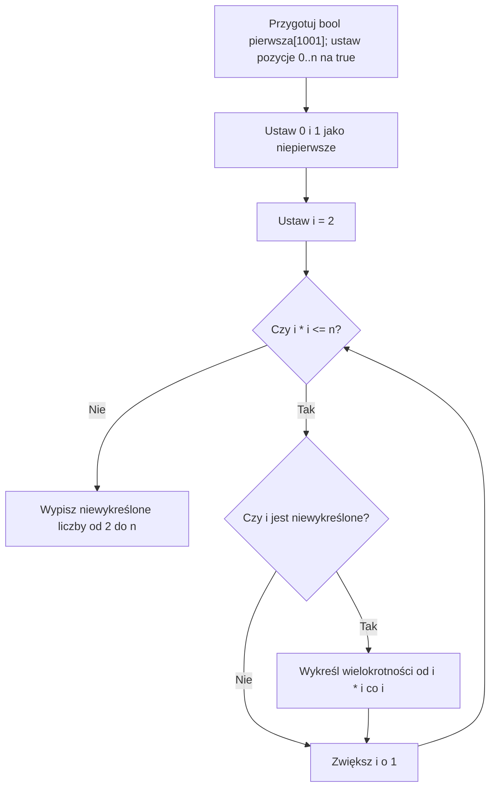

# Sito Eratostenesa - wyznaczanie liczb pierwszych

To lekcja dla złapania oddechu :) Zaczniemy od kartki i wykreślania liczb.

## Kartka z liczbami od 2 do 30

Wyobraź sobie kartkę z liczbami od 2 do 30. Chcemy zostawić na niej tylko liczby pierwsze.

**Liczba pierwsza** to liczba naturalna większa od 1, która ma dokładnie dwa dodatnie dzielniki: 1 i samą siebie. Liczba 1 **nie jest** pierwsza.

Liczba `1` ma tylko jeden dodatni dzielnik: `1`. Nie ma dwóch różnych dodatnich dzielników, więc nie jest pierwsza. Liczba naturalna większa od `1`, która nie jest pierwsza, jest złożona. `0` i `1` nie są ani pierwsze, ani złożone.

Spróbuj zostawić na kartce tylko liczby pierwsze.

<details markdown="1">
<summary>Podpowiedź do wykreślania na kartce</summary>

Zacznij od najmniejszej pozostałej liczby. Jej większe wielokrotności mają już znany dzielnik, więc można je wykreślić.

</details>

<details markdown="1">
<summary>Pokaż wykreślanie wielokrotności 2, 3 i 5</summary>

- Zakreślamy **2**. To liczba pierwsza. Skreślamy jej większe wielokrotności: 4, 6, 8, 10…
- Pierwsza nieskreślona liczba to **3**. Zakreślamy ją i skreślamy jej większe wielokrotności: 6, 9, 12, 15… Nie szkodzi, że część jest już skreślona.
- Następna nieskreślona liczba to **5**. Skreślamy jej większe wielokrotności.
- Pozostałe nieskreślone liczby to liczby pierwsze.

**Dlaczego to działa?** Każda liczba złożona ma dzielnik pierwszy. Kiedy dojdziemy do tego dzielnika, wykreślimy jej wielokrotność. Liczby pierwszej nie wykreślimy, bo nie jest wielokrotnością żadnej mniejszej liczby pierwszej.

</details>

<details markdown="1">
<summary>Pokaż tabelę nowych skreśleń i wynik dla zakresu do 30</summary>

| Etap | Nowo wykreślone liczby |
|---|---|
| Wielokrotności 2, od 4 | 4, 6, 8, 10, 12, 14, 16, 18, 20, 22, 24, 26, 28, 30 |
| Wielokrotności 3, od 9 | 9, 15, 21, 27 |
| Wielokrotności 5, od 25 | 25 |

**Wynik:** `2, 3, 5, 7, 11, 13, 17, 19, 23, 29`.

</details>

Na kartce można ponownie skreślić liczbę już skreśloną. Niczego to nie psuje. W programie pominiemy część takich powtórzeń, zaczynając od kwadratu wybranej liczby.

## Co chcemy osiągnąć?

Napiszemy program, który wypisze wszystkie liczby pierwsze od 2 do podanej liczby `n`. Zamiast dla każdej liczby osobno szukać dzielników, będziemy wykreślać liczby, o których już wiemy, że nie są pierwsze.

## Dwa usprawnienia, które warto zrozumieć

### Dlaczego zaczynamy od `i * i`?

Rundy uruchamiamy tylko dla niewykreślonego `i`. Wtedy `i` jest pierwsza. Każda mniejsza wielokrotność ma postać `i * k`, gdzie `2 <= k < i`. Taka liczba ma już mniejszy dzielnik pierwszy i została wykreślona w jego rundzie.

Dlatego można zacząć od `i * i`. Nie wykreślamy samego `i`.

<details markdown="1">
<summary>Pokaż przykłady dla i równego 5 i 7</summary>

Weźmy `i = 5`. Wielokrotności `5 * 2 = 10`, `5 * 3 = 15`, `5 * 4 = 20` już zostały wykreślone podczas pracy z mniejszymi dzielnikami. Pierwsza wielokrotność 5, którą **możemy dopiero teraz wykreślić**, to `5 * 5 = 25`.

Podobnie dla `i = 7`: liczby `7 * 2`, `7 * 3`, …, `7 * 6` mają mniejsze dzielniki i były już obsłużone. Zaczynamy od `7 * 7`.

</details>

### Dlaczego wystarczy sprawdzać `i * i <= n`?

Jeżeli liczba złożona `x` ma dwa czynniki `a * b = x`, to **przynajmniej jeden z nich nie jest większy od pierwiastka z `x`**. Gdyby oba były większe, ich iloczyn przekroczyłby `x`.

Dlatego każda liczba złożona nie większa od `n` zostanie wykreślona przez odpowiednio mały dzielnik. Nie musimy wykonywać kolejnych rund dla `i`, dla których `i * i > n`.

Dla `n = 30` wystarczą rundy wykreślania dla `2`, `3` i `5`. Pętla rozpatruje także `i = 4`, ale pomija jego rundę, bo `4` zostało już wykreślone.

Jeśli mały dzielnik liczby złożonej sam jest złożony, ma jeszcze mniejszy dzielnik pierwszy. Runda tego dzielnika też wykreśli badaną liczbę. Dlatego nie musimy uruchamiać rund dla wszystkich dzielników.

## Zakres danych i granice tablicy

W głównym programie przyjmujemy `0 <= n <= 1000`. Tworzymy `bool pierwsza[1001]`, czyli pozycje od `0` do `1000`. Liczba elementów tablicy musi być o jeden większa od największego używanego indeksu.

Dla `n = 0` i `n = 1` nie wypiszemy żadnej liczby pierwszej. Pozycje `0` i `1` fizycznie istnieją w tej tablicy także wtedy, gdy `n = 0`, więc obie można bezpiecznie ustawić na `false`. Nie odczytujemy nieustawionych pozycji ponad `n`.

Przy tym ograniczeniu pętla dochodzi najwyżej do sprawdzenia `32 * 32 = 1024`. To mieści się w `int`, również przy minimalnym zakresie gwarantowanym przez C++. Kolejny indeks `j` po ostatnim skreśleniu jest najwyżej równy `n + i`, czyli nie przekracza `1031`. Nie odczytujemy go, gdy przekracza `n`.

Przy znacznie większym zakresie `i * i` może się przepełnić już podczas sprawdzania warunku. Osobno trzeba wtedy sprawdzić rozmiar tablicy, obliczenie kwadratu i przyrost `j`. Samo zwiększenie liczby `1000` w programie nie wystarcza.

## Diagram działania

Zakładamy poprawne `n` z zakresu od `0` do `1000`.



## Pseudokod

```text
Wczytaj n z zakresu od 0 do 1000
Przygotuj tablicę pierwsza[1001]
Dla liczb od 0 do n ustaw: pierwsza = TAK
Ustaw pierwsza[0] = NIE oraz pierwsza[1] = NIE

Dla i od 2, dopóki i * i <= n:
    Jeżeli pierwsza[i] = TAK:
        Dla j od i * i do n, zwiększając j o i:
            Ustaw pierwsza[j] = NIE

Dla i od 2 do n:
    Jeżeli pierwsza[i] = TAK:
        Wypisz i
```

## Tablica oznaczeń w C++

Używamy zwykłej tablicy `bool`. Jej element przechowuje `true` albo `false`. `pierwsza[i]` jest informacją o liczbie `i`, nie samą liczbą.

Na początku `true` oznacza tylko, że liczba nie została jeszcze wykreślona. Po zakończeniu sita `true` oznacza już liczbę pierwszą. Pełny program znajdziesz w rozwiązaniu zadania D.

## Kiedy stosować sito?

Sito jest dobrym wyborem, gdy zadanie pyta o **wiele liczb pierwszych z jednego zakresu**. Rozpoznawaj takie polecenia jak:

- „Wypisz wszystkie liczby pierwsze nie większe od `n`”.
- „Policz, ile liczb pierwszych znajduje się od 1 do `n`”.
- „Dla wielu pytań sprawdź, czy liczba z zakresu od 1 do `n` jest pierwsza”.

Dla jednej małej liczby może wystarczyć zwykłe sprawdzenie dzielników. Nie każde zadanie dotyczące liczb pierwszych wymaga sita.

### Kiedy tego użyć?

Jeśli zadanie każe wyznaczyć wiele liczb pierwszych albo wielokrotnie sprawdzać pierwszość w tym samym niewielkim zakresie, można wykonać przygotowanie raz. Później korzystamy z tablicy oznaczeń zamiast ponownie szukać dzielników.

### Przykład - pytania o numery

Do urządzenia wpływa wiele pytań o numery z zakresu od `0` do `1000`. Numery mogą się powtarzać. Dla każdego numeru odpowiedz `TAK`, jeśli jest pierwszy, albo `NIE` w przeciwnym przypadku.

Przykładowe pytania to `1, 2, 9, 29, 30`. Wybierz metodę przygotowania odpowiedzi i podaj odpowiedź dla każdego z tych numerów. Treść nie podaje nazwy algorytmu.

<details markdown="1">
<summary>Podpowiedź do zadania o numerach</summary>

Zakres jest znany i niewielki. Co można obliczyć raz, aby powtarzające się pytania nie powodowały powtarzania tej samej pracy?

</details>

<details markdown="1">
<summary>Rozpoznanie problemu i odpowiedzi do zadania o numerach</summary>

- Numery mieszczą się w jednym znanym zakresie => wystarczy tablica oznaczeń dla całego zakresu.
- Pytań jest wiele i mogą się powtarzać => opłaca się wykorzystać raz wykonaną pracę.
- Pytanie dotyczy pierwszości => po przygotowaniu wystarczy odczyt `pierwsza[x]`.
- Wybieramy sito Eratostenesa do `1000`. `0` i `1` od razu oznaczamy jako niepierwsze.

| Numer | Odpowiedź |
| --- | --- |
| 1 | NIE |
| 2 | TAK |
| 9 | NIE |
| 29 | TAK |
| 30 | NIE |

Nie trzeba znać osobnej metody dla każdego pytania. Po przygotowaniu każde pytanie dotyczy tylko jednej zapisanej flagi.

</details>

### Kiedy wybrać coś innego?

- Jedna mała liczba => zwykłe sprawdzenie dzielników często wystarczy.
- Bardzo duża górna granica => tablica dla wszystkich liczb może nie zmieścić się w pamięci.
- Pytania wykraczają poza przygotowany zakres => nie można po prostu odczytać flagi spoza tablicy.

Sito przygotowuje odpowiedzi do ustalonej granicy. Nie jest automatyczną odpowiedzią na każde zadanie, w którym pojawia się liczba pierwsza.

## Dlaczego jest wydajne?

Proste podejście polega na sprawdzaniu kolejnych dzielników osobno dla każdej liczby. Sito raz wykreśla wielokrotności i zapamiętuje wynik dla całego zakresu.

- **Czas działania sita:** `O(n log log n)`.
- **Pamięć:** `O(n)`, bo przechowujemy tablicę oznaczeń.
- Po zbudowaniu sita sprawdzenie, czy `x` jest pierwsza, to jeden odczyt `pierwsza[x]`, czyli `O(1)` (dla `x` z przygotowanego zakresu).

Wadą sita jest konieczność przechowywania oznaczeń wszystkich liczb do `n`. Dla bardzo dużego `n` pamięć może stanowić problem.

Dla jednej liczby `x` sprawdzanie dzielników do jej pierwiastka zajmuje najwyżej `O(pierwiastek z x)` prób. Powtarzanie tego osobno dla wszystkich liczb do `n` daje proste oszacowanie `O(n * pierwiastek z n)`. Sito wykorzystuje wspólną pracę dla całego zakresu.

| Sposób | Przygotowanie liczb do `n` | Pamięć dodatkowa |
| --- | --- | --- |
| Osobne sprawdzanie dzielników każdej liczby | `O(n * pierwiastek z n)` | `O(1)` |
| Sito Eratostenesa | `O(n log log n)` | `O(n)` |

Odczyt `pierwsza[x]` jest poprawny tylko dla przygotowanych pozycji. W głównym programie są to liczby od `0` do `n`.

## Typowe błędy

- **Uznanie 1 za liczbę pierwszą.** Liczba pierwsza ma dokładnie dwa dodatnie dzielniki.
- **Wykreślanie samego `i`.** Wykreślamy jej większe wielokrotności, zaczynając od `i * i`.
- **Zapis `j++` zamiast `j = j + i`.** Trzeba przechodzić po wielokrotnościach liczby `i`.
- **Niedopasowany rozmiar tablicy.** Dla indeksów od 0 do 200 potrzeba 201 elementów.
- **Zapomnienie o `<= n`.** Liczba `n` również należy do badanego zakresu.
- **Mylenie `pierwsza[i]` z `i`.** Tablica przechowuje informację `true` lub `false`.

- Obliczanie `i * i` bez sprawdzenia zakresu typu przy dużych danych => ryzyko przepełnienia.
- Odczyt elementu spoza tablicy => błędne działanie mimo poprawnej idei sita.

## Ćwiczenia

### A. Ręczne wykreślanie liczb

Na kartce wypisz liczby od `2` do `20`. Wykreśl wielokrotności zgodnie z sitem. Zapisz osobno liczby nowo wykreślone w rundach `2` i `3`, a potem wszystkie pozostałe liczby. Czy potrzebna jest runda wykreślania dla `5`?

<details markdown="1">
<summary>Podpowiedź do zadania A</summary>

W rundzie `3` część wielokrotności już została wykreślona przez `2`. Sprawdź też, czy kwadrat `5` mieści się w zakresie.

</details>

<details markdown="1">
<summary>Rozwiązanie zadania A</summary>

- Runda `2`: nowo wykreślamy `4, 6, 8, 10, 12, 14, 16, 18, 20`.
- Runda `3`: nowo wykreślamy `9, 15`.
- Pozostają `2, 3, 5, 7, 11, 13, 17, 19`.

Runda `5` nie jest potrzebna, bo `5 * 5 = 25 > 20`. Liczba `5` pozostaje niewykreślona i zostanie wypisana.

</details>

### B. Wyjaśnianie kolejnych kroków

Sito działa do `n = 50`. Doszliśmy do niewykreślonego `i = 7`. Wyjaśnij, dlaczego pomijamy wielokrotności `14, 21, 28, 35, 42`. Podaj pierwszą wykreślaną wielokrotność w rundzie `7` i wszystkie nowe skreślenia tej rundy. Dlaczego nie potrzeba następnej rundy dla `i = 8`?

<details markdown="1">
<summary>Podpowiedź do zadania B</summary>

Mniejsze wielokrotności `7` mają drugi czynnik mniejszy od `7`. Znajdź dla nich mniejszy dzielnik pierwszy.

</details>

<details markdown="1">
<summary>Rozwiązanie zadania B</summary>

`14, 28, 42` mają dzielnik `2`, `21` ma dzielnik `3`, a `35` ma dzielnik `5`. Te liczby zostały już wykreślone.

Zaczynamy od `7 * 7 = 49`. To jedyne nowe skreślenie w tej rundzie, bo następna wielokrotność to `56`, poza zakresem. Dla `i = 8` warunek kończy pętlę: `8 * 8 = 64 > 50`.

</details>

### C. Analiza istniejącego kodu

Program nie pobiera danych. Podaj dokładny wydruk. Ile razy wykona się instrukcja `pierwsza[j] = false` dla `i = 2`, a ile dla `i = 3`? Dlaczego ostatnia pętla nie wypisze `0` i `1`, mimo że zaczyna od `0`?

```cpp
#include <iostream>
using namespace std;

int main() {
    bool pierwsza[11];
    for (int i = 0; i <= 10; i++) {
        pierwsza[i] = true;
    }
    pierwsza[0] = false;
    pierwsza[1] = false;

    for (int i = 2; i * i <= 10; i++) {
        if (pierwsza[i]) {
            for (int j = i * i; j <= 10; j = j + i) {
                pierwsza[j] = false;
            }
        }
    }

    int ile = 0;
    for (int i = 0; i <= 10; i++) {
        if (pierwsza[i]) {
            cout << i << '\n';
            ile++;
        }
    }
    cout << "Liczba: " << ile << '\n';
    return 0;
}
```

<details markdown="1">
<summary>Podpowiedź do zadania C</summary>

Zapisz kolejne wartości `j`. Nie myl liczby uruchomień całej rundy z liczbą kroków wewnętrznej pętli.

</details>

<details markdown="1">
<summary>Rozwiązanie zadania C</summary>

Wydruk:

```text
2
3
5
7
Liczba: 4
```

Dla `i = 2` wewnętrzna instrukcja wykonuje się cztery razy: przy `j = 4, 6, 8, 10`. Dla `i = 3` raz: przy `j = 9`. Pozycje `0` i `1` mają wartość `false`, więc nie spełniają warunku wypisywania.

</details>

### D. Samodzielna implementacja sita

Napisz program, który wczytuje `n` z zakresu od `0` do `1000` i wypisuje wszystkie liczby pierwsze od `2` do `n` w kolejności rosnącej. Użyj zwykłej tablicy `bool`.

Dla `n < 2` lista jest pusta. Wypisz wtedy tylko znak nowej linii. Dla wartości spoza zakresu wypisz `Nieprawidlowa wartosc n.`. Sprawdź program dla wejść `30`, `1` i `0`.

<details markdown="1">
<summary>Podpowiedź do zadania D</summary>

Przygotuj tablicę z miejscem na indeksy od `0` do `1000`. Ustaw pozycje od `0` do `n` na `true`, a `0` i `1` na `false`. Wykreślaj wielokrotności tylko wtedy, gdy wybrane `i` nie jest wykreślone.

</details>

<details markdown="1">
<summary>Rozwiązanie zadania D - pełny program i objaśnienia</summary>

```cpp
#include <iostream>
using namespace std;

int main() {
    int n;
    if (!(cin >> n)) {
        return 0;
    }

    if (n < 0 || n > 1000) {
        cout << "Nieprawidlowa wartosc n.\n";
        return 0;
    }

    bool pierwsza[1001];

    for (int i = 0; i <= n; i++) {
        pierwsza[i] = true;
    }
    pierwsza[0] = false;
    pierwsza[1] = false;

    for (int i = 2; i * i <= n; i++) {
        if (pierwsza[i]) {
            for (int j = i * i; j <= n; j = j + i) {
                pierwsza[j] = false;
            }
        }
    }

    for (int i = 2; i <= n; i++) {
        if (pierwsza[i]) {
            cout << i << " ";
        }
    }
    cout << "\n";
    return 0;
}
```

Dla wejścia `30` program wypisuje w jednej linii:

```text
2 3 5 7 11 13 17 19 23 29
```

Po każdej liczbie drukuje spację, a na końcu znak nowej linii. Dla wejść `0` i `1` wypisuje tylko nową linię. Ujemne `n` i wartości większe od `1000` odrzuca przed obliczeniami.

#### Jak czytać program?

- `pierwsza[i]` przechowuje informację o liczbie `i`, **nie** samą liczbę.
- Najpierw zakładamy, że wszystkie liczby mogą być pierwsze; potem wykreślamy 0 i 1.
- Zewnętrzna pętla wybiera kolejną liczbę `i`.
- Jeżeli `i` nie zostało wykreślone, wewnętrzna pętla skreśla `i*i`, `i*i+i`, `i*i+2*i` itd.
- Ostatnia pętla wypisuje tylko liczby, które pozostały.

- `#include <iostream>` udostępnia `cin` i `cout`. `using namespace std;` pozwala używać ich bez dopisywania `std::`.
- `main` jest początkiem programu, a `return 0;` kończy jego wykonanie.
- `cin >> n` wczytuje granicę. Warunek przed tablicą odrzuca nieudany odczyt i niepoprawny zakres.
- `bool pierwsza[1001]` rezerwuje pozycje od `0` do `1000`. Pierwsza pętla ustawia używane oznaczenia.
- `i++` przechodzi do następnej liczby. `j = j + i` przechodzi do następnej wielokrotności, a nie do sąsiedniego numeru.
- `pierwsza[j] = false` oznacza skreślenie. Ponowny zapis `false` nie zmienia poprawności.
- `cout` wypisuje niewykreślone liczby. Ostatnie `cout` kończy linię.

</details>

### E. Liczby pierwsze w przedziale

**Zadanie: Liczby pierwsze w przedziale**

Wczytaj dwie liczby `a` i `b`, dla których `2 <= a <= b <= 1000`. Wypisz wszystkie liczby pierwsze należące do przedziału od `a` do `b` i podaj ich liczbę.

Przykładowe wejście:

```text
10 20
```

<details markdown="1">
<summary>Podpowiedź do zadania E</summary>

Zbuduj sito do `b`. Zmień tylko ostatnią pętlę: nie zaczynaj wypisywania od 2, lecz od `a`.

</details>

<details markdown="1">
<summary>Rozwiązanie zadania E</summary>

```cpp
#include <iostream>
using namespace std;

int main() {
    int a, b;
    if (!(cin >> a >> b)) {
        return 0;
    }

    if (a < 2 || a > b || b > 1000) {
        cout << "Nieprawidlowy przedzial.\n";
        return 0;
    }

    bool pierwsza[1001];
    for (int i = 0; i <= b; i++) {
        pierwsza[i] = true;
    }
    pierwsza[0] = false;
    pierwsza[1] = false;

    for (int i = 2; i * i <= b; i++) {
        if (pierwsza[i]) {
            for (int j = i * i; j <= b; j = j + i) {
                pierwsza[j] = false;
            }
        }
    }

    int ile = 0;
    for (int i = a; i <= b; i++) {
        if (pierwsza[i]) {
            cout << i << " ";
            ile++;
        }
    }
    cout << "\nLiczba liczb pierwszych: " << ile << "\n";
    return 0;
}
```

Dla wejścia `10 20` wypisane liczby to `11, 13, 17, 19`, a druga linia to `Liczba liczb pierwszych: 4`.

Obie granice należą do przedziału. Sito przygotowujemy do `b`, a wypisywanie zaczynamy od `a`.

</details>

### F. Zadanie praktyczne - numery szafek

W szkole znajduje się **200 szafek**, ponumerowanych od 1 do 200. Specjalne oznaczenie mają otrzymać tylko szafki, których numer jest liczbą pierwszą.

Napisz program, który:

- wypisze numery oznaczonych szafek w kolejności rosnącej;
- policzy, ile szafek zostanie oznaczonych;
- wypisze otrzymaną liczbę.

Najpierw spróbuj zapisać algorytm własnymi słowami. Następnie napisz kod.

<details markdown="1">
<summary>Podpowiedź 1 do zadania F - jak przechowywać wynik sprawdzania?</summary>

Utwórz tablicę `bool pierwsza[201]`. Element o indeksie `i` informuje, czy numer `i` jest pierwszy.

</details>

<details markdown="1">
<summary>Podpowiedź 2 do zadania F - kiedy zwiększać licznik?</summary>

Zwiększaj licznik tylko wtedy, gdy w ostatniej pętli znajdujesz numer, który nie został wykreślony.

</details>

<details markdown="1">
<summary>Rozwiązanie zadania F - C++</summary>

```cpp
#include <iostream>
using namespace std;

int main() {
    bool pierwsza[201];

    for (int i = 0; i <= 200; i++) {
        pierwsza[i] = true;
    }
    pierwsza[0] = false;
    pierwsza[1] = false;

    for (int i = 2; i * i <= 200; i++) {
        if (pierwsza[i]) {
            for (int j = i * i; j <= 200; j = j + i) {
                pierwsza[j] = false;
            }
        }
    }

    int ile = 0;
    for (int i = 2; i <= 200; i++) {
        if (pierwsza[i]) {
            cout << i << " ";
            ile++;
        }
    }

    cout << "\nLiczba oznaczonych szafek: " << ile << "\n";
    return 0;
}
```

</details>

<details markdown="1">
<summary>Wynik do samokontroli</summary>

Liczb pierwszych od 1 do 200 jest **46**. Lista zaczyna się od `2, 3, 5`, a kończy na `197, 199`. Program wypisuje wszystkie te numery rosnąco, a potem `Liczba oznaczonych szafek: 46`.

</details>

## Ćwiczenie z debuggerem

Uruchom program z zadania D dla `n = 30`. Zatrzymaj go w debuggerze na instrukcji `pierwsza[j] = false`. Obserwuj `i`, `j`, `pierwsza[2]`, `pierwsza[9]` i `pierwsza[25]`.

Ustal, w których rundach `9` i `25` zmieniają oznaczenie na `false`. Dlaczego `2` pozostaje niewykreślone? Odczytaj flagi po wykonaniu instrukcji przypisania.

<details markdown="1">
<summary>Podpowiedź do ćwiczenia z debuggerem</summary>

Inicjalizacja już się zakończyła. Każda runda zaczyna od kwadratu niewykreślonego `i`.

</details>

<details markdown="1">
<summary>Rozwiązanie ćwiczenia z debuggerem</summary>

`9` zostaje wykreślone przy `i = 3`, `j = 9`. `25` przy `i = 5`, `j = 25`. Liczby `2` nie wykreślamy, bo pętla skreśla większe wielokrotności, zaczynając od kwadratu. Pierwsze skreślenie w rundzie `2` dotyczy `4`.

</details>

## Sprawdź, czy rozumiesz

- Dlaczego liczby 0 i 1 wykreślamy na początku?
- Dlaczego dla `i = 5` można zacząć od 25, a nie od 10?
- Dlaczego przy `n = 30` ostatnią potrzebną rundą jest 5?
- Co zmienisz w programie, jeżeli chcesz tylko **policzyć** liczby pierwsze, zamiast je wypisywać?
- Dlaczego nie warto budować sita do miliona, jeśli chcesz sprawdzić tylko jedną małą liczbę?

<details markdown="1">
<summary>Podpowiedź do pytań kontrolnych</summary>

Wróć do definicji liczby pierwszej, znaczenia indeksów i dwóch usprawnień wykreślania.

</details>

<details markdown="1">
<summary>Odpowiedzi do pytań</summary>

- Nie są liczbami pierwszymi.
- Wielokrotności 5 mniejsze od 25 zostały już wykreślone dzięki mniejszym dzielnikom.
- `5 * 5 <= 30`, ale `6 * 6 > 30`.
- Zwiększysz licznik przy każdym `pierwsza[i] == true` i wypiszesz licznik na końcu.
- Sito wymaga przygotowania całej tablicy i dodatkowej pamięci; proste sprawdzenie dzielników jednej małej liczby jest wystarczające.

</details>

**Zapamiętaj:** sito Eratostenesa nie szuka dzielników każdej liczby osobno. Wykreśla wielokrotności i wykorzystuje wcześniej wykonaną pracę.
