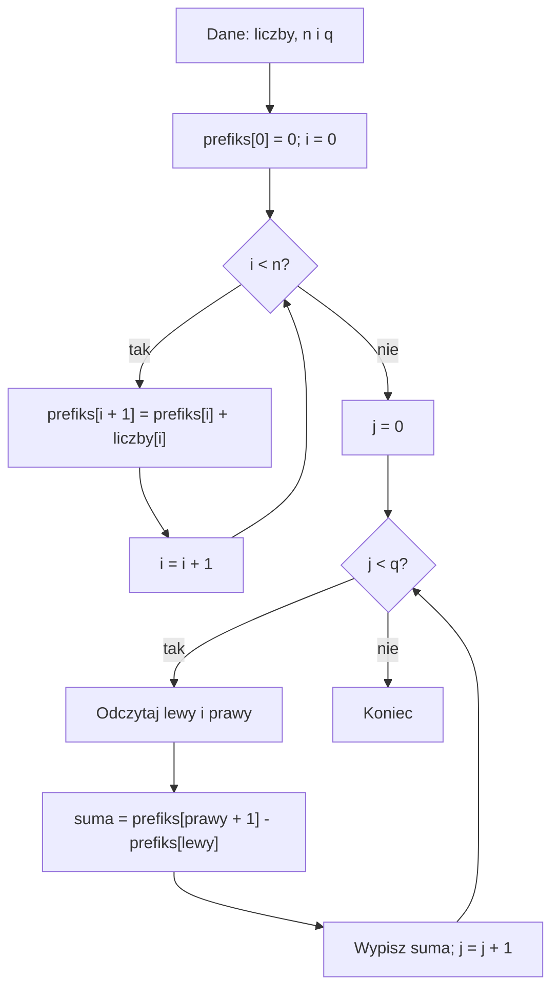

# Sumy prefiksowe - wprowadzenie

## Cel lekcji

Nauczysz się szybko obliczać sumę kolejnych elementów tablicy. Najpierw zapiszesz sumy od początku tablicy. Potem odpowiesz na każde pytanie o fragment za pomocą jednego odejmowania.

Potrzebujesz zwykłych tablic, zmiennych typu `int` i pętli `for`. Przyda się też znajomość indeksów od `0` do `n - 1`.

## Problem: wciąż dodajemy te same liczby

Na półce stoją pudełka. W tablicy zapisano liczbę przedmiotów w każdym pudełku. Pytamy o łączną liczbę przedmiotów w kilku kolejnych pudełkach.

Jedno pytanie łatwo obsłużyć pętlą. Przy wielu pytaniach te same liczby dodajemy wielokrotnie. Chcemy wykonać część pracy raz i wykorzystać ją ponownie.

## Kiedy tego użyć?

Sumy prefiksowe warto rozważyć, gdy:

- mamy jedną tablicę i wiele pytań;
- każde pytanie dotyczy sumy spójnego fragmentu, czyli kolejnych elementów bez pomijania pozycji;
- wartości tablicy nie zmieniają się między pytaniami.

W treści zadania szukaj sformułowań: „od dnia do dnia”, „między dwiema godzinami”, „suma na przedziale”. Sprawdź, czy granice należą do przedziału. Sprawdź też, czy podano indeksy od `0`, czy numery pozycji od `1`.

Przykłady zastosowań to sprzedaż biletów w wybranym okresie, suma opadów i punkty zdobyte w kolejnych rundach. Taką technikę można wykorzystać również w zadaniu maturalnym o sumach fragmentów danych. O wyborze metody decyduje treść i rozmiar danych, a nie sama nazwa zadania.

## Kiedy wybrać coś innego?

- Jedno pytanie o krótki fragment => zwykła pętla może wystarczyć.
- Częste zmiany wartości => trzeba uwzględnić koszt aktualizacji prefiksów. Zwykłe sumy prefiksowe nie dają wtedy od razu szybkich odpowiedzi.
- Pytania o minimum lub maksimum => nie można po prostu odjąć dwóch zapisanych minimów lub maksimów.
- Pytania o dowolne, rozrzucone pozycje => jeden przedział nie opisuje takiego zbioru.

## Przykład 1 - pięć pudełek

Mamy tablicę `liczby`:

| Indeks | 0 | 1 | 2 | 3 | 4 |
| --- | ---: | ---: | ---: | ---: | ---: |
| Liczba przedmiotów | 3 | 1 | 4 | 2 | 5 |

Oblicz sumę elementów o indeksach od `1` do `3` włącznie. Najpierw spróbuj zrobić to zwykłą pętlą.

<details markdown="1">
<summary>Wskazówka do przykładu 1</summary>

Potrzebujesz elementów `liczby[1]`, `liczby[2]` i `liczby[3]`. Zacznij od sumy równej `0`. Dodawaj elementy aż do prawej granicy włącznie.

</details>

<details markdown="1">
<summary>Rozwiązanie przykładu 1 - zwykłe sumowanie</summary>

Dodajemy `1 + 4 + 2 = 7`.

```cpp
#include <iostream>

using namespace std;

int main()
{
    int liczby[5] = {3, 1, 4, 2, 5};
    int lewy = 1;
    int prawy = 3;
    int suma = 0;

    for (int i = lewy; i <= prawy; i++)
    {
        suma = suma + liczby[i];
    }

    cout << suma << '\n';
    return 0;
}
```

Program nie pobiera danych. Wypisuje:

```text
7
```

Pętla działa poprawnie. Jej koszt zależy jednak od długości przedziału. Przy następnym pytaniu znów zaczynamy dodawanie od zera.

</details>

## Pomysł: zapamiętaj sumę od początku

Idziesz wzdłuż półki. Po każdym pudełku zapisujesz, ile przedmiotów naliczyłeś łącznie od początku. Nie zapisujesz liczby tylko z ostatniego pudełka. Zapisujesz dotychczasową sumę.

Taką sumę początkowego fragmentu nazywamy **sumą prefiksową**. Prefiks to po prostu początek ciągu.

Utwórz tablicę `prefiks` o `n + 1` elementach:

- `prefiks[0]` to `0`, bo suma zera elementów wynosi `0`;
- `prefiks[1]` to suma pierwszego elementu;
- `prefiks[2]` to suma pierwszych dwóch elementów;
- `prefiks[k]` to suma pierwszych `k` elementów;
- `prefiks[n]` to suma całej tablicy.

Indeks w tablicy `prefiks` oznacza **liczbę uwzględnionych elementów**. Nie jest ostatnim indeksem w tablicy `liczby`.

Każdą następną sumę otrzymujemy przez dodanie jednej liczby:

```text
prefiks[i + 1] = prefiks[i] + liczby[i]
```

<details markdown="1">
<summary>Pokaż budowę prefiksów dla przykładu 1</summary>

| Liczba elementów `k` | 0 | 1 | 2 | 3 | 4 | 5 |
| --- | ---: | ---: | ---: | ---: | ---: | ---: |
| `prefiks[k]` | 0 | 3 | 4 | 8 | 10 | 15 |

Zaczynamy od `0`. Kolejno dodajemy `3`, `1`, `4`, `2` i `5`. Na przykład `prefiks[4] = 3 + 1 + 4 + 2 = 10`.

</details>

## Jak wydzielić środek tablicy?

Chcemy sumę od indeksu `lewy` do indeksu `prawy` włącznie.

`prefiks[prawy + 1]` zawiera cały potrzebny fragment, ale również elementy stojące przed nim. Suma tych wcześniejszych elementów to `prefiks[lewy]`. Wystarczy ją odjąć:

```text
suma = prefiks[prawy + 1] - prefiks[lewy]
```

Przedział musi spełniać `0 <= lewy <= prawy < n`.

<details markdown="1">
<summary>Pokaż obliczenie dla przykładu 1</summary>

Dla indeksów od `1` do `3`:

```text
prefiks[4] - prefiks[1] = 10 - 3 = 7
```

Suma pierwszych czterech elementów zawiera indeksy `0`, `1`, `2`, `3`. Odejmujemy sumę pierwszego elementu, czyli indeks `0`. Zostają dokładnie indeksy `1`, `2`, `3`.

</details>

## Pseudokod

Zakładamy poprawne dane: `n >= 1`, tablicę `liczby` długości `n` oraz `q` poprawnych zapytań o indeksy od `0`.

```text
utwórz tablicę prefiks o n + 1 elementach
prefiks[0] = 0

dla i od 0 do n - 1:
    prefiks[i + 1] = prefiks[i] + liczby[i]

dla każdego z q zapytań:
    odczytaj lewy i prawy
    suma = prefiks[prawy + 1] - prefiks[lewy]
    wypisz suma
```

## Schemat działania



Najpierw budujemy wszystkie prefiksy jedną pętlą. Dopiero potem obsługujemy pytania drugą pętlą. Nie budujemy prefiksów ponownie przed każdym pytaniem.

## Samodzielna implementacja

W C++ rozmiar zwykłej tablicy musi być znany podczas kompilacji. W przykładzie mamy pięć liczb, więc tworzymy `liczby[5]` i `prefiks[6]`.

<details markdown="1">
<summary>Rozwiązanie przykładu 1 - program z sumami prefiksowymi</summary>

```cpp
#include <iostream>

using namespace std;

int main()
{
    const int n = 5;
    int liczby[n] = {3, 1, 4, 2, 5};
    int prefiks[n + 1];
    prefiks[0] = 0;

    for (int i = 0; i < n; i++)
    {
        prefiks[i + 1] = prefiks[i] + liczby[i];
    }

    for (int k = 0; k <= n; k++)
    {
        cout << prefiks[k] << '\n';
    }

    int lewy = 1;
    int prawy = 3;
    int suma = prefiks[prawy + 1] - prefiks[lewy];
    cout << "Suma: " << suma << '\n';
    return 0;
}
```

Program nie pobiera danych. Wypisuje kolejne prefiksy, a następnie odpowiedź:

```text
0
3
4
8
10
15
Suma: 7
```

Pierwsza pętla wypełnia pozycje od `1` do `n`. Pozycję `0` ustawiliśmy wcześniej. Każda wartość jest więc zapisana, zanim zostanie odczytana.

</details>

## Dlaczego algorytm jest poprawny?

Zaczynamy od `prefiks[0] = 0`. To poprawna suma zera elementów.

Załóżmy, że `prefiks[i]` jest już poprawną sumą pierwszych `i` elementów. Dodanie `liczby[i]` dołącza dokładnie następny element. Otrzymujemy więc poprawną sumę pierwszych `i + 1` elementów. Pętla powtarza ten krok dla wszystkich pozycji.

Po zbudowaniu tablicy `prefiks[prawy + 1]` obejmuje elementy od `0` do `prawy`. `prefiks[lewy]` obejmuje elementy od `0` do `lewy - 1`. Odejmowanie usuwa wspólny początek. Zostają tylko elementy od `lewy` do `prawy`.

Gdy `lewy = 0`, odejmujemy `prefiks[0]`, czyli `0`. Nie potrzebujemy osobnego warunku dla początku tablicy.

To rozumowanie działa również dla zer i liczb ujemnych. Nie wymaga rosnących wartości prefiksów. Wymaga natomiast, aby działania mieściły się w użytym typie liczbowym.

## Przykład 2 - wiele pytań o sprzedaż biletów

Kino zapisuje liczbę sprzedanych biletów w kolejnych dniach. Dla każdego pytania oblicz sprzedaż od dnia `a` do dnia `b` włącznie.

Tym razem dni są numerowane **od 1**. Dzień `a` odpowiada indeksowi `a - 1` w tablicy danych. Dzień `b` odpowiada indeksowi `b - 1`. Dlatego wzór ma postać:

```text
suma = prefiks[b] - prefiks[a - 1]
```

Nie zmieniliśmy znaczenia `prefiks[k]`. Nadal oznacza sumę pierwszych `k` elementów.

### Dane wejściowe

- Pierwszy wiersz zawiera `n` i `q`: liczbę dni i liczbę pytań. Obie liczby należą do zakresu od `1` do `100`.
- Drugi wiersz zawiera `n` liczb biletów. Każda należy do zakresu od `0` do `100`.
- Każdy z kolejnych `q` wierszy zawiera `a` i `b`, gdzie `1 <= a <= b <= n`.

Dla każdego pytania wypisz jedną sumę w osobnym wierszu.

```text
7 4
4 2 7 1 3 5 6
1 3
3 5
2 7
5 5
```

Spróbuj obliczyć wyniki przed otwarciem rozwiązania.

<details markdown="1">
<summary>Wskazówka do przykładu 2</summary>

Zbuduj prefiksy tylko raz. Pytanie `1 3` wymaga odjęcia `prefiks[0]` od `prefiks[3]`. Pytanie `5 5` dotyczy jednego dnia, a nie pustego przedziału.

</details>

<details markdown="1">
<summary>Rozwiązanie przykładu 2 - obliczenia i wyniki</summary>

| Liczba dni `k` | 0 | 1 | 2 | 3 | 4 | 5 | 6 | 7 |
| --- | ---: | ---: | ---: | ---: | ---: | ---: | ---: | ---: |
| `prefiks[k]` | 0 | 4 | 6 | 13 | 14 | 17 | 22 | 28 |

| Pytanie | Odejmowanie prefiksów | Kontrola zwykłym dodawaniem | Wynik |
| --- | --- | --- | ---: |
| `1 3` | `13 - 0` | `4 + 2 + 7` | 13 |
| `3 5` | `17 - 6` | `7 + 1 + 3` | 11 |
| `2 7` | `28 - 4` | `2 + 7 + 1 + 3 + 5 + 6` | 24 |
| `5 5` | `17 - 14` | `3` | 3 |

Wyjście:

```text
13
11
24
3
```

</details>

<details markdown="1">
<summary>Rozwiązanie przykładu 2 - pełny program C++</summary>

```cpp
#include <iostream>

using namespace std;

int main()
{
    const int MAKS = 100;
    int liczby[MAKS];
    int prefiks[MAKS + 1];
    int n;
    int q;

    if (!(cin >> n >> q))
    {
        return 0;
    }
    if (n < 1 || n > MAKS || q < 1 || q > 100)
    {
        return 0;
    }

    for (int i = 0; i < n; i++)
    {
        if (!(cin >> liczby[i]) || liczby[i] < 0 || liczby[i] > 100)
        {
            return 0;
        }
    }

    prefiks[0] = 0;
    for (int i = 0; i < n; i++)
    {
        prefiks[i + 1] = prefiks[i] + liczby[i];
    }

    for (int j = 0; j < q; j++)
    {
        int a;
        int b;
        if (!(cin >> a >> b) || a < 1 || a > b || b > n)
        {
            return 0;
        }
        cout << prefiks[b] - prefiks[a - 1] << '\n';
    }

    return 0;
}
```

Tablica `liczby` ma miejsce na `100` wartości. Używamy tylko pierwszych `n`. Tablica `prefiks` ma o jedną pozycję więcej.

Program kończy pracę, gdy nie uda się wczytać danych lub liczby wykraczają poza podane ograniczenia. Nie odczytuje wtedy elementu spoza tablicy.

Oryginalna tablica ułatwia porównanie danych z prefiksami. Jeśli potrzebne są wyłącznie sumy przedziałów, można też budować prefiksy w czasie wczytywania i nie zachowywać tablicy danych.

</details>

## Wydajność

Niech `n` oznacza liczbę elementów, a `q` liczbę pytań.

| Metoda | Przygotowanie | Jedno pytanie | Cała praca dla `q` pytań | Pamięć dodatkowa poza tablicą danych |
| --- | --- | --- | --- | --- |
| Zwykła pętla | `O(1)` | `O(długości przedziału)`, najwyżej `O(n)` | `O(n * q)` w najgorszym przypadku | `O(1)` |
| Sumy prefiksowe | `O(n)` | `O(1)` | `O(n + q)` | `O(n)` |

Budujemy `n` kolejnych prefiksów. Każde pytanie wymaga potem dwóch odczytów tablicy i jednego odejmowania. Nie przechodzimy przez elementy wybranego fragmentu.

Dla `100` pytań o całą tablicę `100` liczb zwykła metoda wykonuje `10 000` dodawań. Metoda prefiksowa wykonuje `100` dodawań podczas przygotowania i `100` odejmowań podczas odpowiedzi. To liczba podstawowych działań, a nie obietnica konkretnego czasu wykonania.

Zapis `O(n)` dla pamięci opisuje rodzinę zadań, w której rozmiar tablicy pomocniczej rośnie wraz z `n`. W pokazanych programach rezerwujemy z góry miejsce na najwyżej `101` prefiksów.

## Zakres typu int

`int` ma ograniczony zakres. W typowym środowisku z 32-bitowym `int` jest to od `-2 147 483 648` do `2 147 483 647`. Sam standard C++ dopuszcza też mniejszy zakres.

Dlatego w tej lekcji ograniczamy dane: najwyżej `100` wartości, każda najwyżej `100`. Największa suma to `100 * 100 = 10 000`. Mieszczą się wszystkie prefiksy i wszystkie odpowiedzi, także w minimalnym zakresie gwarantowanym dla `int`.

W innym zadaniu sprawdź ograniczenia ponownie. To, że pojedynczy element mieści się w `int`, nie oznacza, że zmieści się suma. Poprawny musi być zakres każdego dodawania przy budowie prefiksów oraz odejmowania przy odpowiedzi. Przy liczbach ujemnych nie wystarczy sprawdzić tylko sumy całej tablicy.

Przepełnienie typu `int` ze znakiem nie daje wiarygodnego wyniku. Nie zakładaj, że licznik po prostu zacznie od początku zakresu. Jeśli ograniczenia są większe, trzeba dobrać odpowiednio pojemny typ, zanim rozpocznie się obliczenia.

## Typowe błędy

- Brak `prefiks[0] = 0` => pierwsze dodawanie korzysta z nieustawionej wartości.
- Tablica `prefiks` ma tylko `n` elementów => zapis do `prefiks[n]` wychodzi poza tablicę.
- Użycie `prefiks[prawy]` zamiast `prefiks[prawy + 1]` dla indeksów od `0` => pominięcie prawego końca.
- Użycie indeksów od `0` w zadaniu z numerami dni od `1` => inny fragment niż wymagany.
- Warunek `i <= n` podczas budowy => próba odczytania nieistniejącego `liczby[n]`.
- Budowanie prefiksów przed każdym pytaniem => utrata korzyści czasowej.
- Zmiana elementu bez ponownego obliczenia odpowiednich prefiksów => odpowiedzi dotyczą starych danych.
- Dobór typu na podstawie jednej wartości zamiast całego obliczenia => ryzyko przepełnienia.

## Ćwiczenia końcowe

### Ćwiczenie 1 - zera i liczby ujemne

Bez pisania programu zbuduj tablicę prefiksów dla `2, -3, 5, 0, -1, 4`. Oblicz sumy dla indeksów `0..5`, `1..4`, `3..3` i `2..5`. Obie granice należą do przedziału. Sprawdź wyniki zwykłym dodawaniem.

<details markdown="1">
<summary>Wskazówka do ćwiczenia 1</summary>

Pierwszy prefiks to `0`. Ujemny element może zmniejszyć następną sumę. To nie psuje algorytmu. Dla przedziału `3..3` odejmij `prefiks[3]` od `prefiks[4]`.

</details>

<details markdown="1">
<summary>Rozwiązanie ćwiczenia 1</summary>

| `k` | 0 | 1 | 2 | 3 | 4 | 5 | 6 |
| --- | ---: | ---: | ---: | ---: | ---: | ---: | ---: |
| `prefiks[k]` | 0 | 2 | -1 | 4 | 4 | 3 | 7 |

- `0..5`: `prefiks[6] - prefiks[0] = 7 - 0 = 7`. Kontrola: `2 - 3 + 5 + 0 - 1 + 4 = 7`.
- `1..4`: `prefiks[5] - prefiks[1] = 3 - 2 = 1`. Kontrola: `-3 + 5 + 0 - 1 = 1`.
- `3..3`: `prefiks[4] - prefiks[3] = 4 - 4 = 0`. Kontrola: jeden element o wartości `0`.
- `2..5`: `prefiks[6] - prefiks[2] = 7 - (-1) = 8`. Kontrola: `5 + 0 - 1 + 4 = 8`.

</details>

### Ćwiczenie 2 - opady w wybranym okresie

Stacja zapisuje całkowitą liczbę milimetrów opadu w kolejnych dniach. Napisz program odpowiadający na pytania o sumę opadów od dnia `a` do dnia `b` włącznie.

Format danych i ograniczenia są takie jak w przykładzie 2: `1 <= n, q <= 100`, opad od `0` do `100` i `1 <= a <= b <= n`. Wypisz każdą odpowiedź w osobnym wierszu. Użyj zwykłej tablicy, `int` i sum prefiksowych.

Wejście:

```text
6 4
2 0 5 3 1 4
1 6
2 4
3 3
5 6
```

<details markdown="1">
<summary>Wskazówka do ćwiczenia 2</summary>

Zerowy opad nie wymaga osobnego warunku. Dla dni numerowanych od `1` użyj różnicy `prefiks[b] - prefiks[a - 1]`. Prefiksy oblicz raz, przed pętlą pytań.

</details>

<details markdown="1">
<summary>Rozwiązanie ćwiczenia 2</summary>

Prefiksy to `0, 2, 2, 7, 10, 11, 15`.

```cpp
#include <iostream>

using namespace std;

int main()
{
    const int MAKS = 100;
    int opady[MAKS];
    int prefiks[MAKS + 1];
    int n;
    int q;

    if (!(cin >> n >> q))
    {
        return 0;
    }
    if (n < 1 || n > MAKS || q < 1 || q > 100)
    {
        return 0;
    }

    for (int i = 0; i < n; i++)
    {
        if (!(cin >> opady[i]) || opady[i] < 0 || opady[i] > 100)
        {
            return 0;
        }
    }

    prefiks[0] = 0;
    for (int i = 0; i < n; i++)
    {
        prefiks[i + 1] = prefiks[i] + opady[i];
    }

    for (int j = 0; j < q; j++)
    {
        int a;
        int b;
        if (!(cin >> a >> b) || a < 1 || a > b || b > n)
        {
            return 0;
        }
        cout << prefiks[b] - prefiks[a - 1] << '\n';
    }

    return 0;
}
```

Wyjście:

```text
15
8
5
5
```

Kontrola: `2 + 0 + 5 + 3 + 1 + 4 = 15`, `0 + 5 + 3 = 8`, `5 = 5` oraz `1 + 4 = 5`.

Budowa zajmuje `O(n)`, a wszystkie pytania `O(q)`. Łącznie jest to `O(n + q)` czasu i `O(n)` pamięci na prefiksy.

</details>

### Ćwiczenie 3 - obserwacja w debuggerze

Uruchom w debuggerze program z sumami prefiksowymi z przykładu 1. Ustaw punkt przerwania na instrukcji `prefiks[i + 1] = prefiks[i] + liczby[i];`.

Obserwuj `i`, `liczby[i]`, `prefiks[i]` i `prefiks[i + 1]`. Zapisz ich wartości po wykonaniu każdego dodawania. Wyjaśnij, dlaczego ostatni zapis trafia do `prefiks[5]`, a nie do `prefiks[4]`.

Na końcu sprawdź odejmowanie dla indeksów `1..3`. Co oznaczają oba odczytane prefiksy?

<details markdown="1">
<summary>Wskazówka do ćwiczenia 3</summary>

Przed wykonaniem dodawania nowa pozycja `prefiks[i + 1]` nie ma jeszcze ustalonej wartości. Odczytaj ją dopiero po wykonaniu instrukcji. Po ostatnim dodawaniu nie wykonuj już podglądu `liczby[i]`, gdy pętla zakończy się z `i = n`.

</details>

<details markdown="1">
<summary>Rozwiązanie ćwiczenia 3</summary>

Przed pętlą `prefiks[0] = 0`. Po kolejnych dodawaniach:

| `i` w wykonanej instrukcji | `liczby[i]` | Dotychczasowy `prefiks[i]` | Zapisany `prefiks[i + 1]` |
| --- | ---: | ---: | ---: |
| 0 | 3 | 0 | 3 |
| 1 | 1 | 3 | 4 |
| 2 | 4 | 4 | 8 |
| 3 | 2 | 8 | 10 |
| 4 | 5 | 10 | 15 |

Ostatni przetwarzany element ma indeks `4`. Po jego dodaniu znamy sumę pięciu elementów, więc zapisujemy ją do `prefiks[5]`. Tablica prefiksów ma sześć pozycji: od `0` do `5`.

Dla indeksów `1..3` odczytujemy `prefiks[4] = 10` i `prefiks[1] = 3`. Pierwszy obejmuje cztery początkowe elementy. Drugi obejmuje jeden początkowy element. Ich różnica wynosi `7`.

Zmienna `i` jest zadeklarowana wewnątrz pętli `for`. Po wyjściu z pętli przestaje być dostępna. Ostatni poprawny podgląd jej wartości wewnątrz ciała pętli dotyczy `i = 4`.

</details>

## Co sprawdzić we własnym rozwiązaniu?

- Jeden element w przedziale.
- Przedział od początku tablicy.
- Przedział do końca tablicy.
- Całą tablicę.
- Zera i liczby ujemne, jeśli treść zadania je dopuszcza.
- Największą dopuszczalną sumę.

Podstawowy wzór dla indeksów od `0` to `prefiks[prawy + 1] - prefiks[lewy]`. Najpierw sprawdź numerację i ograniczenia danych. Dopiero potem podstawiaj liczby.
