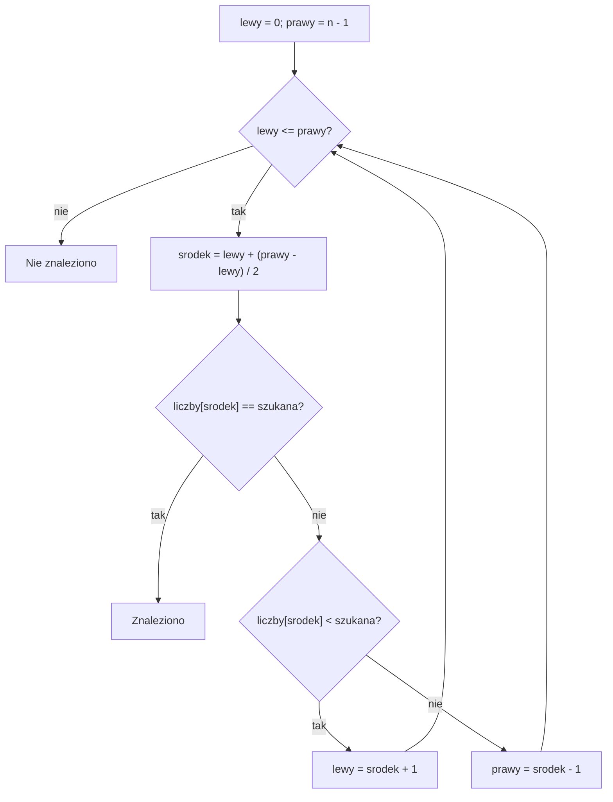

# Wyszukiwanie binarne (Binary Search)


## Zgadnij moją liczbę

Pomyślałem liczbę od **1 do 100**. Odpowiadam tylko: „za mało”, „za dużo” albo „trafione”.

Można pytać kolejno: 1, 2, 3, 4… To jednak powolne. Zamiast tego sprawdzamy liczbę **pośrodku pozostałego zakresu**.

Załóżmy, że szukam liczby **65**:


<details markdown="1">
<summary>Wskazówka do zgadywania liczby</summary>

Za każdym razem wybierz środek zakresu, który jeszcze pozostał. Sprawdzoną liczbę także odrzucasz, jeśli odpowiedź nie brzmi „trafione”.

</details>

<details markdown="1">
<summary>Pokaż zgadywanie liczby 65 krok po kroku</summary>

| Próba | Pozostały zakres | Pytam o | Odpowiedź | Co robię dalej? |
|---|---|---:|---|---|
| 1 | 1-100 | 50 | Za mało | Zostają 51-100 |
| 2 | 51-100 | 75 | Za dużo | Zostają 51-74 |
| 3 | 51-74 | 62 | Za mało | Zostają 63-74 |
| 4 | 63-74 | 68 | Za dużo | Zostają 63-67 |
| 5 | 63-67 | 65 | Trafione | Koniec |

**Dlaczego to działa?** Jeśli moja liczba jest większa niż 50, to **żadna liczba od 1 do 50 nie może być odpowiedzią**. Nie zgadujemy: odrzucamy możliwości, które na pewno są błędne.

</details>

Gdy usłyszysz „za dużo”, dlaczego nie trzeba już sprawdzać większych liczb?

<details markdown="1">
<summary>Odpowiedź do pytania o zbyt dużą liczbę</summary>

Jeśli sprawdzana liczba jest za duża, każda większa też jest za duża. Odrzucamy sprawdzaną liczbę i wszystkie większe. W przeciwną stronę działa odpowiedź „za mało”.

</details>

## Czego nauczysz się na tej lekcji?

Po lekcji będziesz umieć:

- wyjaśnić, dlaczego wyszukiwanie binarne odrzuca połowę możliwości;
- znaleźć liczbę w **uporządkowanej** tablicy;
- zrozumieć znaczenie zmiennych `lewy`, `prawy` i `srodek`;
- rozpoznać w zadaniu warunek pozwalający stosować tę metodę;
- porównać wyszukiwanie liniowe i binarne;
- zastosować tę samą ideę do szukania **najmniejszego wyniku spełniającego warunek**.

> **Myśl przewodnia:** Nie trzeba sprawdzać wszystkich możliwości po kolei, jeśli po jednej próbie potrafimy wykluczyć całą połowę.

## Co oznaczają lewy, prawy i srodek?

W zgadywaniu granice opisują możliwe wartości liczby. W tablicy będą oznaczać indeksy:

| Zmienna | Znaczenie |
| --- | --- |
| `lewy` | Pierwszy indeks, pod którym odpowiedź może jeszcze wystąpić |
| `prawy` | Ostatni indeks, pod którym odpowiedź może jeszcze wystąpić |
| `srodek` | Indeks wybrany do sprawdzenia w obecnym przedziale |
| `liczby[srodek]` | Wartość elementu, którą porównujemy z szukaną liczbą |

Przedział jest domknięty: obejmuje zarówno `lewy`, jak i `prawy`. Dla `n` elementów zaczynamy od indeksów `0` i `n - 1`.

### Jak bezpiecznie obliczyć środek?

```cpp
int srodek = lewy + (prawy - lewy) / 2;
```

Najpierw liczymy odległość między granicami. Dzielimy ją całkowicie przez `2`, a otrzymaną połowę dodajemy do lewej granicy. Przy nieparzystej odległości wybieramy niższy z dwóch środkowych indeksów.

Nie dodajemy do siebie obu dużych indeksów. Dzięki temu unikamy przepełnienia, które mogłoby powstać przy ich sumowaniu. Dla nieujemnych granic używanych w tej lekcji i `lewy <= prawy` środek mieści się między granicami.

Programy korzystają z małych danych. Tablice w ćwiczeniach mają najwyżej `100` elementów, a ich wartości mieszczą się od `-1000` do `1000`. W przykładach z pojemnością rozpatrujemy dodatnie liczby nie większe niż `1000`. Wszystkie działania mieszczą się w `int`, także przy jego minimalnym zakresie gwarantowanym przez C++.

## Przykład 1 - znajdź liczbę w tablicy

Dane są liczby **uporządkowane rosnąco**:

| Indeks | 0 | 1 | 2 | 3 | 4 | 5 | 6 |
|---|---:|---:|---:|---:|---:|---:|---:|
| Liczba | 2 | 5 | 8 | 12 | 16 | 20 | 25 |

Szukamy liczby **16**.


Zapisz kolejne granice i środki, zanim rozwiniesz rozwiązanie.

<details markdown="1">
<summary>Wskazówka do przykładu 1</summary>

Porównuj wartość `liczby[srodek]` z szukaną liczbą. Po nieudanej próbie środek nie należy już do nowego przedziału.

</details>

<details markdown="1">
<summary>Rozwiązanie przykładu 1 - kolejne kroki</summary>

- Początek: `lewy = 0`, `prawy = 6`. Środek: `0 + (6 - 0) / 2 = 3`. W tablicy pod indeksem 3 jest **12**.
- Ponieważ `12 < 16`, odrzucamy indeksy **0-3**. Nowy początek: `lewy = 4`.
- Teraz `lewy = 4`, `prawy = 6`. Środek: `4 + (6 - 4) / 2 = 5`. W tablicy jest **20**.
- Ponieważ `20 > 16`, odrzucamy indeksy **5-6**. Nowy koniec: `prawy = 4`.
- Środek `4 + (4 - 4) / 2 = 4`. Odczytujemy **16**. Znaleziono!

</details>

**Zauważ:** `lewy`, `prawy` i `srodek` to **indeksy**, a nie liczby zapisane w tablicy.

## Przykład 2 - szukanie liczby 15

Ta sama tablica: `2, 5, 8, 12, 16, 20, 25`. Szukamy **15**.


Prześledź szukanie do znalezienia liczby albo opróżnienia przedziału.

<details markdown="1">
<summary>Wskazówka do przykładu 2</summary>

Nie kończ tylko dlatego, że został jeden indeks. Sprawdź go. Brak wyniku stwierdzamy dopiero, gdy `lewy > prawy`.

</details>

<details markdown="1">
<summary>Rozwiązanie przykładu 2</summary>

| Krok | `lewy` | `prawy` | `srodek` | `liczby[srodek]` | Decyzja |
|---|---:|---:|---:|---:|---|
| 1 | 0 | 6 | 3 | 12 | Za mało: `lewy = 4` |
| 2 | 4 | 6 | 5 | 20 | Za dużo: `prawy = 4` |
| 3 | 4 | 4 | 4 | 16 | Za dużo: `prawy = 3` |

Teraz `lewy = 4`, a `prawy = 3`. Warunek `lewy <= prawy` nie jest spełniony, więc kończymy: **15 nie ma w tablicy**.

</details>

## Warunki poprawności

W klasycznym wyszukiwaniu z tej lekcji tablica musi być uporządkowana **niemalejąco**. Każdy kolejny element jest większy lub równy poprzedniemu. Dane mogą zawierać liczby ujemne i powtórzenia.

Gdy `liczby[srodek]` jest za małe, wszystkie elementy od `lewy` do `srodek` też są za małe. Możemy je odrzucić i ustawić `lewy = srodek + 1`.

Gdy wartość jest za duża, wszystkie elementy od `srodek` do `prawy` też są za duże. Ustawiamy `prawy = srodek - 1`.

W każdym kroku zachowujemy wszystkie miejsca, w których odpowiedź może jeszcze wystąpić. Każda nieudana próba usuwa sprawdzony środek i jedną stronę przedziału. Przedział ściśle się zmniejsza, więc pętla kończy pracę.

Bez uporządkowania odrzucana część mogłaby zawierać wynik. Dla danych uporządkowanych malejąco potrzebna byłaby odwrotna reguła porównywania. Poniższy program jest przeznaczony do kolejności niemalejącej.

### Dlaczego lewy <= prawy, a nie lewy < prawy?

Gdy `lewy == prawy`, został jeden kandydat. W tym programie nie wiemy jeszcze, czy jest odpowiedzią. Dlatego sprawdzamy go przez warunek `lewy <= prawy`.

Zamiana tego warunku na `lewy < prawy` pominęłaby ostatni element przedziału. Ten sam znak, którego używaliśmy do wyboru dwóch różnych pozycji w zadaniu o parze, tutaj oznaczałby coś innego.

Warunek `lewy < prawy` bywa poprawny w innych wariantach wyszukiwania binarnego. Wymagają one innych założeń, aktualizacji granic i sprawdzenia albo wykorzystania końcowego kandydata. Nie wolno zamieniać samego warunku, pozostawiając resztę programu bez zmian.

## Pseudokod - wyszukiwanie w tablicy

Tablica jest uporządkowana niemalejąco. Szukamy jednego wystąpienia liczby.

```text
lewy = 0
prawy = n - 1
znaleziono = FAŁSZ

DOPÓKI lewy <= prawy:
    srodek = lewy + (prawy - lewy) / 2  [dzielenie całkowite]

    JEŻELI liczby[srodek] = szukana:
        znaleziono = PRAWDA
        PRZERWIJ PĘTLĘ

    JEŻELI liczby[srodek] < szukana:
        lewy = srodek + 1
    W PRZECIWNYM RAZIE:
        prawy = srodek - 1

JEŻELI znaleziono:
    WYPISZ "Znaleziono"
W PRZECIWNYM RAZIE:
    WYPISZ "Nie znaleziono"
```

## Schemat decyzji



## Program C++ - najpierw spróbuj napisać go samodzielnie

Tablica jest już uporządkowana. Do rozwiązania wystarczą zwykła tablica, zmienne, pętla `while` i instrukcje warunkowe.

<details markdown="1">
<summary><strong>Kliknij, aby zobaczyć rozwiązanie przykładu 1 w C++</strong></summary>

```cpp
#include <iostream>
using namespace std;

int main() {
    int liczby[7] = {2, 5, 8, 12, 16, 20, 25};
    int n = 7;
    int szukana = 16;
    int lewy = 0;
    int prawy = n - 1;
    bool znaleziono = false;

    while (lewy <= prawy) {
        int srodek = lewy + (prawy - lewy) / 2;

        if (liczby[srodek] == szukana) {
            znaleziono = true;
            break;
        }

        if (liczby[srodek] < szukana) {
            lewy = srodek + 1;
        } else {
            prawy = srodek - 1;
        }
    }

    if (znaleziono) {
        cout << "Znaleziono liczbe.\n";
    } else {
        cout << "Nie znaleziono liczby.\n";
    }

    return 0;
}
```

Program nie pobiera danych. Wypisuje:

```text
Znaleziono liczbe.
```

**Przećwicz:** Zmień `szukana` na `15`, a później na `2` i `25`. Sprawdź, czy komunikaty są zgodne z oczekiwaniami.

Dla `15` poprawny komunikat to `Nie znaleziono liczby.`. Dla `2` i `25` poprawny komunikat to `Znaleziono liczbe.`. Są to także testy pierwszego i ostatniego elementu tablicy.

</details>

## Kiedy warto zastosować wyszukiwanie binarne?

W zadaniu szukaj **nie tylko słów**, lecz także pewnej własności danych:

| Co widzisz w treści zadania? | O co warto zapytać? |
|---|---|
| „Znajdź wartość w posortowanej tablicy” | Czy po sprawdzeniu środka mogę odrzucić połowę tablicy? |
| „Ustal, czy liczba występuje w uporządkowanym zbiorze” | Czy interesuje mnie tylko odpowiedź TAK/NIE? |
| „Znajdź najmniejszą liczbę, dla której warunek jest spełniony” | Czy jeśli warunek działa dla `x`, to działa również dla każdej większej liczby? |
| „Wiele pytań o wartości z tej samej uporządkowanej tablicy” | Czy lepiej wyszukiwać niż za każdym razem przeglądać całą tablicę? |

**Warunek dla klasycznego wyszukiwania binarnego:** tablica musi być uporządkowana. Jeżeli nie jest, nie wolno bez uzasadnienia odrzucać połowy elementów.

**Warunek dla poszukiwania najmniejszego wyniku:** odpowiedź na pytanie „czy ta wartość wystarcza?” musi układać się w jeden ciąg: najpierw NIE, potem TAK. Dzięki temu wiemy, którą połowę odrzucić.

### Kiedy tego użyć?

- „Posortowana tablica” lub „numery podano niemalejąco” => sprawdź, czy porównanie środkowej wartości pozwala wykluczyć jedną stronę.
- „Wiele pytań o obecność numeru” => można wielokrotnie korzystać z już uporządkowanych danych.
- „Najmniejsza wystarczająca wartość” => zamień zadanie na pytanie TAK/NIE i sprawdź monotoniczność.
- „Co najmniej”, „nie więcej niż”, „czy wystarczy” => mogą opisywać warunek graniczny, ale same słowa jeszcze niczego nie dowodzą.

### Co to jest monotoniczność warunku?

Rozważamy kolejne wartości od najmniejszej do największej. Dla poszukiwania pierwszego spełnionego warunku chcemy otrzymać odpowiedzi: najpierw same NIE, a potem same TAK. Po pierwszym TAK nie wolno już wrócić do NIE.

Przykład: jeśli większa pojemność pozwala przewieźć co najmniej tyle samo pudełek, to zwiększenie wystarczającej pojemności nie zepsuje wyniku. Możemy szukać pierwszej wartości dającej TAK.

Możliwe są też warunki prawdziwe wszędzie albo fałszywe wszędzie. Trzeba uwzględnić istnienie odpowiedzi. W zadaniu o samochodzie pojemność równa liczbie pudełek na pewno wystarcza, więc mamy znaną poprawną górną granicę.

Nie każdy warunek jest monotoniczny. „Czy liczba jest parzysta?” daje naprzemiennie NIE i TAK. Takiego układu nie przeszukujemy opisaną metodą.

W posortowanej tablicy warunek `liczby[i] >= szukana` również przechodzi od NIE do TAK. Sama równość `liczby[i] == szukana` nie musi mieć tego układu: po wystąpieniach szukanej wartości mogą być jeszcze większe liczby. W klasycznym wyszukiwaniu korzystamy z pełnego porównania: mniejsza, równa albo większa.

### Zadanie - pojemność pojazdu

Do przewiezienia jest `80` jednakowych paczek. Każdy kurs może zabrać najwyżej `c` paczek, gdzie `c` jest dodatnią liczbą całkowitą. Wolno wykonać najwyżej `7` kursów. Znajdź najmniejsze `c`, które wystarczy.

Przeanalizuj każde zdanie, zanim zaczniesz programować. Czy szukasz elementu zapisanej tablicy, czy wyniku obliczeń?


<details markdown="1">
<summary>Podpowiedź do zadania o pojeździe</summary>

Dla ustalonej pojemności policz liczbę potrzebnych kursów. Zastanów się, czy zwiększenie pojemności może zwiększyć tę liczbę.

</details>

<details markdown="1">
<summary>Rozpoznanie zdanie po zdaniu i rozwiązanie zadania o pojeździe</summary>

- „Do przewiezienia jest 80 jednakowych paczek” => liczba paczek jest stała. Nie trzeba osobno rozpatrywać wag czy kolejności.
- „Każdy kurs może zabrać najwyżej c paczek” => dla wybranego `c` potrafimy policzyć liczbę kursów. Dzielimy całkowicie `80` przez `c` i dodajemy kurs przy niezerowej reszcie.
- „Wolno wykonać najwyżej 7 kursów” => pytanie kontrolne brzmi: czy obliczona liczba kursów jest nie większa niż `7`?
- „Znajdź najmniejsze c” => potrzebujemy pierwszego TAK, nie dowolnej wystarczającej pojemności.
- Większe `c` nie wymaga większej liczby kursów. Warunek jest monotoniczny. Możemy odrzucać połowy zakresu pojemności od `1` do `80`.

| `lewy` | `prawy` | Pojemność `srodek` | Kursy | Decyzja |
| --- | ---: | ---: | ---: | --- |
| 1 | 80 | 40 | 2 | Wystarcza => zapisz `40`, szukaj mniejszej |
| 1 | 39 | 20 | 4 | Wystarcza => zapisz `20`, szukaj mniejszej |
| 1 | 19 | 10 | 8 | Nie wystarcza => `lewy = 11` |
| 11 | 19 | 15 | 6 | Wystarcza => zapisz `15`, szukaj mniejszej |
| 11 | 14 | 12 | 7 | Wystarcza => zapisz `12`, szukaj mniejszej |
| 11 | 11 | 11 | 8 | Nie wystarcza => `lewy = 12` |

Najmniejsza pojemność to `12`. Pojemność `11` wymaga ośmiu kursów, a `12` wymaga siedmiu. Wyszukiwaliśmy odpowiedź, mimo że nie była podana w żadnej tablicy.

</details>

### Kiedy wybrać coś innego?

- Dane nie są uporządkowane i nie wolno ich sortować => zwykłe sprawdzenie kolejnych elementów pozostaje poprawne.
- Jest jedno pytanie o małą tablicę => sortowanie tylko po to, by potem szukać binarnie, może nie dać korzyści.
- Warunek przechodzi wielokrotnie z TAK do NIE i z powrotem => nie ma jednej granicy do znalezienia.
- Sprawdzenie warunku jest kosztowne => uwzględnij ten koszt w każdej próbie.
- Wynik można obliczyć prostym wzorem => bezpośrednie obliczenie może być lepsze.

### Binarne, liniowe czy dwa wskaźniki?

| Problem | Co robimy? | Wybór |
| --- | --- | --- |
| Czy numer występuje w dużej uporządkowanej tablicy? | Porównujemy jeden środkowy element i odrzucamy połowę | Wyszukiwanie binarne |
| Czy numer występuje w małej nieuporządkowanej tablicy? | Sprawdzamy kolejne elementy | Wyszukiwanie liniowe |
| Czy dwie liczby z uporządkowanej tablicy dają wskazaną sumę? | Porównujemy parę wartości i przesuwamy granice | Dwa wskaźniki |
| Jaka najmniejsza pojemność wystarcza? | Sprawdzamy monotoniczny warunek dla próbnej odpowiedzi | Wyszukiwanie binarne po wyniku |

Sama obecność zmiennych `lewy` i `prawy` nie rozstrzyga wyboru. Wyszukiwanie binarne sprawdza środek. Technika dwóch wskaźników z zadania o parze porównywała elementy z końców. Uzasadnienia odrzucania możliwości są różne.

## Dlaczego algorytm jest wydajny?

Zwykłe wyszukiwanie liniowe sprawdza kolejne elementy. W najgorszym przypadku wymaga **n** sprawdzeń: `O(n)`.

Wyszukiwanie binarne po każdym nieudanym sprawdzeniu usuwa około połowy możliwości: `O(log n)`.

| Liczba elementów | Wyszukiwanie liniowe: najwyżej | Wyszukiwanie binarne: najwyżej |
|---|---:|---:|
| 8 | 8 | 4 |
| 100 | 100 | 7 |
| 1 000 | 1 000 | 10 |
| 1 000 000 | 1 000 000 | 20 |

Są to granice dla przypadku najgorszego, gdy szukanej liczby może nie być w tablicy. Algorytm używa tylko kilku zmiennych pomocniczych: **pamięć dodatkowa `O(1)`**.

**Ważne:** Jeżeli musisz dopiero posortować tablicę, czas sortowania również trzeba uwzględnić. Nie twierdzimy, że wyszukiwanie binarne zawsze będzie najlepsze dla pojedynczego pytania.

Tabela liczy sprawdzone elementy tablicy, a nie każde porównanie wykonywane przez `if` i warunek pętli. Duże rozmiary są tu porównaniem teoretycznym. Pokazane programy pracują na małych danych.

<details markdown="1">
<summary>Pokaż samodzielne wyszukiwanie liniowe dla porównania</summary>

```cpp
#include <iostream>
using namespace std;

int main() {
    int liczby[7] = {2, 5, 8, 12, 16, 20, 25};
    int n = 7;
    int szukana = 16;
    bool znaleziono = false;

    for (int i = 0; i < n; i++) {
        if (liczby[i] == szukana) {
            znaleziono = true;
            break;
        }
    }

    if (znaleziono) {
        cout << "Znaleziono liczbe.\n";
    } else {
        cout << "Nie znaleziono liczby.\n";
    }
    return 0;
}
```

Program nie pobiera danych i wypisuje `Znaleziono liczbe.`. Działałby również po przestawieniu elementów tablicy. Nie wykorzystuje uporządkowania, więc w najgorszym przypadku sprawdza każdy element.

</details>

## Najczęstsze błędy

- **Nieuporządkowana tablica.** Odrzucanie połowy danych może dać błędny wynik.
- **Zły warunek pętli:** tutaj używamy `lewy <= prawy`, bo także jedno pozostałe miejsce trzeba sprawdzić.
- **Brak `+ 1` lub `- 1`:** przypisania `lewy = srodek` i `prawy = srodek` mogą zatrzymać postęp pętli.
- **Mylenie indeksu z wartością:** porównujemy `liczby[srodek]` z `szukana`, a nie `srodek` z `szukana`.
- **Dzielenie zmiennoprzecinkowe:** przy `int` wyrażenie `lewy + (prawy - lewy) / 2` daje całkowity indeks.
- **Zakładanie, że znaleźliśmy pierwsze wystąpienie:** ten program odnajduje *jedno* wystąpienie, niekoniecznie pierwsze z kilku identycznych.

- Obliczanie środka przed sprawdzeniem, czy przedział nie jest pusty => ryzyko odczytu spoza tablicy.
- Odrzucenie poprawnej pojemności bez jej zapisania => zgubienie najlepszego wyniku w wariancie z szukaniem minimum.
- Zastosowanie wyszukiwania po wyniku bez udowodnienia monotoniczności => pominięcie poprawnych odpowiedzi.

## Ćwiczenia końcowe

### A. Ręczne wykonanie algorytmu


Tablica to `1, 4, 7, 9, 13, 18, 22, 30`. Szukamy `22`. Indeksy zaczynają się od `0`. Ręcznie wykonaj algorytm z domkniętym przedziałem i niższym środkiem. Zapisz granice, środek, odczytaną wartość i decyzję w każdym kroku. Podaj znaleziony indeks.


<details markdown="1">
<summary>Podpowiedź do zadania A</summary>

Zacznij od `lewy = 0` i `prawy = 7`. Przy dzieleniu całkowitym odległości nie zaokrąglamy w górę.

</details>

<details markdown="1">
<summary>Rozwiązanie zadania A</summary>

| Krok | `lewy` | `prawy` | `srodek` | Wartość | Decyzja |
| --- | ---: | ---: | ---: | ---: | --- |
| 1 | 0 | 7 | 3 | 9 | Za mało => `lewy = 4` |
| 2 | 4 | 7 | 5 | 18 | Za mało => `lewy = 6` |
| 3 | 6 | 7 | 6 | 22 | Znaleziono |

Odpowiedź: indeks `6`. Wartość `22` i indeks `6` oznaczają różne rzeczy.

</details>

### B. Analiza gotowego programu


Poniższy program nie pobiera danych. Dla tablicy `3, 6, 9, 12, 15, 18` szuka `18`. Podaj dokładny wydruk. Następnie ustal, jaki wydruk powstałby po zamianie wyłącznie `lewy <= prawy` na `lewy < prawy`. Nie zmieniaj żadnej innej instrukcji.

```cpp
#include <iostream>
using namespace std;

int main() {
    int liczby[6] = {3, 6, 9, 12, 15, 18};
    int szukana = 18;
    int lewy = 0;
    int prawy = 5;
    int kroki = 0;
    int wynik = -1;

    while (lewy <= prawy) {
        int srodek = lewy + (prawy - lewy) / 2;
        kroki = kroki + 1;
        if (liczby[srodek] == szukana) {
            wynik = srodek;
            break;
        }
        if (liczby[srodek] < szukana) {
            lewy = srodek + 1;
        } else {
            prawy = srodek - 1;
        }
    }

    cout << "Sprawdzenia: " << kroki << '\n';
    cout << "Indeks: " << wynik << '\n';
    return 0;
}
```

<details markdown="1">
<summary>Podpowiedź do zadania B</summary>

Licznik rośnie raz po obliczeniu środka. Zmienna `wynik` pozostaje równa `-1`, dopóki program nie sprawdzi właściwego elementu.

</details>

<details markdown="1">
<summary>Rozwiązanie zadania B</summary>

Oryginalny program wypisuje:

```text
Sprawdzenia: 3
Indeks: 5
```

Środki to indeksy `2`, `4` i `5`. Odczytujemy `9`, `15`, a następnie `18`.

Po zmianie warunku na `lewy < prawy` wydruk byłby taki:

```text
Sprawdzenia: 2
Indeks: -1
```

Po dwóch próbach `lewy = prawy = 5`. Wersja z ostrym porównaniem kończy pracę przed sprawdzeniem ostatniego kandydata i podaje błędny wynik.

</details>

### C. Wyszukiwanie liczby, której nie ma


Tablica to `4, 8, 13, 19, 27, 35`. Szukamy `20`. Bez pisania programu zapisz kolejne wartości `lewy`, `prawy`, `srodek` i `liczby[srodek]`. Użyj warunku `lewy <= prawy`. Podaj końcowe granice i informację, czy znaleziono liczbę.


<details markdown="1">
<summary>Podpowiedź do zadania C</summary>

Po odczytaniu `19` nie zatrzymuj granicy na sprawdzonym środku. Ustaw nową lewą granicę o jeden indeks dalej.

</details>

<details markdown="1">
<summary>Rozwiązanie zadania C</summary>

| Krok | `lewy` | `prawy` | `srodek` | Wartość | Decyzja |
| --- | ---: | ---: | ---: | ---: | --- |
| 1 | 0 | 5 | 2 | 13 | `lewy = 3` |
| 2 | 3 | 5 | 4 | 27 | `prawy = 3` |
| 3 | 3 | 3 | 3 | 19 | `lewy = 4` |

Końcowe granice to `lewy = 4` i `prawy = 3`. Przedział jest pusty. Liczba `20` nie występuje w tablicy.

</details>

### D. Samodzielna implementacja - numery szafek

#### Treść zadania: numery szafek

Na korytarzu są szafki oznaczone numerami: `3, 7, 11, 15, 20, 24, 30, 35, 40` (liczby są uporządkowane rosnąco).

- Napisz program, który za pomocą wyszukiwania binarnego sprawdzi, czy numer **24** występuje w tablicy.
- Zmień szukany numer na **22**. Co powinien wypisać program?
- Zapisz na kartce kolejne wartości `lewy`, `prawy` i `srodek` dla numeru 22.
- Wyjaśnij, dlaczego przy każdej decyzji możesz pominąć część tablicy.

Rozwiązanie napisz samodzielnie, używając zwykłej tablicy `int`, pętli i warunków. Dane są zapisane w programie. Nie trzeba niczego wczytywać.

<details markdown="1">
<summary><strong>Podpowiedź do zadania D</strong></summary>

Początek to `lewy = 0`, `prawy = 8`. Gdy środkowy element jest mniejszy od szukanego, ustaw `lewy = srodek + 1`. Gdy większy - `prawy = srodek - 1`.

</details>

<details markdown="1">
<summary><strong>Rozwiązanie zadania D - odpowiedź i program do samokontroli</strong></summary>

Numer `24` istnieje, a numer `22` nie istnieje.

```cpp
#include <iostream>
using namespace std;

int main() {
    int szafki[9] = {3, 7, 11, 15, 20, 24, 30, 35, 40};
    int n = 9;
    int numer = 22;
    int lewy = 0;
    int prawy = n - 1;
    bool znaleziono = false;

    while (lewy <= prawy) {
        int srodek = lewy + (prawy - lewy) / 2;

        if (szafki[srodek] == numer) {
            znaleziono = true;
            break;
        }
        if (szafki[srodek] < numer) {
            lewy = srodek + 1;
        } else {
            prawy = srodek - 1;
        }
    }

    if (znaleziono) {
        cout << "Szafka istnieje.\n";
    } else {
        cout << "Brak takiej szafki.\n";
    }
    return 0;
}
```

Dla `numer = 22` program wypisuje `Brak takiej szafki.`. Po zmianie na `numer = 24` wypisuje `Szafka istnieje.`.

Dla numeru 22 środki mają indeksy `4` (wartość 20), `6` (30), `5` (24). Potem `lewy = 5`, `prawy = 4`, więc kończymy bez znalezienia liczby.

</details>

### E. Rozpoznanie algorytmu - etykiety


System przechowuje numery etykiet w kolejności niemalejącej. Wczytuje tę listę raz, a potem odpowiada na wiele pytań o obecność wskazanego numeru. W małym przykładzie lista to `101, 115, 130, 150, 170, 190, 205, 220`, a pytanie dotyczy `190`.

Wybierz wyszukiwanie liniowe, wyszukiwanie binarne albo metodę dwóch wskaźników z zadania o parze. Uzasadnij wybór. Podaj kolejne środki sprawdzane przy wyszukiwaniu binarnym i indeks znalezionego numeru, licząc od `0`.


<details markdown="1">
<summary>Podpowiedź do zadania E</summary>

Szukasz jednego numeru. Nie trzeba wybierać dwóch etykiet o wspólnej sumie. Uporządkowanie danych jest już gotowe i można je wykorzystać przy każdym pytaniu.

</details>

<details markdown="1">
<summary>Rozwiązanie zadania E</summary>

Wybieramy wyszukiwanie binarne. Lista jest uporządkowana, a wiele pytań pozwala wielokrotnie korzystać z tej własności. Po sprawdzeniu środka można odrzucić połowę pozycji. Wyszukiwanie liniowe byłoby poprawne, ale dla dużej listy mogłoby sprawdzać wiele kolejnych elementów przy każdym pytaniu.

- Początek: `lewy = 0`, `prawy = 7`, `srodek = 3`. Wartość `150` jest za mała => `lewy = 4`.
- Następnie: `lewy = 4`, `prawy = 7`, `srodek = 5`. Wartość `190` pasuje.

Odpowiedź: indeks `5`. Sprawdzono dwa środki: `3` i `5`.

</details>

### F. Najmniejsza wartość spełniająca warunek - pojemność samochodu

#### Treść zadania

Do przewiezienia są **53 pudełka**. Samochód może zabrać podczas jednego kursu określoną liczbę pudełek. Musimy wykonać **nie więcej niż 6 kursów**.

**Znajdź najmniejszą całkowitą pojemność samochodu (liczbę pudełek na jeden kurs), która wystarczy do wykonania transportu w najwyżej sześciu kursach.** Zakładamy, że każdy kurs może zabrać maksymalnie tyle samo pudełek, a pudełka nie mają dodatkowych ograniczeń wagowych ani objętościowych.

To nie jest wyszukiwanie liczby w tablicy. Szukamy **najmniejszej odpowiedzi spełniającej warunek**.


Program ma korzystać z tych danych zapisanych w kodzie. Nie pobiera wejścia. Wypisz najmniejszą pojemność. Użyj dodatnich kandydatów od `1` do `53`, więc nie dzielisz przez zero.


<details markdown="1">
<summary>Pokaż sprawdzenie przykładowych pojemności</summary>

Wyobraź sobie, że sprawdzamy, ile pudełek samochód może zabrać naraz.

- Pojemność **8**: potrzeba 7 kursów - **za mało**.
- Pojemność **9**: potrzeba 6 kursów - **wystarcza**.
- Pojemność **10**: tym bardziej wystarcza.

Jeżeli samochód o pojemności 9 pudełek daje radę, to samochód o pojemności 10, 11 lub większej też da radę. Właśnie dlatego możemy wyszukiwać granicę między **NIE** i **TAK**.

| Pojemność | 7 | 8 | 9 | 10 | 11 | 12 |
|---|---|---|---|---|---|---|
| Czy wystarczy? | NIE | NIE | TAK | TAK | TAK | TAK |

**Pytanie kluczowe:** Gdy sprawdzana pojemność jest zbyt mała, dlaczego wszystkie mniejsze pojemności też możemy odrzucić?

</details>

#### Najpierw samodzielnie

Napisz program, który znajduje najmniejszą pojemność, sprawdzając wartości od 1 do 53 metodą binarną.

<details markdown="1">
<summary><strong>Podpowiedź 1 do zadania F - jaki zakres przeszukujemy?</strong></summary>

Wystarczy rozpatrywać całkowite pojemności od `1` do `53`. Pojemność 53 na pewno wystarcza, bo wszystkie pudełka zmieszczą się w jednym kursie.

</details>

<details markdown="1">
<summary><strong>Podpowiedź 2 do zadania F - jak obliczyć liczbę kursów?</strong></summary>

Jeżeli pojemność wynosi `srodek`, liczbę kursów można policzyć jako:

```cpp
int kursy = 53 / srodek;
if (53 % srodek != 0) {
    kursy = kursy + 1;
}
```

Dzielimy całkowicie i dodajemy jeden kurs, jeżeli zostały pudełka, które nie zmieściły się w pełnych kursach.

</details>

<details markdown="1">
<summary><strong>Podpowiedź 3 do zadania F - co zrobić, gdy pojemność wystarcza?</strong></summary>

Zapisz ją jako dotychczasową najlepszą odpowiedź i sprawdź **mniejsze** pojemności: `prawy = srodek - 1`.

Jeżeli nie wystarcza, sprawdź **większe**: `lewy = srodek + 1`.

</details>

<details markdown="1">
<summary><strong>Rozwiązanie zadania F - pełny program C++</strong></summary>

```cpp
#include <iostream>
using namespace std;

int main() {
    int pudelka = 53;
    int maksKursow = 6;

    int lewy = 1;
    int prawy = pudelka;
    int wynik = pudelka;

    while (lewy <= prawy) {
        int srodek = lewy + (prawy - lewy) / 2;

        int kursy = pudelka / srodek;
        if (pudelka % srodek != 0) {
            kursy = kursy + 1;
        }

        if (kursy <= maksKursow) {
            wynik = srodek;
            prawy = srodek - 1;
        } else {
            lewy = srodek + 1;
        }
    }

    cout << "Najmniejsza pojemnosc: " << wynik << "\n";
    return 0;
}
```

Program wypisuje:

```text
Najmniejsza pojemnosc: 9
```

**Wynik: 9 pudełek.** Samochód zabierający 8 pudełek potrzebowałby 7 kursów, więc 8 nie wystarcza. Przy 9 pudełkach wystarcza 6 kursów.

Kolejne sprawdzone pojemności to `27, 13, 6, 9, 7, 8`. Odpowiednie liczby kursów to `2, 5, 9, 6, 8, 7`. Po ostatniej próbie `lewy = 9`, `prawy = 8`, a zapisany wynik to `9`.

Jeśli sprawdzana pojemność wystarcza, zapisujemy ją przed odrzuceniem prawej części. Potem szukamy mniejszej. Bez zapisu zgubilibyśmy poprawnego kandydata.

Odpowiedź da się tu także sprawdzić bezpośrednio: `53 / 6 = 8` i zostaje reszta, więc potrzebna jest pojemność `9`. W bardziej złożonym zadaniu test wystarczalności może nie dawać tak prostego wzoru.

**Złożoność:** w pokazanym wykonaniu było sześć prób. Ogólnie, gdy liczba pudełek to `n` i przeglądamy pojemności od 1 do `n`, potrzebujemy `O(log n)` prób. W tym prostym zadaniu sprawdzenie liczby kursów zajmuje `O(1)` czasu.

</details>

## Ćwiczenie z debuggerem

Uruchom pierwszy program szukający `16`. Ustaw punkt przerwania na instrukcji obliczającej `srodek`. Obserwuj `lewy`, `prawy`, `srodek`, `liczby[srodek]` i `znaleziono`.

W każdym obrocie odczytaj `srodek` dopiero po jego obliczeniu. Zapisz, które indeksy zostały odrzucone. Sprawdź, czy liczba pozostałych kandydatów maleje po każdej nieudanej próbie.


<details markdown="1">
<summary>Podpowiedź do ćwiczenia z debuggerem</summary>

Nie odczytuj nieustawionej jeszcze zmiennej `srodek`. Gdy sprawdzony element nie pasuje, nowy przedział nie może go zawierać.

</details>

<details markdown="1">
<summary>Rozwiązanie ćwiczenia z debuggerem</summary>

Kolejne pary granic to `(0, 6)`, `(4, 6)` i `(4, 4)`. Środki to `3`, `5` i `4`, a wartości to `12`, `20` i `16`.

Po pierwszej próbie odrzucamy indeksy `0..3`, po drugiej `5..6`. Liczba kandydatów zmienia się z `7` na `3`, a potem na `1`. Ostatni pojedynczy element zostaje sprawdzony. Po trafieniu `znaleziono` przyjmuje wartość `true`, a `break` kończy pętlę.

</details>

## Sprawdź, czy naprawdę rozumiesz

Odpowiedz własnymi słowami:

- Dlaczego w tablicy uporządkowanej można pominąć połowę wartości?
- Co oznacza `srodek` - indeks czy wartość elementu?
- Dlaczego po nieudanej próbie ustawiamy `lewy = srodek + 1`, a nie `lewy = srodek`?
- Kiedy wyszukiwanie binarne **nie** nadaje się do znalezienia liczby w tablicy?
- Dlaczego w zadaniu z pudełkami szukamy *najmniejszej* pojemności, która wystarcza, a nie pierwszej lepszej?

<details markdown="1">
<summary>Podpowiedź do pytań kontrolnych</summary>

Przy każdej odpowiedzi wróć do informacji, którą daje uporządkowanie albo monotoniczny warunek. Sam ruch indeksów nie jest jeszcze uzasadnieniem.

</details>

<details markdown="1">
<summary><strong>Rozwiń odpowiedzi kontrolne</strong></summary>

- Bo porządek liczb mówi nam, że odrzucona połowa nie może zawierać wyniku.
- To indeks, za pomocą którego odczytujemy `liczby[srodek]`.
- Bo środkowy element już sprawdziliśmy i wiemy, że nie jest odpowiedzią.
- Gdy brak uporządkowania pozwalającego zdecydować, którą połowę odrzucić.
- Ponieważ zadanie wymaga wartości granicznej: najmniejszej pojemności, przy której warunek staje się prawdziwy.

</details>

---

**Zapamiętaj:** najważniejszą umiejętnością nie jest przepisanie `while`, ale uzasadnienie, **dlaczego wolno odrzucić połowę możliwości**.
