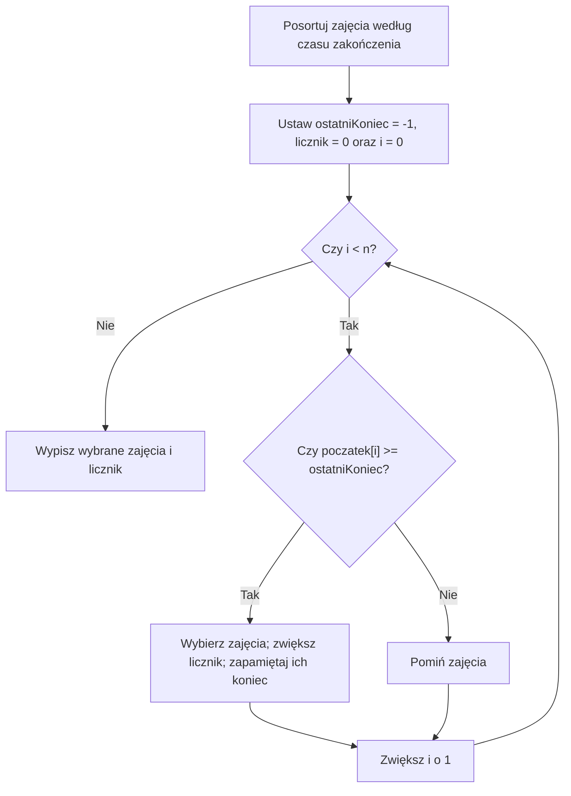

# Algorytmy zachłanne - planowanie zajęć i wybór niekolidujących przedziałów

## Cel lekcji

Po tej lekcji potrafisz wyjaśnić, czym jest wybór zachłanny, znaleźć największą liczbę zajęć możliwych do przeprowadzenia w jednej sali, wskazać błędną regułę wyboru i uzasadnić, dlaczego poprawna reguła działa. Poznasz też podobnie brzmiący problem, w którym trzeba wyznaczyć **minimalną liczbę sal dla wszystkich zajęć**.

## Co oznaczają A-F oraz 5-9?

Każda litera jest **nazwą jednych zajęć**, a nie zmienną matematyczną:

- **A** - pierwsze zajęcia z zestawienia,
- **B** - drugie zajęcia,
- ...,
- **F** - szóste zajęcia.

Liczby określają **moment rozpoczęcia i zakończenia**. Na przykład zapis **F: 5-9** oznacza, że zajęcia F zaczynają się w chwili **5** i kończą w chwili **9**. Trwają **4 jednostki czasu**. Dla łatwiejszego odczytania możesz myśleć: 5 = godzina 5:00, 9 = godzina 9:00. W zadaniu są to umowne punkty na osi czasu; liczy się ich kolejność.

**Ustalenie:** jeśli jedne zajęcia kończą się o 5, a kolejne zaczynają o 5, **nie kolidują**. Traktujemy przedział jako obejmujący początek, ale nie moment zakończenia: `[5, 9)`.

| Nazwa | Początek | Koniec | Jak to czytamy? |
|---|---:|---:|---|
| A | 1 | 4 | Zajęcia A: od 1 do 4 |
| B | 3 | 5 | Zajęcia B: od 3 do 5 |
| C | 0 | 6 | Zajęcia C: od 0 do 6 |
| D | 5 | 7 | Zajęcia D: od 5 do 7 |
| E | 8 | 9 | Zajęcia E: od 8 do 9 |
| F | 5 | 9 | Zajęcia F: od 5 do 9 |

**Przykład kolizji:** A (1-4) i B (3-5) zachodzą na siebie między 3 a 4 - nie mogą korzystać z jednej sali. Natomiast B (3-5) i D (5-7) mogą odbywać się w tej samej sali.

W całej lekcji przyjmujemy `0 <= poczatek < koniec <= 1000`. Każde zajęcia mają dodatni czas trwania. Nie dzielimy zajęć na części i nie przesuwamy ich godzin.

Dwa przedziały kolidują, gdy oba warunki są spełnione: `poczatek1 < koniec2` oraz `poczatek2 < koniec1`. Jeśli jedne kończą się dokładnie wtedy, gdy drugie zaczynają, nie ma kolizji. W zadaniu z jedną salą nie ma dodatkowej przerwy między zajęciami.

## Zadanie 1 - jak zmieścić jak najwięcej zajęć w jednej sali?

Masz **jedną salę** i sześć propozycji zajęć A-F opisanych w tabeli. **Nie musisz przeprowadzić wszystkich.** Wybierz największą możliwą liczbę zajęć tak, aby żadne wybrane zajęcia nie nakładały się w czasie.

To nie znaczy: „zajmij salę przez największą liczbę godzin”. Chcemy **maksymalnej liczby oddzielnych zajęć**.

### Kartki z godzinami

Wyobraź sobie, że każde zajęcia zapisano na osobnej kartce. Na każdej są dwie liczby: początek i koniec.

Chcesz wybrać jak najwięcej kartek, ale masz tylko jedną salę. Co robisz?

- Najpierw spójrz na **godziny zakończenia** wszystkich zajęć.
- Wybierz zajęcia, które **kończą się najwcześniej** - zostawią najwięcej czasu na następne.
- Odrzuć zajęcia zaczynające się przed zakończeniem tych, które już wybrałeś.
- Z pozostałych znowu wybierz te, które kończą się najwcześniej.
- Powtarzaj, aż nie da się wybrać kolejnych.

To jest wybór **zachłanny**: na każdym kroku podejmujemy jedną decyzję, której później nie cofamy. Uwaga: taka metoda nie działa automatycznie dla każdego problemu. Dla tego konkretnego zadania potrafimy uzasadnić jej poprawność.

<details markdown="1">
<summary>Podpowiedź do zadania 1</summary>

Po wybraniu zajęć zapamiętaj ich koniec. Następne możesz wybrać tylko wtedy, gdy zaczynają się nie wcześniej.

</details>

<details markdown="1">
<summary>Rozwiązanie zadania 1 - krok po kroku</summary>

Najpierw uporządkuj zajęcia według **rosnącego czasu zakończenia**. Nasze dane już są w tej kolejności: A (4), B (5), C (6), D (7), E (9), F (9). Przy jednakowym końcu kolejność jest dowolna.

| Sprawdzane zajęcia | Początek-koniec | Decyzja | Dlaczego? |
|---|---|---|---|
| A | 1-4 | **Wybierz** | Pierwsze kończące się zajęcia |
| B | 3-5 | Pomiń | Zaczynają się przed końcem A (3 < 4) |
| C | 0-6 | Pomiń | Zaczynają się przed końcem A (0 < 4) |
| D | 5-7 | **Wybierz** | 5 >= 4, nie kolidują z A |
| E | 8-9 | **Wybierz** | 8 >= 7, nie kolidują z D |
| F | 5-9 | Pomiń | 5 < 9; kolidują z już wybranymi zajęciami |

**Wynik: A, D, E - razem 3 zajęcia.** To jeden z optymalnych wyborów. Inny poprawny zestaw to B, D, E. Zestaw A, D, F nie jest poprawny, bo D i F kolidują.

</details>

## Dlaczego wybieramy najwcześniej kończące się zajęcia?

Załóżmy, że istnieje optymalny harmonogram, który jako pierwsze zajęcia wybiera X. Nasza metoda wybiera jako pierwsze A - zajęcia kończące się **nie później niż X**.

Możemy zamienić X na A. Wszystkie późniejsze zajęcia z optymalnego harmonogramu nadal zmieszczą się po A, bo A kończy się nie później niż X. **Liczba wybranych zajęć się nie zmniejszy.**

A więc istnieje optymalne rozwiązanie zaczynające się od naszego zachłannego wyboru. Ten sam argument stosujemy do pozostałych zajęć. To krótkie uzasadnienie poprawności, nazywane *argumentem wymiany*.

**Pytanie kontrolne:** Dlaczego wybór zajęć zaczynających się najwcześniej może być zły?

<details markdown="1">
<summary>Podpowiedź - wymyśl kontrprzykład</summary>

Rozważ trzy zajęcia: A = 0-10, B = 1-2, C = 2-3. Co da wybór najwcześniejszego początku?

</details>

<details markdown="1">
<summary>Odpowiedź do kontrprzykładu</summary>

Wybór A (0-10) pozwoli przeprowadzić tylko **jedne** zajęcia. Wybór B (1-2) oraz C (2-3) daje **dwa** zajęcia. Dlatego reguła „zaczynają się najwcześniej” nie gwarantuje najlepszego rozwiązania.

</details>

Po zamianie pierwszych zajęć zostaje problem tego samego rodzaju: wybierz jak najwięcej zajęć zaczynających się nie wcześniej niż koniec już wybranych. Możemy więc powtarzać argument wymiany. Nie zakładamy, że pierwszy wybór jest jedynym optymalnym. Wystarczy, że pasuje do co najmniej jednego optymalnego rozwiązania.

## Pseudokod

```text
DANE: n zajęć opisanych przez początek i koniec
POSORTUJ zajęcia według rosnącego czasu zakończenia
licznik = 0
ostatniKoniec = -1  (początki są nieujemne)

DLA każdego zajęcia w tej kolejności:
    JEŻELI początek >= ostatniKoniec:
        wybierz zajęcia
        licznik = licznik + 1
        ostatniKoniec = koniec tych zajęć

WYPISZ wybrane zajęcia i licznik
```

## Schemat decyzji

Zakładamy podany wcześniej zakres godzin. Każdy obrót pętli rozpatruje jedne zajęcia. Po obu decyzjach przechodzimy do następnych.



## C++ - najpierw sam algorytm

Dane są już uporządkowane według czasu zakończenia, więc możemy skupić się na nowej metodzie. Używamy zwykłych tablic i prostych instrukcji.

<details markdown="1">
<summary>Pokaż rozwiązanie zadania 1 w C++</summary>

```cpp
#include <iostream>
using namespace std;

int main() {
    char nazwa[6] = {'A', 'B', 'C', 'D', 'E', 'F'};
    int poczatek[6] = {1, 3, 0, 5, 8, 5};
    int koniec[6] = {4, 5, 6, 7, 9, 9};

    int ostatniKoniec = -1;
    int licznik = 0;

    for (int i = 0; i < 6; i++) {
        if (poczatek[i] >= ostatniKoniec) {
            cout << nazwa[i] << " (" << poczatek[i]
                 << "-" << koniec[i] << ")\n";
            licznik++;
            ostatniKoniec = koniec[i];
        }
    }

    cout << "Liczba zajec: " << licznik << "\n";
    return 0;
}
```

`ostatniKoniec = -1` jest poprawny dla podanych danych, bo wszystkie zajęcia zaczynają się od 0 lub później. W ogólnym zadaniu trzeba dobrać wartość początkową do zakresu danych albo wybrać pierwsze zajęcia osobno.

</details>

### A jeśli zajęcia nie są posortowane?

**Najpierw musisz je uporządkować według końca.** Poniżej jest dodatkowy wariant programu z prostym sortowaniem przez wybieranie. Zwróć uwagę, że podczas zamiany dwóch zajęć trzeba zamienić **równocześnie ich nazwy, początki i końce**.

Sortowanie przez wybieranie działa tutaj tak:

- Ustalamy pozycję `i`, którą chcemy wypełnić.
- Wśród pozycji od `i` do końca szukamy najmniejszej godziny zakończenia.
- Zamieniamy całe zajęcia z pozycji `i` z tymi znalezionymi.
- Przechodzimy do następnej pozycji. Uporządkowanej części już nie zmieniamy.

Zmienna `najmniejszy` przechowuje indeks, nie godzinę. Tablice `nazwa`, `poczatek` i `koniec` opisują te same zajęcia pod wspólnym indeksem. Zamiana samego końca pomieszałaby dane różnych zajęć.

#### Kiedy tego użyć?

Proste sortowanie przez wybieranie jest czytelne dla małego zestawu danych. Dla dużych danych jego koszt `O(n²)` może być zbyt duży. Wtedy warto wybrać szybsze sortowanie. Reguła wyboru zajęć po sortowaniu pozostaje taka sama.

<details markdown="1">
<summary>Pokaż pełny program z sortowaniem</summary>

```cpp
#include <iostream>
using namespace std;

int main() {
    char nazwa[6] = {'F', 'C', 'A', 'E', 'D', 'B'};
    int poczatek[6] = {5, 0, 1, 8, 5, 3};
    int koniec[6] = {9, 6, 4, 9, 7, 5};

    for (int i = 0; i < 5; i++) {
        int najmniejszy = i;
        for (int j = i + 1; j < 6; j++) {
            if (koniec[j] < koniec[najmniejszy]) {
                najmniejszy = j;
            }
        }

        int pomoc = koniec[i];
        koniec[i] = koniec[najmniejszy];
        koniec[najmniejszy] = pomoc;

        pomoc = poczatek[i];
        poczatek[i] = poczatek[najmniejszy];
        poczatek[najmniejszy] = pomoc;

        char pomocNazwa = nazwa[i];
        nazwa[i] = nazwa[najmniejszy];
        nazwa[najmniejszy] = pomocNazwa;
    }

    int ostatniKoniec = -1;
    int licznik = 0;

    for (int i = 0; i < 6; i++) {
        if (poczatek[i] >= ostatniKoniec) {
            cout << nazwa[i] << " ";
            ostatniKoniec = koniec[i];
            licznik++;
        }
    }

    cout << "\nLiczba zajec: " << licznik << "\n";
    return 0;
}
```

</details>

## Kiedy stosować algorytmy zachłanne?

Przy czytaniu zadania zwróć uwagę na pytania:

- Czy trzeba **maksymalizować liczbę** wykonanych zadań lub **minimalizować koszt**?
- Czy można podejmować decyzje **kolejno**, bez cofania wcześniejszych wyborów?
- Czy istnieje prosta reguła: „wybierz najmniejszy”, „wybierz najwcześniej kończący się” albo „wybierz najtańszy”?
- Czy potrafię **udowodnić**, że ta reguła nie pogorszy wyniku?

**Sama obecność słów „minimum” i „maksimum” nie wystarczy.** Istnieją zadania optymalizacyjne, w których algorytm zachłanny daje błędną odpowiedź.

### Kiedy tego użyć?

Najpierw sprawdź, co jest jedną decyzją i jaki jest cel. W naszym problemie decyzją jest przyjęcie albo pominięcie całych zajęć. Liczy się liczba przyjętych zajęć, a nie ich długość czy wartość.

Godziny początku i końca => rozpoznaj przedziały. Jedna sala i zakaz nakładania => potrzebujesz niekolidujących przedziałów. Wolno pominąć część zajęć i każde liczy się tak samo => rozważ wybór według najwcześniejszego końca.

To dopiero kandydat na regułę. Zanim napiszesz program, spróbuj ją obalić na małych danych. Wstaw jeden długi przedział i kilka krótkich. Sprawdź równe końce i stykanie się granic. Jeśli znajdziesz lepszy wynik niż zachłanny, reguła jest błędna. Brak kontrprzykładu po kilku próbach nie jest jeszcze dowodem. Potrzebujesz uzasadnienia, np. argumentu wymiany.

### Zadanie bez podanej metody - stanowisko pomiarowe

W laboratorium jest jedno stanowisko. Nadeszło pięć zgłoszeń badań. Każde ma ustaloną godzinę początku i końca. Badania nie można przerwać ani przesunąć. Dwa badania nie mogą odbywać się jednocześnie. Jeśli jedno kończy się w chwili początku drugiego, można wykonać oba. Wolno odrzucić zgłoszenia. Wybierz jak najwięcej badań.

| Badanie | Początek | Koniec |
| --- | ---: | ---: |
| A | 0 | 5 |
| B | 1 | 2 |
| C | 2 | 4 |
| D | 4 | 6 |
| E | 6 | 7 |

Najpierw nazwij cel, ograniczenia i regułę wyboru. Potem znajdź wynik. Nie zaczynaj od pisania pętli.

<details markdown="1">
<summary>Podpowiedź do zadania o stanowisku</summary>

Czy badanie zajmujące stanowisko od najwcześniejszej godziny musi być najlepszym wyborem? Co daje wcześniejsze zwolnienie stanowiska?

</details>

<details markdown="1">
<summary>Rozpoznanie zadania o stanowisku i rozwiązanie</summary>

- „Jedno stanowisko” => odpowiednik jednej sali.
- „Ustalona godzina początku i końca” => każde badanie jest przedziałem.
- „Nie można przerwać ani przesunąć” => wybieramy całe przedziały z podanymi granicami.
- „Wolno odrzucić zgłoszenia” => nie musimy znaleźć miejsca dla wszystkich.
- „Jak najwięcej badań” => każde badanie ma tę samą wartość: jedną sztukę.
- „Koniec równy początkowi” => stosujemy warunek `poczatek >= ostatniKoniec`.

Sortujemy według końca: B, C, A, D, E. Wybieramy B (1-2), C (2-4), pomijamy A (0-5), wybieramy D (4-6) i E (6-7). Wynik to **4 badania**.

Najwcześniejszy początek wybrałby A, a potem tylko E, czyli 2 badania. Regułę najwcześniejszego końca uzasadnia argument wymiany: zastąpienie pierwszego wybranego badania wcześniejszym końcem nie blokuje późniejszych badań.

</details>

### Kiedy wybrać coś innego?

- Nie każde zadanie z minimum lub maksimum ma poprawną prostą regułę zachłanną. Trzeba ją uzasadnić.
- Wszystkie zajęcia muszą się odbyć => zamiast odrzucać przedziały, rozważ problem minimalnej liczby sal z dalszej części lekcji.
- Cel to największa łączna wartość zajęć => reguła najwcześniejszego końca może zawieść. W takim problemie warto rozważyć programowanie dynamiczne.
- Dochodzą zależności między zajęciami, dodatkowe przerwy lub inne ograniczenia => dowód z tej lekcji nie przenosi się automatycznie. Najpierw ustal nowy warunek dopuszczalności.

<details markdown="1">
<summary>Pokaż kontrprzykład dla zajęć o różnych wartościach</summary>

A (0-2) ma wartość 3, B (2-4) ma wartość 3, a C (0-4) ma wartość 10. Wybór według najwcześniejszego końca daje A i B, czyli 6. Wybór C daje 10.

Celem nie jest tu liczba zajęć. Sama zmiana tego celu wystarcza, żeby poprawna wcześniej reguła przestała działać.

</details>

## Wydajność - dlaczego to dobre rozwiązanie?

Jeśli zajęcia są już posortowane, przeglądamy każde tylko raz: **O(n)** czasu i **O(1)** dodatkowej pamięci (nie licząc danych wejściowych i wyniku wypisywanego od razu).

Jeśli trzeba je posortować, czas zależy od sortowania. Nasze proste **sortowanie przez wybieranie** kosztuje **O(n²)**, więc cały przedstawiony program z sortowaniem ma złożoność **O(n²)**. Lepszy algorytm sortowania może zmniejszyć ten koszt do **O(n log n)**. Sama część zachłanna pozostaje liniowa.

Dlaczego nie testujemy wszystkich zestawów zajęć? Przy `n` propozycjach są aż `2^n` podzbiory. Nawet po odrzuceniu niepoprawnych zestawów takie rozwiązanie może wymagać bardzo wielu prób.

W naszych programach z jedną salą dane są w zwykłych tablicach. Sortowanie zamienia elementy na miejscu i używa kilku zmiennych, więc dodatkowa pamięć nadal wynosi `O(1)`. Przechowywanie wejściowych tablic dla `n` zajęć zajmuje `O(n)` pamięci. Te dwa koszty opisują różne rzeczy.

## Zadanie 2 - minimalna liczba sal dla wszystkich zajęć

**Nowa treść zadania:** Wszystkie sześć zajęć A-F **musi się odbyć**. Możesz korzystać z wielu sal. Każde zajęcia zajmują jedną salę od swojego początku do końca. Ile **co najmniej** sal potrzeba, żeby żadne dwa zajęcia w tej samej sali nie kolidowały?

To **nie jest** poprzednie zadanie. Wcześniej mogliśmy zrezygnować z niektórych zajęć, aby zmieścić jak najwięcej w jednej sali. Teraz nie wolno pominąć żadnych.

### Sprawdź, ilu nauczycieli potrzebuje sali jednocześnie

Pomyśl o osobie pilnującej kluczy do sal. Kiedy zaczynają się zajęcia, trzeba dać im wolną salę. Jeśli żadna nie jest wolna, otwieramy kolejną. Kiedy zajęcia się kończą, sala wraca do puli.

**Najważniejsza obserwacja:** jeśli w pewnej chwili odbywają się trzy zajęcia, dwóch sal na pewno nie wystarczy.

<details markdown="1">
<summary>Podpowiedź do ręcznego przydziału sal</summary>

Prześledź chwile rozpoczęcia zajęć. Przy zwolnieniu sali dokładnie o godzinie początku kolejnych zajęć można jej od razu użyć.

</details>

<details markdown="1">
<summary>Rozwiązanie zadania 2 - liczba sal i przykładowy przydział</summary>

W naszych danych:

- W czasie **3-4** trwają jednocześnie **A, B i C** - potrzebne są co najmniej **3 sale**.
- W czasie **5-6** trwają jednocześnie **C, D i F** - także **3 sale**.
- Da się ułożyć wszystkie zajęcia w **3 salach**, więc minimum wynosi **3**.

Przykładowy przydział:

| Sala | Zajęcia w tej sali |
|---|---|
| 1 | C (0-6), E (8-9) |
| 2 | A (1-4), D (5-7) |
| 3 | B (3-5), F (5-9) |

Zwróć uwagę, że B kończy się dokładnie wtedy, gdy F się zaczyna - dlatego mogą korzystać z tej samej sali.

</details>

### Jak to zaprogramować prostym C++?

Można posortować zajęcia **według czasu rozpoczęcia** i trzymać w tablicy czas zakończenia ostatnich zajęć w każdej już używanej sali. Dla kolejnych zajęć szukamy sali, która jest wolna. Jeśli jej nie ma - dodajemy nową.

To poprawny algorytm zachłanny. **Nie trzeba** w tej wersji używać zaawansowanych kontenerów. Ważne jest rozpatrywanie zajęć według rosnącego początku. Nie używamy tu kolejności według końca z pierwszego zadania.

### Kiedy tego użyć?

Gdy wszystkie zajęcia muszą się odbyć, a chcesz użyć jak najmniejszej liczby sal. Nie wybierasz podzbioru zajęć. Każdym zajęciom musisz przypisać jedną salę.

<details markdown="1">
<summary>Podpowiedź 1 - czym różni się sortowanie w obu zadaniach?</summary>

W zadaniu o największej liczbie zajęć w jednej sali wybieraliśmy po **najwcześniejszym końcu**. Przy przydziale wszystkich zajęć do sal wygodnie jest rozpatrywać je od **najwcześniejszego początku**.

</details>

<details markdown="1">
<summary>Podpowiedź 2 - jak rozpoznać wolną salę?</summary>

Jeśli `koniecSali[j] <= poczatek[i]`, to sala `j` jest już wolna dla zajęć `i`.

</details>

<details markdown="1">
<summary>Pokaż rozwiązanie zadania 2 w C++</summary>

```cpp
#include <iostream>
using namespace std;

int main() {
    // Zajecia sa uporzadkowane wedlug czasu rozpoczecia.
    char nazwa[6] = {'C', 'A', 'B', 'D', 'F', 'E'};
    int poczatek[6] = {0, 1, 3, 5, 5, 8};
    int koniec[6] = {6, 4, 5, 7, 9, 9};

    int koniecSali[6];
    int liczbaSal = 0;

    for (int i = 0; i < 6; i++) {
        int sala = -1;

        for (int j = 0; j < liczbaSal; j++) {
            if (koniecSali[j] <= poczatek[i]) {
                sala = j;
                break;
            }
        }

        if (sala == -1) {
            sala = liczbaSal;
            liczbaSal++;
        }

        koniecSali[sala] = koniec[i];
        cout << "Zajecia " << nazwa[i]
             << " => sala " << sala + 1 << "\n";
    }

    cout << "Minimalna liczba sal: " << liczbaSal << "\n";
    return 0;
}
```

W każdym momencie otwieramy nową salę tylko wtedy, gdy **wszystkie dotychczas otwarte są zajęte**. Taka chwila wymusza użycie większej liczby sal, więc nie otwieramy ich niepotrzebnie.

Dla `n` zajęć proste przeszukiwanie tablicy sal może kosztować **O(n²)** czasu, nawet gdy zajęcia są już uporządkowane. To świadomie prosta wersja algorytmu.

</details>

Dlaczego otwarcie nowej sali bywa konieczne? Rozpatrujemy zajęcia w kolejności początku. Jeśli żadna z dotychczasowych sal nie jest wolna, to ostatnie zajęcia w każdej z nich już się zaczęły i jeszcze trwają w chwili początku nowych. Wszystkie te zajęcia i nowe zajęcia nakładają się w tej chwili. Żaden przydział nie zmieści ich w mniejszej liczbie sal. Jeśli sala jest wolna, używamy jej ponownie. Dowód działa niezależnie od tego, którą z wolnych sal wybierzemy.

Tablica `koniecSali` ma miejsce na tyle sal, ile jest zajęć. Więcej nie potrzeba. Odczytujemy tylko pozycje mniejsze od `liczbaSal`, które już zapisaliśmy. Nową pozycję najpierw wybieramy, a potem od razu zapisujemy. Dodatkowa pamięć wynosi `O(n)`.

Jeśli dane nie są uporządkowane, przed przydziałem sal trzeba je posortować według **początku**, zamieniając jednocześnie wszystkie pola zajęć. Można użyć opisanego sortowania przez wybieranie, porównując początki zamiast końców. Sortowanie i późniejsze szukanie wolnej sali dają w tej prostej wersji łącznie `O(n²)` czasu.

## Ćwiczenia

### A. Ręczne wybieranie przedziałów

W jednej sali wybierz jak najwięcej zajęć. Można odrzucać propozycje, a stykające się przedziały nie kolidują. Zapisz kolejność według końca i decyzję dla każdej pozycji.

| Zajęcia | Początek | Koniec |
| --- | ---: | ---: |
| H | 0 | 2 |
| I | 1 | 4 |
| J | 2 | 3 |
| K | 3 | 5 |
| L | 4 | 6 |

<details markdown="1">
<summary>Podpowiedź do zadania A</summary>

Po każdym wyborze zapisz nowy koniec. Nie zmieniaj go, gdy pomijasz zajęcia.

</details>

<details markdown="1">
<summary>Rozwiązanie zadania A</summary>

Kolejność według końca: H, J, I, K, L.

| Zajęcia | Decyzja | Koniec ostatnich wybranych po decyzji |
| --- | --- | ---: |
| H | Wybierz | 2 |
| J | Wybierz, bo 2 >= 2 | 3 |
| I | Pomiń, bo 1 < 3 | 3 |
| K | Wybierz, bo 3 >= 3 | 5 |
| L | Pomiń, bo 4 < 5 | 5 |

Wybrane zajęcia to H, J, K. Wynik: **3**. Optymalność wynika z reguły najwcześniejszego końca i argumentu wymiany.

</details>

### B. Odczytywanie godzin

Wróć do tabeli A-F na początku lekcji. Co oznacza F: 5-9? Ile trwa F? Czy F koliduje z B, D i E? Rozpatrz każdą parę osobno. Czy B i F można przydzielić do jednej sali?

<details markdown="1">
<summary>Podpowiedź do zadania B</summary>

Zapisz oba przedziały. Wspólny moment końca i początku nie zajmuje jednocześnie sali.

</details>

<details markdown="1">
<summary>Rozwiązanie zadania B</summary>

F zaczyna się w chwili 5 i kończy w chwili 9. Trwa `9 - 5 = 4` jednostki czasu.

- B (3-5) i F (5-9) nie kolidują. Mogą kolejno zajmować jedną salę.
- D (5-7) i F (5-9) kolidują od 5 do 7.
- E (8-9) i F (5-9) kolidują od 8 do 9.

</details>

### C. Kontrprzykład dla najwcześniejszego początku

Rozpatrz zajęcia A (0-8), B (1-3), C (3-5), D (5-7). Strategia wybiera najpierw najwcześniejszy początek, a potem tylko zajęcia niekolidujące z wybranymi. Ile zajęć wybierze? Podaj lepszy zestaw i jego liczbę. Co ten przykład mówi o strategii?

<details markdown="1">
<summary>Podpowiedź do zadania C</summary>

Sprawdź, ile krótszych zajęć blokuje pierwszy wybór.

</details>

<details markdown="1">
<summary>Rozwiązanie zadania C</summary>

Strategia wybierze tylko A: pozostałe zaczynają się przed 8. Poprawny zestaw B, C, D ma **3** zajęcia. To wynik optymalny: wszystkich czterech wybrać nie można, bo A koliduje z każdym z pozostałych. Kontrprzykład obala ogólną regułę najwcześniejszego początku. Nie obala reguły najwcześniejszego końca.

</details>

### D. Analiza kodu C++

Program nie pobiera danych. Tablice są już uporządkowane według końca. Podaj dokładny wydruk i końcową wartość `ostatniKoniec`. Czy wypisywane liczby są godzinami, czy indeksami?

```cpp
#include <iostream>
using namespace std;

int main() {
    int poczatek[5] = {0, 1, 3, 2, 5};
    int koniec[5] = {2, 3, 4, 5, 6};
    int ostatniKoniec = -1;
    int licznik = 0;

    for (int i = 0; i < 5; i++) {
        if (poczatek[i] >= ostatniKoniec) {
            cout << i << "\n";
            ostatniKoniec = koniec[i];
            licznik++;
        }
    }
    cout << "Liczba: " << licznik << "\n";
    return 0;
}
```

<details markdown="1">
<summary>Podpowiedź do zadania D</summary>

Uzupełniaj po każdym kroku trzy wartości: i, ostatniKoniec i licznik. Pominięte zajęcia nie zmieniają ostatniKoniec.

</details>

<details markdown="1">
<summary>Rozwiązanie zadania D</summary>

Wydruk:

```text
0
2
4
Liczba: 3
```

Wypisywane są indeksy. Wybrane przedziały to (0-2), (3-4), (5-6). Końcowe `ostatniKoniec` wynosi `6`. Indeksy `1` i `3` zostają pominięte, bo ich początki są zbyt wczesne.

</details>

### E. Samodzielna implementacja - konsultacje indywidualne

**Konsultacje indywidualne**

Nauczyciel ma jedną salę i otrzymuje sześć propozycji konsultacji. Chce przeprowadzić **jak najwięcej** spotkań, bez nakładania się terminów.

| Spotkanie | Początek | Koniec |
|---|---:|---:|
| A | 2 | 5 |
| B | 1 | 3 |
| C | 3 | 4 |
| D | 4 | 7 |
| E | 5 | 6 |
| F | 6 | 8 |

Twoje zadania:

- Wyjaśnij, co oznacza zapis **C: 3-4**.
- Posortuj spotkania według czasu zakończenia.
- Wybierz największą możliwą liczbę spotkań. Zapisz kolejne decyzje.
- Napisz program w C++ wykorzystujący zwykłe tablice, pętlę i `if`.
- Uzasadnij, dlaczego zaczynanie od najwcześniejszej godziny rozpoczęcia nie jest dobrą regułą ogólną.

Program ma wczytać `n`, a potem `n` par `poczatek koniec` w dowolnej kolejności. Przyjmij `0 <= n <= 100` oraz `0 <= poczatek < koniec <= 1000`. Dla danych spoza zakresu wypisz `Nieprawidlowe dane.` i zakończ program. Dla `n = 0` wypisz tylko `Liczba zajec: 0`.

Dane do sprawdzenia programu odpowiadają tabeli:

```text
6
2 5
1 3
3 4
4 7
5 6
6 8
```

Wypisz wybrane przedziały w kolejnych liniach jako `poczatek-koniec`, a na końcu `Liczba zajec: ` i ich liczbę. Przy równych końcach wystarczy dowolny optymalny wybór.

<details markdown="1">
<summary>Podpowiedź do zadania E</summary>

Po sortowaniu według końca pierwsze będą B (1-3), C (3-4), A (2-5). Wybierz B. Które z następnych spotkań zaczyna się nie wcześniej niż w chwili 3?

</details>

<details markdown="1">
<summary>Rozwiązanie zadania E</summary>

Zapis C: 3-4 oznacza początek o 3 i koniec o 4. Spotkanie trwa jedną jednostkę czasu.

Po sortowaniu: B (1-3), C (3-4), A (2-5), E (5-6), D (4-7), F (6-8).

Wybieramy B, potem C. A pomijamy, bo 2 < 4. Wybieramy E, pomijamy D, bo 4 < 6, i wybieramy F. Można więc przeprowadzić **4 spotkania**: B, C, E, F. Argument wymiany dowodzi, że zachłanny wynik jest optymalny.

To, że najwcześniejszy początek może akurat zadziałać w tym zestawie, nie czyni go regułą ogólną. Kontrprzykład A (0-10), B (1-2), C (2-3) daje jedne zajęcia po wyborze A, a dwa po wyborze B i C.

Pełny program korzysta z tego samego sortowania przez wybieranie co wcześniejszy przykład. Zamieniamy razem początki i końce:

```cpp
#include <iostream>
using namespace std;

int main() {
    int n;
    if (!(cin >> n)) {
        return 0;
    }
    if (n < 0 || n > 100) {
        cout << "Nieprawidlowe dane.\n";
        return 0;
    }

    int poczatek[100];
    int koniec[100];
    for (int i = 0; i < n; i++) {
        if (!(cin >> poczatek[i] >> koniec[i])) {
            return 0;
        }
        if (poczatek[i] < 0 || poczatek[i] >= koniec[i] || koniec[i] > 1000) {
            cout << "Nieprawidlowe dane.\n";
            return 0;
        }
    }

    for (int i = 0; i < n - 1; i++) {
        int najmniejszy = i;
        for (int j = i + 1; j < n; j++) {
            if (koniec[j] < koniec[najmniejszy]) {
                najmniejszy = j;
            }
        }
        int pomoc = koniec[i];
        koniec[i] = koniec[najmniejszy];
        koniec[najmniejszy] = pomoc;
        pomoc = poczatek[i];
        poczatek[i] = poczatek[najmniejszy];
        poczatek[najmniejszy] = pomoc;
    }

    int ostatniKoniec = -1;
    int licznik = 0;
    for (int i = 0; i < n; i++) {
        if (poczatek[i] >= ostatniKoniec) {
            cout << poczatek[i] << "-" << koniec[i] << "\n";
            ostatniKoniec = koniec[i];
            licznik++;
        }
    }
    cout << "Liczba zajec: " << licznik << "\n";
    return 0;
}
```

Wydruk dla podanych danych:

```text
1-3
3-4
5-6
6-8
Liczba zajec: 4
```

Tablice mają po 100 elementów, więc poprawne indeksy to `0..99`. Pętle używają wyłącznie indeksów mniejszych od `n`. Dla pustego zestawu żadna z pętli nie odczytuje tablicy. W programie tylko porównujemy godziny, bez mnożenia ich ani sumowania. Przy podanych granicach indeksy, licznik i godziny mieszczą się w `int`.

</details>

### F. Rozpoznanie problemu w nowej treści

Muzeum ma jednego przewodnika. Każda zgłoszona grupa chce zwiedzania w ustalonym przedziale. Przewodnik nie może obsługiwać dwóch grup jednocześnie. Można odrzucić zgłoszenia. Celem jest przyjęcie jak największej liczby grup. Koniec jednego zwiedzania może być początkiem następnego.

Zgłoszenia: A (0-4), B (1-2), C (2-3), D (3-5), E (5-6).

Wskaż fragmenty treści, które pomagają wybrać metodę. Podaj regułę, uzasadnij ją i wypisz optymalny zestaw grup oraz ich liczbę.

<details markdown="1">
<summary>Podpowiedź do zadania F</summary>

Zamień słowo przewodnik na sala. Czy celem jest liczba grup, czy łączna długość zwiedzania?

</details>

<details markdown="1">
<summary>Rozwiązanie zadania F</summary>

Jeden przewodnik => jeden zasób. Ustalone godziny => przedziały. Nie można obsługiwać równocześnie => wybrane przedziały nie mogą kolidować. Można odrzucać zgłoszenia i liczy się liczba grup => to wybór maksymalnej liczby niekolidujących przedziałów.

Według końca rozpatrujemy B, C, A, D, E. Wybieramy B, C, pomijamy A, wybieramy D i E. Wynik to **4 grupy**: B, C, D, E. Argument wymiany pozwala zastąpić pierwsze zajęcia dowolnego optymalnego zestawu najwcześniej kończącymi się bez utraty późniejszych. Powtarzamy go dla dalszych wyborów.

</details>

### G. Wszystkie zajęcia muszą się odbyć

Zajęcia A (0-4), B (1-2), C (2-3), D (3-4), E (4-5) muszą się odbyć. Nie wolno odrzucić żadnych. Jedne zajęcia zajmują jedną salę. Przy styku końca i początku sala jest od razu wolna.

Wyznacz minimalną liczbę sal, podaj przydział i udowodnij, że mniej sal nie wystarczy. Wyjaśnij też ogólnie, dlaczego algorytm rozpatrujący zajęcia według początku może otwierać nową salę dopiero wtedy, gdy żadna dotychczasowa nie jest wolna.

<details markdown="1">
<summary>Podpowiedź do zadania G</summary>

Znajdź chwilę, w której trwają jednocześnie różne zajęcia. Potem spróbuj używać zwolnionych sal ponownie.

</details>

<details markdown="1">
<summary>Rozwiązanie zadania G</summary>

Potrzeba **2 sal**. Na przykład:

| Sala | Zajęcia |
| --- | --- |
| 1 | A (0-4), E (4-5) |
| 2 | B (1-2), C (2-3), D (3-4) |

Jedna sala nie wystarczy, bo od 1 do 2 trwają A i B. Podany przydział używa dwóch sal, więc dolna granica jest osiągnięta.

Ogólnie: przy rozpatrywaniu zajęć według początku każde zajęcia zapisane wcześniej w sali zaczęły się nie później niż bieżące. Jeśli koniec każdej użytej sali jest większy od bieżącego początku, to w tej chwili trwają wszystkie te zajęcia. Bieżące też już się zaczynają. Potrzebna jest dodatkowa sala w każdym możliwym przydziale. Jeżeli choć jedna sala jest wolna, ponownie jej używamy i nie zwiększamy liczby sal.

To nie jest wybór największej liczby zajęć do jednej sali. Tutaj nie wolno pomijać zajęć, nawet długich.

</details>

## Ćwiczenie z debuggerem

Uruchom program z zadania D. Zatrzymaj go na warunku `if` w pętli. Obserwuj `i`, `poczatek[i]`, `koniec[i]`, `ostatniKoniec` i `licznik`. Wykonuj instrukcje pojedynczo.

Co dzieje się z `ostatniKoniec` dla indeksu `1`, a co dla indeksu `2`? Dlaczego pominięcie zajęć nie może zmienić tej zmiennej?

<details markdown="1">
<summary>Podpowiedź do ćwiczenia z debuggerem</summary>

Po wybraniu indeksu 0 zmienna ostatniKoniec wynosi 2. Porównaj z nią początki następnych zajęć.

</details>

<details markdown="1">
<summary>Rozwiązanie ćwiczenia z debuggerem</summary>

Dla indeksu `1` początek wynosi `1 < 2`, więc warunek jest fałszywy. `ostatniKoniec` pozostaje równy `2`, a licznik `1`. Dla indeksu `2` początek wynosi `3 >= 2`, więc wybieramy zajęcia. `ostatniKoniec` przyjmuje `4`, a licznik `2`. Zmienna opisuje koniec ostatnich wybranych zajęć, dlatego nie wolno aktualizować jej po pominięciu przedziału.

</details>

## Najczęstsze błędy

- Mylenie nazw A-F z godzinami: **litera to nazwa**, liczby to granice czasu.
- Mylenie **liczby zajęć** z **łącznym czasem trwania**.
- Sortowanie po początku zamiast po końcu w zadaniu o maksymalnej liczbie zajęć.
- Odrzucanie zajęć rozpoczynających się dokładnie w chwili zakończenia poprzednich. Tu jest to **dozwolone**.
- Zapominanie o sortowaniu danych wejściowych.
- Używanie tej samej reguły bez zastanowienia do dwóch różnych zadań: wyboru części zajęć i przydzielenia sal wszystkim zajęciom.
- Zakładanie, że każda zachłanna decyzja musi prowadzić do najlepszego wyniku. **Trzeba to uzasadnić.**

- Zamiana tylko jednej tablicy podczas sortowania => początek i koniec przestają opisywać te same zajęcia.
- Użycie `poczatek > ostatniKoniec` zamiast `>=` => tracimy dozwolone zajęcia stykające się granicami.
- Aktualizacja `ostatniKoniec` także po odrzuceniu zajęć => zmienna nie opisuje już ostatniego wyboru.
- Zastosowanie `ostatniKoniec = -1` do nieznanego zakresu z ujemnymi godzinami => pierwsze zajęcia mogą zostać błędnie odrzucone. W tej lekcji godziny są nieujemne.
- Sprawdzanie niezapisanych pozycji `koniecSali` lub indeksu równego rozmiarowi tablicy => wyjście poza poprawnie przygotowane dane.

## Zapamiętaj

**Algorytm zachłanny** dokonuje kolejnych wyborów zgodnie z przyjętą regułą. W zadaniu o wyborze maksymalnej liczby niekolidujących zajęć poprawna reguła brzmi: **wybieraj zajęcia kończące się najwcześniej spośród tych, które możesz jeszcze wykonać**.

Nie chodzi o to, aby nauczyć się jednego programu na pamięć. Chodzi o umiejętność odpowiedzi na dwa pytania:

- **Dlaczego wybieram właśnie te zajęcia?**
- **Dlaczego ten wybór nie odbiera mi lepszego rozwiązania?**
