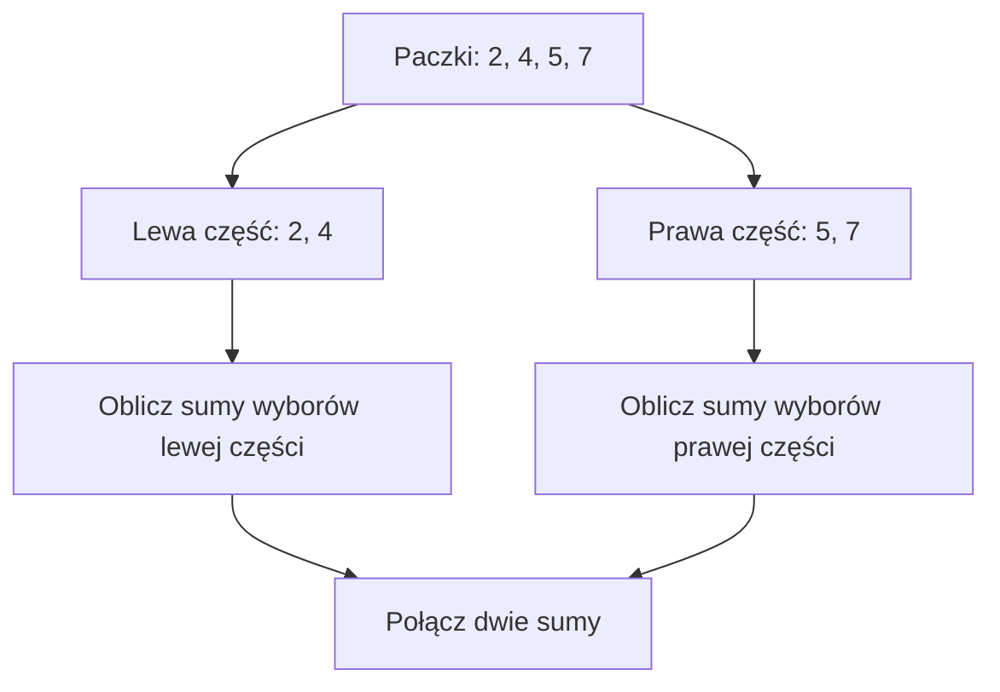

# Meet in the Middle - podzbiory i ich sumy

## Problem, zanim poznamy nazwę techniki

Mamy cztery paczki o masach `2, 4, 5, 7` kg. Każdą można zabrać albo zostawić. Jakie łączne masy da się uzyskać?

**Podzbiór** oznacza wybór dowolnych elementów, także żadnego. Pusta grupa ma sumę 0. Każda paczka może wystąpić najwyżej raz.

<details markdown="1">
<summary>Pokaż wybory dla dwóch i trzech paczek</summary>

Dla dwóch paczek `2, 4` istnieją cztery wybory: nic (`0`), tylko `2`, tylko `4`, obie (`6`). Dla trzech paczek mamy osiem wyborów. Ogólnie dla `n` paczek jest `2^n` podzbiorów.

</details>

Elementy rozróżniamy po pozycjach. Dwie paczki o tej samej masie są nadal dwiema paczkami. Dla każdego z `n` elementów podejmujemy dwie decyzje: biorę albo nie biorę. Liczba wyborów to iloczyn `2 * 2 * ... * 2`, czyli `2^n`. Dla `n = 0` jest jeden wybór: nic. Kolejność wkładania wybranych paczek nie tworzy nowego podzbioru.

## Dwa stoliki

Połóż dwie paczki na lewym stoliku (`2, 4`) i dwie na prawym (`5, 7`). Na każdym stoliku wypisz wszystkie sumy możliwych wyborów:

Spróbuj wypisać obie listy i znaleźć połączenie dające 11 kg.

<details markdown="1">
<summary>Podpowiedź do dwóch stolików</summary>

Na każdym stoliku zacznij od pustego wyboru. Potem wybierz każdą pojedynczą paczkę i obie naraz.

</details>

<details markdown="1">
<summary>Pokaż tabelę obu połówek i połączenie</summary>

| Lewy stolik | Suma | Prawy stolik | Suma |
|---|---:|---|---:|
| Nic | 0 | Nic | 0 |
| 2 | 2 | 5 | 5 |
| 4 | 4 | 7 | 7 |
| 2 + 4 | 6 | 5 + 7 | 12 |

**Każdy wybór spośród czterech paczek** składa się z wyboru na lewym stoliku i wyboru na prawym. Jeśli szukamy masy 11 kg, możemy połączyć `4` (lewa) z `7` (prawa).

Dla tych czterech paczek możemy ręcznie połączyć wszystkie pary. Nagłówki oznaczają sumy połówek, a wnętrze tabeli ich dodawanie:

| Lewa / prawa | 0 | 5 | 7 | 12 |
| --- | ---: | ---: | ---: | ---: |
| 0 | 0 | 5 | 7 | 12 |
| 2 | 2 | 7 | 9 | 14 |
| 4 | 4 | 9 | 11 | 16 |
| 6 | 6 | 11 | 13 | 18 |

To 16 wyborów. Możliwe masy bez powtórzeń to `0, 2, 4, 5, 6, 7, 9, 11, 12, 13, 14, 16, 18`. Niektóre masy odpowiadają kilku różnym wyborom. Pełna tabela par służy tutaj ręcznemu sprawdzeniu małego przykładu. Nie jest szybkim sposobem łączenia dla dużego n.

</details>

Ten podział niczego nie gubi. Z dowolnego pełnego podzbioru można odłożyć elementy z lewej połowy na lewy stolik, a z prawej na prawy. Z kolei dowolne dwa takie wybory łączą się w jeden pełny podzbiór. Połówki nie mają wspólnych pozycji, więc żadnej paczki nie bierzemy dwa razy.

## Schemat podziału



## Jak wytworzyć listę sum?

Zaczynamy od jednej sumy: `0`. Kiedy dokładamy kolejną paczkę o masie `x`, każdą dotychczasową sumę można pozostawić bez zmiany **albo** dodać do niej `x`.

<details markdown="1">
<summary>Pokaż powstawanie listy dla 2 i 4</summary>

Dla `2`: `0, 2`. Po dołożeniu `4`: `0, 2, 4, 6`.

</details>

### Pseudokod

```text
sumy[0] = 0
ile = 1
dla każdej liczby x:
    dla i od 0 do ile - 1:
        sumy[ile + i] = sumy[i] + x
    ile = ile * 2
```

### C++ - prosty przykład z trzema liczbami

<details markdown="1">
<summary>Pokaż program tworzący sumy trzech liczb</summary>

```cpp
#include <iostream>
using namespace std;

int main() {
    int liczby[3] = {2, 4, 5};
    int sumy[8] = {0};
    int ile = 1;

    for (int j = 0; j < 3; j++) {
        for (int i = 0; i < ile; i++) {
            sumy[ile + i] = sumy[i] + liczby[j];
        }
        ile = ile * 2;
    }

    for (int i = 0; i < ile; i++) {
        cout << sumy[i] << " ";
    }
    cout << "\n";
    return 0;
}
```

</details>

<details markdown="1">
<summary>Pokaż wydruk programu i jego znaczenie</summary>

Wynik: `0 2 4 6 5 7 9 11`. Kolejność nie musi być rosnąca. **Każdy indeks listy odpowiada jednemu wyborowi**, nawet jeśli kilka różnych wyborów daje tę samą sumę.

</details>

Wewnętrzna pętla czyta tylko starą część listy, od `0` do `ile - 1`. Nowe sumy zapisuje od indeksu `ile`. Nie zmieniamy `ile` w środku tej pętli. Dopiero gdy dopiszemy całą nową część, podwajamy długość.

Po dodaniu liczby `x` pierwsza część opisuje wybory bez `x`, a nowa część wybory z `x`. To wszystkie możliwości, podzielone według jednej decyzji. Stąd poprawność tworzenia listy.

Dla `k` liczb powstaje `2^k` sum. Dopisujemy kolejno `1, 2, 4, ...` nowych pozycji, razem `2^k - 1`. Czas i pamięć tworzenia listy wynoszą `O(2^k)`. W przykładzie trzy liczby wymagają ośmiu komórek. Sumy mają wartości od 0 do 11, a indeksy od 0 do 7.

## Kiedy tego użyć?

W treści zadania szukaj **jednocześnie** trzech cech: (1) wybierasz lub odrzucasz każdy element; (2) liczba elementów jest za duża na przejrzenie wszystkich `2^n` możliwości; (3) wynik pełnego wyboru można złożyć z wyniku lewej i prawej połowy, np. przez dodawanie sum.

Przykładowo: 40 paczek daje `2^40` pełnych wyborów, ale każda z dwóch połówek po 20 paczek daje tylko `2^20` sum. To jeszcze **nie jest całe rozwiązanie**: w następnej lekcji nauczymy się szybko łączyć dwie listy.

Nie używaj MITM automatycznie, gdy elementy trzeba wybrać w określonej kolejności albo istnieją zależności pomiędzy wyborami z różnych połówek.

Na razie umiemy tworzyć listy. Porównanie każdej lewej sumy z każdą prawą nadal dałoby `2^n` par. Korzyść MITM pojawi się dopiero po dodaniu sprawnego łączenia, np. sortowania i wyszukiwania binarnego.

## Kiedy wybrać coś innego?

Dla trzech lub czterech elementów zwykły pełny przegląd jest wystarczający. Dla spójnego fragmentu tablicy nie wybieramy dowolnych pozycji. Jeśli wynik zależy od historii wyborów albo dodatkowych ograniczeń, sama suma może nie wystarczyć do połączenia połówek.

## Typowe błędy

- Pomijanie pustego podzbioru: tracimy przypadki, gdy cały wynik pochodzi z jednej połowy.

- Zapisywanie nowo powstałych sum od początku tablicy: nadpisujemy dane potrzebne do kolejnych obliczeń.

- Zakładanie, że wszystkie sumy są różne.

- Mylenie liczby elementów z liczbą ich podzbiorów: dla 4 elementów mamy 16 wyborów.

- Podwojenie `ile` przed dopisaniem sum => pętla odczytuje jeszcze nieprzygotowane pozycje.

- Zwiększenie liczby elementów bez zwiększenia tablicy do `2^k` pozycji => zapis poza tablicą.

## Ćwiczenia końcowe

### A. Ręczne podzbiory

Ręcznie wypisz podzbiory tablicy `3, 6, 8` oraz ich sumy, w kolejności dopisywania użytej w programie. Ile jest wyników i czy sumy zawsze muszą być różne?

<details markdown="1">
<summary>Podpowiedź do zadania A</summary>

Każdy nowy element podwaja listę. Pierwszy wybór jest pusty.

</details>

<details markdown="1">
<summary>Rozwiązanie zadania A</summary>

| Wybór | Suma |
| --- | ---: |
| Nic | 0 |
| 3 | 3 |
| 6 | 6 |
| 3 i 6 | 9 |
| 8 | 8 |
| 3 i 8 | 11 |
| 6 i 8 | 14 |
| 3, 6 i 8 | 17 |

Jest osiem wyborów. Tutaj wszystkie sumy są różne, ale nie jest to ogólna własność.

</details>

### B. Jednakowe masy, różne elementy

Zmień program tak, by analizował `1, 1, 3`. Wypisz wszystkie sumy. Wyjaśnij powtórzenia i wskaż dwa różne wybory dające sumę 1.

<details markdown="1">
<summary>Podpowiedź do zadania B</summary>

Oznacz dwie jedynki jako pierwszą i drugą. Nie usuwaj żadnej z listy wejściowej.

</details>

<details markdown="1">
<summary>Rozwiązanie zadania B</summary>

W pełnym programie zmieniamy tylko tablicę danych na:

```cpp
int liczby[3] = {1, 1, 3};
```

Wydruk: `0 1 1 2 3 4 4 5` (po każdej liczbie spacja, potem nowa linia). Sumę 1 daje wybranie tylko pierwszej albo tylko drugiej jedynki. Sumę 4 daje każda z tych jedynek razem z 3. Każdy indeks listy nadal opisuje inny wybór.

</details>

### C. Połącz połówki

Podziel paczki `2, 3, 7, 10` na dwie kolejne połowy. Wypisz sumy każdej połowy i znajdź wszystkie pary sum dające 12.

<details markdown="1">
<summary>Podpowiedź do zadania C</summary>

Wystarczy jedna paczka z lewej i jedna z prawej, ale sprawdź także wybór obu lewych paczek.

</details>

<details markdown="1">
<summary>Rozwiązanie zadania C</summary>

Lewa lista dla `2, 3`: `0, 2, 3, 5`. Prawa dla `7, 10`: `0, 7, 10, 17`. Pary to `2 + 10 = 12` oraz `5 + 7 = 12`. Odpowiadają im podzbiory `2, 10` i `2, 3, 7`.

</details>

### D. Przeanalizuj pętle

W głównym programie z liczbami `2, 4, 5` podaj wartość `ile` przed i po dołączeniu liczby 5. Jakie nowe sumy dopisuje ten obrót i pod jakimi indeksami? Dlaczego nie wolno od razu zmienić ile?

<details markdown="1">
<summary>Podpowiedź do zadania D</summary>

Stara lista zawiera wybory dwóch pierwszych liczb. Nowe pozycje muszą leżeć poza nią.

</details>

<details markdown="1">
<summary>Rozwiązanie zadania D</summary>

Przed obrotem `ile = 4`. Pod indeksami `4, 5, 6, 7` dopisujemy `5, 7, 9, 11`. Po całej wewnętrznej pętli `ile = 8`. Wcześniejsza zmiana długości włączyłaby nowe lub nieustawione komórki do źródła odczytów.

</details>

### E. Uzupełnij dopisywanie

W programie uzupełnij obie luki:

```cpp
for (int i = 0; i < ile; i++) {
    sumy[ile + i] = __________;
}
ile = __________;
```

Sprawdź pierwszy obrót dla liczby 2.

<details markdown="1">
<summary>Podpowiedź do zadania E</summary>

Nowa suma to stara suma z dołączonym nowym elementem. Długość listy zmieniamy dopiero po pętli.

</details>

<details markdown="1">
<summary>Rozwiązanie zadania E</summary>

Pierwsza luka to `sumy[i] + liczby[j]`, druga `ile * 2`. Początkowo suma pod indeksem 0 wynosi 0. Dopisujemy pod indeksem 1 wartość 2. Nowa długość wynosi 2.

</details>

## Ćwiczenie z debuggerem

Zatrzymaj główny program przed dopisaniem sum dla `j = 1`. Obserwuj `ile`, `i` i tablicę `sumy`. Które pozycje zostaną odczytane, a które zapisane?

<details markdown="1">
<summary>Podpowiedź do ćwiczenia z debuggerem</summary>

Przed dodaniem drugiej liczby istnieją dwa wybory.

</details>

<details markdown="1">
<summary>Rozwiązanie ćwiczenia z debuggerem</summary>

Przy `j = 1` dokładamy 4, a `ile = 2`. Czytamy indeksy 0 i 1, czyli sumy 0 i 2. Zapisujemy indeksy 2 i 3, czyli 4 i 6. Dopiero potem `ile` przyjmuje 4.

</details>

## Zapamiętaj

MITM nie polega na dzieleniu tablicy na pół dla samego podziału. Chodzi o obliczenie mniejszych zbiorów możliwości, które potem da się efektywnie połączyć.
