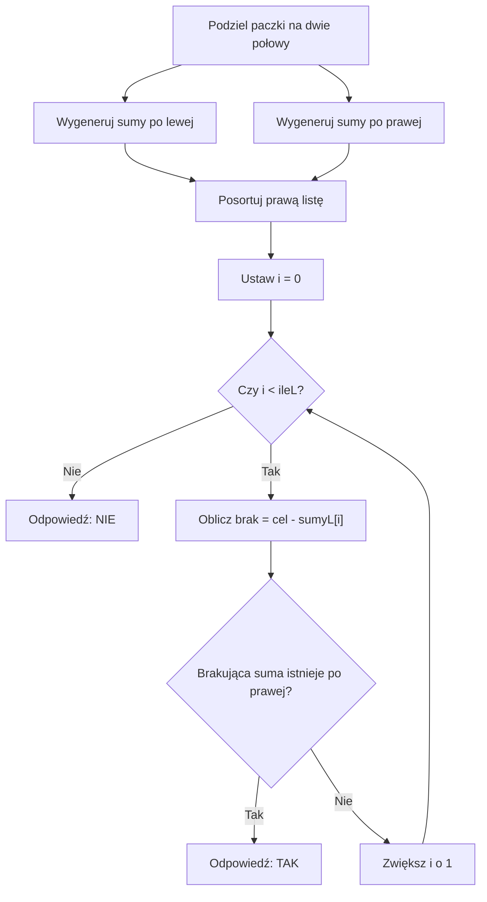

# Meet in the Middle - dokładna suma

## Treść zadania - załadunek

Masz sześć paczek o masach `2, 4, 5, 7, 9, 11` kg. Możesz wybrać dowolne z nich, każdą najwyżej raz. Sprawdź, czy da się przygotować ładunek ważący **dokładnie 20 kg**.

Nie chodzi o przedział mas. Wynik musi być dokładny. Paczki nie muszą leżeć obok siebie w tablicy.

## Dopasuj brakujący kawałek

Rozdziel paczki na dwa stoliki:

<details markdown="1">
<summary>Podpowiedź do załadunku</summary>

Dla wybranej lewej sumy odejmij ją od 20. Szukaj otrzymanej reszty po prawej.

</details>

<details markdown="1">
<summary>Pokaż obie listy i przykładowy ładunek</summary>

| Lewy: 2, 4, 5 | Możliwe sumy | Prawy: 7, 9, 11 | Możliwe sumy |
|---|---|---|---|
| Wszystkie wybory | `0, 2, 4, 6, 5, 7, 9, 11` | Wszystkie wybory | `0, 7, 9, 16, 11, 18, 20, 27` |

Weź z lewej sumę `2`. Do 20 brakuje `18`. Czy prawa lista zawiera 18? Tak: `7 + 11`. Całość: `2 + 7 + 11 = 20`.

</details>

**Pomysł:** dla każdej lewej sumy `s` szukamy po prawej `cel - s`.

## Schemat dopasowania



## Jak szukać bez porównywania każdej pary?

Można sprawdzić wszystkie pary lewej i prawej listy, ale wtedy w najgorszym przypadku wracamy do około `2^n` porównań. Lepiej posortować prawą listę i użyć **wyszukiwania binarnego**, które już znasz.

Najpierw przypomnijmy samodzielne sortowanie przez wybieranie. Na pozycji `i` umieszczamy najmniejszą liczbę z jeszcze nieuporządkowanej części. Szukamy jej indeksu, zamieniamy dwie liczby i przechodzimy dalej. Dla małej listy jest to proste rozwiązanie.

<details markdown="1">
<summary>Pokaż samodzielne sortowanie listy liczb</summary>

```cpp
void sortujProsto(int tablica[], int ile) {
    for (int i = 0; i < ile - 1; i++) {
        int najmniejszy = i;
        for (int j = i + 1; j < ile; j++) {
            if (tablica[j] < tablica[najmniejszy]) {
                najmniejszy = j;
            }
        }
        int pomoc = tablica[i];
        tablica[i] = tablica[najmniejszy];
        tablica[najmniejszy] = pomoc;
    }
}
```

</details>

Dla listy długości `m` takie sortowanie ma czas `O(m^2)` i dodatkową pamięć `O(1)`. Na dużych listach podzbiorów ten koszt zniwelowałby korzyść podziału. Dlatego pełne programy użyją później bibliotecznego sortowania o koszcie `O(m log m)`.

### Kiedy tego użyć?

Sortowanie jest potrzebne, gdy chcemy wyszukiwać binarnie. W C++ zapis `sort(sumyP, sumyP + ileP)` porządkuje rosnąco zajęte pozycje od 0 do `ileP - 1`. Drugi argument wskazuje miejsce tuż za nimi. Do tej funkcji potrzebny jest nagłówek `algorithm`. Nie sortujemy niezajętych komórek tablicy i nie usuwamy powtórzeń.

Po sortowaniu wyszukiwanie binarne sprawdza środek pozostałego przedziału. Jeśli suma jest za mała, przesuwamy lewą granicę za środek. Jeśli za duża, prawą przed środek. Warunek `lewy <= prawy` sprawdza także ostatnią możliwą pozycję. Środek liczymy jako `lewy + (prawy - lewy) / 2`.

## Pseudokod

```text
podziel elementy na lewą i prawą połowę
utwórz listy sum obu połówek, także dla pustego wyboru
posortuj prawą listę
dla każdej lewej sumy:
    brak = cel - lewa
    jeżeli wyszukiwanie binarne znajdzie brak na prawej liście:
        wypisz TAK i zakończ
wypisz NIE
```

## Kod C++ krok po kroku

Dla czytelności każda połowa ma trzy liczby, a tablica sum ma osiem miejsc (`2^3`).

<details markdown="1">
<summary>Pokaż pełny program załadunku</summary>

```cpp
#include <iostream>
#include <algorithm>
using namespace std;

int main() {
    int lewa[3] = {2, 4, 5};
    int prawa[3] = {7, 9, 11};
    int sumyL[8] = {0};
    int sumyP[8] = {0};
    int ileL = 1;
    int ileP = 1;
    int cel = 20;

    for (int j = 0; j < 3; j++) {
        for (int i = 0; i < ileL; i++) {
            sumyL[ileL + i] = sumyL[i] + lewa[j];
        }
        ileL = ileL * 2;
    }

    for (int j = 0; j < 3; j++) {
        for (int i = 0; i < ileP; i++) {
            sumyP[ileP + i] = sumyP[i] + prawa[j];
        }
        ileP = ileP * 2;
    }

    sort(sumyP, sumyP + ileP);
    bool znaleziono = false;

    for (int i = 0; i < ileL; i++) {
        int brak = cel - sumyL[i];
        int lewy = 0;
        int prawy = ileP - 1;

        while (lewy <= prawy) {
            int srodek = lewy + (prawy - lewy) / 2;
            if (sumyP[srodek] == brak) {
                znaleziono = true;
                break;
            }
            if (sumyP[srodek] < brak) {
                lewy = srodek + 1;
            } else {
                prawy = srodek - 1;
            }
        }
        if (znaleziono) {
            break;
        }
    }

    if (znaleziono) {
        cout << "TAK\n";
    } else {
        cout << "NIE\n";
    }
    return 0;
}
```

</details>

<details markdown="1">
<summary>Pokaż przebieg dopasowania i wynik</summary>

Dla lewej sumy `sumyL[1] = 2` brakuje `18`. Prawa lista zawiera `18`, więc to poprawne dopasowanie. Program odpowiada, **czy istnieje wybór**; nie wypisuje samych paczek.

W rzeczywistym przebiegu program trafi jeszcze wcześniej. Zaczyna od `sumyL[0] = 0` i szuka 20 w uporządkowanej prawej liście: `0, 7, 9, 11, 16, 18, 20, 27`.

| Lewy indeks | Prawy indeks | Środek | Sprawdzana suma | Decyzja |
| ---: | ---: | ---: | ---: | --- |
| 0 | 7 | 3 | 11 | Szukaj od indeksu 4 |
| 4 | 7 | 5 | 18 | Szukaj od indeksu 6 |
| 6 | 7 | 6 | 20 | Trafienie |

Znaleziony ładunek to `9 + 11 = 20`. Program wypisuje `TAK` i nie sprawdza już lewej sumy o indeksie 1.

</details>

Wyszukiwanie każdej reszty startuje od całej uporządkowanej prawej listy. Ustawienie `znaleziono = true` kończy oba przeglądy. Jeśli wyczerpiemy lewe sumy bez dopasowania, odpowiedź brzmi `NIE`.

## Dlaczego to działa?

Każdy pełny wybór dzieli się jednoznacznie na lewy i prawy podzbiór. Obie listy zawierają ich sumy. Jeżeli istnieje ładunek o masie `cel`, przy jego lewej sumie znajdziemy po prawej `cel - lewa`. Jeżeli znaleźliśmy taką parę, połączenie odpowiadających jej podzbiorów jest poprawnym ładunkiem.

Sortowanie zmienia kolejność sum, ale nie ich wartości. Dla pytania o istnienie wystarczy jedno trafienie. Nie musimy łączyć każdej pary z osobna, ponieważ uporządkowanie pozwala odrzucać połowę pozostałych kandydatów.

## Kiedy tego użyć?

Sygnały: „wybierz dowolny podzbiór”, „każdy przedmiot najwyżej raz”, „dokładnie X”, `n` rzędu 30-40, wartości mogą być duże, więc tablica DP indeksowana całkowitą sumą byłaby za duża. Jeśli da się zsumować niezależne wybory obu połówek, MITM jest kandydatem.

Nie jest obowiązkowy. Przy małym celu prostszy może być algorytm dynamiczny po sumie, a przy małym `n` - zwykłe sprawdzanie wszystkich wyborów.

## Kiedy wybrać coś innego?

Dla małej liczby elementów zwykłe sprawdzanie podzbiorów jest prostsze. Dla nieujemnych liczb i małej łącznej sumy rozważ DP po sumie. Jeśli zadanie mówi o jednym spójnym fragmencie, opisany wybór dowolnych paczek rozwiązuje inny problem.

## Dlaczego szybciej?

Dla `n` elementów: pełny przegląd to `2^n` podzbiorów. MITM wytwarza około `2 * 2^(n/2)` sum; sortowanie i wyszukiwanie prowadzą do czasu `O(n * 2^(n/2))` i pamięci `O(2^(n/2))`. To nadal algorytm wykładniczy - tylko znacznie mniejszy wykładnik.

Dla 40 elementów każda połowa ma `2^20 = 1 048 576` sum. Do takich danych potrzebne są odpowiednio duże tablice i typ liczbowy dobrany do maksymalnych sum. W szkolnym przykładzie używamy celowo małych liczb mieszczących się w `int`.

Przy nieparzystym `n` jedna połowa ma o jeden element więcej. Niech `k = n / 2`, z dzieleniem całkowitym jak w C++. Listy mają wtedy rozmiary `2^k` oraz `2^(n - k)`. Po wygenerowaniu list sortujemy jedną z nich i wykonujemy jedno wyszukiwanie na każdą sumę drugiej. Nie wykonujemy iloczynu długości obu list.

## Zadania końcowe

### A. Dopasowanie ręczne

Dla liczb `3, 6, 8, 10` sprawdź ręcznie, czy można uzyskać 17. Wypisz obie listy sum i podaj poprawny wybór.

<details markdown="1">
<summary>Podpowiedź do zadania A</summary>

Podziel liczby na 3, 6 oraz 8, 10.

</details>

<details markdown="1">
<summary>Rozwiązanie zadania A</summary>

Lewa lista: `0, 3, 6, 9`. Prawa: `0, 8, 10, 18`. Przy lewej sumie 9 brakuje 8. `3 + 6 + 8 = 17`, więc odpowiedź to **TAK**.

</details>

### B. Przewidź wynik kodu

Zmień `cel` w głównym programie z 20 na 1 oraz na 27. Przed uruchomieniem przewidź obie odpowiedzi i uzasadnij je.

<details markdown="1">
<summary>Podpowiedź do zadania B</summary>

Wszystkie masy są dodatnie. Pamiętaj też o pustym wyborze lewej połowy.

</details>

<details markdown="1">
<summary>Rozwiązanie zadania B</summary>

Dla 1 odpowiedź to `NIE`: najlżejsza paczka waży 2, a pusty wybór daje 0. Dla 27 odpowiedź to `TAK`, np. `7 + 9 + 11`. Cały ładunek może pochodzić z prawej połowy, dlatego lewa lista musi zawierać 0.

</details>

### C. Samodzielny program dla czterech przedmiotów

Masz cztery przedmioty `4, 7, 9, 13`. Każdy można wybrać najwyżej raz. Napisz program analogiczny do pokazanego, sprawdzający sumę 20. Dane wpisz w tablice. Program ma wypisać TAK albo NIE.

<details markdown="1">
<summary>Podpowiedź do zadania C</summary>

Każda połowa ma dwa elementy. Każda lista sum potrzebuje czterech komórek.

</details>

<details markdown="1">
<summary>Rozwiązanie zadania C</summary>

```cpp
#include <iostream>
#include <algorithm>
using namespace std;

int main() {
    int a[2] = {4, 7};
    int b[2] = {9, 13};
    int l[4] = {0}, p[4] = {0};
    int il = 1, ip = 1;
    for (int j = 0; j < 2; j++) {
        for (int i = 0; i < il; i++) l[il + i] = l[i] + a[j];
        il = il * 2;
    }
    for (int j = 0; j < 2; j++) {
        for (int i = 0; i < ip; i++) p[ip + i] = p[i] + b[j];
        ip = ip * 2;
    }
    sort(p, p + ip);
    bool ok = false;
    for (int i = 0; i < il; i++) {
        int szukana = 20 - l[i];
        int low = 0, high = ip - 1;
        while (low <= high) {
            int mid = low + (high - low) / 2;
            if (p[mid] == szukana) { ok = true; break; }
            if (p[mid] < szukana) low = mid + 1;
            else high = mid - 1;
        }
        if (ok) break;
    }
    if (ok) {
        cout << "TAK\n";
    } else {
        cout << "NIE\n";
    }
    return 0;
}
```

Odpowiedź: `TAK`, bo `7 + 13 = 20`.

</details>

### D. Uzupełnij granice wyszukiwania

W wyszukiwaniu binarnym uzupełnij dwa przypisania. Warunek równości był już sprawdzony.

```cpp
if (sumyP[srodek] < brak) {
    lewy = __________;
} else {
    prawy = __________;
}
```

Wyjaśnij, dlaczego nie pozostawiamy środka w przedziale. Sprawdź szukanie 18 w prawej liście załadunku.

<details markdown="1">
<summary>Podpowiedź do zadania D</summary>

Środek nie jest szukaną wartością. Nowy przedział musi być mniejszy.

</details>

<details markdown="1">
<summary>Rozwiązanie zadania D</summary>

Luki to `srodek + 1` i `srodek - 1`. Środek nie pasował, więc nie trzeba już go rozpatrywać. Dla listy `0, 7, 9, 11, 16, 18, 20, 27` i wartości 18 najpierw sprawdzamy indeks 3 (11), potem indeks 5 (18). Trafiamy.

</details>

### E. Pełna implementacja z wczytywaniem danych

Wczytaj `n` i `cel`, a potem `n` nieujemnych liczb. Każdą pozycję można wybrać najwyżej raz. Przyjmij `0 <= n <= 12`, `0 <= liczby[i] <= 1000` i `0 <= cel <= 12000`. Wypisz `TAK` albo `NIE`. Przy danych spoza zakresu wypisz `Nieprawidlowe dane.`. Pusty podzbiór jest dozwolony.

Przykładowe wejście:

```text
6 20
2 4 5 7 9 11
```

Sprawdź także wejścia `0 0` oraz `0 1` bez dalszych liczb. Najpierw napisz program samodzielnie.

<details markdown="1">
<summary>Podpowiedź do zadania E</summary>

Oddziel tworzenie list od dopasowywania sum. Najpierw sprawdź, jaką listę powinna zwrócić pusta połowa.

</details>

<details markdown="1">
<summary>Druga podpowiedź do zadania E</summary>

Użyj funkcji tworzącej listę dla pozycji od poczatek do koniec - 1. Dla n <= 12 każda połowa ma najwyżej 6 liczb. Wystarczą dwie tablice po 64 komórki. Pusta połowa powinna zwracać jedną sumę 0.

</details>

<details markdown="1">
<summary>Rozwiązanie zadania E</summary>

```cpp
#include <iostream>
#include <algorithm>
using namespace std;

int generujSumy(int liczby[], int poczatek, int koniec, int sumy[]) {
    sumy[0] = 0;
    int ile = 1;
    for (int j = poczatek; j < koniec; j++) {
        for (int i = 0; i < ile; i++) {
            sumy[ile + i] = sumy[i] + liczby[j];
        }
        ile = ile * 2;
    }
    return ile;
}

int main() {
    int n, cel;
    if (!(cin >> n >> cel)) {
        return 0;
    }
    if (n < 0 || n > 12 || cel < 0 || cel > 12000) {
        cout << "Nieprawidlowe dane.\n";
        return 0;
    }
    int liczby[12];
    for (int i = 0; i < n; i++) {
        if (!(cin >> liczby[i])) {
            return 0;
        }
        if (liczby[i] < 0 || liczby[i] > 1000) {
            cout << "Nieprawidlowe dane.\n";
            return 0;
        }
    }
    int sumyL[64] = {0};
    int sumyP[64] = {0};
    int polowa = n / 2;
    int ileL = generujSumy(liczby, 0, polowa, sumyL);
    int ileP = generujSumy(liczby, polowa, n, sumyP);
    sort(sumyP, sumyP + ileP);
    bool znaleziono = false;
    for (int i = 0; i < ileL; i++) {
        int brak = cel - sumyL[i];
        int lewy = 0;
        int prawy = ileP - 1;
        while (lewy <= prawy) {
            int srodek = lewy + (prawy - lewy) / 2;
            if (sumyP[srodek] == brak) {
                znaleziono = true;
                break;
            }
            if (sumyP[srodek] < brak) {
                lewy = srodek + 1;
            } else {
                prawy = srodek - 1;
            }
        }
        if (znaleziono) {
            break;
        }
    }
    if (znaleziono) {
        cout << "TAK\n";
    } else {
        cout << "NIE\n";
    }
    return 0;
}
```

Dla przykładu odpowiedź to `TAK`. Dla `0 0` także `TAK`, a dla `0 1` - `NIE`.

Funkcja `generujSumy` zapisuje wyniki w przekazanej tablicy i zwraca ich liczbę. Parametr `koniec` oznacza pierwszą pozycję poza rozpatrywanym fragmentem. Każda lista ma najwyżej `2^6 = 64` pozycje, więc jej indeksy mieszczą się w `0..63`. Nawet dla pustej połowy zwraca jedną sumę: 0.

Łączna suma nie przekracza 12000. Różnica `cel - lewa` mieści się w `-12000..12000`. Te wartości mieszczą się nawet w minimalnym zakresie `int` gwarantowanym przez C++. Dwie tablice po 64 elementy nie wymagają dużej pamięci. Program ma ograniczenie 12 elementów, mimo że korzyść wydajnościową MITM omawiamy także dla większych n.

</details>

## Typowe błędy

- Wyszukiwanie binarne przed sortowaniem => odrzucanie połowy kandydatów nie ma uzasadnienia.

- Szukanie `cel` zamiast `cel - lewa` => ignorowanie wyboru z lewej części.

- Przesuwanie granicy na środek bez `+1` lub `-1` => możliwa pętla bez postępu.

- Brak pustego podzbioru => pomijanie rozwiązań pochodzących tylko z jednej połowy.

- Zastosowanie tablic 64-elementowych do 40 liczb => zapis poza tablicą.

## Ćwiczenie z debuggerem

W programie załadunku zatrzymaj się na `brak = cel - sumyL[i]` dla `i = 0`. Której wartości szukamy i czy można ją znaleźć bez paczek z lewej połowy?

<details markdown="1">
<summary>Podpowiedź do ćwiczenia z debuggerem</summary>

Pierwszy element listy to suma pustego wyboru.

</details>

<details markdown="1">
<summary>Rozwiązanie ćwiczenia z debuggerem</summary>

Szukamy 20, bo `sumyL[0] = 0`. Prawa połowa zawiera sumę `9 + 11 = 20`. Program może zakończyć się już przy i = 0. Przykład z lewą sumą 2 również jest poprawny, ale ten program znajdzie wcześniejsze trafienie.

</details>
