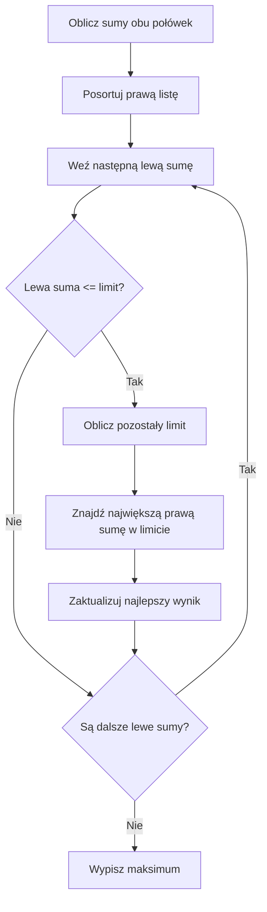

# Meet in the Middle - limit i liczba sposobów

## Dobór eksperymentów do czasu pracy laboratorium

Laboratorium ma **14 godzin** dostępnego czasu. Dostępne doświadczenia trwają `2, 3, 5, 8, 9, 11` godzin. Każde można przeprowadzić najwyżej raz i nie trzeba robić wszystkich. Chcemy wykorzystać **jak najwięcej czasu, ale nie przekroczyć 14 godzin**.

To nie jest pytanie „czy suma jest równa 14?” - szukamy **największej osiągalnej sumy nieprzekraczającej limitu**.

<details markdown="1">
<summary>Podpowiedź do laboratorium</summary>

Nie musisz przeprowadzać wszystkich doświadczeń. Sprawdź połączenie dwóch czasów.

</details>

<details markdown="1">
<summary>Pokaż przykład optymalnego wyboru</summary>

Można wybrać `3 + 11 = 14`. Osiągamy limit, więc nie da się uzyskać większej dopuszczalnej sumy.

</details>

## Dopasuj możliwie największą resztę

Wyobraź sobie dwa pudełka z kartkami. Na każdej kartce zapisana jest suma czasu możliwa do uzyskania z jednej połowy doświadczeń.

Bierzesz kartkę z lewej połowy, np. `5`. Do limitu 14 zostało `9`. Po prawej chcesz znaleźć **największą sumę nie większą niż 9**. Nie wolno wybrać 11, bo przekroczyłbyś limit.

Po posortowaniu prawej listy można znaleźć odpowiednią sumę wyszukiwaniem binarnym. W każdej próbie pamiętamy najlepszy dotychczasowy wynik.

Lewą sumę większą od limitu pomijamy tylko dlatego, że wszystkie czasy są nieujemne. Nie ma po prawej ujemnej sumy, która mogłaby ją zmniejszyć. Nie przenoś tego odrzucania bez zmian na dane z liczbami ujemnymi.

### Pseudokod

```text
utwórz obie listy sum i posortuj prawą
najlepsza = 0
dla każdej lewej sumy:
    jeżeli lewa <= limit:
        wyszukaj największą prawą sumę <= limit - lewa
        zaktualizuj najlepsza sumą obu części
wypisz najlepsza
```

## Schemat szukania maksimum



## C++ - największa suma bez przekroczenia limitu

Zakładamy, że czasy są nieujemne i suma mieści się w typie `int`. W przykładzie mamy po trzy elementy na połowę.

<details markdown="1">
<summary>Pokaż program szukający maksimum w limicie</summary>

```cpp
#include <iostream>
#include <algorithm>
using namespace std;

int main() {
    int a[3] = {2, 3, 5};
    int b[3] = {8, 9, 11};
    int l[8] = {0};
    int p[8] = {0};
    int il = 1, ip = 1;
    int limit = 14;

    for (int j = 0; j < 3; j++) {
        for (int i = 0; i < il; i++) l[il + i] = l[i] + a[j];
        il = il * 2;
    }
    for (int j = 0; j < 3; j++) {
        for (int i = 0; i < ip; i++) p[ip + i] = p[i] + b[j];
        ip = ip * 2;
    }
    sort(p, p + ip);

    int najlepsza = 0;
    for (int i = 0; i < il; i++) {
        if (l[i] > limit) continue;
        int pozostalo = limit - l[i];
        int lewy = 0, prawy = ip - 1;
        int znaleziony = -1;

        while (lewy <= prawy) {
            int srodek = lewy + (prawy - lewy) / 2;
            if (p[srodek] <= pozostalo) {
                znaleziony = srodek;
                lewy = srodek + 1;
            } else {
                prawy = srodek - 1;
            }
        }
        if (znaleziony != -1) {
            int suma = l[i] + p[znaleziony];
            if (suma > najlepsza) najlepsza = suma;
        }
    }
    cout << najlepsza << "\n";
    return 0;
}
```

</details>

<details markdown="1">
<summary>Pokaż wynik i znaczenie wyszukiwania</summary>

Wynik: `14`. Zwróć uwagę, że wyszukiwanie binarne **nie** szuka tutaj dokładnie jednej liczby. Szuka **prawego końca zbioru dozwolonych wartości**.

</details>

W gałęzi `p[srodek] <= pozostalo` zapamiętujemy trafienie, ale szukamy dalej w prawo. Może istnieć większa dopuszczalna suma. Wartość `-1` oznacza brak znalezionej pozycji. Przy nieujemnym limicie i zachowanej pustej sumie 0 dla dopuszczalnej lewej sumy istnieje co najmniej jeden kandydat.

<details markdown="1">
<summary>Pokaż tabelę dopasowań dla laboratorium</summary>

Prawa lista po uporządkowaniu to `0, 8, 9, 11, 17, 19, 20, 28`.

| Lewa suma | Pozostały limit | Największa dopuszczalna prawa | Suma obu części |
| ---: | ---: | ---: | ---: |
| 0 | 14 | 11 | 11 |
| 2 | 12 | 11 | 13 |
| 3 | 11 | 11 | 14 |
| 5 | 9 | 9 | 14 |
| 5 | 9 | 9 | 14 |
| 7 | 7 | 0 | 7 |
| 8 | 6 | 0 | 8 |
| 10 | 4 | 0 | 10 |

Najlepszy wynik to 14. Dwie lewe sumy 5 pochodzą z wyborów `5` oraz `2 + 3`. Przy szukaniu maksimum powtórzenie nie zmienia wyniku, ale pozostaje poprawną osobną pozycją listy.

</details>

### Dlaczego wynik jest najlepszy?

Dla ustalonej lewej sumy wybieramy największą dopuszczalną prawą. Żadna mniejsza prawa nie poprawi ich sumy. Sprawdzamy wszystkie lewe wybory, więc rozpatrzymy także lewą część optymalnego rozwiązania. Pusty wybór daje poprawne początkowe maksimum 0. Wyszukiwanie i sortowanie dają `O(n * 2^(n/2))` czasu i `O(2^(n/2))` pamięci.

## Drugi problem - ile jest sposobów?

Masz cztery zadania konkursowe warte odpowiednio `1, 2, 2, 3` punkty. Każde zadanie możesz rozwiązać albo pominąć. Na ile **różnych wyborów zadań** możesz uzyskać dokładnie 4 punkty?

Trzeba odróżnić wybory od samych sum. Dwa zadania za 2 punkty to dwa różne zadania, mimo jednakowej wartości.

<details markdown="1">
<summary>Podpowiedź do liczby wyborów</summary>

Odróżnij oba zadania za 2 punkty po ich pozycjach. Zsumuj wybór z lewej i prawej części.

</details>

<details markdown="1">
<summary>Pokaż obie listy i dopasowania do 4 punktów</summary>

Podzielmy punkty na `1, 2` i `2, 3`:

- lewe sumy: `0, 1, 2, 3`;

- prawe sumy: `0, 2, 3, 5`.

Dopasowania do 4 punktów: `1 + 3` oraz `2 + 2`. Są **2 sposoby**.

</details>

Gdy wartości się powtarzają, w dłuższych listach sum też mogą wystąpić powtórzenia. **Nie wolno usuwać duplikatów**, jeżeli liczymy różne podzbiory.

## C++ - policz wszystkie pary sum

Dla czterech elementów wystarczą dwie małe listy. Aby uczyć się idei, najpierw stosujemy dwie pętle. Dla dużych danych taka metoda byłaby za wolna; wtedy posortujemy listę i policzymy liczbę wystąpień brakującej sumy przez dwa wyszukiwania binarne.

<details markdown="1">
<summary>Pokaż prosty program zliczający pary</summary>

```cpp
#include <iostream>
using namespace std;

int main() {
    int a[2] = {1, 2};
    int b[2] = {2, 3};
    int l[4] = {0}, p[4] = {0};
    int il = 1, ip = 1;
    int cel = 4;
    int sposoby = 0;

    for (int j = 0; j < 2; j++) {
        for (int i = 0; i < il; i++) l[il + i] = l[i] + a[j];
        il = il * 2;
    }
    for (int j = 0; j < 2; j++) {
        for (int i = 0; i < ip; i++) p[ip + i] = p[i] + b[j];
        ip = ip * 2;
    }
    for (int i = 0; i < il; i++) {
        for (int j = 0; j < ip; j++) {
            if (l[i] + p[j] == cel) sposoby++;
        }
    }
    cout << sposoby << "\n";
    return 0;
}
```

</details>

<details markdown="1">
<summary>Pokaż wynik zliczania</summary>

Wynik: `2`. **Uczciwe ograniczenie:** ten program ilustruje łączenie wyników MITM, lecz przez dwie pętle jego etap łączenia może kosztować `O(2^n)`. Nie należy przedstawiać go jako szybkiej wersji dla `n = 40`.

</details>

Każda para pozycji z list opisuje dokładnie jeden pełny podzbiór. Dwie różne pary są różnymi wyborami, nawet jeśli sumy są równe. Zwiększenie licznika dla każdej pary dającej cel liczy wszystkie wybory raz. Dwie pętle mają czas `O(ileL * ileP) = O(2^n)`; listy zajmują `O(2^(n/2))` pamięci.

## Jak zliczać bez sprawdzania każdej pary?

Po posortowaniu prawej listy jednakowe sumy stoją obok siebie. Dla każdej lewej sumy szukamy dwóch granic: pierwszej pozycji z wartością `>= szukana` i pierwszej z wartością `> szukana`. Ich różnica jest liczbą pasujących prawych wyborów.

Używamy przedziału pozycji `[lewy, prawy)`, początkowo `[0, ip)`. Warunek to `lewy < prawy`, bo prawa granica jest wyłączona. Środek zawsze jest mniejszy od `ip`. Wynik może być równy `ip`: to miejsce za końcem listy, którego nie odczytujemy. Gdy trafień nie ma, obie granice są równe i różnica wynosi 0.

```text
posortuj prawą listę
sposoby = 0
dla każdej lewej sumy:
    szukana = cel - lewa
    pierwszy = pierwsza pozycja z wartością >= szukana
    zaOstatnim = pierwsza pozycja z wartością > szukana
    sposoby = sposoby + zaOstatnim - pierwszy
wypisz sposoby
```

Pierwsze wyszukiwanie przesuwa prawą granicę także przy równości. Drugie przy równości przesuwa lewą granicę. Każdy krok zmniejsza przedział. Dzięki uporządkowaniu końcowe granice obejmują wszystkie i tylko równe wartości. Nie pomijamy również powtarzających się lewych sum: to osobne wybory.

Czas sortowania i wyszukiwań to `O(n * 2^(n/2))`, pamięć `O(2^(n/2))`. W zadaniu C zastosujesz tę wersję do danych z powtórzeniami.

## Kiedy tego użyć?

| Sformułowanie zadania | Czego szukamy po prawej? |
|---|---|
| „Dokładnie X” | Sumy równej `X - lewa` |
| „Jak najwięcej, nie przekraczając X” | Największej sumy `<= X - lewa` |
| „Na ile sposobów?” | Liczby wystąpień sumy `X - lewa` |

W każdym wariancie sprawdź: czy wybory są niezależne, czy wynik da się złożyć z dwóch połówek i czy rozmiar wejścia uzasadnia MITM.

## Kiedy wybrać coś innego?

Dla bardzo małej liczby elementów proste dwie pętle są wystarczające. Przy niewielkim limicie i wielu elementach rozważ DP po sumie. Jeśli zamiast dowolnych elementów wybierasz spójny fragment, sprawdź techniki dla przedziałów.

## Ćwiczenia końcowe

### A. Najlepszy wynik w limicie

Dostępny czas to 10 godzin, a zadania trwają `2, 4, 7, 9`. Każde najwyżej raz. Rozpisz obie połówki i ustal najlepszą sumę bez przekroczenia limitu.

<details markdown="1">
<summary>Podpowiedź do zadania A</summary>

Wynik nie musi być równy limitowi. Sprawdź także wybór jednego zadania.

</details>

<details markdown="1">
<summary>Rozwiązanie zadania A</summary>

Lewa lista: `0, 2, 4, 6`. Prawa: `0, 7, 9, 16`. Dla lewych sum 0 i 2 najlepsze wyniki to 9 i 9. Dla 4 oraz 6 można dołączyć tylko 0, więc wyniki to 4 i 6. Maksimum: **9**, np. `2 + 7` albo samo `9`.

</details>

### B. Zmień limit w programie

W programie laboratorium zmień limit 14 na 13. Przewidź i sprawdź wynik. Podaj poprawny zestaw doświadczeń.

<details markdown="1">
<summary>Podpowiedź do zadania B</summary>

Szukaj największej prawej sumy nie większej niż reszta limitu.

</details>

<details markdown="1">
<summary>Rozwiązanie zadania B</summary>

Program wypisze `13`. Można wybrać `2 + 11` albo `5 + 8`. Większa dopuszczalna suma nie istnieje, bo 13 jest samym limitem.

</details>

### C. Policz różne wybory

Zadania A, B, C, D mają wartości `1, 1, 2, 2`. Każde można wybrać najwyżej raz. Na ile sposobów można uzyskać dokładnie 3 punkty? Wypisz wszystkie wybory konkretnych zadań i napisz program z dwoma wyszukiwaniami granic.

<details markdown="1">
<summary>Podpowiedź do zadania C</summary>

Wybierz jedną z dwóch jedynek i jedną z dwóch dwójek. Po sortowaniu zachowaj obie pozycje o tej samej wartości.

</details>

<details markdown="1">
<summary>Rozwiązanie zadania C</summary>

Wybory: A i C, A i D, B i C, B i D. Razem **4**. Listy połówek to `0, 1, 1, 2` oraz `0, 2, 2, 4`. Każda z dwóch lewych jedynek pasuje do obu prawych dwójek.

```cpp
#include <iostream>
#include <algorithm>
using namespace std;

int main() {
    int a[2] = {1, 1};
    int b[2] = {2, 2};
    int l[4] = {0}, p[4] = {0};
    int il = 1, ip = 1;
    int cel = 3;
    int sposoby = 0;

    for (int j = 0; j < 2; j++) {
        for (int i = 0; i < il; i++) l[il + i] = l[i] + a[j];
        il = il * 2;
    }
    for (int j = 0; j < 2; j++) {
        for (int i = 0; i < ip; i++) p[ip + i] = p[i] + b[j];
        ip = ip * 2;
    }
    sort(p, p + ip);
    for (int i = 0; i < il; i++) {
        int szukana = cel - l[i];
        int lewy = 0, prawy = ip;
        while (lewy < prawy) {
            int srodek = lewy + (prawy - lewy) / 2;
            if (p[srodek] < szukana) {
                lewy = srodek + 1;
            } else {
                prawy = srodek;
            }
        }
        int pierwszy = lewy;

        lewy = 0;
        prawy = ip;
        while (lewy < prawy) {
            int srodek = lewy + (prawy - lewy) / 2;
            if (p[srodek] <= szukana) {
                lewy = srodek + 1;
            } else {
                prawy = srodek;
            }
        }
        int zaOstatnim = lewy;
        sposoby = sposoby + zaOstatnim - pierwszy;
    }
    cout << sposoby << "\n";
    return 0;
}
```

Wydruk to `4`. Dla szukanej wartości 2 w prawej liście granice to 1 i 3, więc mamy dwa trafienia. Usunięcie powtórzeń zgubiłoby różne podzbiory.

</details>

### D. Sprawdź puste i zerowe wybory

Dane to dwie paczki A i B, obie o masie 0. Celem jest suma 0. Ile różnych podzbiorów spełnia warunek? Wypisz je. Wyjaśnij, dlaczego lista zawierająca tylko jedną wartość 0 nie wystarczy do zliczania.

<details markdown="1">
<summary>Podpowiedź do zadania D</summary>

Pusty podzbiór jest jednym wyborem, ale nie jedynym.

</details>

<details markdown="1">
<summary>Rozwiązanie zadania D</summary>

Są **4** wybory: pusty, tylko A, tylko B, A i B. Dla każdej jednoelementowej połowy lista zawiera dwie pozycje o wartości 0. Łącznie powstają cztery pary. Dla pytania o istnienie jedna wartość 0 wystarczyłaby, ale do liczenia wyborów trzeba zachować wszystkie pozycje.

</details>

## Bezpieczne zakresy i typowe błędy

W małych programach z tej lekcji mamy najwyżej sześć elementów, nieujemne wartości do 11 i cele do 14. Sumy oraz liczniki mieszczą się w `int`. Przy rozszerzeniu do najwyżej 12 elementów o wartościach `0..1000` suma nie przekroczy 12000, a licznik wszystkich podzbiorów `2^12 = 4096`. Oba ograniczenia są bezpieczne także dla minimalnego zakresu `int`.

W dużym zadaniu licznik może być znacznie większy niż pojedyncza suma. Dla 40 zer i celu 0 poprawnych wyborów byłoby `2^40`. Tego nie pomieści typowy 32-bitowy `int`. Małe tablice i `int` z naszych przykładów nie są gotowym programem dla takich danych.

- Usuwanie powtórzeń przy zliczaniu => utrata różnych wyborów.

- Zwiększenie licznika tylko raz po znalezieniu wartości => pominięcie pozostałych równych sum.

- Mylenie maksimum z liczbą sposobów => odpowiedź na inne pytanie.

- Stwierdzenie, że dwie pętle po listach dają szybką wersję MITM => pominięcie kosztu `O(2^n)`.

- Odczyt prawej granicy `ip` jako elementu => wyjście za zajętą część tablicy.

## Ćwiczenie z debuggerem

W programie z zadania C zatrzymaj się po obu wyszukiwaniach dla lewej sumy 1. Obserwuj pierwszy, zaOstatnim i sposoby. Ile dodań do licznika dają dwie lewe jedynki?

<details markdown="1">
<summary>Podpowiedź do ćwiczenia z debuggerem</summary>

Prawa lista to 0, 2, 2, 4. Granice opisują pozycje, nie same sumy.

</details>

<details markdown="1">
<summary>Rozwiązanie ćwiczenia z debuggerem</summary>

Dla każdej lewej jedynki pierwszy = 1, zaOstatnim = 3. Dodajemy 2. Ponieważ lewe jedynki są dwie, łącznie dodają 4 do licznika.

</details>
