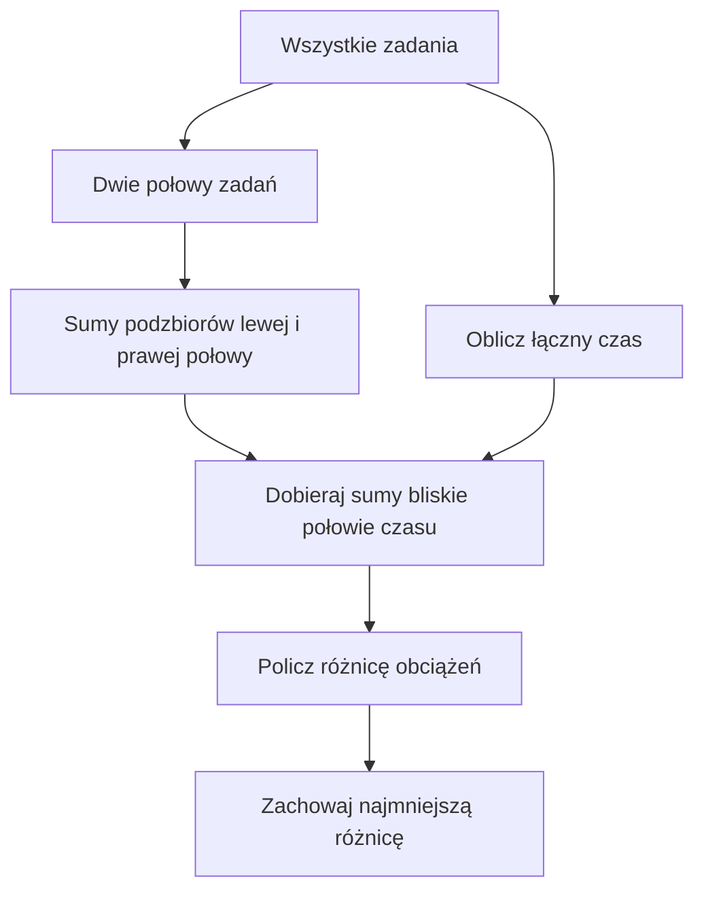

# Meet in the Middle - rozpoznawanie techniki

## Sprawiedliwy podział pracy

Sześć zadań ma czasy wykonania `2, 4, 5, 7, 9, 11` godzin. Chcemy rozdzielić wszystkie zadania między dwa zespoły. **Każde zadanie otrzymuje dokładnie jeden zespół.** Jak sprawić, by suma czasów obu zespołów różniła się możliwie najmniej?

Cały czas to `38` godzin. Jeśli pierwszy zespół ma sumę `s`, drugi otrzymuje `38 - s`. Różnica wynosi `|38 - 2*s|`. Szukamy więc podzbioru o sumie jak najbliższej `19`.

<details markdown="1">
<summary>Podpowiedź do podziału pracy</summary>

Wybór pierwszego zespołu wyznacza drugi. Sprawdź, jak blisko połowy łącznego czasu da się dojść.

</details>

<details markdown="1">
<summary>Pokaż podział i najmniejszą różnicę</summary>

Przykład optymalnego rozwiązania: pierwszy zespół bierze zadania `2, 5, 11` (razem 18 godzin), drugi `4, 7, 9` (razem 20 godzin). Różnica wynosi **2 godziny**. Nie da się uzyskać idealnego podziału po 19 godzin - można to potwierdzić, wypisując wszystkie sumy podzbiorów.

Sprawdźmy brak sumy 19 za pomocą połówek. Prawa lista po uporządkowaniu to `0, 7, 9, 11, 16, 18, 20, 27`.

| Lewa suma | Do 19 brakuje | Czy występuje po prawej? |
| ---: | ---: | --- |
| 0 | 19 | Nie |
| 2 | 17 | Nie |
| 4 | 15 | Nie |
| 6 | 13 | Nie |
| 5 | 14 | Nie |
| 7 | 12 | Nie |
| 9 | 10 | Nie |
| 11 | 8 | Nie |

Sprawdziliśmy wszystkie lewe wybory. Idealny podział jest niemożliwy. Przy łącznym czasie 38 różnica `38 - 2 * s` jest parzysta. Skoro osiągamy różnicę 2, a 0 jest niemożliwe, wynik 2 jest optymalny.

</details>

## Równoważenie wagi

Po obu stronach wagi stawiasz zadania. Nie wybierasz zadań „do zrobienia” - każde zadanie musi trafić na jedną stronę. Dlatego wystarczy wybrać zadania pierwszego zespołu: pozostałe automatycznie trafią do drugiego.

Znów możemy podzielić listę zadań na dwie połowy, policzyć sumy wszystkich podzbiorów każdej połowy, a następnie łączyć je tak, aby pierwsza suma była możliwie bliska połowie całkowitego czasu.



### Pseudokod prostej wersji

```text
oblicz calosc oraz obie listy sum
najlepszaRoznica = calosc
dla każdej lewej sumy i każdej prawej sumy:
    s = lewa + prawa
    roznica = wartość bezwzględna calosc - 2 * s
    zaktualizuj najmniejszą różnicę
wypisz najlepszaRoznica
```

## C++ - prosta wersja z małą liczbą zadań

Tutaj przeglądamy pary sum z dwóch połówek. Dla 6 zadań to tylko 8 × 8 prób. W dużym zadaniu należałoby posortować jedną listę i znajdować sumy najbliższe szukanemu wynikowi wyszukiwaniem binarnym.

<details markdown="1">
<summary>Pokaż prosty program podziału pracy</summary>

```cpp
#include <iostream>
using namespace std;

int main() {
    int a[3] = {2, 4, 5};
    int b[3] = {7, 9, 11};
    int l[8] = {0}, p[8] = {0};
    int il = 1, ip = 1;
    int calosc = 38;

    for (int j = 0; j < 3; j++) {
        for (int i = 0; i < il; i++) l[il + i] = l[i] + a[j];
        il = il * 2;
    }
    for (int j = 0; j < 3; j++) {
        for (int i = 0; i < ip; i++) p[ip + i] = p[i] + b[j];
        ip = ip * 2;
    }

    int najlepszaRoznica = calosc;
    for (int i = 0; i < il; i++) {
        for (int j = 0; j < ip; j++) {
            int s = l[i] + p[j];
            int roznica = calosc - 2 * s;
            if (roznica < 0) roznica = -roznica;
            if (roznica < najlepszaRoznica) {
                najlepszaRoznica = roznica;
            }
        }
    }

    cout << najlepszaRoznica << "\n";
    return 0;
}
```

</details>

<details markdown="1">
<summary>Pokaż wynik i przykładowy podział</summary>

Wynik: `2`. Na przykład pierwszy zespół otrzymuje `2, 5, 11` (18 godzin), a drugi `4, 7, 9` (20 godzin). Program sprawdza wszystkie możliwości i potwierdza, że nie da się osiągnąć różnicy 0.

</details>

Każda para podzbiorów obu połówek wyznacza pełny wybór dla pierwszego zespołu. Drugi dostaje dopełnienie. Sprawdzamy każdą możliwość, a wzór oblicza dokładnie różnicę obciążeń. To dowodzi poprawności małego programu.

Przez dwie pętle czas łączenia wynosi `O(2^n)`, a pamięć list `O(2^(n/2))`. Nie jest to szybka wersja dla 40 zadań.

Można użyć szybszej metody z poprzedniej lekcji: znajdź największą sumę nieprzekraczającą `calosc / 2`. Przy nieujemnych czasach i jednakowych zasadach dla obu zespołów mniejszą grupę zawsze można nazwać pierwszą. Zwiększanie jej sumy w tym zakresie zmniejsza `calosc - 2 * suma`. Dzięki temu wystarczy jedno wyszukiwanie prawego końca dla każdej lewej sumy, także gdy łączny czas jest nieparzysty.

## Kiedy tego użyć? Sześć pytań przed wyborem algorytmu

- Czy dla każdego elementu wybieram „tak/nie” (albo przypisuję go do jednej z dwóch grup)?

- Czy liczba wszystkich wyborów wynosi około `2^n`?

- Czy pełne sprawdzanie jest za drogie, ale `2^(n/2)` mieści się w pamięci i czasie?

- Czy każdy pełny wybór można rozłożyć na wybór z lewej oraz prawej połowy?

- Czy wynik całego wyboru da się szybko obliczyć z dwóch wyników częściowych?

- Czy da się **efektywnie** wyszukać odpowiednią parę częściowych wyników?

Jeśli wszystkie potrzebne warunki są spełnione, MITM jest dobrym kandydatem - ale zawsze porównaj go z prostszymi metodami.

Nie wystarczy odpowiedzieć „tak” na większość pytań. Niezależność połówek, wystarczający opis częściowego wyniku i szybkie łączenie są konieczne dla tej wersji techniki. Jeżeli wybór narzuca dodatkowe warunki, być może musisz zapisać więcej niż sumę, np. liczbę wybranych elementów.

## Kiedy wybrać coś innego?

Pełny przegląd jest dobry dla małego n. DP może wygrać przy małej łącznej sumie. Sumy prefiksowe odpowiadają na pytania o wiele spójnych przedziałów. Dwa wskaźniki pomagają np. przy szukaniu pary w uporządkowanej tablicy. Strategia zachłanna wymaga dowodu, że lokalny wybór nie pogarsza wyniku. Ograniczenia zadania, a nie podobne słowa, rozstrzygają wybór.

## Różne sytuacje - sam wybierz narzędzie

Nie wybieraj metody tylko po słowach „suma” albo „najlepszy”. Dla każdego opisu zapisz proponowaną technikę, przesłankę z treści i powód, dla którego MITM byłby albo nie byłby korzystny. Oblicz też odpowiedź małego przykładu.

| Numer | Treść zadania i przykład |
| --- | --- |
| 1 | Wybierz dowolną część z 36 paczek o nieujemnych całkowitych masach. Każdą najwyżej raz. Pytanie dotyczy dokładnej sumy X, a jej zakres nie pozwala na małą tablicę DP po sumie. Mały przykład: `3, 5, 8, 12, 14, 19`, cel 31. |
| 2 | Znajdź najdłuższy spójny fragment tablicy nieujemnych liczb o sumie nie większej niż X. Przykład: `1, 2, 1, 1, 3`, limit 4. |
| 3 | Masz 200 liczb i wiele zapytań o sumy spójnych przedziałów. Mały przykład: `2, 4, 1, 5`; zapytania o indeksy `0..2` i `1..3`, obie granice włącznie. |
| 4 | Masz wiele małych nieujemnych liczb, ich łączna suma nie przekracza 4000. Każdą wolno wybrać najwyżej raz. Sprawdź osiągalność celu. Mały przykład: `2, 3, 7`, cel 5. |
| 5 | W posortowanej tablicy znajdź dwie różne pozycje dające sumę 14. Przykład: `2, 4, 7, 10`. |
| 6 | W jednej sali przeprowadź jak najwięcej zajęć. Wolno odrzucać propozycje, każde liczy się jednakowo. Koniec może równać się początkowi następnych. Dane: A (0-2), B (1-4), C (2-3), D (3-5). |

**Uważaj na słowo „konieczność”.** Rzadko treść zadania wymusza tylko jeden algorytm. Rozpoznajemy raczej, że MITM jest korzystną możliwością przy danych ograniczeniach. Zadanie E wymaga uzasadnień.

## Zadania końcowe

### A. Zestaw aparatury

Masz moduły o poborze mocy `3, 5, 8, 12, 14, 19` W. Można włączyć dowolny podzbiór, każde urządzenie najwyżej raz. Czy da się osiągnąć dokładnie 31 W? Rozwiąż problem, dzieląc moduły na połowy i wypisując ich sumy.

<details markdown="1">
<summary>Podpowiedź do zadania A</summary>

Szukaj pary sum dającej cel. Pusta lewa połowa też jest wyborem.

</details>

<details markdown="1">
<summary>Rozwiązanie zadania A</summary>

Lewa lista: `0, 3, 5, 8, 8, 11, 13, 16`. Prawa: `0, 12, 14, 26, 19, 31, 33, 45`. Odpowiedź: **TAK**, np. pusta lewa i prawa `12 + 19 = 31`. Powtarzająca się lewa suma 8 nie jest błędem: pochodzi z różnych podzbiorów.

</details>

### B. Limit pamięci

Masz pliki o rozmiarach `4, 6, 7, 13, 15, 18` MB. Każdy najwyżej raz. Wybierz pliki na nośnik 32 MB tak, aby ich suma była największa i nie przekraczała pojemności. Podaj listy połówek, wynik i wybór.

<details markdown="1">
<summary>Podpowiedź do zadania B</summary>

Dla lewej sumy szukaj największej prawej nieprzekraczającej pozostałego limitu.

</details>

<details markdown="1">
<summary>Rozwiązanie zadania B</summary>

Lewa lista: `0, 4, 6, 10, 7, 11, 13, 17`. Prawa: `0, 13, 15, 28, 18, 31, 33, 46`. Maksimum: **32**, np. `4 + 13 + 15`. Większa dopuszczalna suma nie istnieje, bo osiągnęliśmy sam limit.

</details>

### C. Liczba wyborów

Cztery zadania A, B, C, D dają `2, 2, 3, 3` punkty. Każde można wybrać najwyżej raz. Ile różnych wyborów daje dokładnie 5 punktów? Wypisz je i uzasadnij zachowanie powtórzeń.

<details markdown="1">
<summary>Podpowiedź do zadania C</summary>

Odróżnij zadania o tej samej wartości ich pozycjami.

</details>

<details markdown="1">
<summary>Rozwiązanie zadania C</summary>

Są **4** wybory: A i C, A i D, B i C, B i D. W listach połówek dwie sumy 2 i dwie sumy 3 reprezentują osobne wybory. Usunięcie powtórzeń zgubiłoby rozwiązania.

</details>

### D. Dwa zespoły - samodzielny program

Zadania wymagają `2, 3, 5, 8` godzin. Przydziel wszystkie do dwóch zespołów, bez dzielenia zadań. Zminimalizuj różnicę sum. Napisz program z dwiema listami sum, sortowaniem i wyszukiwaniem binarnym. Dane wpisz w tablice. Wypisz najmniejszą różnicę.

<details markdown="1">
<summary>Podpowiedź do zadania D</summary>

Suma godzin to 18. Sprawdź, czy można uzyskać 9, a jeśli nie, znajdź największą sumę poniżej 9.

</details>

<details markdown="1">
<summary>Rozwiązanie zadania D</summary>

Najmniejsza różnica to **2** godziny, np. pierwszy zespół: `2 + 8 = 10`, drugi: `3 + 5 = 8`. Nie ma podzbioru o sumie 9. Można szukać sumy mniejszej grupy, czyli 8, a potem obliczyć `18 - 2 * 8`.

```cpp
#include <iostream>
#include <algorithm>
using namespace std;

int main() {
    int a[2] = {2, 3};
    int b[2] = {5, 8};
    int l[4] = {0};
    int p[4] = {0};
    int il = 1, ip = 1;
    int calosc = 18;
    int limit = calosc / 2;

    for (int j = 0; j < 2; j++) {
        for (int i = 0; i < il; i++) l[il + i] = l[i] + a[j];
        il = il * 2;
    }
    for (int j = 0; j < 2; j++) {
        for (int i = 0; i < ip; i++) p[ip + i] = p[i] + b[j];
        ip = ip * 2;
    }
    sort(p, p + ip);

    int najlepsza = 0;
    for (int i = 0; i < il; i++) {
        if (l[i] > limit) continue;
        int pozostalo = limit - l[i];
        int lewy = 0, prawy = ip - 1;
        int znaleziony = -1;

        while (lewy <= prawy) {
            int srodek = lewy + (prawy - lewy) / 2;
            if (p[srodek] <= pozostalo) {
                znaleziony = srodek;
                lewy = srodek + 1;
            } else {
                prawy = srodek - 1;
            }
        }
        if (znaleziony != -1) {
            int suma = l[i] + p[znaleziony];
            if (suma > najlepsza) najlepsza = suma;
        }
    }
    cout << calosc - 2 * najlepsza << "\n";
    return 0;
}
```

Program wypisuje `2`. Ta wersja ma czas `O(n * 2^(n/2))` i pamięć `O(2^(n/2))`.

</details>

### E. Rozpoznaj, nie programuj

Dla każdego opisu z sekcji „Różne sytuacje” podaj proponowany algorytm, przesłankę i ocenę sensu MITM. Oblicz odpowiedź małego przykładu. Nie podawaj samej nazwy metody.

<details markdown="1">
<summary>Podpowiedź do zadania E</summary>

Najpierw rozróżnij dowolny podzbiór, spójny przedział, parę oraz harmonogram. Potem porównaj liczbę elementów, zakres wartości i sposób łączenia.

</details>

<details markdown="1">
<summary>Rozwiązanie zadania E</summary>

| Opis | Proponowana metoda | Przesłanka i odpowiedź przykładu |
| --- | --- | --- |
| 1 | MITM | 36 decyzji tak/nie; pełne `2^36` jest duże, połowy mają po `2^18` możliwości. Wybory są niezależne, a sumy dają się łączyć. Przykład: TAK, `12 + 19 = 31`. |
| 2 | Przesuwające się okno | Spójny fragment i nieujemne liczby pozwalają kontrolować sumę przez przesuwanie granic. Największa długość to 3, np. `1, 2, 1`. To nie jest dowolny podzbiór. |
| 3 | Sumy prefiksowe | Wiele pytań o sumy przedziałów. Przykładowe wyniki to 7 oraz 10. Tworzenie podzbiorów nie odpowiada na te pytania. |
| 4 | DP po sumie | Niewielki zakres sum pozwala zapamiętywać osiągalność po kolejnych elementach. Każdy element trzeba obsłużyć jako dostępny tylko raz; to inne założenie niż monety w dowolnej liczbie. Przykład: TAK, `2 + 3 = 5`. |
| 5 | Dwa wskaźniki | Dane są uporządkowane, szukamy tylko pary. W przykładzie pasuje 4 i 10. Gdy suma jest za mała lub za duża, uporządkowanie uzasadnia przesunięcie odpowiedniej granicy. |
| 6 | Algorytm zachłanny według końca | Maksymalizujemy liczbę niekolidujących zajęć. Argument wymiany uzasadnia wybór najwcześniejszego końca. Wybieramy A, C, D, czyli 3 zajęcia. |

W opisie 1 zakres wartości może wymagać szerszego typu niż `int`; trzeba go dobrać osobno. Nasze małe programy nie obsługują automatycznie tych dużych ograniczeń. W opisie 4 mała suma zmienia opłacalność metod nawet wtedy, gdy elementów jest dużo. Nie wystarczy zapamiętać samego hasła „wybierz podzbiór”.

</details>

### F. Trudniejszy podział - tyle samo zadań

Sześć zadań trwa `1, 1, 1, 1, 1, 10` godzin. Rozdziel wszystkie między dwa zespoły. Każdy ma otrzymać dokładnie trzy zadania. Zminimalizuj różnicę sum, podaj przykład przydziału i napisz program. Czy sama lista sum wystarczy do sprawdzenia warunku trzech zadań?

<details markdown="1">
<summary>Podpowiedź do zadania F</summary>

Czy dwie grupy o tej samej sumie zawsze mają tyle samo zadań? Sprawdź, jakiej informacji brakuje w zwykłej liście sum.

</details>

<details markdown="1">
<summary>Druga podpowiedź do zadania F</summary>

Zapisuj dla każdego podzbioru dwie informacje: sumę i liczbę elementów. Łącz tylko pary, w których liczby elementów sumują się do 3.

</details>

<details markdown="1">
<summary>Rozwiązanie zadania F</summary>

Zespół z zadaniem 10 musi dostać jeszcze dwie jedynki: razem 12. Drugi dostaje trzy jedynki: razem 3. Najmniejsza różnica to **9**. Każdy dopuszczalny podział ma taki wynik. Jedynki są różnymi zadaniami.

Sama suma nie przechowuje liczby wybranych zadań. Dlatego obok każdej sumy zapisujemy rozmiar podzbioru. Stara część opisuje wybory bez nowego zadania, a nowa zwiększa sumę i rozmiar o jeden element:

```cpp
#include <iostream>
using namespace std;

int main() {
    int a[3] = {1, 1, 1};
    int b[3] = {1, 1, 10};
    int l[8] = {0}, p[8] = {0};
    int il = 1, ip = 1;
    int calosc = 15;
    int rozmiarL[8] = {0};
    int rozmiarP[8] = {0};

    for (int j = 0; j < 3; j++) {
        for (int i = 0; i < il; i++) {
            l[il + i] = l[i] + a[j];
            rozmiarL[il + i] = rozmiarL[i] + 1;
        }
        il = il * 2;
    }
    for (int j = 0; j < 3; j++) {
        for (int i = 0; i < ip; i++) {
            p[ip + i] = p[i] + b[j];
            rozmiarP[ip + i] = rozmiarP[i] + 1;
        }
        ip = ip * 2;
    }

    int najlepszaRoznica = calosc;
    for (int i = 0; i < il; i++) {
        for (int j = 0; j < ip; j++) {
            if (rozmiarL[i] + rozmiarP[j] != 3) {
                continue;
            }
            int s = l[i] + p[j];
            int roznica = calosc - 2 * s;
            if (roznica < 0) roznica = -roznica;
            if (roznica < najlepszaRoznica) {
                najlepszaRoznica = roznica;
            }
        }
    }

    cout << najlepszaRoznica << "\n";
    return 0;
}
```

Program wypisuje `9`. Sprawdza 64 pary, odrzucając te bez wymaganej liczby zadań. To mała wersja z czasem `O(2^n)`. Dla większych danych można grupować sumy według liczby elementów i szybko łączyć tylko pasujące grupy. Nie wolno sortować sum osobno od odpowiadających im rozmiarów.

</details>

## Typowe błędy i zakres danych

- Dwie zagnieżdżone pętle po listach nadal sprawdzają `2^n` par. Sam podział nie daje przyspieszenia.

- Użycie wzoru różnicy bez podwojenia sumy pierwszego zespołu => błędny wynik.

- Zmiana czasów w tablicach bez przeliczenia `calosc` => różnica przestaje odpowiadać danym.

- Zgubienie części zadań => drugi zespół ma dostać dokładne dopełnienie pierwszego.

- Dodanie warunku liczby zadań bez zapamiętania rozmiarów podzbiorów => za mało informacji do łączenia.

- Wybór MITM do każdego zadania o sumie => pominięcie prostszej metody wynikającej z ograniczeń.

W programach z tej lekcji mamy najwyżej sześć zadań i osiem sum na połowę. Największa suma to 38, a `2 * s` nie przekracza 76. Różnica i jej zmiana znaku są bezpieczne w `int`. Przy dużych danych trzeba osobno sprawdzić sumę, jej podwojenie, różnicę oraz rozmiary list.

## Ćwiczenie z debuggerem

W prostym programie podziału pracy znajdź parę sum dającą s = 18. Obserwuj calosc, s, roznica i najlepszaRoznica. Co robi warunek zmiany znaku dla s = 20?

<details markdown="1">
<summary>Podpowiedź do ćwiczenia z debuggerem</summary>

Różnica opisuje odległość obu obciążeń, więc musi być nieujemna.

</details>

<details markdown="1">
<summary>Rozwiązanie ćwiczenia z debuggerem</summary>

Dla s = 18 obliczamy 38 - 36 = 2. Dla s = 20 dostajemy 38 - 40 = -2 i zmieniamy znak na 2. Obie sumy opisują zamianę ról dwóch zespołów. Najlepsza różnica to 2.

</details>

## Podsumowanie cyklu

Meet in the Middle polega na **wyliczeniu możliwości w dwóch mniejszych częściach**, a następnie **sprytnym połączeniu** tych wyników. Zapamiętaj przede wszystkim warunki stosowalności: niezależne wybory, możliwość złożenia wyniku i odpowiednio małą liczbę elementów w każdej połowie.
