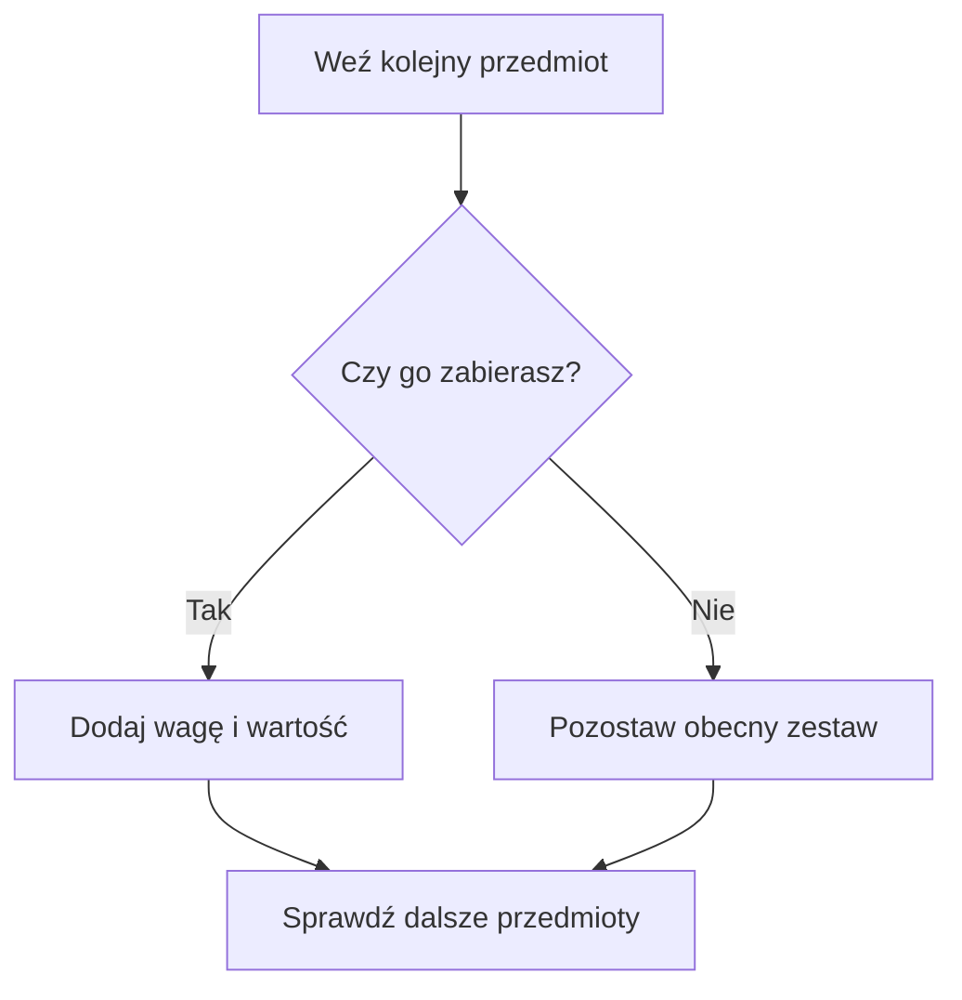

# Problem plecakowy 0/1 - co zabrać do plecaka?

## Co oznacza problem plecakowy 0/1?

Wyobraź sobie, że możesz zabrać najwyżej **5 kg** bagażu. Każdy przedmiot ma wagę oraz wartość (umowne punkty przydatności).

| Przedmiot | Waga (kg) | Wartość (punkty) |
|---|---:|---:|
| A - aparat | 2 | 6 |
| B - kurtka | 3 | 8 |
| C - książka | 4 | 9 |

Litery A, B, C są **nazwami przedmiotów**, a nie zmiennymi. Zapis „A + B” oznacza włożenie do plecaka aparatu i kurtki.

**Zadanie:** wybierz zestaw o największej wartości, którego waga nie przekracza 5 kg. Przedmiot można zabrać raz albo wcale. **0/1** oznacza właśnie „nie biorę / biorę”. Nie wolno brać połowy przedmiotu.

Waga zużywa dostępne miejsce. Wartość opisuje korzyść. Pojemność jest górnym limitem sumy wag, a nie wynikiem, który trzeba koniecznie osiągnąć. Każdy przedmiot jest osobną pozycją listy. Jeśli na liście są dwa podobne przedmioty, każdy nadal można wybrać najwyżej raz.

## Trzy kartki i decyzje

Wyobraź sobie trzy kartki z opisami przedmiotów. Dla każdej kartki musisz zdecydować: **wkładam do plecaka czy odkładam?**. Jeśli włożysz za dużo, zestaw odpada. Spośród zestawów, które się mieszczą, wybierasz najcenniejszy. To cały problem. Trudność rośnie dopiero wtedy, gdy kartek jest bardzo dużo.

Wartość nie oznacza wagi: cięższy przedmiot nie musi być cenniejszy. Nie musisz też zapełnić plecaka do końca.

## Wszystkie możliwości - przykład ręczny

Najpierw porównaj wszystkie zestawy dla danych z pierwszej tabeli. Pamiętaj także o pustym plecaku.

<details markdown="1">
<summary>Podpowiedź do ręcznego wyboru</summary>

Dla każdej z trzech pozycji zapisz tak albo nie. Oblicz dwie sumy i sprawdź limit, zanim porównasz wartości.

</details>

<details markdown="1">
<summary>Pokaż wszystkie zestawy i najlepszy wynik</summary>

Waga takiego zestawu to `2 + 3 = 5`, a wartość `6 + 8 = 14`.

| Zestaw | Łączna waga | Łączna wartość | Dozwolony? |
|---|---:|---:|---|
| nic | 0 | 0 | tak |
| A | 2 | 6 | tak |
| B | 3 | 8 | tak |
| C | 4 | 9 | tak |
| A+B | 5 | 14 | tak |
| A+C | 6 | 15 | nie |
| B+C | 7 | 17 | nie |
| A+B+C | 9 | 23 | nie |

**Najlepszy dozwolony zestaw to A+B: wartość 14.** To, że A+C ma wartość 15, nie ma znaczenia - zestaw jest zbyt ciężki.

</details>

## Czy najpełniejszy plecak zawsze jest najlepszy?

Pojemność wynosi 5 kg. Dostępne są dwa przedmioty: A (waga 4, wartość 10) i B (waga 5, wartość 8). Każdy wolno zabrać najwyżej raz. Porównaj dopuszczalne zestawy. Czy największe wykorzystanie pojemności oznacza największą wartość?

<details markdown="1">
<summary>Podpowiedź do wykorzystania pojemności</summary>

Nie porównuj kilogramów z punktami. Najpierw odrzuć zestaw zbyt ciężki.

</details>

<details markdown="1">
<summary>Pokaż porównanie</summary>

Pusty plecak daje wartość 0. Samo A waży 4 i daje 10 punktów. Samo B waży 5 i daje 8 punktów. Oba ważą 9, więc odpadają. Najlepsze jest A, mimo że zostaje 1 kg miejsca. Maksymalna wartość i maksymalna waga to różne cele.

</details>

## Dlaczego liczba możliwości szybko rośnie?

Dla każdego przedmiotu są dwa wybory. Dla trzech przedmiotów mamy `2 × 2 × 2 = 8` zestawów, a dla 20 aż `2^20 = 1 048 576`. Sprawdzanie wszystkich zestawów to dobry punkt wyjścia do zrozumienia problemu, ale nie zawsze dobry program.



Diagram pokazuje jedną decyzję, a nie gotowy program. Każdy zestaw odpowiada ciągowi decyzji 0/1. Dwa różne ciągi różnią się wyborem co najmniej jednego przedmiotu. Dlatego pełny przegląd nie gubi żadnego zestawu. Liczba zestawów rośnie wykładniczo: dołożenie jednej pozycji podwaja liczbę prób.

## Najprostszy program - trzy przedmioty

Program jest celowo ograniczony do trzech przedmiotów. Zwykłe trzy pętle pokazują wszystkie decyzje 0/1; nie jest to jeszcze programowanie dynamiczne.

<details markdown="1">
<summary>Pokaż kod C++ i omówienie</summary>

```cpp
#include <iostream>
using namespace std;

int main() {
    int waga[3] = {2, 3, 4};
    int wartosc[3] = {6, 8, 9};
    int pojemnosc = 5;
    int najlepsza = 0;

    for (int a = 0; a <= 1; a++) {
        for (int b = 0; b <= 1; b++) {
            for (int c = 0; c <= 1; c++) {
                int sumaWag = a * waga[0] + b * waga[1] + c * waga[2];
                int sumaWartosci = a * wartosc[0] + b * wartosc[1] + c * wartosc[2];
                if (sumaWag <= pojemnosc && sumaWartosci > najlepsza) {
                    najlepsza = sumaWartosci;
                }
            }
        }
    }
    cout << najlepsza << "\n";
    return 0;
}
```

Każda zmienna `a`, `b`, `c` przyjmuje 0 albo 1. Program wypisze **14**.

</details>

Gdy decyzja wynosi 0, jej iloczyn z wagą lub wartością też wynosi 0. Gdy wynosi 1, dodajemy dany przedmiot dokładnie raz. Warunek sprawdza najpierw dopuszczalną wagę, a potem poprawę wartości. Początkowe 0 odpowiada pustemu wyborowi.

Dla dokładnie trzech przedmiotów program wykonuje osiem prób. Gdybyśmy w ten sposób sprawdzali wszystkie wybory dla `n` przedmiotów, samych prób byłoby `2^n`. Przy ponownym sumowaniu do `n` pozycji w każdej próbie koszt wynosiłby `O(n * 2^n)`. To punkt odniesienia dla późniejszych metod. W pokazanym programie największa suma wag to 9, a wartości 23, więc `int` jest bezpieczny.

## Kiedy tego użyć?

Plecak 0/1 opisuje wybór niezależnych przedmiotów z jednej listy. Każdy zużywa część wspólnego zasobu i daje korzyść. Chcesz największej korzyści, ale nie wolno przekroczyć limitu.

Na początku warto sprawdzić mały przykład przez wypisanie zestawów. Tak rozpoznasz cel i warunek dopuszczalności, zanim poznasz szybszy sposób liczenia.

## Kiedy wybrać coś innego?

Jeżeli pytanie dotyczy sumy jednego wskazanego zestawu, wystarczy zwykłe dodawanie. Gdy wybór musi być spójnym fragmentem listy albo między przedmiotami występują zależności, założenia tego zadania się zmieniają. Samo słowo „limit” nie wystarcza do rozpoznania plecaka.

## Ćwiczenia końcowe

### A. Wybierz ręcznie

Pojemność wynosi 4 kg. Przedmioty: A (1 kg, 2 pkt), B (3 kg, 7 pkt), C (4 kg, 8 pkt). Każdy można zabrać najwyżej raz. Wypisz wszystkie dozwolone zestawy, ich wagi i wartości. Znajdź najlepszy.

<details markdown="1">
<summary>Podpowiedź do zadania A</summary>

Zrób tabelę: zestaw, waga, wartość. Odrzuć zestawy przekraczające limit.

</details>

<details markdown="1">
<summary>Rozwiązanie zadania A</summary>

| Zestaw | Waga | Wartość |
| --- | ---: | ---: |
| Nic | 0 | 0 |
| A | 1 | 2 |
| B | 3 | 7 |
| C | 4 | 8 |
| A+B | 4 | 9 |

Pozostałe zestawy przekraczają limit. Najlepsze jest **A+B**, waga 4, wartość **9**.

</details>

### B. Dlaczego sama wartość nie wystarcza?

Dla pierwszych danych z lekcji, przy pojemności 5, porównaj zestawy A+B i A+C. Wyjaśnij, dlaczego większa suma wartości nie zawsze oznacza poprawną odpowiedź.

<details markdown="1">
<summary>Podpowiedź do zadania B</summary>

Przed porównaniem korzyści zawsze sprawdź łączną wagę.

</details>

<details markdown="1">
<summary>Rozwiązanie zadania B</summary>

A+B waży 5 i ma wartość 14, więc jest dozwolone. A+C ma wartość 15, ale waży 6. Przekroczenie pojemności dyskwalifikuje zestaw. Największa wartość ma być wybrana tylko spośród zestawów mieszczących się w plecaku.

</details>

### C. Zmień pojemność w programie

W pokazanym programie zmień pojemność z 5 na 6 kg. Przed uruchomieniem przewidź wydruk. Podaj przedmioty, ich sumę wag i wartość.

<details markdown="1">
<summary>Podpowiedź do zadania C</summary>

Sprawdź zestaw aparatu i książki. Nie zmieniaj wag ani wartości.

</details>

<details markdown="1">
<summary>Rozwiązanie zadania C</summary>

Zmieniamy tylko `int pojemnosc = 6;`. Program wypisze `15` i nową linię. Najlepszy zestaw to A+C: waga `2 + 4 = 6`, wartość `6 + 9 = 15`. B+C i wszystkie trzy przedmioty nadal są zbyt ciężkie.

</details>

## Typowe błędy

- Maksymalizowanie wagi zamiast wartości => odpowiedź na inne pytanie.
- Wybór przedmiotu kilka razy => naruszenie założenia 0/1.
- Przyjęcie, że plecak musi być pełny => odrzucenie poprawnych zestawów.
- Pominięcie pustego wyboru => brak naturalnego wyniku 0, gdy nic się nie mieści.
- Porównywanie korzyści przed sprawdzeniem wagi => przyjęcie zbyt ciężkiego zestawu.

## Ćwiczenie z debuggerem

W głównym programie zatrzymaj się przy `a = 1`, `b = 0`, `c = 1`. Obserwuj `sumaWag`, `sumaWartosci` i `najlepsza`. Dlaczego warunek nie przyjmie tego zestawu przy pojemności 5?

<details markdown="1">
<summary>Podpowiedź do ćwiczenia z debuggerem</summary>

Wartość może być większa od obecnego wyniku, ale to nie jedyny warunek.

</details>

<details markdown="1">
<summary>Rozwiązanie ćwiczenia z debuggerem</summary>

Zestaw A+C ma wagę 6 i wartość 15. Przy pojemności 5 pierwsza część warunku jest fałszywa. Zestaw nie może poprawić wyniku, mimo wysokiej wartości.

</details>

## Zapamiętaj

Celem jest największa wartość przy ograniczonej wadze. Każdy element wybieramy co najwyżej raz.
