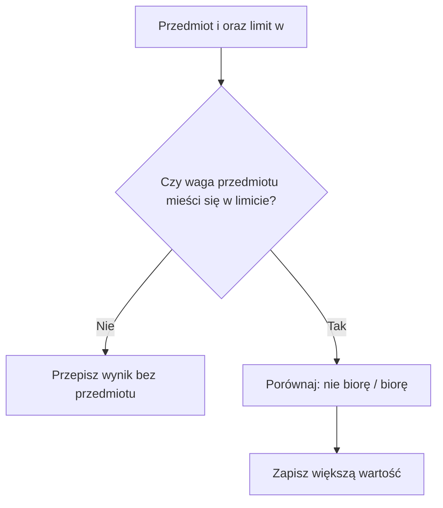

# Problem plecakowy 0/1 - dlaczego zachłanność zawodzi?

## Przypomnienie

Plecak ma określoną pojemność. Z każdego przedmiotu możesz skorzystać najwyżej raz. Szukamy maksymalnej sumy wartości bez przekroczenia limitu wag.

## Dlaczego wybór największej wartości może zawieść?

Masz **5 kg miejsca** i trzy przedmioty:

| Przedmiot | Waga | Wartość | Wartość / kg |
|---|---:|---:|---:|
| A | 5 | 10 | 2 |
| B | 3 | 7 | 2,33… |
| C | 2 | 6 | 3 |

Podpowiedź do reguły największej wartości

Porównaj pojedynczy przedmiot A z zestawem obu pozostałych.

Pokaż kontrprzykład dla największej wartości

Jeśli wybierzesz A (największa wartość pojedynczego przedmiotu), plecak jest pełny. Wynik: **10**. Jeśli wybierzesz B i C, dostaniesz **13**. Nawet to, co wygląda na dobry wybór w danym momencie, może odebrać możliwość lepszego zestawu.

Nie istnieje jedna prosta zasada typu „zawsze bierz najlżejszy” czy „zawsze największy stosunek wartości do wagi”, która rozwiązuje wszystkie przypadki plecaka 0/1.

## Dlaczego wybór najlżejszych może zawieść?

Pojemność wynosi 5 kg. Reguła rozpatruje przedmioty od najlżejszego i bierze każdy, który jeszcze się mieści.

| Przedmiot | Waga | Wartość |
| --- | ---: | ---: |
| A | 1 | 1 |
| B | 2 | 2 |
| C | 5 | 10 |

Prześledź tę regułę i porównaj z najlepszym dopuszczalnym zestawem.

Podpowiedź do najlżejszych

Po zabraniu małych przedmiotów sprawdź, czy zmieści się najcenniejszy.

Pokaż kontrprzykład dla najlżejszych

Reguła bierze A i B: łączna waga 3, wartość 3. C nie mieści się już w pozostałych 2 kg. Samo C waży 5 i daje 10. Jest optymalne: z C niczego więcej nie można dołożyć, a bez C dostępne są tylko A i B. Wynik reguły 3 jest gorszy od 10.

## Kontrprzykład dla stosunku wartości do wagi

Pojemność 10 kg:

| Przedmiot | Waga | Wartość | Punkty / kg |
|---|---:|---:|---:|
| A | 6 | 12 | 2 |
| B | 5 | 9 | 1,8 |
| C | 5 | 9 | 1,8 |

Podpowiedź do punktów na kilogram

Wskaż, co po wyborze A zmieści się w pozostałej pojemności. Potem sprawdź B i C razem.

Pokaż kontrprzykład dla stosunku wartości do wagi

Strategia „najwięcej punktów na kilogram” bierze A, uzyskując **12**. Tymczasem B+C ważą 10 kg i mają wartość **18**. To pokazuje błąd tej reguły dla plecaka 0/1.

Stosunek wartości do wagi to iloraz tych dwóch liczb. W tabelach służy wyłącznie do sprawdzenia proponowanej reguły. Przedmioty nadal są niepodzielne.

## Co pokazuje kontrprzykład?

Każda z trzech reguł zawiodła na konkretnych danych. Nie musi zawodzić zawsze. Nawet jeśli reguła działa dla jednego zestawu, nie jest to dowód poprawności dla wszystkich.

Wybór lokalnie atrakcyjnego przedmiotu zużywa pojemność. Może przez to zablokować kilka innych przedmiotów o większej łącznej wartości. W plecaku 0/1 nie mamy ogólnego uzasadnienia tych trzech reguł. Potrzebujemy sposobu porównania wyników różnych decyzji.

## Nowy pomysł - zapamiętywanie mniejszych wyników

Zamiast za każdym razem zaczynać od zera, zapisuj odpowiedzi dla **mniejszych limitów** oraz **mniejszej liczby przedmiotów**.

Na przykład zapytaj: „Jaki najlepszy wynik uzyskam z pierwszych dwóch przedmiotów, jeśli mam tylko 4 kg?”. Wynik tego mniejszego pytania przyda się później. Ten pomysł nazywamy **programowaniem dynamicznym (DP)**.

Dla kolejnego przedmiotu mamy dwie możliwości:

- **Nie biorę go**: pozostaje najlepszy wynik dla wcześniejszych przedmiotów i tego samego limitu.
- **Biorę go** (jeśli się mieści): dodaję jego wartość do najlepszego wyniku dla wcześniejszych przedmiotów i zmniejszonego limitu.

Wybieramy większy z tych dwóch wyników.

W obu decyzjach korzystamy z wcześniejszych przedmiotów. Jeśli bierzemy nowy, wcześniejszym zostawiamy mniej miejsca. Nie przeliczamy ich zestawów od początku: odczytujemy już znaną najlepszą wartość dla tego mniejszego limitu. Szczegółową tablicę zbudujemy w kolejnej lekcji.

## Ćwiczenie z kartką i ołówkiem

Dwa przedmioty: A (waga 2, wartość 3) i B (waga 3, wartość 5). Dla limitów 0, 1, 2, 3, 4, 5 zapisz najlepszą wartość, którą da się uzyskać.

| Limit wagi | 0 | 1 | 2 | 3 | 4 | 5 |
|---|---:|---:|---:|---:|---:|---:|
| Najlepszy wynik | ? | ? | ? | ? | ? | ? |

Podpowiedź

Dla limitu 4 nie możesz wziąć A i B jednocześnie, bo ważą razem 5. Dla limitu 5 możesz wziąć oba.

Rozwiązanie tabeli

Wyniki: **0, 0, 3, 5, 5, 8**. Przy limicie 4 najlepszy jest B; przy 5 oba przedmioty.

## Kiedy tego użyć?

Podejście z zapamiętywaniem wyników warto rozważyć, gdy ten sam problem wcześniejszych przedmiotów i pozostałej pojemności wraca przy różnych wyborach. Sama nazwa „programowanie dynamiczne” nie wystarczy: trzeba dokładnie opisać zapamiętywaną informację.

## Kiedy wybrać coś innego?

Dla trzech przedmiotów można po prostu sprawdzić wszystkie zestawy. W innych zadaniach reguła zachłanna może być poprawna, ale wymaga dowodu dla ich celu i ograniczeń. Kontrprzykład dla plecaka nie obala np. reguły najwcześniejszego końca w wyborze niekolidujących zajęć.

## Ćwiczenia końcowe

### A. Wskaż błędną regułę

Dla pojemności 5 i przedmiotów A (5 kg, 10 pkt), B (3 kg, 7 pkt), C (2 kg, 6 pkt) podaj strategię zachłanną, która zawodzi. Pokaż jej wybór i lepszy zestaw.

Podpowiedź do zadania A

Największa wartość pojedynczego przedmiotu nie jest wartością najlepszego zestawu.

Rozwiązanie zadania A

Reguła „bierz pojedynczy najcenniejszy” wybiera A i otrzymuje 10. B+C dają wagę 5 i wartość 13. To dopuszczalny lepszy zestaw, więc reguła nie jest ogólnie poprawna.

### B. Znaczenie 0/1

Czy wolno dobrać połowę przedmiotu w plecaku 0/1? Dlaczego odpowiedź ma znaczenie dla metody? W pierwszej tabeli sprawdź, czy po zabraniu B można dołożyć część A.

Podpowiedź do zadania B

Przypomnij, jakie dwie decyzje wolno podjąć dla każdej pozycji.

Rozwiązanie zadania B

Nie wolno. Bierzemy cały przedmiot albo go pomijamy. Po zabraniu B z pierwszej tabeli zostają 2 kg, a A waży 5. Nie można dobrać części A. Algorytm musi porównywać zestawy całych elementów.

### C. Znajdź najlepszy zestaw

Pojemność wynosi 6. Przedmioty A (waga 4, wartość 6), B (3, 5), C (3, 5). Każdy wolno wybrać najwyżej raz. Znajdź najlepszy zestaw i wartość. Porównaj z wyborem największej pojedynczej wartości.

Podpowiedź do zadania C

B i C to dwie odrębne pozycje, mimo identycznych danych.

Rozwiązanie zadania C

Najlepsze jest B+C: waga 6, wartość 10. A daje tylko 6, a z B lub C przekracza pojemność. Wszystkie trzy też się nie mieszczą. Reguła największej wartości wybrałaby A i straciła możliwość wyniku 10.

### D. Sprawdź sens mniejszego problemu

W ćwiczeniu z kartką A ma wagę 2 i wartość 3, a B wagę 3 i wartość 5. Wyjaśnij, dlaczego wynik dla limitu 4 różni się od wyniku dla limitu 5. Czy samo zapamiętanie liczby przedmiotów wystarczy?

Podpowiedź do zadania D

Dostępna pojemność decyduje o tym, które zestawy są dopuszczalne.

Rozwiązanie zadania D

Przy limicie 4 oba przedmioty razem się nie mieszczą, więc najlepsze jest B z wartością 5. Przy limicie 5 można zabrać A+B i uzyskać 8. Liczba dostępnych przedmiotów jest w obu pytaniach taka sama, a wynik inny. Trzeba pamiętać także limit.

## Typowe błędy

- Uznanie kilku udanych prób za dowód poprawności reguły => brak gwarancji dla innych danych.
- Wykreślenie jednej z identycznych pozycji => zgubienie dostępnego przedmiotu.
- Mylenie „dobry pierwszy wybór” z „najlepszy cały zestaw” => pominięcie kosztu zablokowanej pojemności.
- Porównanie reguły z zestawem przekraczającym limit => niepoprawny kontrprzykład.

## Zapamiętaj

Programowanie dynamiczne nie zgaduje jednego najlepszego przedmiotu. Porównuje wyniki dwóch decyzji, korzystając z już policzonych mniejszych problemów.
