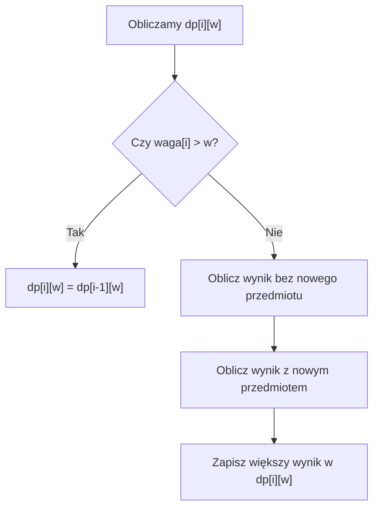

# Problem plecakowy 0/1 - tablica DP od pomysłu do C++

## Co dokładnie zapamiętujemy?

Bierzemy trzy przedmioty i plecak o pojemności 5 kg:

| Numer przedmiotu | Waga | Wartość |
|---|---:|---:|
| 1 | 2 | 3 |
| 2 | 3 | 5 |
| 3 | 4 | 6 |

Zapis `dp[i][w]` oznacza: **największa wartość, jaką mogę uzyskać z pierwszych `i` przedmiotów przy limicie wagi `w`**.

- `i` mówi, ile pierwszych przedmiotów wolno rozważyć.
- `w` mówi, ile kilogramów wolno zabrać.
- `dp[i][w]` jest **wartością**, a nie wagą ani listą przedmiotów.

Limit oznacza „nie więcej niż”, a nie „dokładnie”. Wolno zostawić niewykorzystane miejsce. Przyjmujemy dodatnie całkowite wagi i nieujemne całkowite wartości. Waga 0 nie należy do założeń tych programów.

Numery przedmiotów zaczynają się od 1. Wiersz 0 oznacza brak przedmiotów. Kolumna 0 oznacza brak pojemności. Dodatkowe pozycje pozwalają zapisać te dwa przypadki początkowe.

## Zeszyt odpowiedzi

Wyobraź sobie, że prowadzisz zeszyt odpowiedzi. Każda strona dotyczy liczby dostępnych przedmiotów, a każda kolumna limitu wagi. Kiedy rozważasz nowy przedmiot, nie przeliczasz wszystkiego. Zaglądasz do poprzedniej strony:

- „Co już mogłem zdobyć, **nie biorąc** nowego przedmiotu?”
- „Co mogłem zdobyć przy **mniejszym limicie**, a następnie dołożyć nowy przedmiot?”

Wybierasz większy wynik. To wszystko, co robi pojedyncza komórka tablicy.

## Wypełnianie tablicy ręcznie

Spróbuj przygotować cztery wiersze: brak przedmiotów, pierwszy, pierwsze dwa i pierwsze trzy. Kolumny opisują limity od 0 do 5.

<details markdown="1">
<summary>Podpowiedź do ręcznej tablicy</summary>

Najpierw wypełnij wiersz 0 i kolumnę 0 zerami. Rozważaj kolejno po jednym nowym przedmiocie. Każda odpowiedź korzysta z poprzedniego wiersza.

</details>

<details markdown="1">
<summary>Pokaż pełną tablicę i obliczenia</summary>

Zacznijmy bez gotowego wzoru.

- Bez przedmiotów każdy limit daje 0 punktów.
- Z przedmiotem 1 (waga 2, wartość 3) limity 0 i 1 są za małe. Od limitu 2 można go zabrać, a większy limit nie pozwala zabrać go drugi raz.
- Przy dodawaniu przedmiotu 2 (waga 3, wartość 5) zachowujemy poprzedni wynik lub sprawdzamy, co mieściło się wcześniej w pomniejszonym limicie. Dla limitu 3 wybór przedmiotu 2 daje 5 zamiast 3. Dla limitu 4 również 5. Dla limitu 5 wcześniejsze 2 kg wystarczą na przedmiot 1, więc razem uzyskamy 8.

| Dostępne przedmioty / limit w | 0 | 1 | 2 | 3 | 4 | 5 |
|---|---:|---:|---:|---:|---:|---:|
| Żaden (`i=0`) | 0 | 0 | 0 | 0 | 0 | 0 |
| Tylko 1 (`i=1`) | 0 | 0 | 3 | 3 | 3 | 3 |
| Pierwsze 2 (`i=2`) | 0 | 0 | 3 | 5 | 5 | 8 |
| Pierwsze 3 (`i=3`) | 0 | 0 | 3 | 5 | 6 | 8 |

**Dlaczego `dp[3][4] = 6`?** Jeśli nie weźmiemy przedmiotu 3, wynik wyniesie `dp[2][4] = 5`. Jeśli go weźmiemy, zostanie 0 kg i wynik wyniesie `dp[2][0] + 6 = 6`. Wybieramy 6.

**Dlaczego `dp[3][5] = 8`?** Bez trzeciego przedmiotu mamy `dp[2][5] = 8`. Z trzecim: `dp[2][1] + 6 = 6`. Wybieramy 8.

Przykład odczytu: `dp[2][5] = 8` oznacza najlepszy wynik z pierwszych dwóch przedmiotów przy limicie 5. Oba razem ważą 5 i dają 8. Przy limicie 4 dostępne są te same dwa przedmioty, ale najlepsza wartość wynosi tylko 5.

</details>

## Skąd bierze się wynik jednej komórki?

Dla przedmiotu `i` i limitu `w` rozdzielamy wszystkie dopuszczalne zestawy na dwie grupy.

- Bez nowego przedmiotu => najlepszy wynik to `dp[i - 1][w]`.
- Z nowym przedmiotem => jego waga musi być nie większa niż `w`. Pozostaje limit `w - waga[i]` dla wcześniejszych przedmiotów. Ich najlepszy wynik to `dp[i - 1][w - waga[i]]`. Dodajemy `wartosc[i]`.

Jeśli przedmiot jest za ciężki, druga grupa nie istnieje. Nie wolno odczytywać tablicy dla ujemnego limitu. Jeżeli się mieści, porównujemy oba wyniki i zapisujemy większy.



## Przypadki początkowe i kolejność

`dp[0][w] = 0`, bo bez przedmiotów nie zdobędziemy wartości. `dp[i][0] = 0`, ponieważ wagi są dodatnie i nic nie mieści się przy zerowym limicie. Pusty wybór jest dozwolony.

Najpierw obliczamy cały wiersz 1, potem 2 i następne. W każdym wierszu przechodzimy po limitach od 0 do pojemności. Wszystkie odczyty dla nowego wiersza pochodzą z już gotowego poprzedniego. Program nie musi ponownie wypisywać i sprawdzać zestawów wcześniejszych przedmiotów.

## Pseudokod

```text
Dla każdego limitu w od 0 do W: dp[0][w] = 0
Dla i od 1 do n:
    Dla w od 0 do W:
        dp[i][w] = dp[i - 1][w]
        Jeśli waga[i] <= w:
            zPrzedmiotem = dp[i - 1][w - waga[i]] + wartosc[i]
            Jeśli zPrzedmiotem > dp[i][w]:
                dp[i][w] = zPrzedmiotem
Wypisz dp[n][W]
```

## Kod C++ - zwykłe tablice

<details markdown="1">
<summary>Pokaż pełny program C++</summary>

```cpp
#include <iostream>
using namespace std;

int main() {
    int n = 3;
    int pojemnosc = 5;
    int waga[4] = {0, 2, 3, 4};
    int wartosc[4] = {0, 3, 5, 6};
    int dp[4][6] = {};

    for (int i = 1; i <= n; i++) {
        for (int w = 0; w <= pojemnosc; w++) {
            dp[i][w] = dp[i - 1][w];
            if (waga[i] <= w) {
                int zPrzedmiotem = dp[i - 1][w - waga[i]] + wartosc[i];
                if (zPrzedmiotem > dp[i][w]) {
                    dp[i][w] = zPrzedmiotem;
                }
            }
        }
    }

    cout << dp[n][pojemnosc] << "\n";
    return 0;
}
```

Wynik: **8**. Komórki `dp[0][w]` i `dp[i][0]` są równe 0: bez przedmiotów lub bez miejsca nie można uzyskać dodatniej wartości.

</details>

`waga[0]` i `wartosc[0]` są dodatkowymi zerami ułatwiającymi numerowanie. Przedmioty rozpatrujemy od indeksu 1. Tablica `dp[4][6]` mieści wiersze `0..3` i kolumny `0..5`. Zapis `= {}` ustawia wszystkie komórki na 0.

Najpierw przepisujemy wynik bez przedmiotu. Potem, jeśli przedmiot się mieści, obliczamy kandydata z jego udziałem. Do odczytu `w - waga[i]` dochodzimy dopiero po sprawdzeniu warunku. W tym przykładzie suma wszystkich wartości wynosi 14 i wszystkie obliczenia są bezpieczne dla `int`.

## Dlaczego wynik jest optymalny?

W formule używamy **poprzedniego wiersza** `dp[i - 1][...]`, bo nowy przedmiot można dodać tylko raz. Gdybyśmy korzystali z wyniku, który uwzględnia już ten sam przedmiot, moglibyśmy policzyć jego wielokrotne użycie.

Każdy dopuszczalny zestaw albo nie zawiera nowego przedmiotu, albo go zawiera. Rozważyliśmy więc wszystkie możliwości. Jeśli go zawiera, po jego usunięciu zostaje zestaw wcześniejszych przedmiotów mieszczący się w mniejszym limicie. Możemy zastąpić go najlepszym takim zestawem, nie pogarszając wyniku. Poprzedni wiersz daje właśnie tę odpowiedź.

Wiersz początkowy jest poprawny. Jeśli poprzedni jest poprawny, porównanie dwóch grup daje poprawny następny wiersz. Tak dochodzimy do `dp[n][pojemnosc]`.

Sprawdź jeden przedmiot o wadze 2 i wartości 3, przy limicie 4. Co groziłoby przy odczycie z bieżącego wiersza podczas dokładania przedmiotu?

<details markdown="1">
<summary>Pokaż skutek odczytu z niewłaściwego wiersza</summary>

Poprawny wynik to 3. Odczyt z bieżącego wiersza przy dokładaniu mógłby użyć tego samego przedmiotu drugi raz i dać 6. Dlatego oba kandydaty opieramy na wierszu `i - 1`.

</details>

## Wydajność i ograniczenia

Dla `n` przedmiotów i pojemności `W` obliczamy `n * (W + 1)` komórek. W każdej wykonujemy stałą liczbę działań. Przy dodatnich n i W zapisujemy to zwykle jako czas `O(n * W)` i pamięć `O(n * W)`. Dokładny rozmiar tabeli z wierszem początkowym to `(n + 1) * (W + 1)`.

Koszt zależy od liczbowej wartości pojemności. Milion jako W wymaga miliona kolumn, mimo że zapis tej liczby jest krótki. To nazywamy złożonością pseudowielomianową. DP nie sprawia, że dowolnie duży limit staje się łatwy. Przed utworzeniem tablicy policz liczbę komórek i sprawdź czas oraz pamięć.

W samodzielnym programie z zadania F ograniczymy dane do `n <= 10`, `W <= 20`. Wystarczy `dp[11][21]`, czyli 231 liczb. Przy wartościach przedmiotów `0..100` wynik nie przekroczy 1000. Wagi `1..20`, indeksy i wszystkie sumy mieszczą się w minimalnym zakresie `int` gwarantowanym przez C++. Nie zwiększaj granic bez ponownego sprawdzenia pamięci i zakresu wartości.

## Kiedy tego użyć?

Gdy potrzebujesz najlepszej sumy korzyści z niezależnych, jednorazowo wybieranych elementów, a wspólny limit jest na tyle mały, że tabela wszystkich pojemności jest wykonalna. Stan musi pamiętać zarówno dostępne przedmioty, jak i limit.

## Kiedy wybrać coś innego?

Dla trzech pozycji pełny przegląd jest prostszy. Dla małej liczby przedmiotów i bardzo dużej pojemności warto porównać pełny przegląd lub MITM. W takim zastosowaniu MITM potrzebuje informacji o wadze i wartości częściowego wyboru, nie tylko jednej sumy. Jeśli można wielokrotnie wybierać element albo dochodzą zależności, ta tablica nie opisuje już bez zmian całego problemu.

## Ćwiczenia końcowe

### A. Odczytaj komórkę

Wyjaśnij własnymi słowami znaczenie `dp[2][4]` dla danych z tej lekcji. Podaj jej wartość i zestaw, który ją uzyskuje.

<details markdown="1">
<summary>Podpowiedź do zadania A</summary>

Liczba 2 oznacza dostępne pierwsze przedmioty, a 4 limit, nie numer przedmiotu.

</details>

<details markdown="1">
<summary>Rozwiązanie zadania A</summary>

To największa wartość z pierwszych dwóch przedmiotów przy limicie 4 kg. Wynosi **5**. Uzyskujemy ją, biorąc tylko przedmiot 2. Oba razem ważą 5, więc są zbyt ciężkie.

</details>

### B. Zmień pojemność

W głównym programie zmień pojemność z 5 na 4. Przewidź wynik i wyjaśnij go. Czy trzeba powiększać tablicę?

<details markdown="1">
<summary>Podpowiedź do zadania B</summary>

Sprawdź przedmiot 3 i zestaw pierwszych dwóch.

</details>

<details markdown="1">
<summary>Rozwiązanie zadania B</summary>

Program wypisze **6**. Odpowiada temu sam przedmiot 3 o wadze 4. Pierwsze dwa razem ważą 5. Wystarczy zmienić `int pojemnosc = 4;`. Istniejąca tablica ma miejsce do kolumny 5, więc dla mniejszego limitu też jest wystarczająca.

</details>

### C. Zmień jeden przedmiot

Zastąp trzeci przedmiot takim o wadze 1 i wartości 4. Pozostałe dane zostają, pojemność nadal wynosi 5. Ręcznie porównaj zestawy i sprawdź program.

<details markdown="1">
<summary>Podpowiedź do zadania C</summary>

Rozważ 1+2, 1+3, 2+3 oraz pojedyncze przedmioty. Sprawdź także łączną wagę wszystkich trzech.

</details>

<details markdown="1">
<summary>Rozwiązanie zadania C</summary>

W tablicach trzecią wagę 4 zastępujemy 1, a wartość 6 zastępujemy 4. Najlepsze są przedmioty **2 i 3**: waga `3 + 1 = 4`, wartość `5 + 4 = 9`. Przedmioty 1+2 dają 8, 1+3 dają 7, a wszystkie trzy ważą 6 i nie mieszczą się. Program wypisze `9`.

</details>

### D. Wyświetl całą tablicę

Dopisz do głównego programu wyświetlanie całej tablicy `dp`. Nie zmieniaj danych: n = 3, pojemność 5. Wypisz wiersze `0..3` i kolumny `0..5`, a następnie zachowaj dotychczasowy wydruk wyniku.

<details markdown="1">
<summary>Podpowiedź do zadania D</summary>

Po zakończeniu obliczeń użyj dwóch pętli i cout << dp[i][w] << " ";. Nie pomijaj wiersza początkowego.

</details>

<details markdown="1">
<summary>Rozwiązanie zadania D</summary>

```cpp
#include <iostream>
using namespace std;

int main() {
    int n = 3;
    int pojemnosc = 5;
    int waga[4] = {0, 2, 3, 4};
    int wartosc[4] = {0, 3, 5, 6};
    int dp[4][6] = {};

    for (int i = 1; i <= n; i++) {
        for (int w = 0; w <= pojemnosc; w++) {
            dp[i][w] = dp[i - 1][w];
            if (waga[i] <= w) {
                int zPrzedmiotem = dp[i - 1][w - waga[i]] + wartosc[i];
                if (zPrzedmiotem > dp[i][w]) {
                    dp[i][w] = zPrzedmiotem;
                }
            }
        }
    }

    for (int i = 0; i <= n; i++) {
        for (int w = 0; w <= pojemnosc; w++) {
            cout << dp[i][w] << " ";
        }
        cout << "\n";
    }
    cout << dp[n][pojemnosc] << "\n";
    return 0;
}
```

Wydruk (po każdej komórce tabeli jest spacja):

```text
0 0 0 0 0 0
0 0 3 3 3 3
0 0 3 5 5 8
0 0 3 5 6 8
8
```

</details>

### E. Uzupełnij kod

Uzupełnij kandydaturę w gałęzi `waga[i] <= w`:

```cpp
int zPrzedmiotem = __________;
```

Dlaczego oba indeksy muszą wskazywać wcześniejsze przedmioty i pomniejszoną pojemność? Sprawdź wyrażenie dla `i = 3`, `w = 4` z głównych danych.

<details markdown="1">
<summary>Podpowiedź do zadania E</summary>

Zabierz nowy przedmiot z rozważanego zestawu. Ile miejsca zostaje dla wcześniejszych pozycji?

</details>

<details markdown="1">
<summary>Rozwiązanie zadania E</summary>

```cpp
int zPrzedmiotem = dp[i - 1][w - waga[i]] + wartosc[i];
```

Poprzedni wiersz nie uwzględnia jeszcze nowego przedmiotu, więc dodamy go tylko raz. Pomniejszona kolumna zostawia miejsce na jego wagę. Dla i = 3 i w = 4 kandydat wynosi `dp[2][0] + 6 = 6`.

</details>

### F. Samodzielna implementacja

Napisz program wczytujący `n` i pojemność, a potem `n` par: waga i wartość. Każdy przedmiot można wybrać najwyżej raz. Użyj tablicy dwuwymiarowej. Przyjmij `0 <= n <= 10`, `0 <= pojemnosc <= 20`, wagi `1..20`, wartości `0..100`. Dla danych spoza zakresu wypisz `Nieprawidlowe dane.`. Dla poprawnych danych wypisz największą wartość. Pusty wybór jest dozwolony.

Przykładowe wejście:

```text
3 5
2 3
3 5
4 6
```

Sprawdź też `0 5` bez kolejnych przedmiotów oraz jeden przedmiot o wadze 2 i wartości 3 przy limicie 4.

<details markdown="1">
<summary>Podpowiedź do zadania F</summary>

Zdefiniuj dp[i][w], wpisz przypadki początkowe i pilnuj poprzedniego wiersza. Waliduj rozmiary przed odczytem tablic.

</details>

<details markdown="1">
<summary>Rozwiązanie zadania F</summary>

```cpp
#include <iostream>
using namespace std;

int main() {
    int n, pojemnosc;
    if (!(cin >> n >> pojemnosc)) {
        return 0;
    }
    if (n < 0 || n > 10 || pojemnosc < 0 || pojemnosc > 20) {
        cout << "Nieprawidlowe dane.\n";
        return 0;
    }
    int waga[11] = {};
    int wartosc[11] = {};
    for (int i = 1; i <= n; i++) {
        if (!(cin >> waga[i] >> wartosc[i])) {
            return 0;
        }
        if (waga[i] < 1 || waga[i] > 20 || wartosc[i] < 0 || wartosc[i] > 100) {
            cout << "Nieprawidlowe dane.\n";
            return 0;
        }
    }
    int dp[11][21] = {};
    for (int i = 1; i <= n; i++) {
        for (int w = 0; w <= pojemnosc; w++) {
            dp[i][w] = dp[i - 1][w];
            if (waga[i] <= w) {
                int zPrzedmiotem = dp[i - 1][w - waga[i]] + wartosc[i];
                if (zPrzedmiotem > dp[i][w]) {
                    dp[i][w] = zPrzedmiotem;
                }
            }
        }
    }
    cout << dp[n][pojemnosc] << "\n";
    return 0;
}
```

Dla przykładu wynik to `8`. Dla `0 5` wynik to `0`. Dla jednego przedmiotu `(2, 3)` i limitu 4 wynik to `3`, a nie 6.

</details>

## Typowe błędy

- Użycie bieżącego wiersza zamiast poprzedniego przy dokładaniu => możliwość ponownego zabrania tego samego przedmiotu.
- Odczyt `w - waga[i]` przed sprawdzeniem wagi => ujemny indeks.
- Mylenie wartości z wagą w tablicy DP => błędny cel obliczeń.
- Tablica n wierszy zamiast n + 1 => brak miejsca na przypadek początkowy.
- Tablica W kolumn zamiast W + 1 => brak kolumny dla pełnej pojemności.
- Uznanie sumy równej pojemności za obowiązek => zmiana treści problemu.
- Zmiana danych na zerowe wagi bez sprawdzenia przypadków początkowych => naruszenie przyjętych założeń.

## Ćwiczenie z debuggerem

Zatrzymaj główny program przy i = 3 i w = 5. Obserwuj dp[2][5], dp[2][1], zPrzedmiotem i dp[3][5]. Dlaczego przedmiot 3 nie poprawia wyniku? Odczytaj kandydata po wykonaniu przypisania.

<details markdown="1">
<summary>Podpowiedź do ćwiczenia z debuggerem</summary>

Porównujesz najlepszy wynik bez przedmiotu z kandydatem, który go zawiera.

</details>

<details markdown="1">
<summary>Rozwiązanie ćwiczenia z debuggerem</summary>

Bez przedmiotu mamy 8. Kandydat to dp[2][1] + 6 = 0 + 6 = 6. Jest gorszy, więc dp[3][5] pozostaje równe 8.

</details>

## Zapamiętaj

Każda komórka odpowiada na jedno małe pytanie. Odpowiedź zapisujemy i wykorzystujemy dalej.
