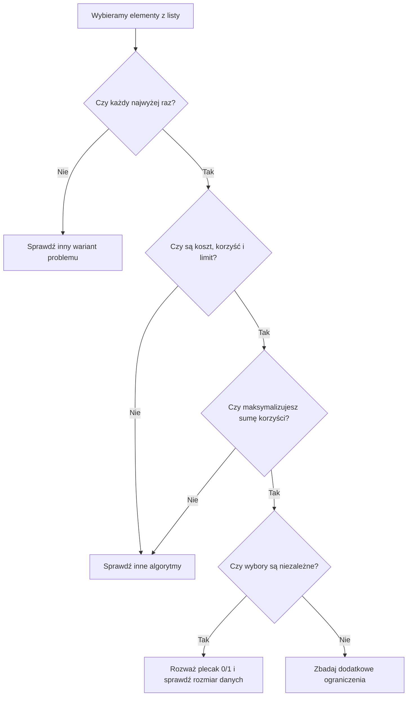

# Problem plecakowy 0/1 - jak rozpoznać zadanie?

## Nie szukaj słowa plecak

W zadaniu maturalnym lub konkursowym mogą występować pliki, projekty, doświadczenia albo wyposażenie. Ważniejsza niż opowieść jest struktura problemu.

Pomyśl o plecaku 0/1, gdy:

- Jest **lista elementów**, a każdy możesz wybrać najwyżej raz.
- Każdy element ma **koszt** (wagę, czas, rozmiar, zużycie zasobu) i **korzyść** (punkty, zysk, wartość).
- Masz **wspólny limit zasobu**.
- Chcesz **zmaksymalizować korzyść**, a wybór elementów nie ma dodatkowych zależności między nimi.

To nie jest mechaniczna reguła oparta na słowie kluczowym. Zawsze sprawdź, czy pojedynczy element można wybrać wielokrotnie i czy pojawiają się inne ograniczenia.

Ograniczony zasób odpowiada pojemności. Każdy element zużywa określoną część tego zasobu i daje określoną korzyść. Celem jest suma korzyści, a nie liczba pozostałych jednostek zasobu. Wybór jest 0/1, gdy jedną pozycję można przyjąć tylko w całości, raz albo wcale.

## Cztery różne zadania - jedna idea

### A. Pliki na pendrivie

Pendrive mieści 7 jednostek danych. Pliki: A (rozmiar 4, ważność 7), B (3, 6), C (2, 4). Każdy plik zapisujesz najwyżej raz. Wybierz zestaw o największej sumie ważności.

<details markdown="1">
<summary>Podpowiedź do przykładu A</summary>

Wskaż koszt jednej pozycji, jej korzyść, wspólny limit i zakaz wielokrotnego użycia.

</details>

<details markdown="1">
<summary>Rozpoznanie i rozwiązanie przykładu A</summary>

Odczytanie: rozmiar = **waga**, ważność = **wartość**, pojemność pendrive'a = **limit**. Wynik: A+B, waga 7, wartość **13**.

</details>

### B. Eksperymenty laboratoryjne

Masz 6 godzin. Doświadczenia: A (4 h, 8 pkt), B (3 h, 7 pkt), C (2 h, 5 pkt). Każde można wykonać najwyżej raz. Zdobądź maksymalną liczbę punktów.

<details markdown="1">
<summary>Podpowiedź do przykładu B</summary>

Wskaż koszt jednej pozycji, jej korzyść, wspólny limit i zakaz wielokrotnego użycia.

</details>

<details markdown="1">
<summary>Rozpoznanie i rozwiązanie przykładu B</summary>

Odczytanie: czas = **waga**, punkty = **wartość**. Wynik: A+C, czas 6 h, wartość **13**.

</details>

### C. Modernizacja pracowni

Masz budżet 9 jednostek. Zakupy: A (koszt 6, korzyść 8), B (5, 7), C (4, 6). Każdy zakup jest niepodzielny i możliwy najwyżej raz. Maksymalizuj korzyść.

<details markdown="1">
<summary>Podpowiedź do przykładu C</summary>

Wskaż koszt jednej pozycji, jej korzyść, wspólny limit i zakaz wielokrotnego użycia.

</details>

<details markdown="1">
<summary>Rozpoznanie i rozwiązanie przykładu C</summary>

Odczytanie: koszt = **waga**, budżet = **pojemność**. Wynik: B+C, koszt 9, korzyść **13**.

</details>

### D. Wyposażenie robota

Robot uniesie 8 jednostek obciążenia. Moduły: A (5, 9), B (4, 7), C (3, 6). Każdy moduł można zamontować najwyżej raz. Maksymalizuj przydatność.

<details markdown="1">
<summary>Podpowiedź do przykładu D</summary>

Wskaż koszt jednej pozycji, jej korzyść, wspólny limit i zakaz wielokrotnego użycia.

</details>

<details markdown="1">
<summary>Rozpoznanie i rozwiązanie przykładu D</summary>

Odczytanie: obciążenie = **waga**, przydatność = **wartość**. Wynik: A+C, obciążenie 8, przydatność **15**.

</details>

## Kiedy tego użyć?

Dla każdej historii wykonaj te same kroki:

- Wypisz, co jest jedną wybieraną pozycją.
- Nazwij jednostkę ograniczonego zasobu.
- Nazwij korzyść, którą dodajemy i maksymalizujemy.
- Sprawdź, czy każdą pozycję wolno wziąć najwyżej raz.
- Sprawdź, czy korzyści i koszty się sumują, a między pozycjami nie ma dodatkowych zależności.
- Dopiero potem sprawdź, czy n i pojemność pozwalają utworzyć tabelę DP.

W plikach zasobem jest rozmiar, a nie czas. W eksperymentach to czas, a nie kilogramy. Opowieść zmienia nazwy, ale stan nadal pyta o najlepszą korzyść z pierwszych i pozycji przy limicie w.

## Kiedy wybrać coś innego?

| Treść zadania | Na co uważać? |
| --- | --- |
| Możesz wybierać ten sam przedmiot wielokrotnie | Decyzja nie jest 0/1. Poprzedni wiersz nie opisuje bez zmian tych zasad. |
| Wolno wykorzystać tylko część jednej pozycji | Nie ma wyboru całej pozycji albo jej pominięcia. To inne założenia. |
| Wymagana jest dokładna suma wag, a wartość nie ma znaczenia | To pytanie o osiągalność sumy podzbioru, nie o największą wartość w limicie. |
| Jeden projekt wymaga wcześniejszego wykonania drugiego | Występują zależności; zwykła tablica 0/1 może nie wystarczyć. |
| Wybierasz spójny fragment listy | Nie wolno dowolnie łączyć pozycji, więc trzeba wykorzystać warunek spójności. |
| Zajęcia muszą pasować do konkretnych godzin | Sama suma czasów nie opisuje kolizji terminów. |

Sam fakt występowania limitu nie wystarcza. W zadaniu o minimalnej liczbie monet wynik komórki oznacza liczbę monet, a tutaj maksymalną korzyść z wcześniejszych przedmiotów. W zadaniu o sumach prefiksowych nie wybieramy dowolnych pozycji. W harmonogramie mogą decydować godziny początku i końca.

Nie zastępuj dowodu hasłem „zachłannie będzie szybciej”. Wybór największej wartości, najlżejszego przedmiotu lub najlepszego stosunku wartości do wagi nie daje ogólnej gwarancji dla plecaka 0/1.

Jeżeli pojemność jest bardzo duża, klasyczna tablica wszystkich limitów może być za duża. Przy małym n można rozważyć pełny przegląd albo MITM, przechowując wagi i wartości częściowych zestawów. Trzeba umieć połączyć te informacje. Samo zastąpienie jednej tablicy większą nie rozwiązuje ograniczeń pamięci.

## Schemat podejmowania decyzji



## Pseudokod - plan rozwiązania

```text
- Przypisz koszt do waga[i] i korzyść do wartosc[i].
- Określ n oraz pojemnosc.
- Utwórz dp[i][w] - najlepsza wartość z pierwszych i elementów.
- Wypełniaj tablicę: bez elementu i z elementem i.
- Odczytaj dp[n][pojemnosc].
- Porównaj wynik z małym przypadkiem policzonym ręcznie.
```

## Zadania końcowe

### A. Wyposażenie ekspedycji - samodzielna implementacja

**Wyposażenie ekspedycji.** Plecak ma pojemność 10 kg. Masz pięć przedmiotów:

| Nr | Waga (kg) | Wartość (pkt) |
|---|---:|---:|
| 1 | 6 | 12 |
| 2 | 4 | 7 |
| 3 | 3 | 6 |
| 4 | 5 | 9 |
| 5 | 2 | 4 |

Napisz program C++, który wyznaczy największą sumę wartości. Każdy przedmiot można zabrać co najwyżej raz. Użyj zwykłych tablic oraz DP. Następnie odpowiedz: dlaczego nie wystarczy zawsze brać przedmiot o największej wartości?

<details markdown="1">
<summary>Podpowiedź 1 do zadania A - rozpoznanie</summary>

Jest pięć niepodzielnych elementów, każdy z wagą i wartością. Pojemność ogranicza sumę wag. To klasyczny plecak 0/1.

</details>

<details markdown="1">
<summary>Podpowiedź 2 do zadania A - tablica</summary>

Przygotuj `dp[6][11] = {};`. Pierwszy wiersz oznacza brak przedmiotów, kolumny od 0 do 10 oznaczają limity wagi.

</details>

<details markdown="1">
<summary>Rozwiązanie zadania A - C++</summary>

```cpp
#include <iostream>
using namespace std;

int main() {
    int n = 5;
    int pojemnosc = 10;
    int waga[6] = {0, 6, 4, 3, 5, 2};
    int wartosc[6] = {0, 12, 7, 6, 9, 4};
    int dp[6][11] = {};

    for (int i = 1; i <= n; i++) {
        for (int w = 0; w <= pojemnosc; w++) {
            dp[i][w] = dp[i - 1][w];
            if (waga[i] <= w) {
                int kandydat = dp[i - 1][w - waga[i]] + wartosc[i];
                if (kandydat > dp[i][w]) {
                    dp[i][w] = kandydat;
                }
            }
        }
    }

    cout << dp[n][pojemnosc] << "\n";
    return 0;
}
```

Wynik: **19**. Jeden z optymalnych zestawów to 3, 4, 5: waga `3 + 5 + 2 = 10`, wartość `6 + 9 + 4 = 19`. Inny to 1 i 2: waga 10, wartość 19.

Reguła największej wartości akurat może znaleźć w tym zestawie optimum: wybierze 1 i 2. To nie dowodzi jej poprawności ogólnej. Kontrprzykład z drugiej lekcji to pojemność 5 oraz A (5, 10), B (3, 7), C (2, 6). Wybór A daje 10, a B+C daje 13. Poprawność reguły musi dotyczyć wszystkich danych spełniających założenia, nie jednego przykładu.

</details>

### B. Dobierz technikę, nie pisz programu

Dla każdego opisu wybierz metodę i uzasadnij ją celem oraz ograniczeniami. Nie podawaj samej nazwy algorytmu. Oblicz wynik małego przykładu.

- Urządzenie ma 5 jednostek energii. Można uruchomić każdy z trzech niezależnych pomiarów najwyżej raz. Pary zużycie-korzyść to `(4, 7)`, `(3, 5)`, `(2, 3)`. Zmaksymalizuj sumę korzyści.
- Znajdź najdłuższy spójny fragment nieujemnej tablicy `1, 2, 1, 1, 3` o sumie nie większej niż 4.
- Do jednej sali wybierz jak najwięcej zajęć A (0-2), B (1-4), C (2-3), D (3-5). Wolno odrzucać zajęcia, koniec może równać się początkowi następnych.
- Monet o wartościach 1, 3, 4 jest dowolnie wiele. Ułóż dokładnie kwotę 6 najmniejszą liczbą monet.

<details markdown="1">
<summary>Podpowiedź do zadania B</summary>

Wskaż, czy wybierasz dowolne jednorazowe pozycje, spójny fragment, terminy czy wielokrotnie dostępne nominały.

</details>

<details markdown="1">
<summary>Rozwiązanie zadania B</summary>

- Pomiary pasują do plecaka 0/1: zużycie to waga, korzyść to wartość, energia to pojemność. Najlepsze są pomiary 2 i 3: zużycie 5, korzyść **8**. Przy tych małych danych wystarczy także pełny przegląd; ogólny stan DP to najlepsza korzyść z pierwszych i pomiarów przy danym limicie energii.
- Spójny fragment i nieujemne dane sugerują przesuwające się okno. Największa długość to **3**, np. fragment `1, 2, 1`. Nie wybieramy dowolnego podzbioru.
- W zajęciach poprawna jest poznana strategia zachłanna według końca. Wybieramy A, C, D: **3 zajęcia**. Argument wymiany uzasadnia regułę. Limit jednej sali nie jest sumą wag przedmiotów.
- Monety pasują do DP dla minimalnej liczby monet. Wynik to **2**, monety `3 + 3`. Ten sam nominał może być użyty wiele razy, a celem jest dokładna kwota i minimalizacja liczby monet. To nie jest tablica plecaka 0/1 z tej lekcji.

</details>

## Pytania na zakończenie cyklu

- Czym różni się waga od wartości w problemie plecakowym?
- Co dokładnie oznacza `dp[i][w]`?
- Dlaczego do wyboru przedmiotu używamy poprzedniego wiersza tablicy?
- Jak udowodnić, że zachłanny wybór nie zawsze działa?
- Kiedy plecak 0/1 może być zbyt kosztowny obliczeniowo mimo użycia DP?

<details markdown="1">
<summary>Podpowiedź do pytań kontrolnych</summary>

Nazwij zasób i cel. Następnie przypomnij znaczenie wiersza oraz koszt liczby wszystkich komórek.

</details>

<details markdown="1">
<summary>Odpowiedzi kontrolne</summary>

- Waga zużywa limit, wartość jest celem maksymalizacji. 2. Najlepsza wartość z pierwszych i przedmiotów dla limitu w. 3. Aby nie użyć tego samego elementu więcej niż raz. 4. Pokazać konkretny kontrprzykład z gorszym wynikiem metody zachłannej. 5. Gdy liczbowa wartość pojemności jest bardzo duża.

</details>

## Typowe błędy

- Rozpoznawanie metody wyłącznie po słowie „limit” => pominięcie celu i charakteru wyborów.
- Użycie DP po pojemności bez sprawdzenia jej zakresu => zbyt duża tablica lub czas.
- Założenie niezależności zakupów mimo wymagań między nimi => dopuszczenie niepoprawnego zestawu.
- Przekonanie, że reguła zachłanna jest zawsze błędna => pomylenie kontrprzykładu z zakazem używania zachłanności w innych zadaniach.
- Oczekiwanie listy przedmiotów od programu wypisującego tylko wartość => pomylenie formatu odpowiedzi.

Program ekspedycji używa indeksów przedmiotów `1..5` oraz tablicy `dp[6][11]`. Największa suma wszystkich wartości to 38. Wszystkie jego obliczenia są bezpieczne dla `int`. Dodatnie wagi uzasadniają zerową kolumnę początkową.

## Ćwiczenie z debuggerem

W programie ekspedycji obserwuj wiersze dla pierwszych dwóch przedmiotów. Zatrzymaj się przy i = 2 i w = 10. Jaką wartość da kandydat z przedmiotem 2? Czy wykorzystuje ponownie przedmiot 2?

<details markdown="1">
<summary>Podpowiedź do ćwiczenia z debuggerem</summary>

W pomniejszonym limicie odczytujesz wiersz 1, który zna tylko pierwszy przedmiot.

</details>

<details markdown="1">
<summary>Rozwiązanie ćwiczenia z debuggerem</summary>

Kandydat to dp[1][6] + 7 = 12 + 7 = 19. Korzysta z przedmiotu 1 i dodaje przedmiot 2 raz. Nie odczytuje wyniku z wiersza 2.

</details>
