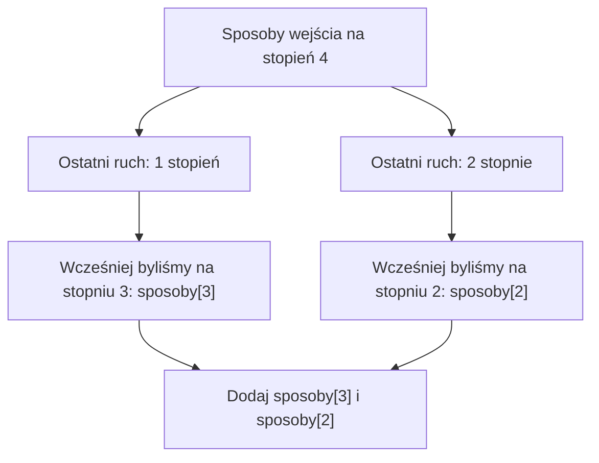

# Programowanie dynamiczne - schody i zapamiętywanie wyników

## Cel lekcji

Po lekcji potrafisz:

- rozpoznać, że większy problem składa się z podobnych, mniejszych problemów;
- zapisać wyniki małych problemów w tablicy;
- samodzielnie wyprowadzić zależność między kolejnymi wynikami;
- przeanalizować kod w C++ z pętlą `for`.

## Co oznacza programowanie dynamiczne?

Nie chodzi o program, który się porusza. **Programowanie dynamiczne** to sposób rozwiązywania zadań: najpierw obliczamy odpowiedzi dla prostych przypadków, a potem korzystamy z nich przy trudniejszych. Nie obliczamy wielokrotnie tego samego.

### Schody i ostatni ruch

Wyobraź sobie schody. W jednym ruchu możesz wejść **o jeden stopień albo o dwa stopnie**. Liczymy różne kolejności ruchów, a nie tylko ich sumy. Na ile różnych sposobów dotrzesz na czwarty stopień?

Ruchy zapisujemy liczbami: `1` oznacza wejście o jeden stopień, a `2` - o dwa.

<details markdown="1">
<summary>Podpowiedź do wejścia na czwarty stopień</summary>

Zapisz wszystkie kolejności ruchów 1 i 2, których suma wynosi 4. Nie licz dwa razy tego samego ciągu.

</details>

<details markdown="1">
<summary>Pokaż drogi na czwarty stopień i wynik</summary>

Możliwe drogi na czwarty stopień:

- `1 + 1 + 1 + 1`
- `1 + 1 + 2`
- `1 + 2 + 1`
- `2 + 1 + 1`
- `2 + 2`

**Odpowiedź: 5 sposobów.** Kolejność ruchów ma znaczenie.

</details>

Zastanów się nad ostatnim ruchem. Jeśli kończysz na stopniu 4, to przed ostatnim ruchem byłeś na stopniu **3** (ostatni ruch o 1) albo **2** (ostatni ruch o 2). Innej możliwości nie ma.

Dlatego:

`liczba sposobów na stopień 4 = liczba sposobów na stopień 3 + liczba sposobów na stopień 2`.

To samo rozumowanie działa dla każdego następnego stopnia.

## Mała tabela - obliczamy ręcznie

Oznaczamy `sposoby[i]` jako liczbę sposobów dotarcia dokładnie na stopień `i`.

Spróbuj obliczyć wyniki dla stopni od `0` do `5`.

<details markdown="1">
<summary>Podpowiedź do tabeli schodów</summary>

Dwa ostatnie ruchy mają różne długości. Dodaj liczby sposobów dotarcia na dwa poprzednie stopnie.

</details>

<details markdown="1">
<summary>Pokaż tabelę kolejnych wyników</summary>

| Stopień `i` | `sposoby[i]` | Wyjaśnienie |
|---:|---:|---|
| 0 | 1 | Jeden sposób: jeszcze nie wykonać żadnego ruchu |
| 1 | 1 | Tylko ruch `1` |
| 2 | 2 | Ruchy `1+1` lub `2` |
| 3 | 3 | `sposoby[2] + sposoby[1] = 2 + 1` |
| 4 | 5 | `sposoby[3] + sposoby[2] = 3 + 2` |
| 5 | 8 | `sposoby[4] + sposoby[3] = 5 + 3` |

</details>

**Dlaczego dla stopnia 0 wpisujemy 1, a nie 0?** Ponieważ istnieje dokładnie jeden sposób, aby pozostać na początku: nic nie zrobić. To pozwala prawidłowo policzyć wyższe stopnie.

## Schemat zależności



## Trzy kroki myślenia dynamicznego

**Krok 1 - co zapisujemy?** `sposoby[i]` oznacza liczbę sposobów wejścia na stopień `i`.

**Krok 2 - od czego zaczynamy?** `sposoby[0] = 1`, `sposoby[1] = 1`.

**Krok 3 - jak liczymy następne?** Dla `i >= 2`:

```text
sposoby[i] = sposoby[i - 1] + sposoby[i - 2]
```

To nazywamy **zależnością rekurencyjną**, ale do obliczeń **nie potrzebujemy rekurencji w C++**. Wystarczy tablica i zwykła pętla.

Do ostatniego ruchu o 1 i do ostatniego ruchu o 2 należą różne drogi. Żadnej nie liczymy dwa razy. Każda droga musi należeć do jednej z tych grup. Dopisanie ostatniego ruchu do każdej wcześniejszej drogi daje wszystkie drogi na stopień `i`. To uzasadnia dodawanie wyników.

Ręczna tabela staje się tablicą w programie. Numer stopnia jest indeksem, a liczba sposobów jest zawartością komórki. Wpisujemy dwa znane wyniki. Następnie pętla odwiedza stopnie od 2 do `n` i wykonuje dokładnie jedno dodawanie na każdy stopień.

## Pseudokod

```text
wczytaj n
sposoby[0] = 1
jeżeli n >= 1:
    sposoby[1] = 1
dla i od 2 do n:
    sposoby[i] = sposoby[i-1] + sposoby[i-2]
wypisz sposoby[n]
```

## Program w C++

W tej lekcji przyjmujemy **`0 <= n <= 30`**. Zakładamy `int` o zakresie co najmniej od `-2147483647` do `2147483647`, jak w typowym środowisku z 32-bitowym `int`. Przy tym założeniu wszystkie wyniki mieszczą się w `int`.

Największy wynik dla tego zakresu to `sposoby[30] = 1346269`. C++ dopuszcza też mniejszy, 16-bitowy `int`. Nie wystarczy on dla `n = 30`. Dlatego założenie o typie jest ważne. Nie zwiększaj granicy `30` bez sprawdzenia zakresu wyników i rozmiaru tablicy.

Tablica ma indeksy `0..30`. Dla `n = 0` nie wchodzimy do pętli od `2` ani do instrukcji ustawiającej stopień `1`. Wypisujemy poprawną odpowiedź zapisaną dla stopnia `0`.

<details markdown="1">
<summary>Otwórz kod C++ po samodzielnym zapisaniu pseudokodu</summary>

```cpp
#include <iostream>
using namespace std;

int main() {
    int n;
    if (!(cin >> n)) {
        return 0;
    }

    if (n < 0 || n > 30) {
        cout << "Nieprawidlowa liczba stopni.\n";
        return 0;
    }

    int sposoby[31] = {0};
    sposoby[0] = 1;

    if (n >= 1) {
        sposoby[1] = 1;
    }

    for (int i = 2; i <= n; i++) {
        sposoby[i] = sposoby[i - 1] + sposoby[i - 2];
    }

    cout << "Liczba sposobow: " << sposoby[n] << '\n';
    return 0;
}
```

</details>

## Dlaczego nie wypisujemy wszystkich dróg?

Dla małych schodów można ręcznie wymienić wszystkie kombinacje. Dla większej liczby stopni tych dróg szybko przybywa. Program z tablicą nie musi ich wypisywać - zapisuje tylko **ile dróg prowadzi na każdy stopień**.

Dla `n` stopni wykonujemy około `n` prostych obliczeń: **czas `O(n)`**, pamięć **`O(n)`**.

Gdybyśmy osobno pytali o liczbę sposobów na `n - 1` i na `n - 2`, w obu obliczeniach wracałoby np. pytanie o `n - 3`. Bez zapisu wyniku te same pytania powtarzałyby się wiele razy. Tablica przechowuje odpowiedź dla każdego stopnia tylko raz. Później odczytujemy gotową liczbę, zamiast ponownie rozważać prowadzące do niej drogi.

## Kiedy warto zastosować programowanie dynamiczne?

### Kiedy tego użyć?

Gdy zadanie liczy sposoby dojścia do celu, a ostatni ruch prowadzi z jednego z kilku mniejszych celów. Różne drogi mogą prowadzić do tego samego stopnia. Do dalszego liczenia wystarczy ich liczba, nie pełna historia ruchów.

Przed pisaniem kodu odpowiedz na cztery pytania:

- Co zapamiętuję? `sposoby[i]` - liczbę kolejności ruchów prowadzących dokładnie na stopień `i`.
- Od czego zaczynam? `sposoby[0] = 1`, bo pusty ciąg ruchów jest jednym sposobem. Dla `n >= 1` także `sposoby[1] = 1`.
- Od czego zależy kolejny wynik? Od dwóch poprzednich stopni: ostatni ruch miał długość 1 albo 2.
- W jakiej kolejności liczę? Od mniejszych stopni do większych. Przy obliczaniu `i` wyniki dla `i - 1` i `i - 2` są już gotowe.

Te same mniejsze problemy pojawiają się przy różnych rozważanych rozwiązaniach. Obliczenie odpowiedzi raz i zapisanie jej w tablicy pozwala nie powtarzać tej pracy. Jedna komórka wraz z jej znaczeniem opisuje **stan**. Zależność od wcześniejszych komórek opisuje, jak obliczyć kolejny stan.

### Kiedy wybrać coś innego?

Jeśli trzeba tylko obliczyć wysokość schodów, wystarczy zwykłe mnożenie. Jeśli pytanie dotyczy jednej podanej drogi, wystarczy sprawdzić jej ruchy. Dla kilku małych stopni można wypisać drogi ręcznie. Wybieranie zawsze ruchu o 2 nie policzy wszystkich kolejności.

Algorytm zachłanny podejmuje jeden wybór i go nie cofa. Potrzebuje dowodu, że taki wybór nie pogarsza wyniku. DP zachowuje wyniki wielu mniejszych problemów i łączy potrzebne możliwości. Samo słowo „najlepszy” albo „liczba sposobów” nie wystarcza do wyboru metody. Trzeba uzasadnić znaczenie stanu i zależność.

## Typowe błędy

- Wpisanie `sposoby[0] = 0`: wyniki staną się błędne.
- Rozpoczęcie pętli od `i = 1`: odczyt `sposoby[i - 2]` wyszedłby poza początek tablicy.
- Mylenie numeru stopnia z liczbą sposobów.
- Wybór zbyt dużego `n` dla typu `int` - dlatego ograniczyliśmy dane.

- Traktowanie `1 + 2` i `2 + 1` jako jednej drogi => pomijamy różne kolejności ruchów.
- Mylenie liczby wszystkich dróg z najmniejszą liczbą ruchów => rozwiązujemy inne zadanie.

## Zadania na koniec lekcji

### A. Policz ręcznie

Uzupełnij tabelę dla stopni `6`, `7` i `8`, gdy ruch ma długość 1 albo 2. Nie uruchamiaj programu, zanim nie zapiszesz wyników.

<details markdown="1">
<summary>Podpowiedź do zadania A</summary>

Zacznij od gotowych wyników dla stopni 4 i 5. Każdy następny wynik jest sumą dwóch poprzednich.

</details>

<details markdown="1">
<summary>Rozwiązanie zadania A</summary>

| Stopień | Obliczenie | Wynik |
| ---: | --- | ---: |
| 6 | 8 + 5 | 13 |
| 7 | 13 + 8 | 21 |
| 8 | 21 + 13 | 34 |

</details>

### B. Co oznacza komórka?

Co oznacza `sposoby[5]`? Wyjaśnij różnicę między indeksem `5` a zapisaną tam liczbą. Dlaczego `sposoby[0]` wynosi 1? Co oznacza odpowiedź dla `n = 0`?

<details markdown="1">
<summary>Podpowiedź do zadania B</summary>

Indeks opisuje cel. Zawartość opisuje, ile różnych kolejności prowadzi do tego celu.

</details>

<details markdown="1">
<summary>Rozwiązanie zadania B</summary>

`sposoby[5]` oznacza liczbę sposobów wejścia dokładnie na stopień 5. Jest ich 8, więc indeks wynosi 5, a zawartość 8. `sposoby[0] = 1` opisuje jeden pusty ciąg ruchów. Dla `n = 0` odpowiedź to 1: zostajemy na początku.

</details>

### C. Uzupełnij instrukcję

W pętli `for (int i = 2; i <= n; i++)` uzupełnij prawą stronę:

```cpp
sposoby[i] = __________;
```

Uzasadnij oba indeksy. Sprawdź swoje wyrażenie dla `i = 4`, korzystając z wcześniejszej tabeli.

<details markdown="1">
<summary>Podpowiedź do zadania C</summary>

Rozdziel drogi według ostatniego ruchu.

</details>

<details markdown="1">
<summary>Rozwiązanie zadania C</summary>

```cpp
sposoby[i] = sposoby[i - 1] + sposoby[i - 2];
```

Ostatni ruch o 1 prowadzi ze stopnia `i - 1`, a o 2 ze stopnia `i - 2`. Dla `i = 4` dodajemy `3 + 2` i otrzymujemy `5`.

</details>

### D. Zinterpretuj program

Przeanalizuj pełny program z tej lekcji dla wejść `4`, `0` i `31`. Podaj wydruk w każdym przypadku. Ile razy wykona się instrukcja dodawania dla `n = 4`?

<details markdown="1">
<summary>Podpowiedź do zadania D</summary>

Walidacja odbywa się przed utworzeniem tabeli wyników. Dla poprawnego n pętla zaczyna od i = 2.

</details>

<details markdown="1">
<summary>Rozwiązanie zadania D</summary>

- Wejście `4` => `Liczba sposobow: 5`. Dodawanie wykona się trzy razy: dla `i = 2, 3, 4`.
- Wejście `0` => `Liczba sposobow: 1`. Dodawanie nie wykona się ani razu.
- Wejście `31` => `Nieprawidlowa liczba stopni.`. Program kończy się przed obliczeniami.

Każdy komunikat kończy się znakiem nowej linii.

</details>

### E. Samodzielny program

Wczytaj `n` z przedziału `0..20` i wypisz liczbę sposobów wejścia na stopień `n` ruchami o 1 albo 2. Dla wartości spoza zakresu wypisz `Nieprawidlowa liczba stopni.`. Sprawdź wejścia `6` i `0`. Napisz program bez zaglądania do rozwiązania.

<details markdown="1">
<summary>Podpowiedź do zadania E</summary>

Odtwórz znaczenie komórki, przypadki początkowe i pętlę. Potrzebujesz miejsca na indeksy od 0 do 20.

</details>

<details markdown="1">
<summary>Rozwiązanie zadania E</summary>

```cpp
#include <iostream>
using namespace std;

int main() {
    int n;
    if (!(cin >> n)) {
        return 0;
    }

    if (n < 0 || n > 20) {
        cout << "Nieprawidlowa liczba stopni.\n";
        return 0;
    }

    int sposoby[21] = {0};
    sposoby[0] = 1;

    if (n >= 1) {
        sposoby[1] = 1;
    }

    for (int i = 2; i <= n; i++) {
        sposoby[i] = sposoby[i - 1] + sposoby[i - 2];
    }

    cout << "Liczba sposobow: " << sposoby[n] << '\n';
    return 0;
}
```

Dla `6` wydruk to `Liczba sposobow: 13`, a dla `0` - `Liczba sposobow: 1`.

</details>

### F. Rozpoznaj problem

Pasek ma długość 6 jednostek. Wypełniamy go od lewej do prawej klockami długości 1 albo 2. Nie zostawiamy luk. Klocki tej samej długości są nierozróżnialne, ale ich kolejność ma znaczenie. Ile jest ułożeń? Podaj znaczenie stanu, zależność, przypadki początkowe i kolejność obliczeń.

<details markdown="1">
<summary>Podpowiedź do zadania F</summary>

Popatrz na ostatni klocek i długość paska pozostającą przed jego dołożeniem.

</details>

<details markdown="1">
<summary>Rozwiązanie zadania F</summary>

Stan `sposoby[i]` oznacza liczbę ułożeń paska długości `i`. Ostatni klocek ma długość 1 albo 2 => dodajemy wyniki dla `i - 1` oraz `i - 2`. Początek: `sposoby[0] = 1`, `sposoby[1] = 1`. Liczymy rosnąco. Tabela dla długości 0..6 to `1, 1, 2, 3, 5, 8, 13`. Odpowiedź: **13 ułożeń**. Stan wystarcza, bo po dołożeniu ostatniego klocka liczy się tylko pozostała długość.

</details>

### G. Zmiana reguły ruchu

Teraz w jednym ruchu można wejść o 1, 2 lub 3 stopnie. Kolejność nadal ma znaczenie. Oblicz ręcznie wyniki dla stopni `0..5`. Napisz zależność i program dla `0 <= n <= 20`. Dla niepoprawnego zakresu wypisz `Nieprawidlowa liczba stopni.`. Uwzględniaj tylko ruchy, które nie prowadzą poniżej stopnia 0.

<details markdown="1">
<summary>Podpowiedź do zadania G</summary>

Na stopień 5 możesz wejść ze stopnia 4, 3 albo 2. Dla stopnia 1 nie wolno odwołać się do stopnia -1.

</details>

<details markdown="1">
<summary>Rozwiązanie zadania G</summary>

Wyniki dla stopni 0..5 to `1, 1, 2, 4, 7, 13`.

Dla `i >= 3`: `sposoby[i] = sposoby[i-1] + sposoby[i-2] + sposoby[i-3]`. Początkowo `sposoby[0] = 1`, `sposoby[1] = 1`, `sposoby[2] = 2`. Możemy też zacząć od zera i dodawać tylko składniki o nieujemnych indeksach:

```cpp
#include <iostream>
using namespace std;

int main() {
    int n;
    if (!(cin >> n)) {
        return 0;
    }
    if (n < 0 || n > 20) {
        cout << "Nieprawidlowa liczba stopni.\n";
        return 0;
    }

    int sposoby[21] = {0};
    sposoby[0] = 1;
    for (int i = 1; i <= n; i++) {
        sposoby[i] = sposoby[i - 1];
        if (i >= 2) {
            sposoby[i] = sposoby[i] + sposoby[i - 2];
        }
        if (i >= 3) {
            sposoby[i] = sposoby[i] + sposoby[i - 3];
        }
    }
    cout << "Liczba sposobow: " << sposoby[n] << '\n';
    return 0;
}
```

Dla wejścia `5` program wypisuje `Liczba sposobow: 13`. Największy wynik przy `n = 20` wynosi `121415`. Mieści się w założonym 32-bitowym `int`.

</details>

## Ćwiczenie z debuggerem

Uruchom główny program dla `n = 4`. Zatrzymaj go na przypisaniu w pętli. Obserwuj `i`, `sposoby[i - 1]`, `sposoby[i - 2]` i `sposoby[i]`. Jakie wartości zostaną użyte i zapisane w ostatnim obrocie? Odczytaj wynik po wykonaniu przypisania.

<details markdown="1">
<summary>Podpowiedź do ćwiczenia z debuggerem</summary>

Ostatni obrót dotyczy stopnia 4. Komórki dla dwóch poprzednich stopni są już obliczone.

</details>

<details markdown="1">
<summary>Rozwiązanie ćwiczenia z debuggerem</summary>

Przy `i = 4` odczytujemy `sposoby[3] = 3` i `sposoby[2] = 2`. Zapisujemy `sposoby[4] = 5`. Przed wykonaniem przypisania ta komórka ma jeszcze początkowe 0.

</details>

## Sprawdź, czy rozumiesz

Wyjaśnij własnymi słowami: *Co oznacza jedna komórka tablicy `sposoby` i dlaczego do obliczenia kolejnej wystarczą tylko dwa poprzednie wyniki?*

<details markdown="1">
<summary>Podpowiedź do pytania kontrolnego</summary>

Oddziel cel od liczby sposobów i nazwij dwa możliwe ostatnie ruchy.

</details>

<details markdown="1">
<summary>Odpowiedź do pytania kontrolnego</summary>

Jedna komórka podaje liczbę wszystkich uporządkowanych ciągów ruchów prowadzących na określony stopień. Ostatni ruch ma długość 1 albo 2. Te dwie rozłączne grupy korzystają z wyników dla dwóch poprzednich stopni.

</details>
