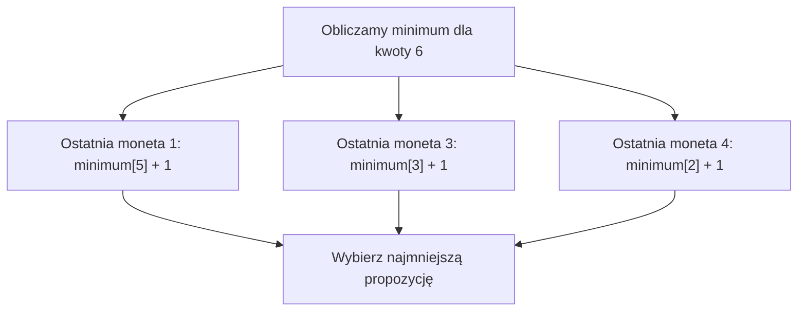

# Programowanie dynamiczne - najmniejsza liczba monet

## Co już umiemy?

W zadaniu o schodach zapisywaliśmy w tablicy **liczbę sposobów**. Teraz w tablicy będziemy zapisywać **najmniejszą liczbę monet potrzebną do uzyskania kwoty**.

Zmienia się znaczenie wyniku: nie liczymy wszystkich sposobów, lecz wybieramy najlepszy.

## Automat z monetami

Masz monety o wartościach **1, 3 i 4 zł**. Każdego rodzaju możesz użyć dowolnie wiele razy. Zakładamy, że mamy wystarczającą liczbę monet każdego nominału. Chcesz zapłacić **6 zł**, zużywając możliwie mało monet.

<details markdown="1">
<summary>Podpowiedź do kwoty 6</summary>

Porównaj wybór największej monety z użyciem dwóch jednakowych monet.

</details>

<details markdown="1">
<summary>Pokaż porównanie dwóch sposobów zapłaty</summary>

Pierwszy pomysł: „Bierz największą monetę, jaka jeszcze pasuje”. Wybieramy 4 zł, potem 1 zł i 1 zł. To **3 monety**.

Ale `3 + 3 = 6`: wystarczą **2 monety**.

**Wniosek:** Najbardziej oczywisty wybór w danym kroku nie zawsze prowadzi do najlepszego wyniku całego zadania.

</details>

Jak zatem rozumować? Zapytaj: **Jaka była ostatnia moneta?**

Jeśli ostatnia moneta miała wartość:

- `1`, wcześniej trzeba było ułożyć kwotę `5`;
- `3`, wcześniej trzeba było ułożyć kwotę `3`;
- `4`, wcześniej trzeba było ułożyć kwotę `2`.

Jeżeli znamy już najmniejszą liczbę monet dla kwot 5, 3 i 2, możemy wybrać najlepszą możliwość i **dodać jedną monetę na końcu**.

## Co zapamiętujemy w tablicy?

`minimum[k]` = najmniejsza liczba monet potrzebna do uzyskania dokładnie `k` zł.

Na początek:

`minimum[0] = 0`, bo do zapłacenia 0 zł nie potrzeba monet.

Dla kwoty `k` sprawdzamy każdą monetę, która nie przekracza `k`. Rozważamy:

`minimum[k - wartośćMonety] + 1`.

Wybieramy **najmniejszy** z tych wyników.

Spróbuj wypełnić tabelę dla kwot od `0` do `6`.

<details markdown="1">
<summary>Podpowiedź do tabeli monet</summary>

Dla każdej dopuszczalnej ostatniej monety sięgnij do mniejszej kwoty i dodaj 1.

</details>

<details markdown="1">
<summary>Pokaż tabelę i obliczenia dla kwoty 6</summary>

### Przykład - kwoty 0-6

| Kwota | Najlepszy sposób | `minimum[kwota]` |
|---:|---|---:|
| 0 | Brak monet | 0 |
| 1 | 1 | 1 |
| 2 | 1 + 1 | 2 |
| 3 | 3 | 1 |
| 4 | 4 | 1 |
| 5 | 4 + 1 | 2 |
| 6 | 3 + 3 | **2** |

### Co sprawdzamy dla kwoty 6?

- Ostatnia moneta 1: `minimum[5] + 1 = 2 + 1 = 3`.
- Ostatnia moneta 3: `minimum[3] + 1 = 1 + 1 = 2`.
- Ostatnia moneta 4: `minimum[2] + 1 = 2 + 1 = 3`.

Wybieramy `2`.

</details>

## Diagram decyzji dla kwoty 6



## Przed programowaniem: plan rozwiązania

- Tworzymy tablicę `minimum`.
- Wpisujemy `minimum[0] = 0`.
- Liczymy kolejne kwoty od 1 do podanej wartości.
- Dla każdej kwoty sprawdzamy dopuszczalne monety.
- Zapamiętujemy najkorzystniejszy wynik.

W zadaniu są monety o wartości 1, dlatego **każdą nieujemną kwotę da się uzyskać**. Nie musimy jeszcze rozpatrywać sytuacji niemożliwych do zapłacenia.

To założenie dotyczy tego zestawu monet. W dalszej części pokażemy, co trzeba zmienić, gdy monety o wartości 1 nie ma.

## Pseudokod

```text
wczytaj kwota
minimum[0] = 0
dla k od 1 do kwota:
    minimum[k] = k                // k monet po 1 zł
    dla każdej monety (1, 3, 4):
        jeżeli moneta <= k:
            propozycja = minimum[k - moneta] + 1
            jeżeli propozycja < minimum[k]:
                minimum[k] = propozycja
wypisz minimum[kwota]
```

## C++ - proste tablice i pętle

Wczytujemy kwotę z przedziału `0..100`. Monety są zawsze takie same: `1`, `3`, `4`.

<details markdown="1">
<summary>Otwórz rozwiązanie w C++</summary>

```cpp
#include <iostream>
using namespace std;

int main() {
    int kwota;
    if (!(cin >> kwota)) {
        return 0;
    }

    if (kwota < 0 || kwota > 100) {
        cout << "Nieprawidlowa kwota.\n";
        return 0;
    }

    int monety[3] = {1, 3, 4};
    int minimum[101] = {0};

    for (int k = 1; k <= kwota; k++) {
        minimum[k] = k;

        for (int i = 0; i < 3; i++) {
            if (monety[i] <= k) {
                int propozycja = minimum[k - monety[i]] + 1;

                if (propozycja < minimum[k]) {
                    minimum[k] = propozycja;
                }
            }
        }
    }

    cout << "Najmniejsza liczba monet: " << minimum[kwota] << '\n';
    return 0;
}
```

</details>

Tablica ma indeksy `0..100`. Sprawdzamy `monety[i] <= k` przed odczytem, więc indeks `k - monety[i]` nie jest ujemny. Ponieważ wszystkie nominały są dodatnie, odczytujemy mniejszą, już obliczoną kwotę. Wynik nie przekracza 100 monet, więc mieści się w `int`.

## Dlaczego to działa?

Każda poprawna zapłata kwoty `k > 0` kończy się **którąś z dostępnych monet**. Po jej usunięciu pozostaje mniejsza kwota, dla której najlepszy wynik już znamy. Przeglądamy wszystkie trzy możliwości ostatniej monety i wybieramy najmniejszą. Nie pomijamy żadnej możliwej ostatniej monety.

Jeśli po usunięciu ostatniej monety pozostała kwota nie byłaby zapłacona najmniejszą liczbą monet, moglibyśmy zastąpić ją lepszym sposobem. Cała zapłata też używałaby wtedy mniej monet. Dlatego dla każdej ostatniej monety wystarczy znać najlepszy wynik mniejszej kwoty.

## Porównanie z metodą zachłanną

<details markdown="1">
<summary>Pokaż porównanie wyników dla kwoty 6</summary>

| Metoda | Kwota 6 | Liczba monet |
|---|---|---:|
| Największa moneta najpierw | 4 + 1 + 1 | 3 |
| Programowanie dynamiczne | 3 + 3 | **2** |

</details>

Algorytm dynamiczny nie zgaduje, co będzie najlepsze. **Sprawdza wszystkie rodzaje ostatniej monety**, wykorzystując wcześniej obliczone wyniki.

W naszym przykładzie mamy 3 nominały. Dla `K` kolejnych kwot wykonujemy około `3K` porównań: **czas `O(K)`**, pamięć **`O(K)`**. Przy `m` nominałach czas wynosi `O(K · m)`.

## Co, jeśli nie ma monety o wartości 1?

Gdy monety mają wartości `2` i `4`, nie da się uzyskać każdej kwoty. Nie wolno wtedy wpisywać `minimum[k] = k`: to była zapłata monetami o wartości 1, których teraz nie mamy.

Użyjemy oznaczenia `brak = 101`. Oznacza ono, że kwoty jeszcze nie umiemy uzyskać. Dla zakresu `0..100` poprawna liczba monet nigdy nie przekroczy 100, bo każda moneta ma dodatnią całkowitą wartość. Liczba 101 nie pomyli się więc z poprawną odpowiedzią.

Zaczynamy od `minimum[0] = 0`. Dla kolejnej kwoty ustawiamy `minimum[k] = brak`. Propozycję tworzymy tylko wtedy, gdy poprzednia kwota jest osiągalna. Nie dodajemy 1 do oznaczenia `brak`.

```text
minimum[0] = 0
dla k od 1 do kwota:
    minimum[k] = brak
    dla każdej monety:
        jeżeli moneta <= k oraz minimum[k - moneta] != brak:
            propozycja = minimum[k - moneta] + 1
            jeżeli propozycja < minimum[k]:
                minimum[k] = propozycja
jeżeli minimum[kwota] = brak:
    wypisz komunikat o braku rozwiązania
w przeciwnym razie:
    wypisz minimum[kwota]
```

Dlaczego ta wersja działa? Każda osiągalna kwota kończy się dostępną monetą i zostawia osiągalną mniejszą kwotę. Sprawdzamy każdą taką możliwość. Jeśli nie ma żadnej, oznaczenie `brak` pozostaje. Pełny program i przykłady sprawdzisz w zadaniu G.

## Kiedy warto zastosować programowanie dynamiczne?

### Kiedy tego użyć?

Gdy zadanie pyta o najmniejszą liczbę elementów lub operacji potrzebnych do osiągnięcia dokładnego celu. Wiele różnych wyborów może pozostawiać tę samą resztę kwoty. Zapamiętana odpowiedź dla reszty przydaje się wielokrotnie.

Przed pisaniem kodu odpowiedz na cztery pytania:

- Co zapamiętuję? `minimum[k]` - najmniejszą liczbę monet potrzebną do uzyskania dokładnie kwoty `k`. Gdy kwota jest nieosiągalna, zapisujemy oddzielne oznaczenie.
- Od czego zaczynam? `minimum[0] = 0`. Pozostałe kwoty wymagają obliczeń. W wersji ogólnej zaczynają jako nieosiągalne.
- Od czego zależy kolejny wynik? Od wyników dla kwot mniejszych o jeden z nominałów. Każda propozycja dodaje jedną ostatnią monetę do osiągalnej kwoty.
- W jakiej kolejności liczę? Rosnąco po kwocie. Wszystkie nominały są dodatnie, więc poprzednie kwoty są mniejsze.

Te same mniejsze problemy pojawiają się przy różnych rozważanych rozwiązaniach. Obliczenie odpowiedzi raz i zapisanie jej w tablicy pozwala nie powtarzać tej pracy. Jedna komórka wraz z jej znaczeniem opisuje **stan**. Zależność od wcześniejszych komórek opisuje, jak obliczyć kolejny stan.

### Kiedy wybrać coś innego?

Jeśli jest tylko jeden nominał, często wystarczy dzielenie i sprawdzenie reszty. Dla konkretnego systemu monet można użyć strategii zachłannej dopiero po uzasadnieniu jej poprawności. Jeśli liczba monet każdego rodzaju jest ograniczona, nasz stan i pętle nie opisują całego zadania. Bardzo duża kwota może też nie pozwolić na tablicę wszystkich wartości.

Algorytm zachłanny podejmuje jeden wybór i go nie cofa. Potrzebuje dowodu, że taki wybór nie pogarsza wyniku. DP zachowuje wyniki wielu mniejszych problemów i łączy potrzebne możliwości. Samo słowo „najlepszy” albo „liczba sposobów” nie wystarcza do wyboru metody. Trzeba uzasadnić znaczenie stanu i zależność.

## Typowe błędy

- Uznanie, że największa dostępna moneta zawsze jest najlepsza.
- Odczyt `minimum[k - monety[i]]`, kiedy `monety[i] > k`.
- Zapomnienie o `+1`, czyli o ostatniej monecie.
- Pomieszanie wartości monety z liczbą użytych monet.

- Ustawienie `minimum[k] = k` bez monety o wartości 1 => zapisujemy nieistniejącą zapłatę.
- Traktowanie oznaczenia `brak` jak zwykłego wyniku => tworzymy propozycję z nieosiągalnej kwoty.
- Odczyt kwot od największej do najmniejszej => potrzebne mniejsze wyniki nie są jeszcze gotowe.

## Zadania na koniec lekcji

### A. Ręczna tabela

Uzupełnij `minimum[k]` dla kwot `7`, `8`, `9` i `10`. Nominały to `1`, `3`, `4`, każdego można używać dowolnie wiele razy. Podaj wynik i jeden zestaw monet dla każdej kwoty.

<details markdown="1">
<summary>Podpowiedź do zadania A</summary>

Przy kwocie 8 sprawdź, czy lepiej skończyć monetą 1, 3 czy 4.

</details>

<details markdown="1">
<summary>Rozwiązanie zadania A</summary>

| Kwota | Minimum | Przykładowe monety |
| ---: | ---: | --- |
| 7 | 2 | 3 + 4 |
| 8 | 2 | 4 + 4 |
| 9 | 3 | 3 + 3 + 3 |
| 10 | 3 | 3 + 3 + 4 |

Dla 9 i 10 dwie monety nie wystarczą, bo dwie największe dają tylko 8. Zależność z lekcji potwierdza pozostałe minima.

</details>

### B. Znaczenie komórki i kolejność

Co oznacza `minimum[6]`? Czym różni się od `monety[2]`? Wyjaśnij, dlaczego kwoty liczymy od najmniejszej do największej, a nie odwrotnie. Co zapisujemy dla kwoty 0?

<details markdown="1">
<summary>Podpowiedź do zadania B</summary>

Oddziel wartość monety od liczby monet. Zastanów się, czy minimum[k - 4] zostało już policzone.

</details>

<details markdown="1">
<summary>Rozwiązanie zadania B</summary>

`minimum[6] = 2` oznacza, że do zapłacenia 6 wystarczą dwie monety i mniej nie wystarczy. `monety[2] = 4` to wartość trzeciego nominału, nie liczba monet. Kwoty liczymy rosnąco, bo korzystamy z odpowiedzi dla mniejszych kwot. Dla zera zapisujemy 0: nie potrzeba żadnej monety.

</details>

### C. Uzupełnij propozycję

W programie dla monet `1, 3, 4` jesteśmy wewnątrz warunku `monety[i] <= k`. Uzupełnij wyrażenie:

```cpp
int propozycja = __________;
```

Dlaczego potrzebne jest dodawanie 1? Sprawdź propozycję dla `k = 6` i monety 3.

<details markdown="1">
<summary>Podpowiedź do zadania C</summary>

Najpierw rozwiąż problem kwoty pozostającej po zabraniu ostatniej monety.

</details>

<details markdown="1">
<summary>Rozwiązanie zadania C</summary>

```cpp
int propozycja = minimum[k - monety[i]] + 1;
```

Poprzedni wynik nie zawiera ostatniej monety, dlatego dodajemy 1. Dla kwoty 6 i monety 3 otrzymujemy `minimum[3] + 1 = 1 + 1 = 2`.

</details>

### D. Zinterpretuj kod i błędną strategię

W pełnym programie zmień tablicę `monety` na `{1, 4, 5}`. Dla kwoty `8` przewidź wydruk, zanim uruchomisz kod. Porównaj z regułą „największa moneta najpierw”. Podaj konkretne zestawy monet i ich liczby.

<details markdown="1">
<summary>Podpowiedź do zadania D</summary>

Zacznij zachłannie od 5, a potem sprawdź dwie monety po 4.

</details>

<details markdown="1">
<summary>Rozwiązanie zadania D</summary>

Program wypisze `Najmniejsza liczba monet: 2`. Zapłata to `4 + 4`. Mniej niż dwie monety nie wystarczy, bo nie ma monety o wartości 8. Strategia zachłanna daje `5 + 1 + 1 + 1`, czyli 4 monety. Program DP sprawdza wszystkie możliwe ostatnie nominały, zamiast ograniczać się do największego.

</details>

### E. Samodzielny program

Zmodyfikuj program tak, aby używał monet `1`, `5`, `7`. Każdego rodzaju jest dowolnie wiele. Wczytaj kwotę `0..100`, wypisz najmniejszą liczbę monet. Dla niepoprawnej kwoty wypisz `Nieprawidlowa kwota.`. Sprawdź wejścia `10` i `0`.

<details markdown="1">
<summary>Podpowiedź do zadania E</summary>

Zmień zawartość tablicy monety. Logika wyboru minimum pozostaje taka sama, bo nadal masz monetę 1.

</details>

<details markdown="1">
<summary>Rozwiązanie zadania E</summary>

```cpp
#include <iostream>
using namespace std;

int main() {
    int kwota;
    if (!(cin >> kwota)) {
        return 0;
    }

    if (kwota < 0 || kwota > 100) {
        cout << "Nieprawidlowa kwota.\n";
        return 0;
    }

    int monety[3] = {1, 5, 7};
    int minimum[101] = {0};

    for (int k = 1; k <= kwota; k++) {
        minimum[k] = k;

        for (int i = 0; i < 3; i++) {
            if (monety[i] <= k) {
                int propozycja = minimum[k - monety[i]] + 1;

                if (propozycja < minimum[k]) {
                    minimum[k] = propozycja;
                }
            }
        }
    }

    cout << "Najmniejsza liczba monet: " << minimum[kwota] << '\n';
    return 0;
}
```

Dla kwoty `10` wynik to `Najmniejsza liczba monet: 2` - dwie monety po 5. Dla zera program wypisuje `Najmniejsza liczba monet: 0`.

</details>

### F. Rozpoznaj zastosowanie DP

Urządzenie zaczyna na poziomie 0. Jedna operacja podnosi poziom o 1, 3 albo 4. Operacji można używać wielokrotnie. Nie wolno przekroczyć poziomu docelowego. Jaka jest najmniejsza liczba operacji potrzebna do osiągnięcia poziomu 6? Zdefiniuj stan, przypadek początkowy, zależność i kolejność. Wyjaśnij, czy zawsze warto wybrać największy skok.

<details markdown="1">
<summary>Podpowiedź do zadania F</summary>

Potraktuj długość operacji tak jak nominał. Każda ostatnia operacja pozostawia mniejszy poziom.

</details>

<details markdown="1">
<summary>Rozwiązanie zadania F</summary>

Stan `minimum[k]` to najmniejsza liczba operacji do poziomu `k`. Zaczynamy od `minimum[0] = 0`. Dla każdego dopuszczalnego skoku rozważamy `minimum[k - skok] + 1` i wybieramy minimum. Liczymy rosnąco. Dla 6 wystarczą **2 operacje**: `3 + 3`. Jedna nie wystarczy, bo nie ma skoku 6. Reguła największego skoku daje `4 + 1 + 1`, czyli 3 operacje.

</details>

### G. Nie każdą kwotę da się uzyskać

Nominały to `2` i `4`, każdego można używać dowolnie wiele razy. Wczytaj kwotę `0..100`. Wypisz minimum albo `Nie mozna uzyskac kwoty.`. Dla niepoprawnego zakresu wypisz `Nieprawidlowa kwota.`. Ręcznie wypełnij tablicę dla `0..8`. Sprawdź program dla `3`, `8` i `0`.

<details markdown="1">
<summary>Podpowiedź do zadania G</summary>

Nie zaczynaj od minimum[k] = k. Oznacz nieosiągalne kwoty i nie twórz z nich propozycji.

</details>

<details markdown="1">
<summary>Rozwiązanie zadania G</summary>

| Kwota | 0 | 1 | 2 | 3 | 4 | 5 | 6 | 7 | 8 |
| --- | --- | --- | --- | --- | --- | --- | --- | --- | --- |
| Minimum | 0 | brak | 1 | brak | 1 | brak | 2 | brak | 2 |

```cpp
#include <iostream>
using namespace std;

int main() {
    int kwota;
    if (!(cin >> kwota)) {
        return 0;
    }
    if (kwota < 0 || kwota > 100) {
        cout << "Nieprawidlowa kwota.\n";
        return 0;
    }

    int monety[2] = {2, 4};
    int minimum[101] = {0};
    int brak = 101;
    for (int k = 1; k <= kwota; k++) {
        minimum[k] = brak;
        for (int i = 0; i < 2; i++) {
            if (monety[i] <= k) {
                if (minimum[k - monety[i]] != brak) {
                    int propozycja = minimum[k - monety[i]] + 1;
                    if (propozycja < minimum[k]) {
                        minimum[k] = propozycja;
                    }
                }
            }
        }
    }

    if (minimum[kwota] == brak) {
        cout << "Nie mozna uzyskac kwoty.\n";
    } else {
        cout << "Najmniejsza liczba monet: " << minimum[kwota] << '\n';
    }
    return 0;
}
```

- Dla `3`: `Nie mozna uzyskac kwoty.`. Suma parzystych nominałów nie jest nieparzysta.
- Dla `8`: `Najmniejsza liczba monet: 2`, bo `4 + 4 = 8`.
- Dla `0`: `Najmniejsza liczba monet: 0`.

Przy dodatnich nominałach i kwocie do 100 każda poprawna odpowiedź mieści się w `0..100`. Oznaczenie `101` jest od niej oddzielone. W każdym kroku obliczamy tylko wynik dla mniejszej, osiągalnej kwoty, więc propozycja opisuje rzeczywistą zapłatę. Złożoność pozostaje `O(K * m)` czasu i `O(K)` pamięci.

</details>

## Ćwiczenie z debuggerem

Uruchom główny program dla kwoty `6`. Zatrzymaj go wewnątrz pętli monet dla `k = 6`. Obserwuj `i`, `monety[i]`, `propozycja` i `minimum[k]`. Jak minimum zmienia się po sprawdzeniu każdej monety?

<details markdown="1">
<summary>Podpowiedź do ćwiczenia z debuggerem</summary>

Początkowo minimum[6] = 6. Odczytaj wcześniej obliczone minimum dla kwot 5, 3 i 2.

</details>

<details markdown="1">
<summary>Rozwiązanie ćwiczenia z debuggerem</summary>

Kolejne propozycje to 3, 2 i 3. Po sprawdzeniu monet 1, 3 i 4 wartość minimum[6] wynosi odpowiednio 3, 2 i 2. Ostatnia propozycja nie poprawia wyniku.

</details>

## Co zapamiętać?

W pierwszej lekcji dodawaliśmy **liczbę sposobów**. W drugiej wybieramy **najmniejszą liczbę monet**. W obu przypadkach tablica przechowuje odpowiedzi dla mniejszych problemów.
