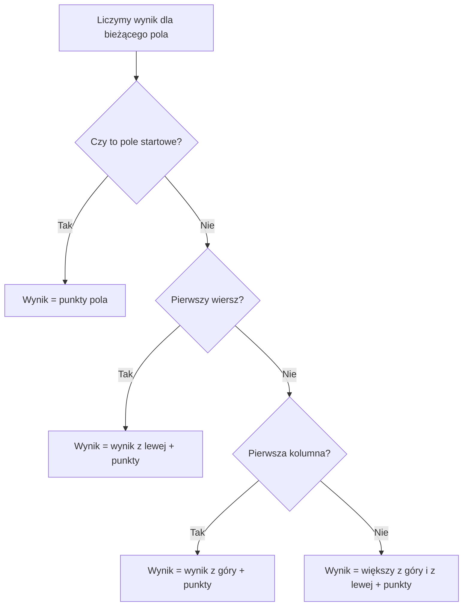

# Programowanie dynamiczne - najlepsza droga przez planszę

## Problem

Robot porusza się po planszy. Startuje w **lewym górnym rogu** i chce dotrzeć do **prawego dolnego rogu**.

Może wykonać tylko dwa ruchy:

- **w prawo** (o jedną kolumnę);
- **w dół** (o jeden wiersz).

Na każdym polu leży określona liczba punktów. Robot zbiera punkty z **każdego odwiedzonego pola**, także startowego i końcowego.

**Zadanie:** Znajdź największą sumę punktów na jednej dozwolonej drodze.

## Najpierw odczytaj dane

Plansza z punktami:

| Wiersz / kolumna | 0 | 1 | 2 |
|---|---:|---:|---:|
| 0 | 2 | 4 | 1 |
| 1 | 3 | 1 | 5 |
| 2 | 2 | 6 | 2 |

Pole `(1, 2)` to **wiersz 1, kolumna 2**, czyli wartość `5`.

Robot zaczyna na polu `(0, 0)` (wartość 2), kończy na `(2, 2)` (wartość 2).

Nie może się cofać, iść w lewo ani w górę.

## Kropki na kartce

Wyobraź sobie kratkowaną kartkę i pionek. Przy każdym polu zapisujesz pytanie:

> Jaka jest **największa suma**, z jaką mogę dotrzeć dokładnie tutaj?

Nie musisz pamiętać całej drogi, którą przebyłeś. Wystarczy zapisać jej najlepszy dotychczasowy wynik.

Jak można dotrzeć do wybranego pola?

- **Z góry** - jeśli pole nie jest w pierwszym wierszu.
- **Z lewej** - jeśli pole nie jest w pierwszej kolumnie.

Wybierasz lepszą z tych dwóch możliwości, a potem dodajesz punkty z bieżącego pola.

**Tylko dwa kierunki dojścia** - to najważniejsze odkrycie.

## Obliczenia ręczne

Oznaczymy `najlepiej[w][k]` jako **największą sumę punktów możliwą do uzyskania po dotarciu na pole `(w, k)`**.

Spróbuj uzupełnić wyniki dla całej planszy.

<details markdown="1">
<summary>Podpowiedź do obliczeń na planszy</summary>

Najpierw start, potem górny wiersz i lewa kolumna. W środku porównuj sumy dotarcia, nie punkty sąsiadów.

</details>

<details markdown="1">
<summary>Pokaż obliczenia, tablicę wyników i drogę</summary>

Pole startowe:

`najlepiej[0][0] = 2`.

Pierwszy wiersz: można przyjść tylko z lewej:

- `(0, 1)`: `2 + 4 = 6`;
- `(0, 2)`: `6 + 1 = 7`.

Pierwsza kolumna: można przyjść tylko z góry:

- `(1, 0)`: `2 + 3 = 5`;
- `(2, 0)`: `5 + 2 = 7`.

Pozostałe pola:

- `(1, 1)`: `1 + większa z (6, 5) = 7`;
- `(1, 2)`: `5 + większa z (7, 7) = 12`;
- `(2, 1)`: `6 + większa z (7, 7) = 13`;
- `(2, 2)`: `2 + większa z (12, 13) = 15`.

Wynikowa tablica:

| Wiersz / kolumna | 0 | 1 | 2 |
|---|---:|---:|---:|
| 0 | 2 | 6 | 7 |
| 1 | 5 | 7 | 12 |
| 2 | 7 | 13 | **15** |

Jedna z najlepszych dróg to: **prawo => dół => dół => prawo**. Kolejne odwiedzane pola to `(0,0)`, `(0,1)`, `(1,1)`, `(2,1)`, `(2,2)`. Zebrane punkty: `2 + 4 + 1 + 6 + 2 = 15`.

</details>

## Schemat decyzji przy jednym polu



## Pseudokod

```text
wczytaj wysokość i szerokość planszy
wczytaj punkty w każdym polu
dla każdego pola, od lewej do prawej i od góry do dołu:
    jeżeli to start:
        najlepiej[w][k] = punkty[w][k]
    w przeciwnym razie, jeżeli pierwszy wiersz:
        najlepiej[w][k] = najlepiej[w][k-1] + punkty[w][k]
    w przeciwnym razie, jeżeli pierwsza kolumna:
        najlepiej[w][k] = najlepiej[w-1][k] + punkty[w][k]
    w przeciwnym razie:
        wybierz większy wynik: z góry albo z lewej
        dodaj punkty bieżącego pola
wypisz wynik w prawym dolnym rogu
```

Zewnętrzna pętla wybiera wiersz. Wewnętrzna przechodzi po jego kolumnach od lewej do prawej. Gdy liczymy `(w, k)`, cały poprzedni wiersz i wcześniejsze kolumny bieżącego wiersza są już policzone. Pole z góry i pole z lewej mają więc gotowe wyniki.

## Program C++

Używamy planszy **3 x 3** wpisanej bezpośrednio w kodzie. Zwykłe tablice przechowują punkty i obliczone wyniki.

<details markdown="1">
<summary>Otwórz rozwiązanie w C++</summary>

```cpp
#include <iostream>
using namespace std;

int main() {
    int punkty[3][3] = {
        {2, 4, 1},
        {3, 1, 5},
        {2, 6, 2}
    };

    int najlepiej[3][3] = {0};

    for (int w = 0; w < 3; w++) {
        for (int k = 0; k < 3; k++) {
            if (w == 0 && k == 0) {
                najlepiej[w][k] = punkty[w][k];
            } else if (w == 0) {
                najlepiej[w][k] = najlepiej[w][k - 1] + punkty[w][k];
            } else if (k == 0) {
                najlepiej[w][k] = najlepiej[w - 1][k] + punkty[w][k];
            } else {
                int zGory = najlepiej[w - 1][k];
                int zLewej = najlepiej[w][k - 1];

                if (zGory > zLewej) {
                    najlepiej[w][k] = zGory + punkty[w][k];
                } else {
                    najlepiej[w][k] = zLewej + punkty[w][k];
                }
            }
        }
    }

    cout << "Najwieksza suma: " << najlepiej[2][2] << '\n';
    return 0;
}
```

</details>

Pseudokod pozwala na ogólne wymiary. Ten program ma stałe `3` wiersze i `3` kolumny, czyli indeksy `0..2`. Dla ćwiczeń przyjmujemy punkty od `-100` do `100`. Droga w planszy `3 x 3` odwiedza dokładnie 5 pól, więc suma mieści się w `-500..500`. To bezpieczne dla `int`.

Pierwszy warunek obsługuje start. Następny obsługuje pierwszy wiersz, a kolejny pierwszą kolumnę. Dopiero ostatnia gałąź odczytuje obu sąsiadów. Dzięki temu nie odczytujemy wiersza `-1` ani kolumny `-1`. Tak samo obsługiwalibyśmy planszę z jednym wierszem lub jedną kolumną, po dopasowaniu wymiarów.

## Skąd wiemy, że wybór jest poprawny?

Do pola `(w, k)` można wejść wyłącznie z góry albo z lewej. Jeśli istnieje najlepsza droga kończąca się na tym polu, przed ostatnim ruchem prowadziła do jednego z tych dwóch sąsiadów. Zastąpienie drogi do sąsiada lepszą drogą nie może pogorszyć wyniku, a dalszy ruch nadal jest dozwolony. Dlatego wystarczy zapamiętać najlepszy wynik dla każdego pola.

**Uwaga:** To zadanie pozwala na ruch tylko w prawo i w dół. Jeśli dodamy ruchy w cztery strony, ten prosty sposób wypełniania tablicy nie wystarczy.

## Dlaczego lokalny wybór może zawieść?

Reguła „idź na sąsiednie pole z większą liczbą punktów” porównuje tylko najbliższy krok. Nie uwzględnia tego, co stanie się dalej. Sprawdź ją dla planszy:

| Wiersz / kolumna | 0 | 1 | 2 |
| --- | ---: | ---: | ---: |
| 0 | 1 | 5 | 4 |
| 1 | 4 | 1 | 1 |
| 2 | 100 | 1 | 1 |

Start i koniec liczymy tak jak wcześniej. Porównaj wynik tej reguły z najlepszą dozwoloną drogą.

<details markdown="1">
<summary>Podpowiedź do lokalnego wyboru</summary>

Po pierwszym ruchu w prawo nie można wrócić do pierwszej kolumny. Sprawdź, co wtedy tracisz.

</details>

<details markdown="1">
<summary>Kontrprzykład - obie drogi i wyniki</summary>

Reguła wybiera prawo, prawo, dół, dół. Zbiera `1 + 5 + 4 + 1 + 1 = 12`. Lepsza droga to dół, dół, prawo, prawo: `1 + 4 + 100 + 1 + 1 = 107`.

Tablica DP potwierdza optimum:

| Wiersz / kolumna | 0 | 1 | 2 |
| --- | ---: | ---: | ---: |
| 0 | 1 | 6 | 10 |
| 1 | 5 | 7 | 11 |
| 2 | 105 | 106 | 107 |

DP nie wybiera kierunku na podstawie punktów sąsiada. Porównuje najlepsze całe drogi prowadzące do poprzedników danego pola.

</details>

## Wydajność

Plansza o `W` wierszach i `K` kolumnach ma `W · K` pól. Dla każdego pola wykonujemy stałą liczbę działań.

- **Czas:** `O(W · K)`.
- **Pamięć:** `O(W · K)` na tablicę z najlepszymi wynikami.

Nie wypisujemy i nie sprawdzamy wszystkich możliwych dróg, bo ich liczba rośnie znacznie szybciej niż liczba pól.

## Kiedy warto zastosować programowanie dynamiczne?

### Kiedy tego użyć?

Gdy zadanie szuka najlepszej drogi, różne drogi spotykają się w tych samych polach, a dalsze możliwości zależą od pola, nie całej historii. Wiele pełnych tras korzysta z tego samego fragmentu drogi. Zapis najlepszego wyniku dla pola pozwala nie liczyć go ponownie.

Przed pisaniem kodu odpowiedz na cztery pytania:

- Co zapamiętuję? `najlepiej[w][k]` - najlepszą sumę po dotarciu dokładnie do pola `(w, k)`, łącznie z jego punktami.
- Od czego zaczynam? Start ma wynik równy swoim punktom. Górny wiersz ma tylko poprzednika z lewej, a lewa kolumna tylko z góry.
- Od czego zależy kolejny wynik? Od najlepszego wyniku z góry i z lewej. Po wybraniu większego dodajemy punkty bieżącego pola.
- W jakiej kolejności liczę? Wierszami od góry do dołu, a wewnątrz wiersza od lewej do prawej. Żaden ruch nie wraca do wcześniej odwiedzonego pola.

Te same mniejsze problemy pojawiają się przy różnych rozważanych rozwiązaniach. Obliczenie odpowiedzi raz i zapisanie jej w tablicy pozwala nie powtarzać tej pracy. Jedna komórka wraz z jej znaczeniem opisuje **stan**. Zależność od wcześniejszych komórek opisuje, jak obliczyć kolejny stan.

### Kiedy wybrać coś innego?

Dla jednej podanej trasy wystarczy zsumować jej punkty. Jeśli jedyną dozwoloną trasą jest pojedynczy wiersz, też wystarczy prosta suma. Ruchy w cztery strony, ograniczenia zależne od wcześniejszych pól albo dodatkowe zasoby mogą wymagać innego stanu lub innej metody. Nie stosuj bez dowodu zachłannego wyboru najdroższego sąsiada.

Algorytm zachłanny podejmuje jeden wybór i go nie cofa. Potrzebuje dowodu, że taki wybór nie pogarsza wyniku. DP zachowuje wyniki wielu mniejszych problemów i łączy potrzebne możliwości. Samo słowo „najlepszy” albo „liczba sposobów” nie wystarcza do wyboru metody. Trzeba uzasadnić znaczenie stanu i zależność.

## Typowe błędy

- Mylenie indeksów wiersza i kolumny.
- Odczytywanie pola `k - 1` w pierwszej kolumnie lub `w - 1` w pierwszym wierszu.
- Dodanie punktów z pola dwa razy.
- Wybór większej **wartości sąsiedniego pola** zamiast większej **sumy dotarcia** do sąsiada.
- Założenie, że wolno wracać do wcześniejszych pól.

- Przyjmowanie 0 jako wyniku nieistniejącego sąsiada przy liczbach ujemnych => tworzymy drogę spoza planszy. Osobne gałęzie dla brzegów tego unikają.
- Wybranie minimum zamiast maksimum bez zmiany treści zadania => rozwiązujemy inny problem.

## Zadania na koniec lekcji

### A. Obliczenia ręczne

Dla planszy poniżej uzupełnij całą tablicę `najlepiej` i podaj największą sumę. Ruchy są tylko w prawo i w dół, od lewego górnego do prawego dolnego rogu. Wliczamy start i koniec.

|  | Kol. 0 | Kol. 1 | Kol. 2 |
| --- | ---: | ---: | ---: |
| Wiersz 0 | 1 | 8 | 2 |
| Wiersz 1 | 4 | 1 | 3 |
| Wiersz 2 | 2 | 5 | 1 |

<details markdown="1">
<summary>Podpowiedź do zadania A</summary>

Najpierw uzupełnij górny wiersz i lewą kolumnę.

</details>

<details markdown="1">
<summary>Rozwiązanie zadania A</summary>

| Wiersz / kolumna | 0 | 1 | 2 |
| --- | ---: | ---: | ---: |
| 0 | 1 | 9 | 11 |
| 1 | 5 | 10 | 14 |
| 2 | 7 | 15 | 16 |

Wynik: **16**. Przykładowa najlepsza droga to prawo, dół, dół, prawo. Suma: `1 + 8 + 1 + 5 + 1 = 16`.

</details>

### B. Punkty a wynik dojścia

Wróć do pierwszej planszy z lekcji. Co oznacza `punkty[1][2]`, a co `najlepiej[1][2]`? Podaj obie wartości. Czy druga z nich dotyczy jednej komórki, czy całej drogi?

<details markdown="1">
<summary>Podpowiedź do zadania B</summary>

Pierwsza tablica przechowuje dane wejściowe. Druga odpowiedzi dla mniejszych problemów.

</details>

<details markdown="1">
<summary>Rozwiązanie zadania B</summary>

`punkty[1][2] = 5` to punkty leżące na jednym polu. `najlepiej[1][2] = 12` to największa suma całej drogi od startu do tego pola, razem z punktem końcowym tej części drogi. Nie są to dwie nazwy tej samej wartości.

</details>

### C. Uzupełnij obsługę brzegów

W poniższych gałęziach uzupełnij brakujące odczyty. Warunek dla pola startowego był wcześniej.

```cpp
if (w == 0) {
    najlepiej[w][k] = __________ + punkty[w][k];
} else if (k == 0) {
    najlepiej[w][k] = __________ + punkty[w][k];
}
```

Wyjaśnij, dlaczego nie odczytujemy obu sąsiadów na brzegu. Dla pierwszej planszy sprawdź pola `(0, 1)` i `(1, 0)`.

<details markdown="1">
<summary>Podpowiedź do zadania C</summary>

W pierwszym wierszu nie ma pola z góry, a w pierwszej kolumnie pola z lewej.

</details>

<details markdown="1">
<summary>Rozwiązanie zadania C</summary>

Pierwsza luka to `najlepiej[w][k - 1]`, druga `najlepiej[w - 1][k]`.

```cpp
if (w == 0) {
    najlepiej[w][k] = najlepiej[w][k - 1] + punkty[w][k];
} else if (k == 0) {
    najlepiej[w][k] = najlepiej[w - 1][k] + punkty[w][k];
}
```

Start został już obsłużony, więc w tych gałęziach istnieje wskazany sąsiad. Dla `(0, 1)` wynik to `2 + 4 = 6`, a dla `(1, 0)` - `2 + 3 = 5`. Odczyt drugiego sąsiada wymagałby ujemnego indeksu.

</details>

### D. Interpretacja kodu

W głównym programie prześledź obliczenie pola `(1, 2)`. Jakie wartości przyjmą `zGory` i `zLewej`? Która gałąź porównania wykona się i jaka wartość trafi do `najlepiej[1][2]`? Co wypisze cały program?

<details markdown="1">
<summary>Podpowiedź do zadania D</summary>

Obie sąsiednie komórki DP są już gotowe. Gdy sumy są równe, warunek zGory > zLewej jest fałszywy.

</details>

<details markdown="1">
<summary>Rozwiązanie zadania D</summary>

`zGory = 7`, `zLewej = 7`. Wykona się gałąź `else`, która zapisze `7 + 5 = 12`. Przy równych sumach dowolny z tych dwóch poprzedników daje ten sam wynik. Cały program wypisze `Najwieksza suma: 15`.

</details>

### E. Samodzielny program

Zapisz planszę z zadania A jako zwykłą tablicę dwuwymiarową C++. Oblicz największą możliwą sumę punktów od lewego górnego do prawego dolnego rogu. Dozwolone są tylko ruchy w prawo i w dół. Wliczamy start i koniec. Nie kopiuj gotowego programu przed własną próbą.

<details markdown="1">
<summary>Podpowiedź do zadania E</summary>

Zmieniaj tylko dane planszy, a później odtwórz program samodzielnie. Zacznij od przypadku pola startowego.

</details>

<details markdown="1">
<summary>Rozwiązanie zadania E</summary>

```cpp
#include <iostream>
using namespace std;

int main() {
    int punkty[3][3] = {
        {1, 8, 2},
        {4, 1, 3},
        {2, 5, 1}
    };

    int najlepiej[3][3] = {0};

    for (int w = 0; w < 3; w++) {
        for (int k = 0; k < 3; k++) {
            if (w == 0 && k == 0) {
                najlepiej[w][k] = punkty[w][k];
            } else if (w == 0) {
                najlepiej[w][k] = najlepiej[w][k - 1] + punkty[w][k];
            } else if (k == 0) {
                najlepiej[w][k] = najlepiej[w - 1][k] + punkty[w][k];
            } else {
                int zGory = najlepiej[w - 1][k];
                int zLewej = najlepiej[w][k - 1];

                if (zGory > zLewej) {
                    najlepiej[w][k] = zGory + punkty[w][k];
                } else {
                    najlepiej[w][k] = zLewej + punkty[w][k];
                }
            }
        }
    }

    cout << "Najwieksza suma: " << najlepiej[2][2] << '\n';
    return 0;
}
```

Program powinien wypisać `Najwieksza suma: 16`.

</details>

### F. Które zadania pasują do DP?

W treści zadania napisano: „Możesz przejść do pola tylko z pola znajdującego się bezpośrednio nad nim albo z jego lewego sąsiada”. Wyjaśnij, dlaczego jest to sygnał, że warto rozważyć DP. Sama ta informacja nie określa jeszcze celu zadania.

Porównaj cztery zadania. Wskaż, gdzie warto użyć DP, a gdzie wystarczy prostsza lub poznana wcześniej metoda. Podaj wynik każdego przykładu. Dla DP zdefiniuj stan, przypadki początkowe, zależność i kolejność. Dla pozostałych uzasadnij wybór metody.

- Robot zbiera jak najwięcej punktów w planszy `2 x 2`: pierwszy wiersz `1, 2`, drugi `3, 4`. Start w lewym górnym rogu, koniec w prawym dolnym, tylko prawo i dół. Wliczamy oba krańce.
- Znajdź najmniejszy element tablicy `7, 2, 9`.
- Do jednej sali wybierz jak najwięcej zajęć spośród A (0-2), B (1-3), C (2-4). Wolno pomijać zajęcia, a stykające się granice nie kolidują.
- Ułóż kwotę 6 najmniejszą liczbą monet o nominałach 1, 3, 4. Każdego rodzaju jest dowolnie wiele.

<details markdown="1">
<summary>Podpowiedź do zadania F</summary>

Sprawdź, czy różne rozwiązania korzystają z tych samych mniejszych problemów. Potem sprawdź, co wystarczy zapamiętać.

</details>

<details markdown="1">
<summary>Rozwiązanie zadania F</summary>

- W zadaniu o robocie pasuje DP. Stan to największa suma dojścia do pola. Start ma wartość 1. Na brzegach jest jeden poprzednik, w środku wybieramy większy wynik z góry i z lewej i dodajemy punkty. Liczymy wierszami. Tablica DP to pierwszy wiersz `1, 3`, drugi `4, 8`. Wynik **8**, droga dół, prawo. Różne drogi dochodzą do tego samego pola, a dalsze ruchy zależą tylko od pola.
- Minimum w tablicy znajdziemy jedną pętlą, pamiętając najmniejszy dotąd element. Wynik **2**. Nie potrzeba tablicy odpowiedzi dla wielu stanów.
- Wybór zajęć rozwiązuje poznana strategia zachłanna według końca. Wybieramy A i C: **2 zajęcia**. Jej poprawność uzasadnia argument wymiany, więc DP nie jest potrzebne do tego celu.
- Monety pasują do DP. Stan to minimalna liczba monet dla kwoty. `minimum[0] = 0`; rozważamy każdą ostatnią monetę i dodajemy 1 do wyniku mniejszej kwoty. Liczymy kwoty rosnąco. Wynik **2**, monety `3 + 3`. Największy nominał najpierw daje gorszy wynik.

Informacja o dwóch poprzednikach sugeruje zależności od wcześniej obliczonych komórek. Nadal trzeba ustalić, czy liczymy drogi, minimalizujemy koszt, czy maksymalizujemy punkty. To określa, czy wyniki dodajemy, czy wybieramy minimum albo maksimum.

</details>

### G. Najmniejszy koszt przejazdu

Przez magazyn przejeżdża robot. Każde pole planszy z zadania A ma koszt przejazdu równy podanej liczbie. Robot porusza się tylko w prawo albo w dół, od lewego górnego do prawego dolnego rogu. Ma znaleźć najmniejszy łączny koszt. Wliczamy koszt pola startowego i końcowego. Uzupełnij tabelę, podaj jedną najlepszą drogę i napisz program. Wyjaśnij, którą decyzję zmieniasz względem maksymalnej sumy.

<details markdown="1">
<summary>Podpowiedź do zadania G</summary>

W polu wybieraj mniejszą, nie większą sumę dojścia do sąsiada. Obsługa startu i brzegów pozostaje taka sama.

</details>

<details markdown="1">
<summary>Rozwiązanie zadania G</summary>

Zmieniamy znaczenie komórki: teraz zawiera najmniejszy koszt dotarcia. W środku wybieramy mniejszą sumę z góry i z lewej.

| Wiersz / kolumna | 0 | 1 | 2 |
| --- | ---: | ---: | ---: |
| 0 | 1 | 9 | 11 |
| 1 | 5 | 6 | 9 |
| 2 | 7 | 11 | 10 |

Minimalny koszt to `1 + 4 + 1 + 3 + 1 = 10`. Droga: dół, prawo, prawo, dół.

```cpp
#include <iostream>
using namespace std;

int main() {
    int punkty[3][3] = {
        {1, 8, 2},
        {4, 1, 3},
        {2, 5, 1}
    };

    int najlepiej[3][3] = {0};

    for (int w = 0; w < 3; w++) {
        for (int k = 0; k < 3; k++) {
            if (w == 0 && k == 0) {
                najlepiej[w][k] = punkty[w][k];
            } else if (w == 0) {
                najlepiej[w][k] = najlepiej[w][k - 1] + punkty[w][k];
            } else if (k == 0) {
                najlepiej[w][k] = najlepiej[w - 1][k] + punkty[w][k];
            } else {
                int zGory = najlepiej[w - 1][k];
                int zLewej = najlepiej[w][k - 1];

                if (zGory < zLewej) {
                    najlepiej[w][k] = zGory + punkty[w][k];
                } else {
                    najlepiej[w][k] = zLewej + punkty[w][k];
                }
            }
        }
    }

    cout << "Najmniejszy koszt: " << najlepiej[2][2] << '\n';
    return 0;
}
```

Program wypisuje `Najmniejszy koszt: 10`. Uzasadnienie jest takie samo jak dla maksimum: każda droga kończy się ruchem z jednego z dwóch sąsiadów, a gorszą drogę do tego sąsiada można zastąpić tańszą. Czas i pamięć nadal wynoszą `O(W * K)`.

</details>

## Ćwiczenie z debuggerem

W głównym programie zatrzymaj się w środku planszy przy `w = 2`, `k = 1`. Obserwuj `zGory`, `zLewej`, `punkty[w][k]` i `najlepiej[w][k]`. Która gałąź porównania wykona się? Jaki wynik zostanie zapisany?

<details markdown="1">
<summary>Podpowiedź do ćwiczenia z debuggerem</summary>

Najpierw ustal wyniki dojścia do (1, 1) i (2, 0). Nie porównuj samych punktów tych pól.

</details>

<details markdown="1">
<summary>Rozwiązanie ćwiczenia z debuggerem</summary>

Oba wcześniejsze wyniki to 7. Warunek zGory > zLewej jest fałszywy, więc wykonuje się else. Dodajemy punkty bieżącego pola, czyli 6, i zapisujemy 13.

</details>

## Podsumowanie całego cyklu

| Lekcja | Co przechowujemy? | Co robimy z poprzednimi wynikami? |
|---|---|---|
| Schody | Liczbę sposobów wejścia na stopień | **Dodajemy** dwa wyniki |
| Monety | Najmniejszą liczbę monet dla kwoty | Wybieramy **minimum** |
| Plansza | Największą sumę po dojściu do pola | Wybieramy **maksimum** |

**Trzy pytania, które pomagają rozpoznać programowanie dynamiczne:**

- Jak zdefiniować jeden mały problem (jedną komórkę tablicy)?
- Od których mniejszych problemów zależy wynik?
- W jakiej kolejności obliczyć wyniki, aby potrzebne wartości były już gotowe?
